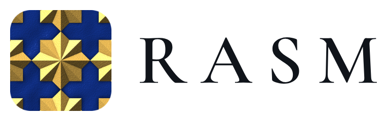
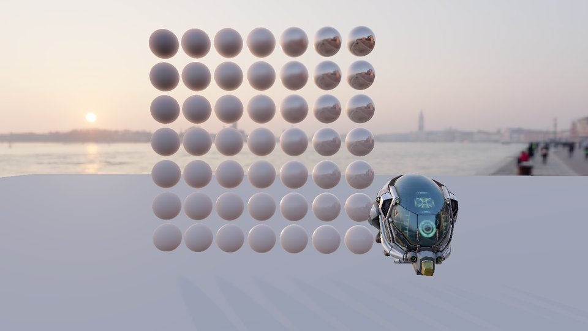
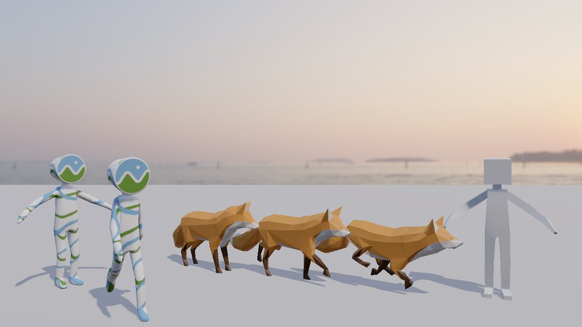
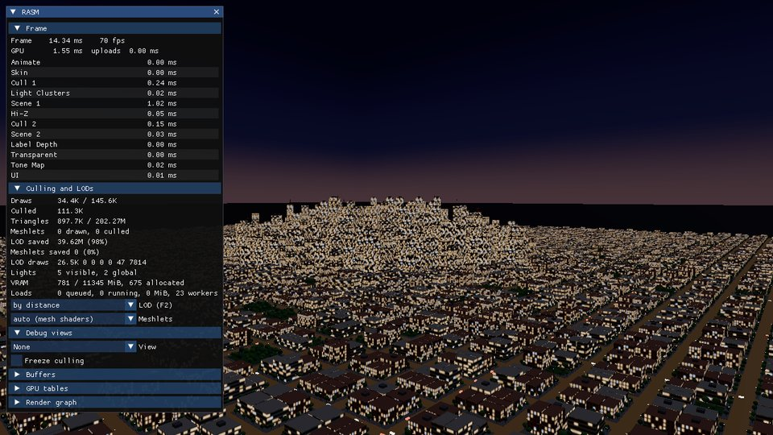
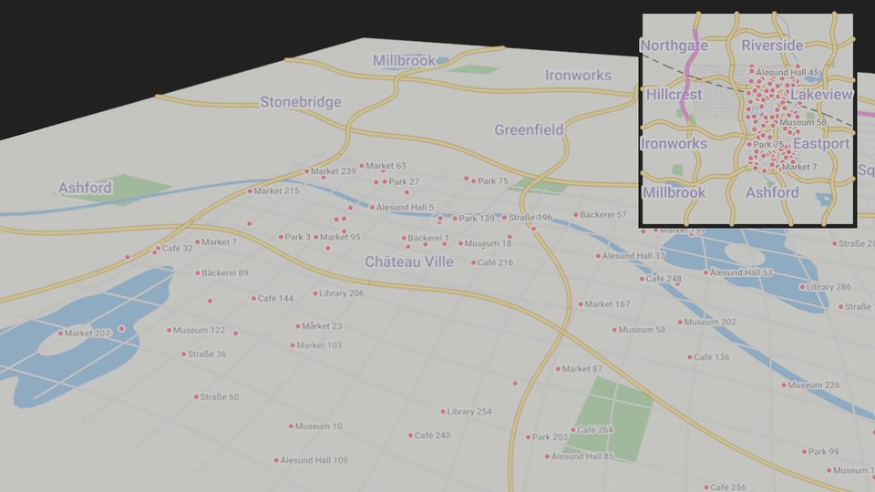
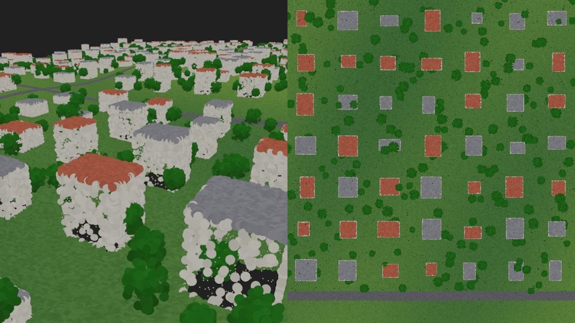
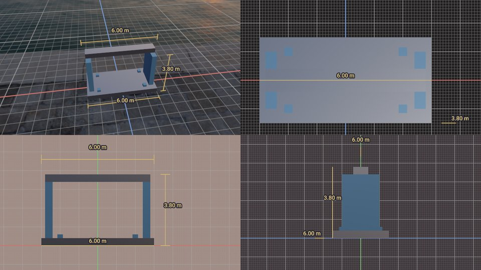

<div align="center">

<picture>
  <source media="(prefers-color-scheme: dark)" srcset="docs/assets/logo/logo-dark.png">
  
</picture>

**A GPU-driven rendering engine for games, maps and visualization.**

[](https://github.com/adel-elmala/rasm/actions/workflows/ci.yml)
[](LICENSE)


[Features](#features) · [Getting started](#getting-started) · [Using RASM](#using-rasm-in-your-project) · [Examples](#examples) · [Documentation](#documentation) · [Roadmap](#status-and-roadmap) · [Contributing](#contributing)

</div>

---

RASM (Arabic: رسم, "drawing") is an open-source rendering engine written in C++20. The GPU does the heavy lifting: it keeps the scene, culls it, chooses levels of detail and builds its own draw calls, so the CPU cost of a frame stays flat as the scene grows.

RASM is built for three audiences:

- **Indie games:** physically based rendering, shadows, image-based lighting, animation and post-processing, out of the box.
- **Map engines:** planet-scale coordinates, streamed terrain and vector tiles, labels and picking.
- **Visualization tools:** point clouds of any size, instanced glyphs, colormaps and orthographic CAD views.

It offers a high-level API that puts a scene on screen in a few lines, a low-level render-graph API for full control, and a stable C ABI for other languages.

> [!NOTE]
> RASM is under active development. The C++ API can still change between versions. The C API (`rasm_c.h`) is versioned and stays compatible within a major version.

## Gallery

| | | |
|:---:|:---:|:---:|
|  |  |  |
| PBR materials and image-based lighting | glTF skinning and animation | 145K objects, culled and drawn by the GPU |
|  |  |  |
| Vector maps with SDF labels | 8M-point cloud streamed under a 48 MiB budget | Orthographic CAD views and reference grids |

## Features

**GPU-driven core**
- The scene lives in GPU tables. A frame uploads only the rows that changed, and a steady frame makes no heap allocations.
- Two-pass GPU occlusion culling (frustum and Hi-Z), automatic mesh LODs, and meshlets drawn with mesh shaders or vertex pulling.
- Bindless resources and indirect draws: a handful of draw calls per frame, not one per object.
- A render graph with automatic barriers, transient memory aliasing and async compute.
- Shaders written in [Slang](https://shader-slang.org), compiled on worker threads at startup, with a disk cache.

**Rendering**
- Physically based materials (glTF metallic-roughness with alpha modes, texture transforms and vertex colors) and image-based lighting from HDR environments.
- Cascaded shadow maps for directional lights, and shadows for spot and point lights.
- Clustered forward lighting: 16K lights by default, and more if you raise the limit.
- HDR rendering with AgX tone mapping and exposure, bloom, MSAA and TAA.
- Debug views (normals, overdraw, LODs, culling, light counts) and a GPU buffer inspector.

**Assets and streaming**
- glTF 2.0 (skinning, morph targets, node animation), OBJ, KTX2 textures, Radiance HDR environments, and LAS/LAZ point clouds.
- Background loading on a worker pool, with uploads on the transfer queue.
- Tile streaming under a GPU memory budget, with a parent tile shown while a finer one loads.

**Large worlds and maps**
- Double-precision positions, camera-relative rendering and reversed-Z: geometry thousands of kilometres from the origin renders without jitter.
- Terrain from height-map tiles, with seamless edges, normals and draped imagery.
- Anti-aliased vector lines, polygons and points, draped exactly on the terrain.
- SDF text labels, placed per view, with halos, priorities and decluttering.
- Picking: the entity and vector feature under a pixel, and its world position in double precision.

**Visualization**
- Point clouds: octree streaming of datasets larger than GPU memory, and a compute rasterizer that draws small points up to 10× faster than triangles.
- Instanced glyphs (arrows, spheres or any mesh), culled per instance on the GPU, for vector fields and markers in the millions.
- Colormaps (viridis, turbo, magma and more) for points, glyphs and data lines.
- Orthographic views with pan and zoom at the cursor, and anti-aliased reference grids that stay sharp at any zoom.

**Embedding**
- Use the whole `Engine`, or only the `Renderer` on your own window and event loop, without SDL or the file loaders.
- Native window handles (Win32, Metal, X11, XCB, Wayland), several windows, several views per window, and render-to-texture.
- Headless rendering with frame readback, for servers, tests and offline output.
- Optional Dear ImGui integration, and camera controllers that your application drives.
- A stable C API (`rasm_c.h`) as a shared library, for bindings in C, Python, C#, Rust or Zig.

## Platform support

| Platform | Compiler | Graphics API | Status |
|---|---|---|---|
| Windows x64 | Clang 22 or newer | Vulkan 1.4 | Supported, built and tested in CI |
| macOS (Apple Silicon, Intel) | Apple Clang | Vulkan 1.4 through MoltenVK | Supported, built and unit-tested in CI |
| Linux | Clang | Vulkan 1.4 | Not tested yet |

RASM needs a GPU driver with Vulkan 1.4. Metal, Direct3D 12 and WebGPU backends are planned (see the [roadmap](#status-and-roadmap)).

## Getting started

### Prerequisites

- CMake 3.23 or newer, Ninja, and Clang (see the platform table)
- [vcpkg](https://github.com/microsoft/vcpkg), with the `VCPKG_ROOT` environment variable set
- A Vulkan 1.4 driver. The [Vulkan SDK](https://vulkan.lunarg.com/sdk/home) is optional: it adds the validation layer and the debugging tools.

The [build guide](docs/build_guide.md) walks through the setup on each platform.

### Build and run

```sh
git clone https://github.com/adel-elmala/rasm.git
cd rasm
cmake --preset x64-debug           # on macOS: --preset macOS
cmake --build --preset x64-debug
ctest --preset x64-debug           # unit tests
```

On the first configure, vcpkg downloads and builds every dependency. Then run an example. The examples find the repository's `shaders/` and `assets/` folders on their own, so they run from any directory:

```sh
./build/x64-debug/examples/02_gltf
```

Every example can also run without a window and save a frame as a PNG:

```sh
./build/x64-debug/examples/02_gltf --headless --frames 120 --out frame.png
```

## Using RASM in your project

Install RASM, then find it with CMake:

```sh
cmake --install build/x64-release --prefix <install-dir>
```

```cmake
find_package(rasm 0.1 CONFIG REQUIRED)            # or: find_package(rasm 0.1 CONFIG REQUIRED COMPONENTS renderer)
target_link_libraries(my_app PRIVATE rasm::rasm)   # or: rasm::renderer
```

| Target | What you get |
|---|---|
| `rasm::rasm` | The `Engine`: the renderer, plus an SDL window and input, and the file loaders |
| `rasm::renderer` | The `Renderer` alone, for your own window and assets, with no SDL or loader libraries |
| `rasm::c` | The C API as a shared library (`rasm::c_renderer` for the renderer alone) |

Shaders are compiled at run time, so copy RASM's `shaders/` folder next to your executable. The [getting started page](docs/api/index.html) covers this, the dependencies your project needs, and `add_subdirectory` as another way to add RASM.

A minimal program:

```cpp
#include "rasm/rasm.h"

int main()
{
    rasm::EngineConfig config = {.appName = "my_app", .windowWidth = 1280, .windowHeight = 720, .assetRoot = "assets"};
    rasm::Engine engine(config);
    if (!engine.running())
        return 1; // the reason is in the log

    rasm::SceneHandle scene = engine.createScene();

    // Files load on a worker thread. The handles are usable at once.
    rasm::MeshHandle mesh = engine.loadMesh("models/obj/bunny/bunny.obj");
    rasm::TextureHandle albedo = engine.loadTexture("models/obj/bunny/bunny-atlas.jpg");
    rasm::MaterialHandle material = engine.createMaterial(rasm::MaterialType::PBR, {albedo});

    rasm::EntityHandle bunny = engine.createEntity("bunny", mesh, material,
                                                   rasm::Transform{.position = glm::dvec3(0.0, 0.0, -10.0), .scale = glm::vec3(0.005f)});
    rasm::CameraHandle camera = engine.createCamera(
        rasm::CameraProjection{.type = rasm::CameraProjection::Type::PERSPECTIVE,
                               .perspective{.fovY = 45.0f, .aspect = 1280.0f / 720.0f, .nearZ = 0.1f}},
        rasm::Transform{.position = glm::dvec3(0.0, 0.0, 4.0)});
    rasm::LightHandle sun = engine.createLight(rasm::LightType::DIRECTIONAL, glm::vec3(1.0f), glm::vec3(0.0f),
                                               glm::normalize(glm::vec3(-0.5f, -0.8f, -1.0f)), 3.0f);

    engine.addEntityToScene(scene, bunny);
    engine.addCameraToScene(scene, camera);
    engine.addLightToScene(scene, sun);

    while (engine.running())
        engine.render(scene, camera);
    return 0;
}
```

## Examples

The [`examples/`](examples) folder has 31 programs, each built around one feature. Some highlights:

| Example | Shows |
|---|---|
| [`00_hello_scene`](examples/00_hello_scene) | The smallest complete program |
| [`01_render_graph`](examples/01_render_graph) | Your own passes with the low-level render graph |
| [`05_city`](examples/05_city) | 145K objects with GPU culling, LODs and meshlets |
| [`08_ibl`](examples/08_ibl), [`09_gltf_materials`](examples/09_gltf_materials) | Image-based lighting and the glTF materials |
| [`11_many_lights`](examples/11_many_lights) | Thousands of lights with clustered shading |
| [`13_skinning`](examples/13_skinning), [`14_morph_targets`](examples/14_morph_targets) | Skeletal animation and morph targets |
| [`19_embedding`](examples/19_embedding), [`21_renderer`](examples/21_renderer) | RASM in your own window, or the renderer alone |
| [`20_views`](examples/20_views) | Split screen, picture-in-picture and render-to-texture |
| [`22_c_api`](examples/22_c_api) | The C API, from a program written in C |
| [`23_large_world`](examples/23_large_world) | A scene 6,370 km from the origin, with no jitter |
| [`24_map_tiles`](examples/24_map_tiles), [`25_vector_map`](examples/25_vector_map) | Streamed terrain, vector tiles and labels |
| [`26_picking`](examples/26_picking) | Hover and click picking with world positions |
| [`27_cad_views`](examples/27_cad_views) | Orthographic CAD views with grids and dimensions |
| [`29_point_streaming`](examples/29_point_streaming) | An 8M-point LiDAR scan streamed under a memory budget |
| [`30_glyphs`](examples/30_glyphs) | A vector field drawn with instanced arrows and streamlines |

## Documentation

The documentation is a set of HTML pages in [`docs/`](docs). Open [`docs/index.html`](docs/index.html) in a browser: it works offline, with no server and no build.

| | For | Contents |
|---|---|---|
| [API reference](docs/api/index.html) | Application developers | Getting started, then every public type and function, with examples |
| [Concept guides](docs/guides/index.html) | Contributors and the curious | One technique per page, explained with diagrams and interactive figures: GPU culling, the render graph, clustered lighting, TAA, large-world precision, point-cloud streaming and more |
| [Architecture](docs/architecture.md) | Contributors | How the engine works today, in full technical detail |
| [Build guide](docs/build_guide.md) | Everyone | Toolchain setup, build options, and the analysis builds |

## Status and roadmap

Development follows a phased [development plan](docs/development_plan.md). Phases 0 to 4 are complete: stabilization, foundations, the GPU-driven scene, the render graph and the core rendering features. Phase 5, integration for the target audiences, is in progress: embedding and map-engine support are done, and most of the visualization tools are done.

Next:
- Order-independent transparency, and image export at any resolution.
- The rest of the C++ API in the C API.
- Scene serialization, an asset cooking step, particles and decals.
- New backends: Metal, Direct3D 12 and WebGPU.

Known issues and design notes are tracked in [`docs/code_review.md`](docs/code_review.md).

## Contributing

Contributions are welcome, and so are test reports from Linux, AMD and Intel GPUs. Read [`CONTRIBUTING.md`](CONTRIBUTING.md) for how to help, and follow the [Code of Conduct](CODE_OF_CONDUCT.md). Questions go to [GitHub Discussions](https://github.com/adel-elmala/rasm/discussions). Before you open a pull request:

1. Read [`docs/coding_style.md`](docs/coding_style.md) and the code rules in [`CLAUDE.md`](CLAUDE.md), and check [`docs/code_review.md`](docs/code_review.md) for known issues.
2. Keep the build warning-free, and run `clang-format` on the files you change.
3. Run the unit tests (`ctest`) and the examples with validation on. A change must not add validation messages.
4. Update the documentation pages that describe the code you changed.

CI builds and tests every pull request on Windows and macOS. On Windows it also renders a set of scenes on a software GPU and compares them with reference images.

**Support RASM:** if RASM is useful to you, you can sponsor its development through [GitHub Sponsors](https://github.com/sponsors/adel-elmala).

## Acknowledgements

RASM builds on these open-source projects: [volk](https://github.com/zeux/volk), [vk-bootstrap](https://github.com/charles-lunarg/vk-bootstrap), [Vulkan Memory Allocator](https://github.com/GPUOpen-LibrariesAndSDKs/VulkanMemoryAllocator), [Slang](https://github.com/shader-slang/slang), [SDL](https://github.com/libsdl-org/SDL), [glm](https://github.com/g-truc/glm), [meshoptimizer](https://github.com/zeux/meshoptimizer), [tinygltf](https://github.com/syoyo/tinygltf), [tinyobjloader](https://github.com/tinyobjloader/tinyobjloader), [KTX-Software](https://github.com/KhronosGroup/KTX-Software), [LASzip](https://github.com/LASzip/LASzip), [earcut.hpp](https://github.com/mapbox/earcut.hpp), [stb](https://github.com/nothings/stb), [Dear ImGui](https://github.com/ocornut/imgui), [Tracy](https://github.com/wolfpld/tracy), [spdlog](https://github.com/gabime/spdlog) and [doctest](https://github.com/doctest/doctest).

Sample models come from the [Khronos glTF Sample Assets](https://github.com/KhronosGroup/glTF-Sample-Assets) and other sources, each under its own license. The Venice Sunset environment is by Greg Zaal, from [Poly Haven](https://polyhaven.com/a/venice_sunset) (CC0).

## License

RASM is released under the [MIT License](LICENSE).
