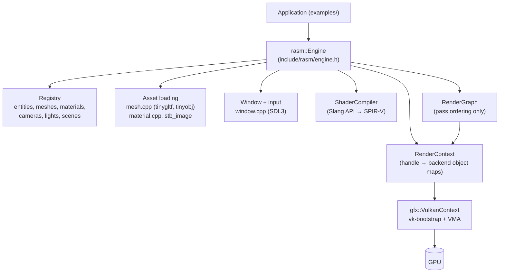
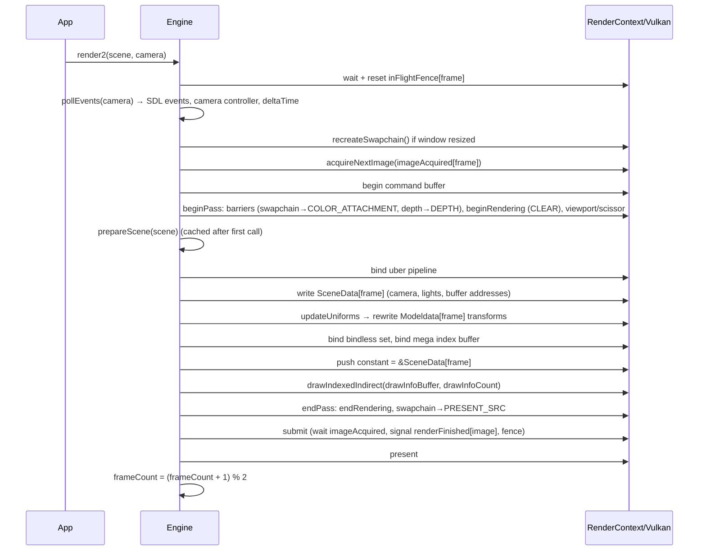
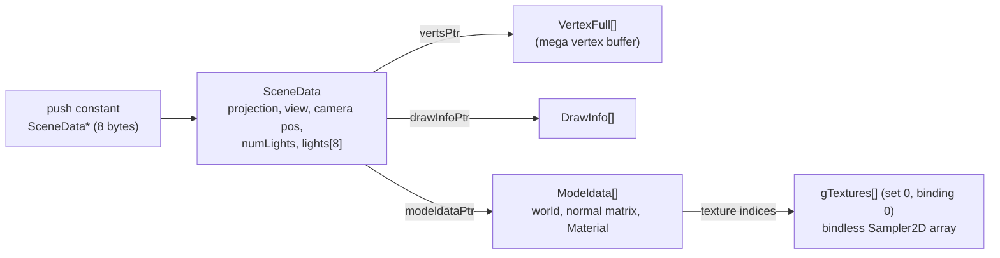

# RASM Architecture

This document describes how RASM is built **today** (branch `feat/pbr`, Oct 2026). Planned changes live in [development_plan.md](development_plan.md); known defects are tracked by ID (e.g. `B1`, `D4`) in [code_review.md](code_review.md).

## 1. Overview

RASM is a C++20 rendering engine with a single implemented backend (Vulkan 1.4). It is built as a static library (`rasm`, alias `rasm::rasm`) and driven by small example programs. Its rendering core is *GPU-driven*: the whole scene is drawn with one `vkCmdDrawIndexedIndirect` call. Vertices are pulled from a mega buffer through buffer device addresses, textures are accessed through one bindless descriptor array, and the only per-draw binding is a 64-bit push constant.

| Layer | Files | Responsibility |
|---|---|---|
| Public API | `include/rasm/` (`rasm.h`, `engine.h`, …) and `include/rasm/render/` (`renderGraph.h`, `renderContext.h`, `resource.h`) | Single facade class `Engine`; everything is created through it and referenced by handles. The low-level API (render graph, `RenderContext`, `ResourceDesc`) lives in `render/`. |
| Engine | `src/engine.cpp` | Construction, frame loop (`beginFrame`/`render2`/`endFrame`), texture loading. |
| Core utilities | `src/core/` | Handle manager, profiler, file reading. |
| Platform | `src/platform/window.cpp` | SDL3 window, surface creation, event polling and camera input. |
| Assets | `src/assets/` | glTF/OBJ import (`mesh.cpp`), materials and glTF material/texture import (`material.cpp`). |
| Scene | `src/scene/` | Scenes, entities, cameras, lights, transforms; scene preparation for rendering (`scene.cpp`). |
| Renderer | `src/renderer/` | Render graph, Slang shader compiler, GPU struct definitions (`uberMaterialTypes.h`). |
| Render context | `src/rhi/renderContext.cpp` | Backend-agnostic(ish) API over handles; owns the handle → backend-object maps and the creation-dedup caches. |
| Vulkan backend | `src/rhi/vulkan/` | `VulkanContext`: instance/device/swapchain setup, VMA allocations, pipelines, barriers, submission. `vulkanTypes.h`: Vulkan handle structs. |
| Third-party implementations | `src/thirdparty_impl.cpp` | The single translation unit with the `*_IMPLEMENTATION` defines (stb, tinygltf, tinyobjloader, VMA). |
| Shaders | `shaders/lib/`, `shaders/passes/` | `lib/`: shared modules: GPU structs (`core.slang`), PBR BRDF (`pbr.slang`). `passes/`: entry shaders: the uber shader (`rasm.slang`) and the legacy shader (`basic.slang`). |

`src/` is currently also a *public* include directory, because public headers still include private ones (`renderer/shaderCompiler.h`, `renderer/uberMaterialTypes.h`, `rhi/vulkan/*`). Removing that is `D2`.

## 2. Object model: handles and registries

**Handles** (`rasm/handle.h`) are typed `Handle<Tag>{ uint64_t index; uint64_t generation; }` values. `generation == 0` means invalid. `HandleManager` hands out a monotonically increasing `index` per type, starting at 1, with `generation` always 1. Handles are never recycled or invalidated, and there is no destroy API (see `D4`).

There are two kinds of handle owner:

- **CPU-side objects** live in `Engine::registery` (a private struct of `std::vector`s) and are indexed directly by `handle.index`. These are `Entity`, `Mesh`, `Material`, `Camera`, `Light`, `Scene` and shader *source strings*. Slot 0 is an unused default-constructed element. Each `create*` checks `index` against a compile-time `MAX_*` constant.
- **GPU objects** live in `RenderContext`. Each type has an `unordered_map<Handle, gfx::XxxVKHandle>` cache (`bufferCache`, `textureCache`, `pipelineCache`, …). The backend structs (`src/rhi/vulkan/vulkanTypes.h`) carry the raw Vulkan objects plus a copy of the `ResourceDesc` they were created from.

**`ResourceDesc`** (`rasm/render/resource.h`) is the one creation descriptor for every GPU resource. It is a tagged union of `texture`, `buffer`, `shader`, `pipeline`, `renderTarget`, `bindlessDescriptorSetLayout`, `descriptorPool` and `descriptorSet`, with a `std::string name`. The constructor zeroes the whole union, so fields a caller leaves unset are 0 (fixed `B18`). It has a hand-written `operator==` and `ResourceDescHash`.

**Creation dedup.** Only immutable objects are deduplicated: `createShader`, `createPipeline` and `createBindlessDescriptorSetLayout` first look the desc up in a `*DescCache` (`unordered_map<ResourceDesc, Handle>`) and return the existing handle for an equal desc. Equality covers the full state: shader equality compares the SPIR-V bytes, and pipeline equality compares shaders, vertex input layout, descriptor set layout, topology and attachment formats. Buffers, textures, descriptor pools and descriptor sets are mutable, so every `create*`/`allocate*` call makes a new object (fixed `B1`). Callers that want sharing cache at the asset level: `loadTexture` caches by path and format, and glTF import caches per model by image index and color space.

## 3. Engine lifetime and the frame loop

### Construction (`Engine::Engine`, `src/engine.cpp`)
1. Create the SDL3 window (`createWindow`).
2. `RenderContext::initialize` creates a `VulkanContext`, which:
   - creates the instance (validation optional),
   - creates the surface (it calls back into `Engine::createSurfaceVk`),
   - selects a physical device with the required features (below),
   - creates the device, graphics queue, swapchain (`B8G8R8A8_SRGB`) and VMA allocator.
3. Create per-frame resources for `MAX_FRAMES_IN_FLIGHT = 2` slots: a command pool and buffer, an image-acquired semaphore, an in-flight fence (created signaled), a 1 MB "shader data" buffer (legacy path only), and a depth texture (`D32_SFLOAT_S8_UINT`).
4. Create one render-finished semaphore per swapchain image.
5. Initialize the Slang session (SPIR-V 1.4, scalar layout, column-major matrices, search path `cwd/shaders/lib`).
6. Create the single bindless descriptor set: layout, pool and set. It is binding 0 of set 0, an array of 1024 `COMBINED_IMAGE_SAMPLER`s with `UPDATE_AFTER_BIND | PARTIALLY_BOUND`.
7. `isRunning = true`. Any failure returns early and leaves `running() == false`.

**Required Vulkan features**: API 1.4.
- 1.0: `multiDrawIndirect`, `samplerAnisotropy`, `shaderInt64`.
- 1.1: `shaderDrawParameters`.
- 1.2: descriptor indexing (runtime arrays, partially bound, update-after-bind, variable count, non-uniform sampled image indexing), `bufferDeviceAddress`, `scalarBlockLayout`, `shaderInt8`, `storagePushConstant8`.
- 1.3: `dynamicRendering`, `synchronization2`.
- 1.4: `hostImageCopy`.
- Extensions: `VK_KHR_swapchain`, `VK_EXT_memory_budget`.

### Per frame (`Engine::render2`)

Notes:
- `frameCount` is the frame-in-flight **slot index** (0 or 1), not a running frame counter.
- Input handling, delta-time measurement and the camera controller run inside `beginFrame`. The caller passes the camera that should receive input.
- Acquire and present results are not checked (`B4`).

## 4. The GPU-driven path: `prepareScene` + `render2`

`Engine::prepareScene` (`src/scene/scene.cpp`) runs once per scene, the first time that scene is rendered, and its result is cached in `Engine::preparedScenes`. It does the following:

1. **Flattens the scene.** For every entity with a mesh, `processMesh` returns a list of `SubGLTFRaw`s: one per glTF primitive, or one for an OBJ. Each holds interleaved `Vertex` data, `uint32_t` indices, the node's world transform, and a material handle.
2. **Allocates scene buffers.** All are host-visible and persistently mapped:

   | Buffer | Usage | Content |
   |---|---|---|
   | `megaVertexBuffer` | STORAGE | All `Vertex`es of every sub-mesh, back to back. |
   | `megaIndexBuffer` | INDEX | All indices, *local* to their sub-mesh. |
   | `megaModelDataBuffer[2]` | STORAGE | One `gfx::Modeldata` per draw: world matrix, normal matrix, material. |
   | `drawInfoBuffer` | INDIRECT | One `gfx::DrawInfo` (`VkDrawIndexedIndirectCommand` layout) per draw. |
   | `sceneDataBuffer[2]` | STORAGE | One `gfx::SceneData` per frame slot. |
3. **Writes draw records.** For each sub-mesh i it sets `DrawInfo{indexCount, 1, firstIndex = running index offset, vertexOffset = running vertex offset, 0}`. `Modeldata[i]` gets the entity transform × node transform and the converted `gfx::Material`.
4. **Builds the uber pipeline.** It compiles `shaders/passes/rasm.slang` (`vertMain`/`fragMain`) and creates a graphics pipeline with an empty vertex-input state (vertex pulling) and the bindless set layout.

Every frame, `updateUniforms` rewrites only the matrix part of each `Modeldata` (`offsetof(Modeldata, material)` bytes) from the current entity transforms.

### GPU data chain

In `vertMain`:
- `drawID` comes from the SPIR-V `DrawIndex` built-in, read with `spirv_asm` in `core.slang`.
- Slang lowers `SV_VertexID` to `VertexIndex − BaseVertex`, so the shader adds `drawInfoPtr[drawID].vertexOffset` back before indexing `vertsPtr`.
- `fragMain` reads `Modeldata[drawID].material` and calls `PBR()` in `pbr.slang`.

### CPU/GPU struct contract

The C++ structs in `src/renderer/uberMaterialTypes.h` and the Slang structs in `shaders/lib/core.slang` and `pbr.slang` must match byte for byte under **scalar layout**. The C++ side `static_assert`s the sizes and key offsets (`SceneData` = 552 bytes, `Modeldata` = 184 bytes, …), and `rasm::Vertex` is asserted equal to `gfx::VertexFull`. When you change a struct, change both sides and the asserts. `ShaderCompiler::validateRasmStructs` could check the sizes against Slang reflection at runtime, but nothing calls it yet.

## 5. Materials and textures

- `rasm::Material` (`rasm/material.h`) is a CPU-side record:
  - `textures[PbrSlot::COUNT]` and `texCoords[...]`,
  - a flat `float params[]` indexed by `PbrParam` offsets (albedo is 3 floats at offset 0, metallic is at 3, …),
  - a `ShaderHandle`.
- `convertToGfxMaterial` turns it into the GPU `gfx::Material`. Texture handles are replaced by bindless slot indices, and `INVALID_TEXTURE_INDEX` (0xFFFFFFFF) means "no texture".
- **Bindless slots.** `Engine::addBindlessTexture` → `RenderContext::updateBindlessDescriptorSet` writes the texture into the next free slot (`nextBindlessTextureIndex++`). The slot is remembered in `registery.bindlessTextureIndexMap`. Slots are never reused.
- **Texture upload.** This is `VulkanContext::fillTexture`:
  - the image is transitioned on the host and filled with `VK_EXT_host_image_copy` (core in 1.4), so no command buffer or staging buffer is involved;
  - the full mip chain is generated on the CPU with `stb_image_resize2`, sRGB-aware for sRGB formats;
  - every texture gets its own `VkSampler` (linear, repeat, 8× anisotropy).
- **Color spaces.** Base color and emissive are uploaded as `R8G8B8A8_SRGB`. Normal, metallic-roughness and occlusion maps are uploaded as `R8G8B8A8_UNORM`.
- `MaterialType` selects a shader source file for the legacy path: `BASIC` → `basic.slang`, `PBR` → `rasm.slang`, `UNLIT` → `unlit.slang` (missing, `B9`), `SHADER` → a user-provided source. The GPU-driven path ignores `Material::shader` and always uses the uber shader.

## 6. Asset import

- `Engine::loadMesh(path)` dispatches on the file extension and caches by path in `registery.loadedMeshes`.
  - **OBJ** (tinyobjloader) is de-indexed into one vertex per index. Y and V are flipped per vertex.
  - **glTF/GLB** (tinygltf) goes through `processGLTF`, which walks the default scene's node tree from a root transform of `scale(1, −1, 1)` (the Y flip). For each mesh node, `extractGLTFRaws` reads `POSITION`, `NORMAL` and `TEXCOORD_0..2` (assumed float), indices (8/16/32-bit), and computes smooth normals when they are missing. It calls `loadMaterial` for each primitive.
- `loadMaterial` maps a glTF PBR material to `rasm::Material`. It expands images to RGBA8 and uploads each texture.
- The whole `tinygltf::Model`, including decoded images, is kept in the `Mesh` (`GLTFRaw::model`). CPU vertex data is never released.

## 7. Shader compilation

- `ShaderCompiler` wraps one Slang global session and one session.
- `compileFromString(source, moduleName, entryPoint)` loads a module, finds the entry point, composes, links and returns SPIR-V. For the legacy path it also returns a vertex-input layout reflected from the entry point.
- Shaders are compiled **at runtime from source** every time a pipeline is built. Nothing is cached.
- `tools/compile-shaders.bat` is an offline `slangc` invocation that is useful for checking compile errors. The engine does not consume its output.

## 8. Camera and input

- `Camera` holds a `CameraProjection` (a union of perspective and orthographic), a `CameraController` (trackball or free-fly, plus `easingSpeed`), the rendered `transform`, and a `targetTransform`.
- `pollEvents` converts SDL events into a `CameraInput`: mouse drag in NDC normalized by the smaller window dimension, wheel delta, WASD state and frame delta-time. It feeds that input to `updateCamera`, which updates the target with the active controller and then eases the rendered transform toward it with exponential smoothing. The trackball eases along the orbit sphere.
- Window resize updates every camera's aspect ratio and marks the swapchain for recreation. Escape or closing the window sets `isRunning = false`.
- View matrix = `conjugate(rotation)` × `translate(−position)`. Projection uses `glm::perspective`/`glm::ortho` with the Vulkan [0, 1] depth range (`GLM_FORCE_DEPTH_ZERO_TO_ONE` is a PUBLIC compile definition of `rasm`, see `B2`).

## 9. Render graph (low-level path)

- `RenderGraph::addPass(name, setup, execute)` records the resources each pass reads and writes through `PassBuilder`. `compile()` builds producer → consumer edges and topologically sorts the passes (Kahn's algorithm, with cycle detection).
- `execute()` runs `beginFrame` once, then for each pass in order calls `setRenderTarget(pass.outputRenderTarget)`, `beginPass`, `pass.execute(ctx)` and `endPass`. A pass without an output render target renders to the swapchain. Last comes `endFrame`.
- The graph currently only orders passes. It does not insert barriers or layout transitions, does not allocate transient resources, and uses the current scene's first camera. Only `examples/01_render_graph` uses it, together with the legacy `compileScene` path.

## 10. The legacy path: `compileScene` + `render`

`compileScene` uploads one combined vertex+index buffer per entity (OBJ only) and builds one pipeline per material, with classic vertex input reflected from Slang. `render()` binds the pipeline, the vertex and index buffers, and a push-constant pointer into the 1 MB per-frame shader-data buffer, then issues one `drawIndexed` per entity. It survives for `01_render_graph` and is slated for removal (`D10`).

## 11. Compile-time limits

| Constant | Value | Where |
|---|---|---|
| `MAX_FRAMES_IN_FLIGHT` | 2 | `rasm/types.h` |
| `MAX_BINDLESS_TEXTURES` | 1024 | `rasm/types.h` |
| `MAX_MESHES` | 8 (7 usable) | `rasm/mesh.h` |
| `MAX_ENTITIES` / `MAX_ENTITIES_PER_SCENE` | 1024 | `rasm/entity.h`, `rasm/scene.h` |
| `MAX_MATERIALS`, `MAX_SHADERS` | 256 | `rasm/engine.h` |
| `MAX_CAMERAS` | 8 | `rasm/engine.h` |
| `MAX_LIGHTS` (global) / per scene | 8 / 8 | `rasm/light.h`, `rasm/scene.h` |
| `MAX_SCENES` | 16 | `rasm/scene.h` |
| `MAX_VERTEX_UV_SETS` | 3 | `rasm/mesh.h` (mirrored in `core.slang`) |

## 12. Conventions that cross files

- **Working directory.** Shaders (`./shaders/passes`, includes from `./shaders/lib`) and example assets (`assets/...`) are opened relative to the process working directory, so run from the repo root.
- **Coordinate system.** The engine works in a Y-down world: imported geometry is mirrored in Y (`D8`), and back-face culling is disabled. Light directions and camera transforms are expressed in that mirrored space.
- **Depth.** `D32_SFLOAT_S8_UINT`, cleared to 1.0, compare `LESS_OR_EQUAL`.
- **Output.** The PBR shader applies Reinhard tone mapping. The sRGB swapchain format does the gamma encoding, so shaders must output linear color.
