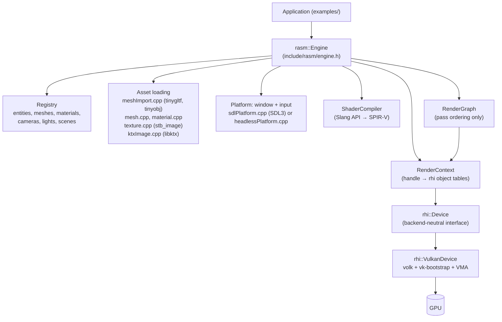
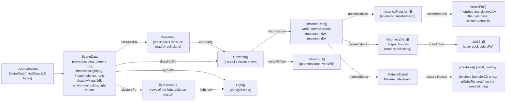

# RASM Architecture

This document describes how RASM is built **today** (branch `feat/pbr`, Oct 2026). Planned changes live in [development_plan.md](development_plan.md); known defects are tracked by ID (e.g. `B1`, `D4`) in [code_review.md](code_review.md).

## 1. Overview

RASM is a C++20 rendering engine with a single implemented backend (Vulkan 1.4). It is built as a static library (`rasm`, alias `rasm::rasm`) and driven by small example programs. Its rendering core is *GPU-driven*: compute passes cull the scene's draws against the camera frustum and, in two passes, against a hierarchical depth buffer (Hi-Z), and the visible ones are drawn with one `vkCmdDrawIndexedIndirectCount` call per run of draws with the same alpha mode and cull mode (usually one to three), through one pipeline per alpha mode. See-through (glTF `BLEND`) draws come last, sorted back to front on the GPU. Vertices are pulled from one engine-wide geometry pool through buffer device addresses, textures are accessed through one bindless descriptor array, and the only per-draw binding is a 16-byte push constant.



| Layer | Files | Responsibility |
|---|---|---|
| Public API | `include/rasm/` (`rasm.h`, `engine.h`, …) and `include/rasm/render/` (`renderGraph.h`, `renderContext.h`, `resource.h`) | Single facade class `Engine`; everything is created through it and referenced by handles. The low-level API (render graph, `RenderContext`, the resource descriptors) lives in `render/`. |
| Engine | `src/engine.cpp` | Construction, frame loop (`beginFrame`/`render`/`endFrame`), swapchain recreation, finishing background loads within the frame's budget. |
| Core utilities | `src/core/` | Handle manager, file reading. |
| Platform | `src/platform/` | `Platform` (`platform.h`): the window and its events, as `PlatformEvents` the engine applies. `sdlPlatform.cpp` opens an SDL3 window and reads its events and the Vulkan surface hook (`createWindowSurface`); `headlessPlatform.cpp` has no window and no events (`EngineConfig::platform`). |
| Assets | `src/assets/` | glTF/OBJ import on the worker thread (`meshImport.h/.cpp`, also used by tests), LOD building with meshoptimizer (`meshLod.h/.cpp`), meshes and the geometry pool (`mesh.cpp`), textures (`texture.cpp`), KTX2 reading and Basis transcoding with libktx (`ktxImage.h/.cpp`), materials and glTF material/texture import (`material.cpp`). |
| Scene | `src/scene/` | Scenes, entities, cameras, lights, transforms. |
| Renderer | `src/renderer/` | Readbacks (`readback.cpp`: `Engine::readFrame`, `readTexture`, `takeReadback`, `writePng`; §3), the GPU-driven scene path (`gpuScene.cpp`: GPU scene tables, `syncGpuScene`, the scene passes of `addScenePasses`; `renderer.cpp`: `Renderer`, the graph behind `Engine::render`; `gpuTable.cpp`: per-slot tables with dirty-range uploads; `geometryPool.cpp`: the geometry pool and its table; `lightClusters.cpp`: the light table, the scenes' light lists and each shaded view's light clusters), the tone-map pass (`toneMap.cpp`: `Engine::addToneMapPass`), the bloom passes (`bloom.cpp`: `Engine::addBloomPasses`), the MSAA resolve (`msaaResolve.cpp`: `Engine::addMsaaResolvePass`), TAA (`taa.cpp`: `Engine::addTaaPass`), the frame stats and GPU timers (`frameStats.cpp`) and their overlay (`statsOverlay.cpp`), render graph, Slang shader compiler, GPU struct definitions (`uberMaterialTypes.h`). |
| Render context | `src/rhi/renderContext.cpp` | Backend-neutral API over handles; owns the handle → `rhi::` object tables, the creation-dedup caches and render targets. |
| RHI | `src/rhi/device.h` | The backend-neutral GPU interface: `Device`, `CommandBuffer`, `Queue`, `Swapchain` and the resource objects (§12). |
| Vulkan backend | `src/rhi/vulkan/` | `VulkanDevice` (instance, device, VMA, resource creation), `VulkanCommandBuffer` (recording, barriers), `VulkanSwapchain` (surface swapchain and its semaphores), `VulkanQueue` (submission), one `.h`/`.cpp` pair each. `vulkanTypes.h`: the Vulkan objects behind each `rhi::` struct. |
| Third-party implementations | `src/thirdparty_impl.cpp` | The single translation unit with the `*_IMPLEMENTATION` defines (stb, tinygltf, tinyobjloader, VMA). |
| Shaders | `shaders/lib/`, `shaders/passes/` | `lib/`: shared modules: GPU structs (`core.slang`), PBR BRDF (`pbr.slang`), unlit shading (`unlit.slang`), the shadow map lookup (`shadow.slang`), the light clusters' layout and slices (`lightClusters.slang`), the frustum test (`frustumCulling.slang`) and the Hi-Z occlusion test (`occlusionCulling.slang`). `passes/`: entry shaders: the uber shader (`rasm.slang`), the depth-only scene pass (`shadow.slang`), culling (`cull.slang`), the Hi-Z build (`hiz.slang`), the light assignment (`lightClusters.slang`) and the stats overlay (`statsOverlay.slang`). |

Applications compile against `include/rasm/` and glm only. `src/`, the backend libraries and the tinygltf/stb include paths are PRIVATE to the `rasm` target, and static linking still pulls the libraries in. `RenderContext` keeps its `rhi::Device` and object tables in a private `RenderContext::Impl`, defined in `src/rhi/renderContext.cpp`. `Engine` holds `ShaderCompiler` through a forward declaration.

## 2. Object model: handles and registries

**Handles** (`rasm/handle.h`) are typed `Handle<Tag>{ uint64_t index; uint64_t generation; }` values. `generation == 0` means invalid. Every table hands out its handles from a `HandlePool` (`src/core/handle.cpp`): `allocate` pops the index released last (a stack, so indices stay low) or adds a new one from 1, with the slot's current generation; `release` adds 1 to the generation and pushes the index; `isAlive` is true only for the handle the slot gave out last, while it is not released. A pool made with a limit holds at most `limit - 1` live indices (index 0 means full), which is how the `MAX_*` limits work; a slot whose generation reaches `UINT64_MAX` is not reused. Unit tests: `tests/handleTests.cpp`.

There are two kinds of handle owner:

- **CPU-side objects** live in `Engine::registry` (a private struct of `std::vector`s) and are indexed directly by `handle.index`. These are `Entity`, `Mesh`, `Material`, `Camera`, `Light` and `Scene` (environments in `Environments::environments`, readbacks in `Readbacks::pending`). Each has a `HandlePool` in the registry (`entityHandles`, …, `readbackHandles`): `MAX_ENTITIES`, `MAX_MATERIALS`, `MAX_CAMERAS`, `MAX_SCENES`, and `EngineConfig::maxLights + 1` (set by the constructor) are their limits. Slot 0 is an unused default-constructed element, and a vector grows to its pool's `size`. Every public call checks its handles with `Engine::isLive` (the pool's `isAlive`), so a destroyed object's handle is refused. Only textures, buffers and render targets can be destroyed so far (`D4`).
- **GPU objects** live in `RenderContext`. Each type has a table (`BufferTable`, `TextureTable`, …, in `renderContext.cpp`): a `HandlePool` and a `std::vector<rhi::Xxx*>` indexed by `handle.index`, pointing at objects the `rhi::Device` created (null when free). A lookup checks the generation and reads the vector: no hash (`P4`). A stale or unknown handle logs `<caller>: <kind> handle {i, g} is invalid or was destroyed.` and fails. `TextureTable::slots` holds each texture's bindless slot (§5). Render targets are in `std::deque`s (`renderTargets`, `renderTargetInfos`), so a `getRenderTarget` reference survives a new target. Each `rhi::` struct carries a copy of the descriptor it was created from, and the backend derives from it to add its native objects (§12).

**Deferred destruction** (`docs/guides/resource-lifetime.html`). `RenderContext::destroyTexture`, `destroyBuffer` and `destroyRenderTargets` (`Engine::destroyTexture`, `destroyBuffer`, `destroyRenderTarget` for applications) release the handle at once and give the free to `rhi::ReleaseQueue` (`src/rhi/releaseQueue.cpp`): a list of `std::function` frees, untagged until the frame ends. `Engine::endFrame` calls `RenderContext::tagReleases` after `submitBatches`, also for a dropped frame: the untagged entries wait for `frameFenceValue`, `computeFenceValue` and the upload manager's `lastSubmit` (`RELEASE_TIMELINES` = 3), the values signaled last. `beginFrame` tags and collects at its start too, before it may skip the frame, so frees go on while frames are skipped (a minimized window): nothing is recorded then, so the values signaled last cover everything. It collects again after the slot's fence wait. `collectReleases` reads the three fences (no wait) and runs the entries they all reached, in order; with nothing tagged it returns at once. A render target's textures are marked (`TextureTable::attachments`) and `destroyTexture` refuses them; only the target frees them. A transient target that is destroyed leaves its group at once, since its index may go to a new target. The graphics value covers the frame's compute work (the last graphics batch waits for it); the compute value covers a frame whose later batches failed; the upload value covers a copy flushed after the frame. What waits: a texture (then `textureStates.forget`, `cancelUploads`, destroy) and its bindless slot (back to `freeBindlessSlots`), a buffer (also the old buffer of `resizeBuffer`), the heaps of transient render targets, and storage slots of destroyed storage targets. `RenderContext::cleanup` waits for the device and runs them all (`releaseAll`). Rows of a `GpuTable` need no queue: each frame slot has its own copy, written only after its fence (§4). Shaders, pipelines and descriptor set layouts are deduplicated, so another holder may share a handle: they have no destroy and live as long as the device. Unit tests: `tests/releaseQueueTests.cpp`; example `17_streaming` pushes more textures through the bindless set than it has slots.

**Descriptors** (`rasm/render/resource.h`). Each GPU resource has its own creation descriptor: `BufferDesc`, `TextureDesc`, `ShaderDesc`, `PipelineDesc`, `RenderTargetDesc`, `BindlessDescriptorSetLayoutDesc` and `DescriptorPoolDesc` (fixed `D5`). Each is an aggregate with a `std::string name` and default member initializers, so it is filled with designated initializers and a field left unset has a defined value. Each has a defaulted `operator==`, so every field takes part in equality. Passing the wrong kind of descriptor is a compile error. `ShaderDesc` owns its SPIR-V (`std::vector<uint8_t> code`). A `PipelineDesc` with `computeShader` set describes a compute pipeline (§12). Descriptor sets, command buffers and fences only take a name. `DescriptorType` names the descriptor kind of a layout or pool.

**Creation dedup.** Only immutable objects are deduplicated: `createShader`, `createPipeline` and `createBindlessDescriptorSetLayout` first look the desc up in a `*DescCache` (`unordered_map<XxxDesc, Handle, XxxDescHash>`) and return the existing handle for an equal desc. Equality is the defaulted one, so it covers every field, including the name and the SPIR-V bytes. The hashes (`ShaderDescHash`, `PipelineDescHash`, `BindlessDescriptorSetLayoutDescHash`, defined in `src/rhi/resource.cpp`) fold the fields with `hashCombine` from `rasm/handle.h`, which is order-sensitive, unlike the old XOR. `HandleHash` uses it too. Buffers, textures, descriptor pools and descriptor sets are mutable, so every `create*`/`allocate*` call makes a new object (fixed `B1`). Callers that want sharing cache at the asset level: `loadTexture` caches by path and format, and glTF import caches per model by image index and color space.

## 3. Engine lifetime and the frame loop

### Construction (`Engine::Engine`, `src/engine.cpp`)
1. Create the platform for `EngineConfig::platform` (`createSdlPlatform` or `createHeadlessPlatform`) and the main window through it (`createWindow`). A headless window has no handle, and its pixel size is `windowWidth` × `windowHeight`; a headless engine runs `EngineConfig::ui` with no input (§13).
2. `RenderContext::initialize` calls `rhi::createDevice` for `EngineConfig::preferredBackend`. For Vulkan, `VulkanDevice::initialize`:
   - loads Vulkan (`loadVulkan`, §12): the loader SDL loaded for the window, or, headless, the one volk finds. No loader, or one older than 1.3, stops startup with an error,
   - creates the instance. `EngineConfig::enableValidation` turns on the Khronos validation layer; with it, `enableSyncValidation` and `enableGpuValidation` (copied into `DeviceDesc`) add the `validate_sync` and `gpuav_enable` layer settings through `VK_EXT_layer_settings`. Without validation (or without the layers installed) those two are ignored with a warning,
   - creates the surface from the main window (`createWindowSurface` in `src/platform/sdlPlatform.cpp`, which wraps `SDL_Vulkan_CreateSurface`). A headless engine passes no window: the instance is made with `set_headless`, there is no surface, and the device needs no `VK_KHR_swapchain`,
   - selects a physical device with Vulkan 1.4 and the required features (below). When none fits, each GPU older than 1.4 is named with its version,
   - creates the device, the graphics queue and the VMA allocator. With `EngineConfig::asyncCompute` (copied into `DeviceDesc`) it also takes a compute queue from a queue family without graphics, if the GPU has one whose timestamps have as many valid bits as the graphics queue's. Then every buffer and image is created `VK_SHARING_MODE_CONCURRENT` for both families, so either queue can use any resource without ownership transfers.

   It then creates the swapchain (`B8G8R8A8_SRGB`, with `TRANSFER_SRC` usage when the surface's `supportedUsageFlags` has it, so `readFrame` can copy it), registers its images as texture handles, and creates the shared sampler set. A headless engine gets an `OffscreenSwapchain` instead (`src/rhi/offscreenSwapchain.cpp`, backend-neutral, on `rhi::Device` textures): `MAX_FRAMES_IN_FLIGHT` readable `R8G8B8A8_SRGB` color attachments with an `R8G8B8A8_UNORM` view (`TextureDesc::encodedView`: `VK_IMAGE_CREATE_MUTABLE_FORMAT_BIT` and a format list of the two), which the UI draws through as through a window's (§12), handed out in turn. Its `acquireNextImage` waits for the frame fence value of the last submit that drew into the image (`submitted`, called by `RenderContext::submit` for the present submit), `present` does nothing, and submits get no acquire or present swapchain.
3. Create the frame fence (a timeline), the compute fence when there is a compute queue, and, for each of the `MAX_FRAMES_IN_FLIGHT = 2` slots, a command buffer and a depth texture (`D32_SFLOAT`, `SAMPLED_DEPTH_ATTACHMENT`, so occlusion culling can read it).
4. Initialize the Slang session (SPIR-V 1.4, scalar layout, column-major matrices, search path `lib/` under `EngineConfig::shaderDir`). A missing folder fails here, so a wrong path stops startup instead of failing every frame.
5. Create the geometry pool (`GeometryPool::create`, `src/renderer/geometryPool.cpp`): one device-local vertex buffer of `EngineConfig::geometryPoolVertices` `Vertex`es (STORAGE, read through its device address), one index buffer of `EngineConfig::geometryPoolIndices` `uint32_t`s, a color pool of `EngineConfig::geometryPoolColors` packed vertex colors for the meshes that have them, a skin pool of `EngineConfig::geometryPoolSkins` `SkinVertex`es (joints and weights) for the skinned meshes, a morph pool of `EngineConfig::geometryPoolMorphs` `MorphDelta`s (morph target deltas) for the morphed meshes, and the geometry table of `EngineConfig::geometryPoolSubMeshes` rows. Every mesh lives in these buffers (§6). Their size is fixed for the engine's lifetime, so an app that draws little can make them smaller and one with big scenes larger. `createGpuScene` then creates the instance and material tables and the scene data buffers (§4), `createGpuLights` the light table of `EngineConfig::maxLights` + 1 rows (§4, lights; 0 or `UINT32_MAX` stops startup with an error, and so does a table larger than the device's `maxBufferSize`, which `VulkanDevice::createBuffer` checks for every buffer), and `createStatsOverlay` the timestamp query pools and the overlay's text buffers (§3, frame stats). With `EngineConfig::ui` (and `RASM_IMGUI`), `createUi` makes the ImGui context and the UI pipeline after them (§3, the UI).
6. Create the single bindless descriptor set: layout, pool and set. Binding 0 of set 0 is an array of 1024 `COMBINED_IMAGE_SAMPLER`s, binding 1 an array of `MAX_BINDLESS_STORAGE_IMAGES` (1024) `STORAGE_IMAGE`s (`BindlessDescriptorSetLayoutDesc::storageImageCount`; `VulkanDevice::createBindlessDescriptorSetLayout` fails with an error that names both numbers when the device allows fewer update-after-bind storage images, `maxDescriptorSetUpdateAfterBindStorageImages` and the per-stage limit), both with `UPDATE_AFTER_BIND | PARTIALLY_BOUND` and visible to every shader stage (`ShaderType::ALL`), so compute shaders can sample too.
7. Create the BRDF LUT of image-based lighting (`createEnvironments`, §4), which the first frame bakes.
8. `isRunning = true`. Any failure returns early and leaves `running() == false`.

**Required Vulkan features**: API 1.4.
- 1.0: `multiDrawIndirect`, `drawIndirectFirstInstance` (each draw names its instance row in `firstInstance`), `samplerAnisotropy`, `shaderInt64`.
- 1.1: `shaderDrawParameters`.
- 1.2: descriptor indexing (runtime arrays, partially bound, update-after-bind for sampled and storage images, variable count, non-uniform sampled image indexing), `drawIndirectCount`, `bufferDeviceAddress`, `scalarBlockLayout`, `hostQueryReset`, `timelineSemaphore`, `shaderInt8`, `storagePushConstant8`.
- 1.3: `dynamicRendering`, `synchronization2`, `shaderDemoteToHelperInvocation` (`discard` demotes, §7).
- 1.4: `hostImageCopy`.
- Extensions: `VK_EXT_memory_budget`, and `VK_KHR_swapchain` with a window.
- Optional, each on when the GPU has it: `textureCompressionBC`, `textureCompressionASTC_LDR`, `textureCompressionETC2` (1.0), for block-compressed textures (§5). The log says which are on.

### Per frame (`Engine::render`)

`Engine::render(scene, camera)` calls `Renderer::render` (`src/renderer/renderer.cpp`). The `Renderer` keeps one `RenderGraph` that holds the scene passes of that view drawing into an HDR target, `scene_hdr` (`Engine::addScenePasses`, §4), and the `Tone Map` pass that maps it into the swapchain (`Engine::addToneMapPass`, §11), builds it again only when the scene or the camera changes (also after `addScenePasses` failed: its failures come from bad handles or a failed allocation, and building every frame would make a new `scene_hdr` each time), and runs it with `RenderGraph::execute`. An application with its own graph calls `addScenePasses` and `addToneMapPass` itself and runs its graph instead; the frame is the same.

```mermaid
sequenceDiagram
    participant App
    participant E as Engine
    participant C as RenderContext/rhi
    App->>E: render(scene, camera) → Renderer::render → RenderGraph::execute(camera)
    E->>E: beginFrame: pollEvents(camera) → SDL events, camera controller, frameTime and deltaTime
    E->>E: finishLoads → upload background loads that are done (§6)
    E->>E: skip frame if minimized / 0×0
    E->>C: recreateSwapchain() if resized or out of date (skip frame if it fails)
    E->>C: waitForFence(frameFence, frameResources[frame].fenceValue), and computeFence with async compute
    E->>C: collectReleases: free what was destroyed and the fences now cover (no wait, §2)
    E->>C: updateFrameStats: read the slot's last timers and cull counts, reset them, write the overlay text (without the UI)
    E->>E: buildUi (EngineConfig::ui): ImGui::NewFrame, the RASM window, the app's callback, ImGui::Render, UI textures, vertices into the slot's buffers
    E->>C: syncGpuScene: assign instance rows, rebuild dirty draw lists and light lists, upload this slot's dirty rows (§4)
    E->>C: acquireNextImage (skip frame on OUT_OF_DATE)
    E->>C: open the graphics batch (useQueue), clear new history render target copies (clearNewHistory)
    E->>C: recordEnvironmentBakes: the BRDF LUT and at most one loaded environment, before any pass (§4)
    loop each pass in the graph's order (scene view: Cull 1 with the light clusters, Scene 1, Hi-Z, Cull 2, Scene 2, Transparent, then Tone Map and UI)
        E->>E: useQueue: an async compute pass records into the compute batch, any other pass into the graphics batch
        E->>E: waits for the other queue's batches that used the pass's resources (closes an open one)
        E->>C: aliasingBarrier before a transient target's first pass, one memoryBarrier for the pass's declared buffers if needed, read textures and depths → SAMPLED
        alt compute pass
            E->>C: GPU timer around the pass's dispatches (Cull: prepareSceneView, then countMain, COMPUTE→COMPUTE, writeMain)
        else graphics pass
            E->>C: beginPass: attachments → COLOR / DEPTH (discard unless the pass loads them), beginRendering with the graph's AttachmentOps, viewport/scissor, cull NONE
            E->>C: the pass's draws (Scene: per run setCullMode, push constant, drawIndexedIndirectCount)
            E->>C: endPass: endRendering (a render target's color → SAMPLED)
        end
    end
    E->>C: endFrame: an empty "Clear" pass if no pass drew the swapchain, a "UI" pass if the UI has draws and no UI pass ran, the stats overlay pass (without the UI), the readbacks asked for since the last frame (`recordReadbacks`), swapchain image → PRESENT_SRC (not headless), COMPUTE → HOST barrier (cull stats; without a compute queue), close the batches
    E->>C: submitBatches: end every batch (the last compute one after a COMPUTE → HOST barrier), then one submit per batch in the order they were closed, each signals its queue's fence; the first graphics one waits for the acquired image, the last presents; a failed one or a dropped frame → discardRecording
    E->>C: tagReleases(frameFenceValue, computeFenceValue): what was destroyed since waits for them (§2)
    E->>E: finishEnvironmentBakes: a bake whose textures stayed SAMPLED went out (READY), one in a dropped frame waits again
    E->>C: present (SUBOPTIMAL / OUT_OF_DATE → recreate next frame)
    E->>E: frameCount = (frameCount + 1) % 2
```

Notes:
- `frameCount` is the frame-in-flight **slot index** (0 or 1), not a running frame counter.
- Input handling, delta-time measurement and the camera controller run inside `beginFrame`. The caller passes the camera that should receive input.
- `beginFrame` returns `false` when the frame is skipped. The caller then records nothing and does not call `endFrame`.
- Frame pacing uses one timeline fence per queue, `Engine::frameFence` for graphics and `Engine::computeFence` for the compute queue. Every submit signals the next value of its queue's fence, and the slot remembers the last one in `FrameResources::fenceValue` and `computeFenceValue`. Before reusing a slot, `beginFrame` waits for both. A slot takes a new value only when the submit succeeds, because waiting for a value nothing signals would block forever. Nothing is reset, so a skipped frame needs no cleanup.
- **Batches.** A frame is one batch, or with async compute a few: a batch is one command buffer and one submit on one queue. Each queue records into one open batch at a time (`Engine::useQueue`), and `FrameResources::commandBuffer` names the one being recorded, so code that records through it follows the graph between the queues. A batch is closed when the other queue needs what it did (`waitForQueue`, called by the graph, §9) or at the end of the frame, and its waits for the other queue's fence are fixed then. `endFrame` makes the last graphics batch wait for all of the frame's compute work, so a slot's graphics value covers the whole frame. All batches are submitted at the end of the frame, in the order they were closed (`submitBatches`), so every wait is on a submit that went out before it, and the GPU starts the frame once it is recorded. A closed batch is ended only in `submitBatches`, so its last compute batch can still take the cull stats barrier. A frame's command buffers per queue are made as needed and kept per slot (`batchCommandBuffers`). If one can't be made or begun, `useQueue` returns false and sets `recordingFailed`: the graph stops recording, `endFrame` records nothing more, and `submitBatches` ends every batch and submits none of them, like a failed submit. The scene view's passes make four batches: compute `Cull 1`, graphics `Scene 1`, compute `Hi-Z` + `Cull 2`, graphics `Scene 2` + `Tone Map` + overlay.

  ```
  compute : [Cull 1]                 [Hi-Z, Cull 2]
  graphics:      ↘ [Scene 1] ──────────↗        ↘ [Scene 2, Transparent, Tone Map, overlay] → present
  ```
- Every frame presents, and present needs the image in `PRESENT_SRC_KHR`. A frame that only draws to render targets gets an empty swapchain pass in `endFrame`, so it presents the clear color. A headless frame "presents" its offscreen image: it stays a color attachment, and the next acquire of it drops what it holds.
- Acquire, present and `recreateSwapchain` return `SwapchainStatus` (`OK`, `SUBOPTIMAL`, `OUT_OF_DATE`, `FAILURE`). `SUBOPTIMAL` from acquire still renders the frame, because the image was acquired and its semaphore will be signaled. `Engine::swapchainOutOfDate` schedules recreation.
- Swapchain-sized resources (render targets with `swapchainScale`, viewport, camera aspect) use the swapchain extent in pixels (`Swapchain::width`/`height`). `Window::width`/`height` are logical and are only used for mouse input.
- The swapchain always uses `VK_PRESENT_MODE_FIFO_KHR`, so the frame rate is capped at the display's refresh rate (see `B21` in the code review).
- `beginPass(name)` and `endPass` put a GPU timer around each graphics pass, the graph puts one around each compute pass, and the frame's graphics work gets one, from the first graphics batch to the last (frame stats, below).
- `endFrame` emits the Tracy frame mark, so skipped frames add none. Zones cover the frame functions, the backend-neutral `RenderContext` calls that block or submit, and whole upload loops. `fillBuffer` has no zone of its own because it runs per primitive per frame. See the [build guide](build_guide.md#profiling-with-tracy) for connecting a profiler.

### Readbacks

`Engine::readFrame(ReadbackFormat)` and `readTexture(texture, format, layer, mip)` copy an image back to the CPU without stalling the frame (`src/renderer/readback.cpp`, state in `Readbacks`). The concept: `docs/guides/headless-readback.html`.

```
frame F    readFrame()            → PendingReadback (handle, texture or the frame's swapchain image, format)
           endFrame: recordReadbacks → a hostReadable buffer, RenderContext::copyTextureToBuffer into the last graphics batch
           submitBatches            → finishReadbackSubmit: fenceValue = the frame's graphics value (a dropped frame records it again next frame)
frame F+2  beginFrame waits slot F  → isReadbackReady(h) is true
           takeReadback(h, image)   → readBuffer, convertReadback, destroy the buffer
```

- Only a readable texture can be copied: `TextureDesc::readable` adds `TRANSFER_SRC` usage, and `RenderTargetDesc::readable` gives every color and the depth of a target that usage. A graph makes a readable target in memory of its own, like a history target (`RenderGraph::createRenderTarget`), and `createTransientRenderTarget` refuses one, since a later pass could reuse the memory before the copy at the end of the frame. The offscreen swapchain's images are always readable; a window's are when its surface allows it. Multisampled textures are refused (read the resolve).
- `rhi::CommandBuffer::copyFromTexture` moves the layer and mip to `TRANSFER_SRC_OPTIMAL` and back to its tracked state around `vkCmdCopyImageToBuffer2`, so the texture states do not change, then makes the bytes visible to the host (`COPY` → `HOST` buffer barrier). With a compute queue the copy waits for all of the frame's compute work first, and the compute batches of later frames wait for the frame that made it (`readbackComputeWait`), since no graph sees the copy's use of the texture.
- `convertReadback` turns the tightly packed texels into a `ReadbackImage` on the CPU, when the image is taken: 8-bit sources keep their bytes as `RGBA8_SRGB` (BGRA swizzled), float sources are clamped and sRGB-encoded for it; `RGBA32_FLOAT` decodes sRGB and widens halves; a depth reads only as `RGBA32_FLOAT`. Formats: RGBA8 and BGRA8 (UNORM, sRGB), `R16G16B16A16_SFLOAT`, `R16G16_SFLOAT`, `R32G32B32A32_SFLOAT`, `R32G32_SFLOAT`, `D32_SFLOAT`. `writePng` writes an `RGBA8_SRGB` image through `stbi_write_png_to_func` to a UTF-8 path, and `readPng` reads one back (`stbi_load_from_file`).
- `takeReadback` blocks on the frame fence when the copy is recorded but not done, and returns false without blocking when no frame has recorded it yet.

### Image tests

`rasm_image_tests` (`tests/image/imageTests.cpp`) renders 15 scenes headless at 512 × 288 and compares each frame with `tests/golden/lavapipe/<test>.png`. The concept: `docs/guides/image-tests.html`.

```
tools/image_tests.py --lavapipe   fetch Mesa 26.3.0 (lavapipe) and Sponza, SHA-256 checked, into build/test-assets/
                                  VK_DRIVER_FILES = lavapipe's manifest, LP_NATIVE_VECTOR_WIDTH = 256
rasm_image_tests                  for each group: one headless Engine, one camera, the sunset environment, a cube
  for each test of the group      the scene (built once, shared by the tests of one build function)
                                  a graph: shadows, scene passes, MSAA resolve or TAA, bloom, tone map
                                  waitForLoads, N frames at a fixed animation time, readFrame, takeReadback
                                  compareImages with the golden (readPng): fail when > F of the pixels differ by > T
```

- `ImageTest` holds a test: its build function, samples, TAA, bloom, debug view, frame count, animation time, T (`threshold`, 0 to 255) and F (`fraction`). Every test uses T = 3, F = 0.1%; `determinism` renders the helmet again and compares it with `helmet_ibl`'s image of the same run, T = 0, F = 0 (`sameAs`).
- One engine runs every test, in the order of `TESTS`. Tests that share a build function share its scene, so their pipelines and loads are made once. Each test resets the camera's history and sets its projection, transform, bloom strength and debug view.
- A failure writes `actual.png`, `expected.png` and `diff.png` (gray same, orange ≤ T, red > T) to `build/<preset>/image-tests/<test>/`. `--update` writes the goldens; `--scenes` picks tests; `--sponza` points at the fetched Sponza.
- The goldens are lavapipe's. The script fails when the log names a device other than llvmpipe, or has a validation or engine error. The presets' `ctest` excludes the label `image`. CI's Windows job registers lavapipe and the validation layer in the registry (its processes are elevated, so the loader ignores `VK_DRIVER_FILES`) and runs the script after the Release tests.

### Frame stats and the overlay

`Engine::getFrameStats()` returns a `FrameStats` (`rasm/engine.h`), and with `EngineConfig::showStats` (F1 toggles it) the engine shows it: in the RASM window with `EngineConfig::ui` (below), else in a panel in the top-left corner. Measuring is in `src/renderer/frameStats.cpp` (state in `FrameStatsCollector`, `frameStats.h`), the panel in `src/renderer/statsOverlay.cpp` (state in `StatsOverlay`, `statsOverlay.h`); `Engine` holds both through forward declarations like `GpuScene`. Frames are measured only while the overlay is shown or once `getFrameStats` has been called; until then there are no timestamps, read-backs or budget queries. `Engine::beginGpuTimer`/`endGpuTimer` are public, so an application can time its own work into the frame's command buffer; the render graph uses them for compute passes.

| Value | Source |
|---|---|
| `cpuFrameMs` | `frameTime`, the time between the starts of the last two frames (measured, also under `fixedDeltaTime`) |
| `gpuFrameMs`, `gpuTimers` | timestamp queries: a pair around the frame's command buffer, each `beginPass`/`endPass` and each render graph compute pass, named after the pass (a scene view's `"Cull 1"`, `"Scene 1"`, `"Hi-Z"`, `"Cull 2"`, `"Scene 2"`, or `"Cull"` and `"Scene"` without occlusion culling), or after `Pass::timerName`, which compute passes next to each other in the order on one queue share (the 11 bloom passes are one timer, `"Bloom"`). At most `MAX_GPU_TIMERS` (64) per frame (`D21`); later ones are not timed, with one warning. `getTimestamps` takes each value as a distance from the first query it reads, modulo `timestampValidBits`, so a counter wrap inside a frame does not break the times. `gpuFrameMs` runs from the frame timer's start (query 0) to the latest end of a graphics-queue timer, and the timers are listed in the order they were recorded. Async compute timers are left out of `gpuFrameMs`, because timestamps of two queues may count from different origins; each one's time is read from its own two queries (`getTimestamps(pool, 2 * timer, 2, ...)`), since it begins and ends on one queue. |
| `draws`, `triangles` | CPU sums over the frame's scene views (`GpuScene::drawTotals`, added in `prepareSceneView`), from each draw list's size and `triangleCount` |
| `drawsVisible`, `trianglesVisible`, `trianglesVisibleLod0`, `drawsPerLod` | `cull.slang`: each group of `countMain` (early and late) adds the draws and triangles it keeps to the slot's `Cull Stats Buffer` (`SceneData::cullStatsPtr`, `CULL_STATS_WORDS` = 13 × u32, named by the `STATS_*` constants in `cull.slang` and `CULL_STATS_*` in `gpuScene.h`: draws; triangles at the picked LOD, low and high; the same triangles at LOD 0, low and high; draws per LOD) with atomics. The triangles are 64-bit as two words with a carry (`addCount64`), since Metal and WebGPU lack 64-bit atomics. A view drawn without culling counts all its draws, at LOD 0. The overlay shows `trianglesVisibleLod0 − trianglesVisible` as "LOD saved" and `drawsPerLod` as "LOD draws". |
| `lightsGlobal`, `lightsVisible`, `lightsDropped` | the global lights of the frame's shaded views (CPU); the local lights `lightsMain` found in a view's frustum, and the lights that did not fit a cluster (`MAX_CLUSTER_LIGHTS`, counted per cluster) or a tile's list, both added to the `Cull Stats Buffer` (words 13 and 14) by `lightClusters.slang`. A view without clusters counts all its local lights as visible. |
| `memory` | `queryVRAMStats` (`VK_EXT_memory_budget`) |

```
frame N in slot s                         frame N+2 in slot s (after the fence wait)
 record: timestamps, scene view totals ──▶ updateFrameStats: read timestamps + Cull Stats Buffer[s]
 cull:   atomics into Cull Stats[s]          reset the query pool on the host, zero the counters
 COMPUTE → HOST barrier, in endFrame or      updateStatsOverlay: write the overlay text into Stats Overlay Text[s]
   the frame's last compute batch
```

- The cull stats are zeroed every frame, measured or not, and the dropped lights are read every frame: the first time a frame drops lights, `updateFrameStats` logs a warning with the count and what to do, and again at most every 10 seconds while it goes on.
- The GPU values are `MAX_FRAMES_IN_FLIGHT` frames old: a slot is read only after its fence wait. A frame that was recorded but not submitted leaves its slot's fence value unchanged, so `updateFrameStats` skips it, since its queries were never written.
- One `COMPUTE → HOST` barrier per frame makes the counters visible to the CPU after the fences: `endFrame` records it after the last pass, or with a compute queue, where the culling runs, `submitBatches` records it at the end of the frame's last compute batch. `RenderContext::readBuffer` reads a buffer created with `hostReadable` (cached memory).
- The text is rebuilt every 0.25 s of frame time (`gridAge` adds up `deltaTime`), so the numbers can be read, and with `EngineConfig::fixedDeltaTime` the same frames rebuild it in every run (`C15`). It is copied into the slot's host-visible text buffer every frame. It is a grid of at most 40 × 76 characters (`MAX_TEXT_ROWS`: room for every GPU timer).
- `endFrame` draws the overlay in a pass of its own after every other (`drawStatsOverlay`), so it covers whatever the frame drew: the pass loads the swapchain image's color and has no depth attachment (`beginRendering` with an invalid depth handle; the overlay pipeline is made with `Format::UNKNOWN` depth), so it costs no depth clear. It has no GPU timer. `statsOverlay.slang` draws two triangles over the panel at depth 1 (the near plane) and looks up each pixel's character and glyph bit in an 8x8 bitmap font (the public-domain IBM VGA font, `'!'` to `'~'`) kept in the shader. Its 16-byte push constant holds the text's address, the grid size and scale, and the screen size. Each font pixel covers `max(1, height / 1080)` screen pixels on each side. It sets a full-swapchain viewport and scissor and `CullMode::NONE` first, since it works in window pixels and its triangles wind clockwise.
- The overlay pipeline is created at startup, after the bindless layout. If it fails to compile, the error is logged once and the overlay stays off.
- With the UI on, the overlay is neither written nor drawn: `updateStatsOverlay` and `drawStatsOverlay` are skipped.

### The UI (Dear ImGui)

`EngineConfig::ui` runs Dear ImGui (`src/renderer/ui.cpp`, `src/renderer/engineUi.cpp`, `src/platform/uiPlatform.cpp`, `shaders/passes/ui.slang`), in a rasm built with the CMake option `RASM_IMGUI` (on by default). The option adds the `imgui` feature of `vcpkg.json` (the port with `sdl3-binding`), compiles those three files, links `imgui::imgui` PUBLIC and defines `RASM_IMGUI` PUBLIC; `rasmConfig.cmake` finds `imgui` only then. Without the option `engine.cpp` defines `addUiPass`, `setUiCallback` and `getUiTexture` as stubs, and `ui` logs a warning. The engine owns the one ImGui context (`Ui::context`), which the application's `ImGui::` calls use.

- **Startup** (`createUi`): the context with `IniFilename = nullptr` (no `imgui.ini`), `ImGuiBackendFlags_RendererHasVtxOffset` and `RendererHasTextures`, the style and `FontScaleDpi` scaled by the display's content scale (`getUiContentScale`, read once; 1 headless), SDL3's platform backend (`initUiPlatform`; none headless), and the UI pipeline: no vertex input, no depth, `PREMULTIPLIED_ALPHA` blending, for the swapchain's encoded format with `#define RASM_UI_ENCODED` when it has one (§12), else for its sRGB format. A failure leaves the UI off and the stats overlay on.
- **Input** (`pollEvents`): every SDL event goes to `ImGui_ImplSDL3_ProcessEvent` while a UI is built (`Ui::active`). With ImGui's `WantCaptureMouse` a button press and the wheel do not reach the camera, with `WantCaptureKeyboard` neither do W/A/S/D, and with `WantTextInput` Escape and F1–F3 are ignored. Only `src/platform/uiPlatform.cpp` calls ImGui's SDL3 backend, so a platform layer the application owns (`D7`) replaces that file. A headless window (no handle) gets no backend and no input: each `newUiPlatformFrame` sets `DisplaySize` to the window's pixel size, and a framebuffer scale of 1, and the UI is built and drawn as with a window, so `readFrame` copies it. With or without a window, ImGui's `DeltaTime` is the engine's `deltaTime` (1/60 s on the first frame), not SDL's clock, so `EngineConfig::fixedDeltaTime` steps the UI too.
- **Building** (`buildUi`, in `beginFrame` after `updateFrameStats` and before `syncGpuScene`, Tracy zone `UI`): only while the RASM window is shown (`showStats`) or a callback is set; otherwise nothing runs and no events are fed. `NewFrame`, `drawFrozenFrustums` (below), `drawEngineWindow` (stats renewed every 0.25 s of frame time, `Ui::statsAge`, the forced LOD, the debug view and Freeze culling, the Buffers and GPU tables sections (§4), the last F3 dump), `Ui::callback`, `Render`. Then texture requests, and the draw data: each list's vertices and 16-bit indices are copied (`fillBuffer`) into the frame slot's host-visible `UI Vertices` and `UI Indices` buffers, which grow to the next power of two (at least 64 KiB and 16 KiB) and are made again only then. Each `ImDrawCmd` becomes a `UiDraw`: the device address of its first vertex, its index range, its texture and its clip rectangle in framebuffer pixels (`getUiScissor`). A user draw callback runs here.
- **Textures** (ImGui's `RendererHasTextures` protocol): a texture ImGui asks for, and one it changed, becomes a new `R8G8B8A8_UNORM` texture with all its pixels (an `Alpha8` one expanded to RGBA) in a free bindless slot (`LINEAR_CLAMP`). The old texture goes to `RenderContext::destroyTexture`, so it and its slot are freed once no submitted frame samples them (`releaseUiTexture`, §2 deferred destruction). A texture that cannot be made keeps ImGui's request and its old texture, and the next frame tries again. An `ImTextureID` is the bindless slot + 1, with bit 32 for a texture in an sRGB format (`getUiTexture`, which also gives a loaded texture without a slot one).
- **Drawing** (`drawUi`): the pass `addUiPass` adds (`UI`, `writeSwapchain`, `Pass::encodedSwapchain`), or `drawUiFallback` in `endFrame` (`beginPass("UI", {.loadColor = true, .encodedColor = true})`, with a debug-level log line the first time) when no UI pass ran and there are draws. Per draw: a scissor, the 16-byte `UiPushConstants` (`vertices` address, `texture` slot with bit 31 for sRGB, `displaySize` in points), `drawIndexed` with vertex offset 0. The vertex shader reads `vertices[SV_VertexID]`, so the base vertex travels in the address (D3D12's `SV_VertexID` leaves it out).
- **Color.** ImGui's colors are sRGB numbers, blended as numbers. Through the encoded view the shader passes them as they are and encodes an sRGB texture's samples back, which matches ImGui's own backends. Without it, the shader decodes the vertex colors and a UNORM texture's samples, and the blend happens in linear light (`D31`). Either way an image shows the texture's stored colors.

## 4. The GPU-driven path: GPU scene tables + the scene passes

The scene lives on the GPU in tables that last for the engine's lifetime. They are created in `Engine::createGpuScene` (`src/renderer/gpuScene.cpp`), and their state is `GpuScene` (`src/renderer/gpuScene.h`), which `Engine` holds through a forward declaration, like the `GeometryPool`. Only `gpuScene.cpp` touches `GpuScene`: the scene, entity and material code calls `Engine` methods (`queueInstanceRows`, `writeInstanceRows`, `writeMaterialRow`, `addEntityToDrawList`, `refreshEntitiesAfterMaterialChange`).

```
ENGINE-WIDE (all scenes share them)                                        PER SCENE
 geometry table        material table          instance table              draw list
 1 row per sub-mesh    1 row per material      1 row per entity x sub-mesh DrawInfo[]
 GeometryData          MaterialData            InstanceData                firstInstance = instance row
 written once          rows rewritten when     rows rewritten when         rebuilt when the scene changes,
 (GeometryPool)        a material changes      a transform changes         stored as runs by alpha and cull mode
```

| Table | Buffer(s) | Row | Written by |
|---|---|---|---|
| Geometry | `GeometryPool::tableBuffer()`, one copy, `EngineConfig::geometryPoolSubMeshes` rows | `gfx::GeometryData`: `vertexOffset`, bounding sphere (center, radius), `lodCount` and `lods[MAX_MESH_LODS]` (`firstIndex`, `indexCount`, error per LOD), `colorOffset` (the sub-mesh's first vertex color in the color pool, -1 without colors), `skinOffset` (its first `SkinVertex` in the skin pool, -1 when not skinned), `morphOffset` and `morphTargetCount` (its first `MorphDelta` in the morph pool, -1 without morph targets) | `GeometryPool::upload`, once per sub-mesh. No frame has read a new row yet, so one copy is enough. |
| Materials | `GpuTable materials`, `MAX_MATERIALS` rows, row = material handle index | `gfx::MaterialData`: `gfx::Material`, `gfx::MaterialId`, `alphaMode`, `alphaCutoff`, `flags` (`MATERIAL_DOUBLE_SIDED`, `MATERIAL_TEXTURE_TRANSFORM`), then one `TextureTransform` per texture slot | `writeMaterialRow`, from `createMaterial`, `loadMaterial` and `updateMaterial` |
| Instances | `GpuTable instances`, `EngineConfig::maxInstances` rows | `gfx::InstanceData`: world matrix, normal matrix, geometry index, material index, `previousWorld` (the rows of the affine matrix the frame before drew, for motion), and `animationRow` (the row's `InstanceTransform` while a clip moves its sub-mesh, -1 otherwise; below, node animation) | `writeInstanceRows`, from `updateTransform` and when an entity gets its rows |
| Lights | `GpuLights::lights` (a `GpuTable`), `EngineConfig::maxLights` + 1 rows, row = light handle index | `gfx::Light` (56 B): position, intensity, color, range, direction, type, the spot cone's `spotScale` and `spotOffset` | `writeLightRow`, from `createLight` and `updateLight` |
| Scene light list | `SceneLightList::buffers[2]` per scene, grown 2x | `uint32_t` light rows: the scene's global lights, then its local ones, each in the scene's order (`buildSceneLightList`) | `syncGpuLights`, when `addLightToScene` added a light or `updateLight` moved one between global and local |
| Light clusters | `ViewClusters::buffers[2]`, one per frame slot and shaded view, grown to the scene's local lights | the slices' depths, a count and `MAX_CLUSTER_LIGHTS` rows per cluster, the tiles' lists, the lights' view-space spheres and visible bits (below) | `lightClusters.slang`, on the GPU, in the view's first cull pass |
| Draw list | `SceneDrawList::buffers[2]`, grown 2x when too small | `gfx::DrawInfo{indexCount, 1, firstIndex, firstVertex, firstInstance = instance row}` | `rebuildDrawList` + `uploadDrawList` |
| Visible draws | `SceneView::visibleDraws[2]`, one per frame slot and scene view, grown 2x when too small | `gfx::DrawInfo`, the draw list's rows that pass culling, packed per run in list order. Then culling's scratch: a `uint32_t` slot per draw (`cullSlotsPtr`) and a visible count per group of 64 (`groupCountsPtr`). Then the draw counts: `MAX_DRAW_RUNS` `uint32_t`s (`drawCountsPtr`), the visible draws of each run, which `drawIndexedIndirectCount` reads | `cull.slang`, on the GPU (`writeMain`, the run's last group, writes the counts) |
| Visibility | `SceneView::visibility`, one copy per scene view, `EngineConfig::maxInstances` `uint32_t`s, zero when the view is made | 1 if the instance row passed its last occlusion test | `cull.slang` (late `countMain`) |
| Hi-Z | `SceneView::hiz[2]`, one per frame slot and scene view, grown to the target's size | `float`: the farthest depth under each texel, all levels packed | `hiz.slang` (`hizMain`) |

**`GpuTable`** (`src/renderer/gpuTable.h`) is N rows of a fixed size with a CPU copy and one device-local buffer per frame slot. `setRow` writes the CPU copy and marks the row dirty for both slots. `upload(frame)` sorts that slot's dirty rows, merges neighbours into ranges (`mergeRows`) and writes each range with `fillBuffer`. If a write fails, the rows stay dirty and the slot sends them again in its next frame. A slot is written only in its own frame, after the fence wait, so the GPU is done with it. This holds on both `fillBuffer` paths (a staged copy, or a direct write into ReBAR memory).

**Instance rows.** An entity created with a mesh goes on `entitiesWaitingForMesh` (`queueInstanceRows`). Once the mesh is READY, `syncGpuScene` bump-allocates one row per sub-mesh (`GpuScene::entities[entity]`, an `EntityDrawState`: first row, row count, a bit per scene that holds the entity, and whether it waits for textures) and writes them. An entity whose mesh failed to load leaves the list with a warning and never gets rows. Nothing is freed, because entities are never destroyed yet (`D4`). A row's matrix is entity transform (`Transform::toMatrix`: scale, then rotate, then translate) x node transform. Its material is the primitive's, else the entity's, and `getMaterial` resolves an invalid one to the default material. Each row also keeps its `CullMode` and its material's `AlphaMode` on the CPU (`instanceCullModes`, `instanceAlphaModes`): `NONE` for a double-sided or a `BLEND` material, otherwise `BACK`, or `FRONT` when the matrix has a negative determinant (a mirror turns the front faces clockwise, as glTF specifies). A row whose cull mode or alpha mode changes (`updateDrawModes`) marks the draw lists of the entity's scenes for a rebuild. A sub-mesh missing vertices or indices gets a row but no draw, with a warning.

**Waiting for textures.** An entity is drawn only once every texture of every sub-mesh's material (the primitive's, else the entity's) is loaded, so nothing is drawn half-loaded. When it gets its rows with a texture still loading, it goes on `entitiesWaitingForTextures` instead of into the draw lists. `finishLoads` sets `GpuScene::texturesFinished` when a texture load finishes, and only then does `syncGpuScene` check the waiting entities again. `updateMaterial` calls `refreshEntitiesAfterMaterialChange` when `doubleSided` or `alphaMode` changed or a new texture still loads. It recomputes every entity's cull modes and alpha modes and moves entities with a texture that still loads back to waiting. It uploads no instance rows: the material keeps its row index.

**Draw lists.** `SceneDrawList::rebuild` is set by `addEntityToDrawList` (from `addEntityToScene`, when the entity already has rows) and by `markDrawListsDirty(entity)`, which marks only the scenes that hold the entity. That happens when the entity becomes drawable (rows and textures ready), starts waiting for a texture again, or changes cull mode. `rebuildDrawList` walks the scene's entities in order. It adds one `DrawInfo` per drawable sub-mesh of each entity that has rows and does not wait for textures. The draws are stable-sorted by alpha mode (`NONE`, `MASK`, `BLEND`), then cull mode, and stored as runs `{alphaMode, cullMode, first, count}`: at most `MAX_DRAW_RUNS` (7), three cull modes for each of `NONE` and `MASK` and one `BLEND` run, whose cull mode is always `NONE` so that it can be drawn in one sorted order. The list is then stale in both slots (`staleSlots`), and `uploadDrawList` writes it into each slot's buffer in that slot's frame. Growing a slot's buffer destroys the old one, which only that slot's last frame used.

**`syncGpuScene`** runs in `beginFrame`, after the fence wait for the frame's slot. It assigns rows to entities whose mesh is ready, checks the entities waiting for textures, rebuilds dirty draw lists, then uploads this slot's dirty instance and material rows and its stale draw lists. Its cost follows what changed, except that a scene holding a changed entity rebuilds its whole draw list (`P7`). A change made after `beginFrame` reaches the GPU in the next frame.

**The scene passes.** `Engine::addScenePasses(graph, scene, camera, renderTarget, shadows, shadowCount)` adds the passes that draw a scene into `renderTarget`. They are ordinary graph passes: the graph sorts them, records their barriers from what they declare (§9), and gives later passes on the same target `load` ops. A depth-only `renderTarget` (no colors, `D32_SFLOAT` depth) gets the scene's depth only, and its passes are named `Shadow Cull 1`, `Shadow 1`, … instead (`Cascade 0 Cull 1`, `Cascade 0 1`, … for a shadow cascade, `Spot 2 Cull 1`, `Spot 2 1`, … for the map of spot light 2, `Cube 3 Face 0 Cull`, `Cube 3 Face 0`, … for the cube of point light 3); `shadows` (below, at most `MAX_VIEW_SHADOWS`, 4) are such targets that the shaded view samples.

```
Cull 1 (compute)          Scene 1 (graphics)     Hi-Z (compute)          Cull 2 (compute)          Scene 2 (graphics)      Transparent (graphics)
prepareSceneView,         early draws,           readDepth(target),      late countMain,           late draws, the sky     the blend run, back to
early countMain,          clears the target      hizMain per level       writeMain, blend sort     loads the target        front; loads the target
writeMain, light clusters
readPrevious: visibility  read: visible draws,   write: hiz              read: hiz                 read: visible draws,    read: visible draws,
write: visible draws,       light clusters                               write: visible draws,       light clusters          light clusters
  sort buffers, clusters                                                   visibility, sort buffers
```

The visible draws hold the draw counts too. The cull stats are not declared: views only add to them with atomics, and only the CPU reads them, after the slot's fence, so views need no order between them. Without `EngineConfig::occlusionCulling`, or when the view's visibility or Hi-Z buffers cannot be made (an error, then frustum culling only), it adds only `Cull` and `Scene`. A shaded view always ends with `Transparent` (`drawTransparent`), also while its scene has no `BLEND` draws, since the graph is fixed and the scene is not; a depth-only view has none. Adding the same view twice to one graph logs an error, adds nothing and returns `false`. An invalid scene, camera or render target, a render target that has neither one `SCENE_COLOR_FORMAT` color and `D32_SFLOAT` depth (the uber pipeline's formats) nor `D32_SFLOAT` depth only, or a `shadow` on a depth-only view, or one that `addShadowPasses` did not make for the same scene and camera in this graph, logs an error, adds nothing and returns `false`.

**Shadows.** A light's shadow is a set of depth-only maps, each drawn by a scene view of its own. `Engine::addShadowPasses(graph, scene, camera, ShadowDesc{light, cascadeCount, size, distance, splitLambda})` creates the maps of `size`² in the graph, adds the scene passes of each as a view of `camera` (whose LODs they use), and returns the `SceneShadow{light, maps, mapCount, distance, splitLambda}` to give to `addScenePasses` for the shaded view (`examples/06_shadows`, `examples/07_lights`). It depends on the light's type:

| Light | Maps (`SceneShadow::maps`) | Views | `distance` |
|---|---|---|---|
| `DIRECTIONAL` | `cascadeCount` (1 to `MAX_SHADOW_CASCADES`, 4) cascades `shadow_cascade_i`, each an orthographic box around a slice of the camera's view | one per cascade | from the camera, beyond its near plane |
| `SPOT` | one map `shadow_spot_<light>`, a perspective camera at the light along its direction, field of view 2 × `outerConeAngle` (at most 160°) | one | the far plane, from the light |
| `POINT` | one cube `shadow_cube_<light>` (`RenderTargetDesc::cube`), six 90° faces | one per face (6) | the far plane, from the light |

It rejects an invalid light, a zero size, for a directional light a count outside 1–4, a `distance` not beyond the camera's near plane or a `splitLambda` outside 0–1, for the others a `distance` that is not finite and above 0, and fewer free scene views than the shadow's views; it adds nothing then, and returns a shadow with `mapCount` 0. A spot or point light's near plane is `distance` / 200 (`localShadows.cpp`). `addScenePasses` takes up to `MAX_VIEW_SHADOWS` (4) shadows, of different lights, each only for the scene and camera it was made for in the same graph, and each for one view: cascades are fitted to that view's aspect ratio. Every view of a shadow computes the maps' matrices again every frame in `prepareSceneView` with the same function (`getShadowMaps` in `gpuScene.cpp`), so the maps are drawn and read with the same matrices and no light camera exists:
- `getShadowSplits` (`src/renderer/shadowCascades.cpp`) puts the end of cascade *i* at `splitLambda` · logarithmic + (1 − `splitLambda`) · even split of near…`distance`; the last split is `distance`. An orthographic camera's near plane can be at or behind it, and then the split is even. When the near plane has moved to `distance` or beyond since `addShadowPasses` (`setCameraProjection`), or the light is no longer in the scene, the shaded view has no shadow from that light and its maps' views draw nothing.
- `fitShadowCascade` takes the smallest sphere centred on the view axis around the slice. It depends only on the projection and the two depths, so turning the camera keeps its size. The box around it is an orthographic camera along the light, moved in whole texels in the light's x and y, so moving the camera does not move the texel grid and shadow edges do not crawl. The box reaches `distance` past the sphere toward the light, for casters outside the slice.
- `getSpotShadowView` and `getSpotShadowProjection` (`src/renderer/localShadows.cpp`) look from the light along its direction; the map's square holds the whole cone.
- `getCubeFaceView` and `getCubeFaceProjection` give face *f* of a point light's cube in Vulkan's order (+X, −X, +Y, −Y, +Z, −Z). Vulkan samples a face's texel (s, t) at direction `forward + S·(2s − 1) + T·(2t − 1)` (the spec's cube map face table, `CUBE_FORWARD`, `CUBE_S` and `CUBE_T` in both `localShadows.cpp` and `shadow.slang`), so the face's view has rows S, −T and −forward. That frame is mirrored, so the face's view (`getShadowMaps` with the view's `face`) sets `SceneView::mirrored` (its 3x3 has a negative determinant) and `drawSceneView` swaps `BACK` and `FRONT` culling. `tests/localShadowsTests.cpp` checks every face against the table.

A map's view uses the map's matrices for its frustum planes and culling, and the camera's own projection and the shaded view's target size for LOD. A cube's faces are frustum culled only (no Hi-Z: the Hi-Z build reads a 2D depth). The shaded view's draw passes declare `readDepth` on every map, so the graph runs them after the map passes, makes the last pass of each store its depth and moves it to `SAMPLED` before them; the next frame's first map pass moves it back. `prepareSceneView` writes the maps into `SceneData::shadowMaps` (`MAX_SHADOW_MAPS`, 16 = 4 lights × 4 maps), one table for all the view's shadows: each `gfx::ShadowMap` has a `matrix` (projection times view for a cascade or a spot map, the faces' projection for a cube), the depth's bindless `texture` and a cascade's `split`. Each shadowed light is a `gfx::ShadowedLight` in `SceneData::shadowedLights` (`shadowedLightCount` of them): its row in the light table, the index of its first map and their number; a light no longer in its scene (`GpuLights::lightScenes`, a bit per scene for each light) has none. `shadePBR` shades these lights in a loop of their own (below, lights) and calls `sampleShadow` (`shaders/lib/shadow.slang`) only where the light reaches the surface (`P12`); the ambient term is not shadowed. Per light type:
- A directional light takes the fragment's view depth, picks the first cascade whose split is beyond it, and reads it with `sampleShadowMap`. A lookup that the offset pushes off a cascade's edge goes to the next cascade. The cascade loop is unrolled, so each cascade's texture index is a constant element of `SceneData`, uniform over the draw: neighbouring pixels may pick different cascades without `NonUniformResourceIndex`, which would make Slang raise the SPIR-V profile. Past the last split a fragment is lit, faded in over the last tenth of `distance` so the shadow does not end in a line.
- A spot light reads its one map with `sampleShadowMap`; outside the map it is lit.
- A point light reads its cube with `sampleShadowCube` through `gCubeTextures[]`, a `SamplerCube` array declared on the same binding as `gTextures[]` (`rasm.slang`): a slot is read only through the declaration that matches its view type. It picks the face by the biggest axis of fragment − light, whose length along that axis is the depth in the face's projection (`getCubeDepth`), and builds the PCF on that face; each gather turns a texel corner back into a direction, so a gather on a face's edge reads the next face (Vulkan's cube sampling is seamless), and compares with the depth along the axis of the face its corner falls on.

Both lookups move the point off the surface by about one texel of the map in world units, along its normal (more where the light grazes the surface) and toward the light (`offsetLookup`). A texel covers `2 · w / (|row 0 of the matrix| · size)`, with `w` the point's clip w: 1 everywhere in an orthographic cascade, the depth from the light in a perspective map. Then a 3x3 PCF with bilinear weights (`getPcfWeights`) compares the 4x4 texels around it, read as four 2x2 `Gather`s (reversed-Z: lit when its depth is at least the map's). Slang counts any gather as the `spvImageGatherExtended` capability, so `ShaderCompiler::getTargetDesc` names it for SPIR-V; a plain gather emits no such SPIR-V capability. `examples/07_lights` has a directional light (4 cascades), a spot light and a point light: 11 map views and the shaded view take 12 of the `MAX_SCENE_VIEWS` (16) (`D20`).

**Scene views.** Each (scene, camera, target, face, shadows) is a `SceneView` in `GpuScene::views`, at most `MAX_SCENE_VIEWS` (16) at once; `face` is the cube face a point light's map view draws, and a map's view holds its own shadow as `shadows[0]`. A view lives while a graph holds it: the graph keeps the views it added (`RenderGraph::sceneViews`), and graphs built for the same five share one view (`createSceneView` counts them in `SceneView::graphs`). A destroyed or replaced graph lets go of its views (`releaseSceneView`); the last one waits for the submitted frames and frees the view's buffers, and its slot is free for a new view. A view owns a visible-draw buffer (with its draw counts) and a Hi-Z buffer per frame slot and its visibility flags, and has its own slot in `GpuScene::sceneData[frame]`. The GPU reads `SceneData` after the whole frame is recorded, so each view needs its own slot, visible list and counts; that is what lets one frame draw scenes with several cameras. A graph's declarations are fixed when the passes are added, so the passes declare the per-slot buffers of both slots; the frame order needs those barriers anyway. The buffers start small and grow with `RenderContext::resizeBuffer`, which keeps the handle, so the declarations stay valid. Two graphs that draw the same view share its buffers, and the graph does not order buffers between graphs (§9).

**`prepareSceneView`** runs at the start of the view's `Cull` pass, every frame, and decides what the view's passes record:
1. Nothing when the scene's draw list is empty or this slot's copy could not be uploaded. The scene passes keep their cleared attachments. A color view still writes the camera and the environment into its `SceneData` then, so the sky shows while the meshes load.
2. Creates the uber pipeline on first use: `Engine::createScenePipeline` with `shaders/passes/rasm.slang` (`vertMain`/`fragMain`), no vertex input, the bindless set layout and the formats and sample count of the view's target (`SCENE_COLOR_FORMAT` and `D32_SFLOAT` depth). A shaded view's pipelines (uber, `MASK`, `BLEND`, sky) are a `ShadedPipelines` set of `GpuScene::shaded`, one per sample count (1, 2, 4, 8; `getShadedPipelines`), so views with and without MSAA can share a frame. A depth-only view uses `GpuScene::depthPipeline` instead, from `shaders/passes/shadow.slang` (the same vertex pulling, an empty `fragMain`) and the target's formats: no color. The pipelines of the other alpha modes are made the first time the scene's draw list has their run (below), so a scene without them compiles nothing more; a failed one leaves out only its runs. With a `BLEND` run and culling, it also makes the four sort pipelines of `shaders/passes/sort.slang` and grows the slot's sort buffer to the run. The culling pipelines come from `Engine::createComputePipeline` with the `countMain` and `writeMain` entry points of `shaders/passes/cull.slang` and (with `EngineConfig::occlusionCulling`) `hizMain` of `shaders/passes/hiz.slang`. If either of the first two fails, the view draws its whole list unculled with `drawIndexedIndirect`, so a culling shader error does not blank the scene. Without `hizMain` it is frustum culled only. A shader error logs and retries next frame, for the failed pipelines only, so a shader fixed on disk is picked up while the application runs. Cull mode is dynamic state, so one pipeline serves all cull modes.
3. Grows the slot's visible-draw buffer to the draw list's size if needed, and for occlusion culling the slot's Hi-Z buffer to the target's size. It samples the target's depth texture through the bindless array (`NEAREST_CLAMP`), where the texture went when it was created: `createSwapchainResources` (a depth texture replaced by a resize takes the old one's slot) and `RenderContext::createAttachments`, both only with `EngineConfig::occlusionCulling`, which also gives the depth textures `SAMPLED` usage (a depth-only target's depth, and the depth of a target with a `MOTION_FORMAT` color for TAA, always have both). The view is frustum culled only this frame (`hizLevelCount` 0) when the depth texture has no slot or the Hi-Z buffer cannot grow: the Hi-Z covers the whole attachment and `isOccluded` maps NDC onto it.
4. Writes the view's slot of `GpuScene::sceneData[frame]`, which holds `MAX_SCENE_VIEWS` host-visible `gfx::SceneData`s per frame slot: camera (its projection fitted to the target's aspect ratio), the six world-space frustum planes, lights, the scene's environment (`writeSceneEnvironment`, below; none for a depth-only view), the run starts and the blend run (`blendRun`, `MAX_DRAW_RUNS` for none and for a depth-only view), the target's size, the depth texture's bindless index, the Hi-Z level count (0 without occlusion culling), the shadow map table (above), and the addresses of the geometry pool and its color pool (`colorsPtr`), this slot's animated transforms and skinned vertices and the other slot's skinned vertices (`animatedTransformsPtr`, `skinnedVertsPtr`, `previousSkinnedVertsPtr`), the blend sort's keys and copied draws (`sortKeysPtr`, `sortDrawsPtr`, with `sortCapacity`), the scene's whole draw list (`allDrawsPtr`), the view's visible draws (`drawInfoPtr`), draw counts and culling scratch, the visibility flags and the Hi-Z, the instance and material tables, and the geometry table.
5. Counts the view's cull groups and adds its draws and triangles to `GpuScene::drawTotals`.

`recordSceneCulling` (both `Cull` passes) dispatches `countMain`, records a `COMPUTE → COMPUTE` barrier inside the pass, and dispatches `writeMain`; in the phase that keeps the blend run's draws it then sorts them (`recordBlendSort`, below). `drawSceneView` (both `Scene` passes) binds the geometry pool's index buffer, then per run the run's pipeline when it changes (`NONE`: the uber or the depth-only pipeline; `MASK`, and `BLEND` in a depth-only view: the mask ones) with the bindless set, `setCullMode`, push constant `{SceneData address, firstDraw = run.first, argument = CULL_EARLY or CULL_LATE}` (the pass; only the culling view reads it), and `drawIndexedIndirectCount(visible draws + run.first, count = the run's draw count, max = run.count)` (unculled: `drawIndexedIndirect` of the whole list). A shaded view leaves its blend run to `drawTransparent`. It sets the cull mode back to `NONE`, which is what `beginPass` sets for every other pipeline. `Hi-Z`, `Cull 2` and `Scene 2` record nothing in a frame without a late half (`SceneView::late`: false when `hizLevelCount` is 0 or culling is frozen, below). The view's last draw pass of the frame (`Scene 2`, or `Scene 1` in such a frame, or `Scene` without occlusion culling) then calls `drawSky` (below).

**GPU frustum culling.** Each run of the draw list is split into groups of 64 draws (`getCullGroup`), the groups of run 0 first:
- `countMain` tests each draw. It transforms the geometry table's bounding sphere with the instance's world matrix and scales the radius by the matrix's largest stretch, bounded from above with Gershgorin's theorem on `transpose(M) * M`. The bound is exact when the columns are orthogonal, and never too small under a non-uniform scale followed by a rotation.
- A sphere fully outside one of the frustum planes is culled. The planes come from the rows of projection × view (`getFrustumPlanes`), normalized. The infinite reversed-Z far plane comes out as `(0, 0, 0, nearZ)`, which every sphere passes.
- `countMain` picks each visible draw's LOD and writes the draw's slot among its group's visible draws, with the LOD above it (`slot | lod << 16`, or `CULLED`), to `cullSlotsPtr`, and the group's visible count to `groupCountsPtr`. The group's last thread also adds its visible draws and triangles (at the picked LOD and at LOD 0) to `cullStatsPtr`, and threads 0 to 7 add the group's draws per LOD, for the frame stats (§3).
- `writeMain` adds up the counts of the run's earlier groups, copies each visible `DrawInfo` to `drawInfoPtr[runFirst[run] + that sum + slot]` with the index range of the LOD `countMain` picked (below), and the run's last group writes the run's count. The visible draws therefore keep the draw list's order every frame, and no count needs zeroing.

**Occlusion culling** (`EngineConfig::occlusionCulling`, on by default) is the two-pass Hi-Z scheme. The push constant's `argument` tells `countMain` the phase.

```
Cull 1                   Scene 1        Hi-Z                         Cull 2                                Scene 2
in frustum AND           early draws    depth → SAMPLED (the graph)  seen = in frustum AND not occluded    late draws
visibility[row] == 1     (stores        hizMain, one dispatch        visibility[row] = seen                (depth → DEPTH and
                          its depth)    per level                    draw if seen AND not drawn early       loaded, beginPass)
```

- `Cull 1` reads the visibility flags that the last frame's `Cull 2` wrote. It declares them with `PassBuilder::readPrevious(buffer)`: that adds no edge from `Cull 2`, makes `Cull 1` run before this frame's `Cull 2`, and still waits for the previous write. Rows start at 0, so a new instance is drawn by the late pass first. The late culling reuses the view's visible-draw list and counts: `Scene 1` read them, so the graph records a `GRAPHICS | COMPUTE → COMPUTE` barrier before `Cull 2`. The late `countMain` reads the early pass's `cullSlotsPtr` entry of the draw before it overwrites it, so it knows what was drawn early.
- Each view has its own flags, one per instance row, shared by both frame slots because the GPU runs the frames in order: only the compute passes use them, and those run on one queue.
- `Cull 1`, `Hi-Z` and `Cull 2` are async compute passes (`addAsyncComputePass`, §9), so with `EngineConfig::asyncCompute` they run on the compute queue. The visible draws and the Hi-Z are declared per frame slot (`PassBuilder::write(perFrame)`), so `Cull 1` of a frame waits only for the frame two before, which the slot's fences cover, and not for the last frame's draws. It can then run next to them.
- The Hi-Z is a buffer of `float`s. Level 0 is half the target's size, rounded up, and each level halves the one before down to 1x1 (`getHizLevelCount`; in the shaders `getHizLevel` gives a level's offset and size). A level-L texel holds the farthest depth (reversed-Z: the smallest value) of the 2^(L+1)-pixel square it covers; an odd size repeats the last row or column. `hizMain` reads level 0 from the depth texture with `Load` through the bindless array (`loadDepth`: with `SceneData::depthSamples` above 1, every sample through `Sampler2DMS`, keeping the farthest, so a multisampled target needs no depth resolve), and every other level from the level before; `recordHiz` records a `COMPUTE → COMPUTE` barrier between levels.
- `isOccluded` projects the eight corners of the view-space box around the bounding sphere, so it works for perspective and orthographic cameras. A box that reaches behind the camera or past the near plane is visible. Otherwise it takes the first level where the box's pixel rectangle covers at most 2x2 texels, and the draw is occluded when its nearest depth is farther than the farthest of those texels.
- The `Hi-Z` pass declares `readDepth(target)`. So the graph makes `Scene 1` store its depth, moves the depth to `SAMPLED` before `Hi-Z`, and `Scene 2`'s `beginPass` moves it back to an attachment and loads it. Depth is otherwise `DONT_CARE` at the end of a pass unless a later pass loads or reads it.

**Level of detail.** The draw list always holds LOD 0. For each visible draw, `selectLod` (`shaders/lib/lodSelection.slang`) picks the coarsest LOD whose error, seen from the view's LOD camera, stays under `SceneData::lodErrorPixels` (`EngineConfig::lodErrorPixels`, 1 pixel by default; 0 keeps LOD 0), and replaces the draw's `firstIndex` and `indexCount` with that LOD's range. Only `countMain` calls it: it counts the LOD's triangles and keeps the LOD in `cullSlotsPtr` for `writeMain`. The LOD camera comes in as `SceneData::lodPixelsPerUnit` (pixels per world unit at view depth 1) and `lodDepthPlane` (a point's view depth is its dot product with the plane; zero for an orthographic camera). It is the view's own camera. A shadow cascade's view has the camera of the view that reads it, and takes the size of that view's target (the first one, if several read it), so a caster is drawn into the map at the LOD the main view shades it with, and a surface is not shadowed by a different version of itself.

```
 pixels = lods[i].error × sphere.scale × |projection[1][1]| × viewportHeight / 2 / depth
 depth  = clip w of the sphere center − sphere radius   (≤ 0: the sphere reaches the camera plane, LOD 0)
```

- `EngineConfig::forcedLod` (`SceneData::forcedLod`, -1 by default) overrides the error test for debugging: from 0 up, every draw uses that LOD, or its mesh's coarsest one if it has fewer. F2 cycles it at runtime through -1, 0, …, `MAX_MESH_LODS - 1` (`pollEvents`), and the stats overlay shows the mode.
- `sphere.scale` is the world matrix's largest stretch, the same bound the frustum test uses for the radius. An orthographic projection (`projection[3][3] == 1`) skips the division by depth. The view depth, not the distance, is what `projection[1][1]` divides by: off the screen's centre an object is nearer in depth than in distance, and the distance would pick too coarse a LOD there.
- All LODs of a sub-mesh share its vertices, so `vertexOffset` stays the same and the vertex shader needs no change. An unculled view draws LOD 0.

### Lights and light clusters

Lights live in a GPU table, like instances, and a shaded view sorts them into **clusters**, boxes of its view, so each pixel shades only the lights near it. The code is `src/renderer/lightClusters.cpp` (state in `GpuLights`, `lightClusters.h`, held by `Engine` like `GpuScene`), `shaders/passes/lightClusters.slang` (the assignment) and `shaders/lib/lightClusters.slang` (the layout and the slices, shared with `fragMain`).

```
CPU, only on a change                      GPU, each shaded view, in its Cull pass ("Light Clusters" timer)        fragMain
createLight / updateLight ──setRow──►      lightsMain    1 group: sphere per local light, frustum test,          shadowed lights (≤ 4, SceneData)
  light table (2 slots)                                   visible bits, nearest / farthest depth                 global lights (every pixel)
addLightToScene ──► scene light list       tilesMain     1 group per tile (16 x 9): lights in its column        cluster lights (tile from pixel x, y;
  [global | local], 2 slots                clustersMain  1 thread per cluster: tile lights in its box ──►          slice from view depth)
```

- **Kinds.** A directional light, or a point or spot light without a range (`range` 0, `isGlobalLight`), reaches every point: it is a **global** light, shaded at every pixel like before clusters, so hundreds of them cost what hundreds of lights cost without clusters. A point or spot light with a range is **local**: `shadePBR`'s window takes it to 0 at `range`, so beyond its bounding sphere it adds nothing and a cluster can leave it out. A spot light's sphere is the smallest around its cone of length `range` (`getLightSphere`).
- **`updateLight`** changes every field but the type (an error, since a shadow's maps are made for it) and the handle.
- **CPU cost.** Nothing walks every light every frame. `writeLightRow` changes one row (`GpuTable::setRow`); `syncGpuLights` uploads the slot's dirty rows and rebuilds only the scene lists marked by `addLightToScene` or by an `updateLight` that moves a light between global and local (`markLightListsDirty`, through `lightScenes`). `prepareSceneView` writes the view's `lightsPtr`, `sceneLightsPtr`, `globalLightCount`, `localLightCount`, `nearZ` and `clustersPtr` (`writeSceneLights`). A light is in a scene at most once: adding it again logs a warning.
- **The grid.** `CLUSTER_TILES_X` × `CLUSTER_TILES_Y` × `CLUSTER_SLICES` = 16 × 9 × 24 = `CLUSTER_COUNT` (3456) clusters, whatever the resolution. The slices span the visible local lights' depths: from the nearest sphere's near side (no nearer than the camera's `nearZ`) to the farthest one's far side. A perspective camera's slices each grow by the same factor (`getClusterSliceDepth`: `near · (far / near)^(k / 24)`), an orthographic camera's are even, and may start behind it. A pixel outside that range has no local light.
- **Assignment** (`recordLightClusters`, three dispatches with a `COMPUTE → COMPUTE` barrier between them): `lightsMain` (one group of 256) tests each local light's sphere against the frustum planes, writes the visible ones' view-space spheres and a bit per light, and finds the depth range with workgroup atomic min and max. `tilesMain` (a group of 64 per tile) keeps the visible spheres that touch the four side planes of the tile's column, 64 lights at a time, packed in order with a prefix sum in shared memory, at most `MAX_TILE_LIGHTS` (24 × 256: more could not fit in the tile's clusters). `clustersMain` (a thread per cluster, the threads of one tile side by side) tests its tile's spheres against its box: the tile's rectangle unprojected at the slice's two depths (`getViewPoint`, which takes any projection without skew, so a TAA jitter or an off-centre projection works), grown by 1e-3 of the depth. It writes at most `MAX_CLUSTER_LIGHTS` (256) light rows; the rest are dropped and counted. Nothing appends with a global atomic, so the lists, and the image, are the same on every run. The view's shadowed lights are left out of every list.
- **Shading.** `shadePBR` runs three loops: the view's shadowed lights, the global lights (skipping a shadowed one), and the local lights of its cluster (`getCluster` from `SV_Position` and the view depth). Without clusters (`clustersPtr` null) the third loop walks every local light of the scene. Each light goes through `shadeLight`. The order of the sums is the same either way and a light outside its range adds exactly 0, so `examples/11_many_lights` renders the same pixels with and without clusters.
- **Nothing reads depth.** The clusters come from the camera and the lights only, so they serve the opaque and the `Transparent` pass alike, and do not depend on the depth buffer's samples (MSAA).
- **Buffers.** A view's cluster buffer is `getClusterBufferSize(lights)`: 16 B of header, the counts and lists of the clusters (3.4 MiB) and of the tiles (3.4 MiB), then 16 B and a bit per local light; about 6.8 MiB per frame slot and shaded view. `createViewClusters` makes them for a shaded view when `EngineConfig::clusteredLighting` is on; `writeSceneLights` grows them to the scene's local lights. Without them, while the pipelines fail to compile (retried every frame), or when a buffer cannot grow, the view's pixels shade every light (`totals.unclustered`).
- **Cost** (`examples/11_many_lights --bench`: 1920x1080, RTX 3060, Release, the lights' range shrinking as their number grows; draw passes = `Scene 1` + `Scene 2` + `Transparent`, which also draw a marker cube per light):

  | Lights (visible) | Light Clusters | Draw passes | Draw passes, every light per pixel |
  |---|---|---|---|
  | 256 (254) | 0.13 ms | 2.2 ms | 12.2 ms |
  | 1024 (997) | 0.19 ms | 3.0 ms | 50.5 ms |
  | 4096 (3813) | 0.31 ms | 4.5 ms | 231 ms |
  | 16384 (15069) | 0.69 ms | 10.8 ms | 1254 ms |

  The assignment grows less than linearly, since each cluster tests only its tile's lights; with one level (each cluster against every visible light) it took 0.17, 0.39 and 0.78 ms at 256, 1024 and 4096. At 16384 the far clusters hold many lights each and 10 light and cluster pairs are dropped (`P15`).

### Alpha modes and the Transparent pass

A material's `alphaMode` (`rasm::AlphaMode`, glTF `alphaMode`) decides how its draws are drawn. Alpha is the base color factor's alpha × the base color texture's × the vertex color's (`getBaseAlpha` in `core.slang`).

| Alpha mode | Run | Pipeline (shaded view) | Pipeline (depth-only view) |
|---|---|---|---|
| `NONE` (glTF `OPAQUE`) | one per cull mode | `pipeline`: `fragMain`, no discard, so the early depth test holds | `depthPipeline`, empty `fragMain` |
| `MASK` | one per cull mode | `maskPipeline`: `fragMain` with `RASM_ALPHA_MASK`, discards where alpha < `alphaCutoff`; on a multisampled target also `RASM_ALPHA_TO_COVERAGE`: no discard, alpha-to-coverage on, alpha = `getCoverage` | `depthMaskPipeline` (`vertMask`/`fragMask`): the same cutoff |
| `BLEND` | one, cull mode `NONE` | `blendPipeline`: `fragMain` with `RASM_ALPHA_BLEND`, `BlendMode::PREMULTIPLIED_ALPHA`, depth test on and write off; a single-sided material discards its back faces | `depthMaskPipeline`: hashed alpha |

- **One entry point.** The three shaded pipelines are `rasm.slang`'s `fragMain`, compiled with a define put before the source (`createScenePipeline`'s `defines`, then `#line 1`). Shading in a function that takes the varyings would read every varying up front, which costs the opaque draws about 5% in `05_city`, and Slang does not compile an entry point that calls another.
- **MASK and MSAA.** With one sample per pixel, alpha-to-coverage would only cut at 0.5, so `MASK` discards below the material's cutoff. On a multisampled target the MASK pipeline is compiled with `RASM_ALPHA_TO_COVERAGE` and made with `PipelineDesc::alphaToCoverage`: it writes the sharpened alpha `saturate((alpha − alphaCutoff) / fwidth(alpha) + 0.5)` (`getCoverage`, through `toTarget`; where alpha does not change, `fwidth` below 1e-4, it covers all or nothing by `alpha >= alphaCutoff`, as discard decides) and does not discard, so the rasterizer covers that share of the samples, the edge stays at the cutoff and is as smooth as a triangle's. Shadow maps have one sample and keep the cutoff. Cut-out edges still lose coverage in the lower mips (`D25`).
- **Order.** `BLEND` draws are drawn after the opaque ones and the sky, in the `Transparent` pass, depth tested but not written: each blends over what is behind it. They must also be drawn back to front. With occlusion culling, the early `countMain` keeps none of the blend run (`group.run != SceneData::blendRun`) and the late one keeps every blend draw in the frustum and not occluded, so all of them are drawn once, after `Scene 2`. In a frame without a Hi-Z (or without occlusion culling) the one culling phase keeps them.
- **The sort.** `recordBlendSort` (after `writeMain` of that phase, behind a `COMPUTE → COMPUTE` barrier, with a GPU timer `Blend Sort`) sorts the run's visible draws in place with a bitonic sort (`shaders/passes/sort.slang`, the plan in `src/renderer/blendSort.cpp`). Each key is (`~asuint(view depth of the bounds' centre)`, draw), so an ascending sort puts the farthest first and equal depths keep a fixed order. The CPU knows only the run's size, not its visible count, so the sort covers `getBlendSortCapacity(run size)` keys, a power of two of at least `BLEND_SORT_BLOCK` (1024), and the keys past the count are the largest. `sortKeysMain` writes a key per element, copies the draws aside and sorts each block of 1024 in shared memory; each merge of size 2048 and more takes a `sortMergeMain` dispatch per step of distance 1024 or more and one `sortLocalMergeMain` for the steps below; `sortWriteMain` writes the draws back in order. Up to 1024 draws that is 2 dispatches, 2048 draws 4, 4096 draws 7. Each shaded view has a sort buffer per frame slot (keys, then the copied draws), grown like the visible draws; depth-only views do not sort. Without the sort pipelines, when the buffer cannot grow, or when the plan would need more than `MAX_BLEND_SORT_DISPATCHES` dispatches (no capacity does today), the run is drawn unsorted (an error). In `examples/09_gltf_materials` (RTX 3060, Release) the sort takes 0.025 ms for 1537 blend draws and 0.018 ms for 501; drawing them takes 1.2 ms and 0.6 ms.
- **Shadows.** A depth-only view draws `MASK` and `BLEND` with `shadow.slang`'s `vertMask`/`fragMask`. `MASK` keeps its cutoff. `BLEND` discards where alpha < a hashed threshold (`getHashedAlphaThreshold`, Wyman and McGuire 2017): white noise fixed on the object, about one cell per texel of the map, blended between the two nearest power-of-two cell sizes, so the share of texels a surface covers follows its alpha and the PCF filter gives a shadow as dense as the surface. The noise does not move from frame to frame.
- `drawTransparent` binds `blendPipeline`, sets cull mode `NONE` and draws the blend run like `drawSceneView` draws a run.

### Image-based lighting

A scene's environment lights it from all around and shows behind it. `Engine::loadEnvironment(path)` takes an equirectangular Radiance `.hdr` image and `setSceneEnvironment(scene, SceneEnvironment{environment, intensity, rotation, sky})` gives it to a scene; an invalid handle (`SceneEnvironment{}`) takes it away. The code is `src/assets/environment.cpp` (loading), `src/renderer/environmentBake.cpp` (the bake, state in `Environments`, `environmentBake.h`), `shaders/passes/environment.slang` (the bake's compute entry points), `shaders/lib/environment.slang` (shading and sampling) and `shaders/passes/sky.slang`.

```
loadEnvironment ──worker──► stbi_loadf, RGBA16F ──finishLoads──► 4 textures + bindless slots (WAITING)
                                                                         │
beginFrame (recordEnvironmentBakes, before any pass, graphics batch)     ▼
  image ──cubeMain──► cube mip 0 ──downsampleMain──► mips 1..n  (cube: STORAGE ──► SAMPLED)
  cube ──specularMain──► specular mips 0..5     cube ──irradianceMain──► irradiance  (both STORAGE ──► SAMPLED)
endFrame (finishEnvironmentBakes): irradiance still SAMPLED ──► READY, else WAITING again
```

| Texture | Size | Mips | Made by |
|---|---|---|---|
| image | the file's | 1 | the worker (`decodeEnvironment`: floats clamped to 65504, packed to half), uploaded with `fillTexture` |
| cube | `getEnvironmentCubeSize`: a quarter of the image's width as a power of two, 64 to 1024 (`venice_sunset_2k.hdr`: 512) | full chain | `cubeMain`: 4 lookups of the image per texel (`getEquirectUV`: −Z at the image's centre, +Y at its top; v kept half a texel inside the image, since the sampler repeats for u's seam and must not blend the poles), then `downsampleMain`: each mip the 2x2 mean of the one before |
| specular | `SPECULAR_CUBE_SIZE` (256, at most the cube's) | `SPECULAR_MIPS` (6) | `specularMain`: mip m is GGX of roughness m / 5 with n = v, 256 samples (`sampleGgx` on a Hammersley set) each reading the cube's mip that matches its pdf (`getSampleMip`, filtered importance sampling, one mip coarser), weighted by n·l. Mip 0 copies the cube's mip of the same size |
| irradiance | `IRRADIANCE_CUBE_SIZE` (32) | 1 | `irradianceMain`: the mean of 512 cosine-distributed samples, also by pdf mip, so it holds the irradiance divided by π |
| BRDF LUT (one per engine) | `BRDF_LUT_SIZE` (128) | 1 | `brdfMain`, at (n·v, roughness): the split sum's scale and bias of f0 with `V_SmithGGXCorrelated`, 512 samples |

All are `R16G16B16A16_SFLOAT`. The cubes and the LUT are `SAMPLED_STORAGE`: compute writes them through binding 1 of the bindless set (`[format("rgba16f")] RWTexture2DArray<float4> gStorageImages[]`), one slot per mip (`RenderContext::updateBindlessStorageImage`), and they are sampled through binding 0 with `LINEAR_CLAMP` (the image with `LINEAR_REPEAT`, since it wraps in u).
- **When.** `recordEnvironmentBakes` runs at the end of `beginFrame`, into the first graphics batch, before any pass. Its transitions go through `RenderContext::transitionImageLayout`, so the tracked states end `SAMPLED` and every later pass, in a graph or not, starts from there. It bakes the LUT (in the engine's first frame) and at most one `WAITING` environment per frame, and only once the frame fence has passed `Environments::storageFreeValue`, the frame that last wrote the storage slots: every bake writes the same slots (`BRDF_LUT_STORAGE_SLOT` 0, then `ENVIRONMENT_STORAGE_SLOT` 1 onwards: the cube's mips, the specular mips, the irradiance; a `static_assert` keeps one bake within `RESERVED_STORAGE_IMAGES`, the 32 slots below the storage render targets'). The LUT compiles only `brdfMain`; the other four entry points are compiled when the first environment waits. A failed compile logs and retries the next frame. The bake has a GPU timer, `Environment Bake`.
- **A dropped frame.** A recorded bake is `RECORDED`, and the views of the same frame use it. After the submits, `finishEnvironmentBakes` reads the tracked state of the last texture it moved (the irradiance cube, or the LUT): `SAMPLED` means its commands went out (`READY`, and `bakeValue` and `storageFreeValue` take the slot's frame fence value); otherwise `discardRecording` put the states back, and it is `WAITING` again. The next bake writes the same textures from `UNKNOWN`, so nothing is made twice or freed twice. A `READY` environment's image is destroyed once the frame fence passes `bakeValue`. Its bindless slot goes back through the release queue (§2), and environments are never destroyed (`D22`).
- **Shading.** `writeSceneEnvironment` writes `SceneData::environmentSpecular`, `environmentSpecularMips`, `environmentIrradiance`, `brdfLut`, `environmentIntensity` and `environmentRotation` (cos and sin) when both the environment and the LUT are `RECORDED` or `READY`, else `INVALID_TEXTURE_INDEX`. `shadePBR` then replaces its constant ambient (`0.03 × diffuse color`) with `getEnvironmentLight` (`shaders/lib/environment.slang`): the split sum, `specular cube (reflect(−v, n), lod = roughness × 5) × (f0 · LUT.x + LUT.y)`, plus `irradiance cube (n) × diffuse color`, times `intensity` and the material's occlusion. Neither the environment light nor the constant is shadowed, and occlusion is its only specular occlusion (`D23`). `toEnvironment` turns every lookup direction back by `rotation` (counter-clockwise around +Y seen from above), so turning an environment needs no bake.
- **Sky.** With `SceneEnvironment::sky`, `writeSceneEnvironment` also writes `environmentSky`, the cube's slot, and `SceneView::sky` is set. `drawSky` (`gpuScene.cpp`) then draws one triangle with `shaders/passes/sky.slang` (`GpuScene::skyPipeline`, made from the view's target like the uber pipeline) at depth 0, the far plane in reversed-Z: `GREATER_OR_EQUAL` passes only where no draw wrote depth. Each pixel looks up the cube's mip 0 along its view ray (from the projection's `[0][0]` and `[1][1]`; an orthographic camera looks the same way from every pixel), times `intensity`.

### Node animation

glTF clips move nodes, and the GPU poses them in one compute pass per frame, so the CPU pays nothing per animated entity and per frame (guide: `docs/guides/keyframe-animation.html`; example `12_animation`). Skinning and morph targets are below.

```
CPU                                          GPU (Animate, a group per table row)          every view of the frame
setAnimationTime(double) ── each frame       1 sample each node's channels → local         Cull, Scene, Transparent,
playAnimation / stopAnimation / a move ──►     (pose buffer, 3 rows per matrix)            the shadow views:
  one row of the animated entity table       2 walk up the parents → world per node        getWorldMatrix(instance)
finishMeshLoad ──► animation pool, once      3 entity matrix × node world → InstanceTransform  = the transform when
  (nodes, samplers, channels, keys)            per animated sub-mesh, this slot's buffer;     animationRow >= 0
                                               previousWorld = the other slot's world
```

- **Import** (`src/assets/animationImport.cpp`). `traverseNodes` fills a `GltfNodeWalk` (visit order, parents, local and world matrices) and records each sub-mesh's glTF node (`SubGLTFRaw::node`). `importAnimations` keeps a node when a channel moves it or one of its parents, and it holds a mesh (not a skinned one) or is the parent of a kept node, and always keeps a skin's joint (skinning, below) and the node of a morphed mesh that is not skinned (morph targets, below), in visit order (parents first). A kept node whose parent is not kept hangs below one extra node whose `rest` is that parent's world matrix (one per such parent), so the GPU never walks static nodes. Kept nodes keep their rest TRS for the paths a clip animates, and `rest` (the local matrix) for the others. A channel on a node with a `matrix` is ignored with a warning (glTF animates TRS only). A `weights` channel becomes one sampler and one `AnimationPath::WEIGHTS` channel per morph target (morph targets, below). Each glTF animation becomes an `AnimationClipRaw` with the same index (named `animation <i>` without a name), also one left with no channels; a sampler that does not parse (unknown interpolation, times that decrease, a value count that does not match, `CUBICSPLINE` with three values per key) is skipped with a warning. Sampler values are `glm::vec4`s. A model whose clips move no mesh has no animation. The accessor readers are shared through `src/assets/gltfAccessor.cpp`.
- **Pool and table** (`src/renderer/animation.cpp`, `GpuAnimation`). `finishMeshLoad` checks before any upload that the mesh's `getAnimationPoolBytes` fits in `EngineConfig::animationPoolBytes` (16 MiB), else the mesh fails with an error that names it; `uploadMeshAnimation` writes `buildAnimationPoolData` into the pool: an `AnimationMeshData` header with the addresses of the `AnimationNodeData` rows (96 B), the `AnimationSamplerData` rows, a channel table (per clip a row of `getChannelRow` `int32_t` samplers: three per node, translation, rotation and scale, then one per morph weight; -1 for rest; one more row for `ALL_ANIMATION_CLIPS` with every clip's channels, the later one winning, and one with none, the rest pose), the node of each animated sub-mesh, the keys (times, then 4 floats per value), and for skinned and morphed meshes the joints, joint spheres, rest weights and morph radii (below). The pool is append-only (`D4`). `MeshAnimation` keeps the header's address, the node count and each sub-mesh's row among its entity's transforms. `Mesh::animations` holds the clips' names and lengths.
- **Playing.** `playAnimation` on an entity whose mesh loads, or that has no instance rows yet, keeps the play (`EntityAnimation::pending`) and `syncGpuScene` starts it once the rows exist (`startPendingAnimation`); a mesh that failed or none is an error. `startAnimation` refuses a clip the mesh does not have; on the entity's first play it takes a row of the animated entity table (`GpuTable`, `EngineConfig::maxAnimatedEntities` rows, 120 B, an error that names the setting when full) and ranges of the transform and pose buffers, which it keeps (`D4`). It sets `resetSync` to the first sync that draws the new pose and calls `writeInstanceRows`, which writes `InstanceData::animationRow` (`getAnimationRow`: -1 for a static sub-mesh or a stopped entity) and the entity's `AnimatedEntity` row (`writeAnimationRow`: entity matrix, the mesh's address, phase, speed, duration, clip (-1 stopped; the extra row for `ALL_ANIMATION_CLIPS`), loop, first transform and node, `resetSync`). So a move updates the row too, and a stop puts the instance rows back on their own (rest pose) matrices. Rows change only through `GpuTable::setRow`; `syncGpuAnimation` uploads the slot's dirty rows in the sync.
- **Clock.** `setAnimationTime` sets a double; the engine reads no clock. `getAnimationBase` (`animationTime.cpp`) moves the base to the clock when the clock is `ANIMATION_REBASE_SECONDS` (64) past it or behind it, and `syncGpuAnimation` then rewrites every playing row with `getAnimationPhase`: the clip time at the base in doubles, wrapped into one loop, or for a clip that does not loop clamped on the side it moves away from. The GPU computes `phase + float(clock − base) · speed` and wraps or clamps it, so its floats stay under about 64 s plus a clip (`tests/animationTests.cpp`: under 0.1 ms of error after 24 hours).
- **The pass.** The first `addSceneViewPasses` of a graph calls `addAnimationPass` (`RenderGraph::animationPass`), an async compute pass `Animate` that writes this slot's `GpuAnimation::transforms`, reads the other slot's with `PassBuilder::readPrevious` of the pair, and writes the pose buffer; every view's culling and draw passes declare a read of the transforms. `recordAnimation` writes the slot's `AnimationFrame` (host-visible: the table, both transform buffers, the pose buffer, the clock since the base, the sync, the row count) and dispatches a group of 64 threads per table row (at most 65535 rows). `animateMain` returns for a stopped row; the threads go over the nodes in strides: sample each node's channels (`sampleChannel`: binary search, STEP, LINEAR with slerp for rotations, CUBICSPLINE), compose T·R·S, a barrier, each node's world by walking up its parents' locals (any depth, no order between threads), a barrier, then per animated sub-mesh `entityMatrix · node world`, its normal matrix (cofactors over the determinant) and `previousWorld` from the other slot's row, or this frame's world when the frame before did not run the pass (`AnimationFrame::previousSync`, the sync of the last frame that did, so a frame dropped at acquire counts) or the entity started after it (`resetSync`). A pipeline that fails to compile logs and retries each frame; new transform rows hold zeros until then.
- **Readers.** `getWorldMatrix`, `getNormalMatrix` and `getPreviousWorldPosition` (`core.slang`) return the row's own matrices, or the `InstanceTransform` at `SceneData::animatedTransformsPtr[animationRow]`. `vertMain` and `vertMask` of `rasm.slang` and `shadow.slang` and `getWorldSphere` (culling, LOD, the blend sort) use them, so an animated part is culled, picked a LOD, sorted and shadowed where it is, and every view of the frame reads the one pose. The draw list's cull mode comes from the rest pose (§4, draw lists), so a sub-mesh whose clips can take a scale through 0 on its path (`canMirror`: a key at or below 0, or a cubic segment that dips there) is drawn without face culling (`animationCanMirror`), and depth shows a closed mesh's outside whichever way the winding turns.
- **Growth.** The transform and pose buffers start at 64 transforms and 256 nodes and grow ×2 when a first play needs more (`growAnimationBuffers`). A frame reads the other slot's transforms, so both slots grow together after waiting for the frame and compute fences, and every playing entity's motion starts again (`resetSync`).
- `EngineConfig::maxAnimatedEntities` must be 1 to 65535, else the engine does not start. The pose is GPU-only: an entity cannot hang on another's node yet (`D28`). Every playing entity is posed every frame, paused or not seen (`P18`). A glTF mesh used by several nodes is uploaded once per node (`P17`). On an RTX 3060 at 1080p (`12_animation --bench`, Release) `Animate` takes 0.04 ms for 4 playing entities (about 115 nodes), 0.04 ms with 1000 more `BoxAnimated` (3 kept nodes each), 0.17 ms with 10000 more (30k nodes), and 0.08 / 0.24 ms with 100 / 400 more 100-node chains; the main thread's time outside the fence wait stays at 0.5–0.75 ms from 0 to 10000 extra playing entities, and `recordAnimation` at 0.01 ms.

### Skinning

A skinned glTF mesh's clips move its joints, the `Animate` pass turns them into joint matrices, and a `Skin` pass writes every skinned vertex once per frame, which every view of the frame draws (guide: `docs/guides/skinning.html`; example `13_skinning`).

```
import                                   GPU, once per frame, before any view                    every view
JOINTS_0/WEIGHTS_0 ──► skin pool          Animate (a group per row)                               getVertex: a skinned
  SkinVertex, 16 B, GeometryData::          ... node worlds (above)                                 instance's vertex from
  skinOffset                                4 joint matrix = world(joint node) · inverseBind        skinnedVertsPtr[skinnedVertex
skin ──► AnimationRaw::joints               5 per skinned sub-mesh: world = entity matrix,          + raw index]
  (kept node, inverse bind)                   bounds from the joint spheres, skinnedVertex,         getWorldSphere: the
per joint: a sphere around the                skinnedMotion                                         posed bounds
  vertices it moves                       Skin (x = row, y = 64 vertices of one sub-mesh)         getPreviousObjectPosition:
                                            morph targets first (below), then                       the other slot's vertex
                                            Σ weight · joint matrix → pos, normal, tangent
                                            → this slot's skinned vertices (64 B, Vertex layout)
```

- **Import** (`src/assets/skinImport.cpp`). `extractGLTFRaws` reads a primitive of a node with a skin (`getNodeSkin`) with `readSkinVertices`: every `JOINTS_n` / `WEIGHTS_n` pair (any integer or float type, read with `readFloatAccessor`; a joint named in two sets adds its weights), a weight whose joint is past the skin's joints dropped (one warning per primitive), the 4 largest kept (one warning per primitive that had more), scaled to add up to 1 and quantized to UNORM16 that add up to 65535 exactly, the rounding's rest on the largest (a vertex with no weight follows joint 0). `SkinVertex` is 4 `uint16_t` joints and 4 `uint16_t` weights, 16 B; a skin of more than 65536 joints is not skinned. A skinned primitive's `SubGLTFRaw::transform` is the identity: glTF ignores the node's matrix and the joints place it. `getJointSpheres` builds per joint of the skin the sphere around the bind-pose vertices with a weight on it (box center, farthest vertex; radius -1 for none). `importAnimations` always keeps a skin's joints, moved or not, does not keep a skinned mesh's own node, and `importSkinJoints` appends each used skin once to `AnimationRaw::joints` (the joint's kept node and its inverse bind matrix, the identity without the accessor) and sets the sub-mesh's `firstJoint` and `jointCount`; a skin with a joint outside the scene, or bad inverse bind matrices, is not skinned. `importAnimations` keeps the joints also for a file without clips. `importGltf` then clears the skin stream of a primitive whose skin failed, which draws its bind pose. `weldVertices` welds the skin stream with the vertices, so the LODs share it; they are simplified in the bind pose without looking at the weights (`D29`).
- **Pool.** `GeometryPool::upload` puts a sub-mesh's `SkinVertex`es in the skin pool (`EngineConfig::geometryPoolSkins`, 2^20, 16 MiB) and its row's `skinOffset` names where (-1 without). `uploadMeshAnimation` writes, per animated sub-mesh, an `AnimationSubMeshData` (36 B: the node a rigid one follows, or the skinned one's `jointCount`, `firstJoint`, `firstSphere`, `geometryIndex`, `vertexCount` (0 when the `Skin` pass does not pose it) and `firstSkinnedVertex` among its entity's skinned vertices, rounded up to a multiple of 64 so a `Skin` group holds one sub-mesh; `firstWeight` and `firstMorphRadius` for morph targets, below), the mesh's `AnimationJointData` (the inverse bind matrix's rows and the node, 52 B) and the joint spheres. A skinned sub-mesh can mirror when one of its joints can (`animationCanMirror`).
- **Playing and rest.** An entity's first pose (`takeAnimationRow`) also takes a range of joint matrices (`EntityAnimation::firstJoint`, `MeshAnimation::jointCount`) and of skinned vertices (`firstSkinnedVertex`, `MeshAnimation::skinnedVertexCount`), kept like the transforms (`D4`), and `AnimatedEntity` carries both. An entity of a skinned or morphed mesh takes its row when it gets its instance rows (`poseAtRest`, from `syncGpuScene` after `startPendingAnimation`): with no clip it is posed by its skeleton's rest pose (`EntityAnimation::rest`; `writeAnimationRow` writes the clip index after `ALL_ANIMATION_CLIPS`'s, whose channel row is all rest, and a duration of 0), so the joint matrices are `restWorld · inverseBind` and the mesh is skinned at rest. `stopAnimation` on a skinned entity goes back to rest with `resetSync` at the next sync (no motion that frame); on a rigid one it keeps putting the rows back on their own matrices. `getAnimationRow` and the growth's motion reset count a resting entity like a playing one. A mesh with more skinned vertices than one dispatch's 65535 × 64 cannot play.
- **The passes.** `addAnimationPass` adds `Animate` (it also writes `GpuAnimation::joints`, one buffer per slot) and then `Skin`, an async compute pass that reads the joints and writes this slot's `GpuAnimation::skinnedVertices`. `animateMain` writes, after the node worlds and a barrier, each joint matrix `world(joint node) · inverseBind` (3 rows) at the entity's `firstJoint`, then a barrier; a skinned sub-mesh's `InstanceTransform` gets the entity matrix as its world, the posed bounds (`getSkinnedBounds`: each joint sphere, its radius first grown by the morph growth (below), moved by its joint matrix, center `J·c`, radius × the matrix's largest stretch, then the box of them and the radius to the farthest edge; a sphere around them holds every weighted mix since a sphere is convex), `skinnedVertex` (the entity's first skinned vertex plus the sub-mesh's) and `skinnedMotion` (0 on the same reset as `previousWorld`); a rigid one gets `boundsRadius` -1 and `skinnedVertex` -1. `recordSkinning` runs only when this frame's `Animate` ran (`recordedSync`), and dispatches (`entityRows`, `ceil(maxSkinnedVertices / 64)`) groups of 64: `skinMain` returns for a stopped row or a group past the entity's vertices, finds the group's posed sub-mesh, adds its morph targets (below), returns for a thread past the sub-mesh's vertices, and when the sub-mesh has joints mixes the 4 joint matrices by weight; it writes the posed `VertexFull` (position, normal through the cofactors over the determinant, tangent with its `w` turned around where the mix mirrors, the UVs as they are). Once an entity with skinned or morphed vertices is posed, `recordAnimation` also creates the Skin pipeline, so `Animate` runs only when `Skin` can follow it; until then a new transform holds zeros and its sub-mesh collapses to a point, whatever its unwritten skinned vertices hold.
- **Readers.** Every vertex shader of a scene draw reads `getVertex` (`core.slang`): a skinned instance's vertex from `SceneData::skinnedVertsPtr`, any other from `vertsPtr`. With motion vectors, `getPreviousObjectPosition` reads the same vertex from `previousSkinnedVertsPtr` (the other slot's) when `skinnedMotion` is 1. `getWorldSphere` takes the `InstanceTransform`'s bounds when `boundsRadius` is not negative, so culling, LOD selection and the blend sort see the posed mesh in every view. A shaded view's draw passes declare `read` of this slot's skinned vertices and `readPrevious` of the pair; a depth-only view only the read.
- **Growth.** The joint and skinned vertex buffers start at 256 joints and 4096 vertices and grow ×2 with the transforms (`growAnimationBuffers`); a growth of the skinned vertices starts every playing entity's motion again, and logs the new size.
- **Memory.** 128 B per skinned vertex per playing or resting entity (64 B in each of the 2 slots), plus 96 B per joint per playing entity (its 48 B matrix in each slot), and 16 B per vertex in the skin pool once per mesh. On `13_skinning` (Release, RTX 3060, 1080p, `--bench`): the default scene (2 CesiumMan, one at rest, 3 foxes, 1 RiggedFigure: 12100 skinned vertices) needs 1.5 MiB; with 100 more CesiumMan (336k vertices) 41 MiB; with 1000 more (3.28M) 401 MiB, in buffers that grew to 512 MiB.
- **Cost.** `Skin` takes 0.03 ms for the default scene, 0.29 ms with 100 more CesiumMan (0.34M vertices), 2.1 ms with 1000 more (3.28M vertices, about 0.64 ns per vertex: it reads 80 B and writes 64 B per vertex), 0.19 / 1.15 ms with 100 / 1000 more foxes (0.18M / 1.73M vertices); `Animate` stays at 0.03–0.09 ms. The 4 shadow cascades add no skinning: with 1000 more CesiumMan `Skin` is 2.10 ms with them and 2.09 ms without. The main thread's time outside the fence wait stays at 1.5–1.8 ms from 0 to 1000 extra skinned entities (Tracy), and `recordAnimation` at 0.02 ms. Every playing entity is skinned every frame, paused or not seen (`P18`), and the dispatch covers every row by the largest skinned mesh (`P19`).

### Morph targets

A glTF primitive's morph targets are deltas added to its vertices by weights. The `Animate` pass writes every posed entity's weights, and the `Skin` pass adds the deltas before it skins, once per frame for every view (guide: `docs/guides/morph-targets.html`; example `14_morph_targets`).

```
import                                   GPU, once per frame, before any view
targets' POSITION/NORMAL/TANGENT ──►     Animate (a group per row)
  morph pool, MorphDelta 24 B,             per weight: weightOverrides (setMorphWeights)
  target-major; GeometryData::               else the clip's weights channel, else the rest weight
  morphOffset, morphTargetCount              → this slot's morph weights
node / mesh weights ──► AnimationRaw::     bounds grow by Σ |w_t| · r_t (getMorphGrowth)
  morphWeights, morphTargetNames         Skin (x = row, y = 64 vertices of one sub-mesh)
per target: longest position delta         weights into shared memory, list those ≠ 0
  r_t ──► animation pool                   pos/normal/tangent += Σ w_t · delta_t, renormalize
                                           then skin when the sub-mesh has joints
```

- **Import** (`src/assets/morphImport.cpp`). `extractGLTFRaws` calls `readMorphTargets` per primitive: at most `MAX_MORPH_TARGETS` (256) targets (a warning for the rest), each target's `POSITION`, `NORMAL` and `TANGENT` (xyz) read with `readFloatAccessor`, which fills in sparse accessors (`gltfAccessor.cpp`); a missing or malformed attribute moves nothing, and a primitive whose targets move nothing keeps none. `packMorphDelta` stores the position as 3 floats and the normal and tangent xyz as 6 half floats, two per `uint32_t` (`MorphDelta`, 24 B). `ObjRaw::morphs` is target-major (target t's delta of vertex v at `t · vertexCount + v`) with `ObjRaw::morphTargetCount`. `importMorphWeights` gives each node that draws a morphed mesh its range of `AnimationRaw::morphWeights` (the node's weights, else the mesh's, else 0) and `morphTargetNames` (`mesh.extras.targetNames`, else `target N`), and sets `SubGLTFRaw::firstWeight`; `getMorphTargetCount` takes the most targets of the mesh's primitives. `importAnimations` splits a weights sampler (all targets per key, `CUBICSPLINE` as in-tangents, values, out-tangents) into one sampler per target, its value in x, and adds one `AnimationPath::WEIGHTS` channel per weight, whose `AnimationChannel::node` is the weight's index. `importGltf` drops the targets of a primitive with no weights or that nothing places while it is posed. `Mesh::morphTargetNames` keeps the names (`getMorphTargetNames`).
- **Pool.** `GeometryPool::upload` puts a sub-mesh's deltas in the morph pool (`EngineConfig::geometryPoolMorphs`, 2^20, 24 MiB) and sets `MeshGeometry::firstMorph`, `morphCount`, `morphTargetCount` and the row's `morphOffset` (-1 without) and `morphTargetCount`; `fits` counts the deltas too. `uploadMeshAnimation` writes the rest weights and `getMorphRadii` (per target its longest position delta) into the animation pool (`AnimationMeshData::weights`, `morphRadii`, `weightCount`), and per sub-mesh `AnimationSubMeshData::firstWeight` and `firstMorphRadius`. A morphed sub-mesh is posed (`isPosed`), so it gets skinned vertices like a skinned one. MorphStressTest's stream is 282 KiB (1504 vertices × 8 targets × 24 B).
- **Weights.** `takeAnimationRow` also takes a range of `EngineConfig::maxMorphWeights` (2^16) weights per entity (`EntityAnimation::firstWeight`, `MeshAnimation::weightCount`, kept, `D4`; an error that names the setting when full), and `AnimatedEntity::firstWeight` names it. `setMorphWeights` checks the handle, the pointer, that every weight is finite and, once the mesh is `READY`, the count; it stores the values (`EntityAnimation::morphWeights`, `morphOverride`) and, once the entity has its row, `writeMorphWeightRows` writes one row of `GpuAnimation::weightOverrides` (a `GpuTable` of 4 B rows, one buffer per slot, uploaded by `syncGpuAnimation`) per weight: the value, or a quiet NaN (`NO_WEIGHT_OVERRIDE`, bits 0x7FC00000, compared by its bits so fast math cannot drop the test) past the count. A mesh that still loads keeps the values until the row exists and then drops those past its weight count. The first `setMorphWeights` after none and `clearMorphWeights` set `resetSync` (no motion that frame); later calls are motion. With no clip, the rest channel row has no weights channel, so an entity at rest has its rest weights.
- **The passes.** `animateMain` writes each weight, after the node locals and before the barrier, to this slot's `GpuAnimation::weights` (`maxMorphWeights` floats per slot): the override, else the clip's weights sampler (`sampleChannel(...).x`), else `AnimationMeshData::weights`. `getMorphGrowth` sums `|w_t| · r_t` over the sub-mesh's targets: a morphed sub-mesh with no skin follows its node, with its geometry sphere grown by it; a skinned one grows each joint sphere's radius by it before the joint matrix stretches it. `skinMain` loads the group's sub-mesh weights into groupshared memory, thread 0 lists the targets whose weight is not 0, and every thread adds those targets' deltas to its base vertex (position, normal, tangent xyz; `getHalf` decodes the halves with bit math, so the device needs no 16-bit types), renormalizes the normal and, when `tangent.w` is not 0, the tangent, then skins. Every view reads the posed vertices through `getVertex`, so the shadow views cost no morph work; motion vectors come from the other slot's posed vertices as for skinning.
- **LODs.** The LODs share the vertices, so every LOD is morphed. `weldVertices` compares each target's deltas as one more stream and remaps them with the vertices; `meshopt_generateVertexRemapMulti` takes at most 16 streams, so a mesh with more than 13 targets is not welded and gets no LODs. Simplification ignores the deltas (`D29`).
- **Memory.** 24 B per vertex and target in the morph pool once per mesh, 16 B per weight per posed entity (4 B in each slot's weight buffer and override table), plus the posed vertices (128 B per vertex per posed entity, as for skinning). Every entity of a morphed mesh is posed every frame, at rest or not (`P18`). `Skin` takes 0.88 ms for 1000 MorphStressTest (1.5M morphed vertices) with every weight at 0, 0.92 ms with 4 of 8 active and 1.11 ms with 8 (RTX 3060, 1080p, `--bench --crowd 1000 --active K`): a target at weight 0 costs nothing. The crowd shares one mesh, so its 282 KiB of deltas stay in the L2 cache; meshes of their own would read memory.

### Debug views and frozen culling

`Engine::setDebugView(DebugView)` makes every shaded scene view draw one value per pixel instead of its shading (`NORMALS`, `UVS`, `OVERDRAW`, `LODS`, `CULLING`, `LIGHT_COUNT`), and `Engine::setCullingFrozen(bool)` keeps each shaded view's culling of one frame. The RASM window has both under "Debug views", with a color key. Both work without the UI. The concept and how to read each view: `docs/guides/debug-views.html`.

```
prepareSceneView (shaded view, debugView != NONE)            Tone Map pass
  first time: ShadedPipelines::debug (BlendMode::NONE)          debugView != NONE: debugDisplayPipeline (fragDebug)
              ShadedPipelines::overdraw (ADDITIVE)                or debugHeatPipeline (fragDebugHeat, OVERDRAW, LIGHT_COUNT)
              = rasm.slang fragMain + RASM_DEBUG_VIEW, x3 alpha   bloomRuns: false, the bloom passes dispatch nothing
              ghostPipeline (debugGhosts.slang, CULLING)
  SceneView::debugView = the view, once its pipeline exists   drawSky: none while SceneView::debugView != NONE
  SceneData::debugView = the view (spare word, no size change)
```

- **Variant.** `rasm.slang` with `#define RASM_DEBUG_VIEW` returns `getDebugColor` (`shaders/lib/debugViews.slang`) after the alpha test and the blend run's back-face discard, so cut-outs still cut. Its MASK variant discards (no alpha-to-coverage), its BLEND variant writes without premultiplying. The vertex shader adds the draw's LOD (`getDrawLod`: its `firstIndex` against `GeometryData::lods`) as a flat varying. The normal variants have no debug code: everything is inside `#if defined(RASM_DEBUG_VIEW)`. `DebugView`'s numbers match `DEBUG_VIEW_*` (a `static_assert` in `gpuScene.cpp`).
- **Pipelines.** Per `ShadedPipelines` set (sample count, motion target): `debug` and `overdraw` (`DebugPipelines`: opaque, MASK and BLEND, made only for runs the scene has), and `ghostPipeline`. Made the first time a view needs them, like MASK and BLEND; a failed one logs and the view draws shaded. `drawSceneView` and `drawTransparent` pick them from `SceneView::debugView`, the view of this frame (so a `setDebugView` between two passes cannot mix pipelines): one compare per run.
- **Values.** `NORMALS`: the shading normal (after the normal map, flipped on a back face) × 0.5 + 0.5. `UVS`: `fract(uv0)` as red and green, times 0.7 on every other square of an 8 × 8 per unit checker. `LODS` and `CULLING`: a color per LOD, or green for the early pass and yellow for the late one (`PushConstants::argument`), times `0.35 + 0.65 · N·V`. `LIGHT_COUNT`: the shadowed lights, the non-shadowed global lights and the pixel's cluster's lights (`getDebugLightCount`, the loops of `shadePBR`). `OVERDRAW`: 1, added by `BlendMode::ADDITIVE` with the depth test on, in both draw passes and Transparent; with a motion target the fragments write zero motion, which the blend leaves as it was.
- **Display.** The scene's values are display values: The Tone Map pass and `bloomRuns` follow `getDrawnDebugView(camera)` (`src/renderer/debugViews.cpp`), the view the camera's shaded views drew this frame, so a view still loading or without its debug pipeline is tone mapped as usual. `fragDebug` decodes them for the sRGB swapchain; `fragDebugHeat` rounds the red channel and maps it to a heat color, one step per doubling from 1 (dark blue) to 64 (white). No exposure, no curve, no bloom, no sky: the target's clear color (`BACKGROUND_COLOR`, 0.018) shows behind and rounds to 0. MSAA's resolve and TAA run as usual: the inside of a surface keeps its exact value, edges blend. `setDebugView` bumps every camera's `historyResets`, so TAA starts over on a new view.
- **Ghosts** (`CULLING`). `drawCullingGhosts`, in the `Transparent` pass after the blend run: one `draw` of 36 vertices with an instance per draw of the scene's list (`SV_InstanceID` is the draw), `debugGhosts.slang`, `BlendMode::ADDITIVE`, `PipelineDesc::depthTest` false, back faces culled. Each instance is the world box around the draw's bounding sphere (`getWorldSphere`), not its mesh: the meshes at LOD 0 cost 32 ms in `05_city` (202M triangles), the boxes are 12 triangles each. The vertex shader moves a drawn draw's vertices behind the near plane: drawn is "in the frustum and the visibility buffer saw it" with a Hi-Z this frame, else "culling gave it a slot" (`cullSlotsPtr`). An object the early pass drew and this frame's late test found hidden counts as not drawn, so it gets a ghost too: it is culled next frame. The rest is red in the frustum (occluded), blue outside, in diagonal bands 4 pixels wide so the surface under shows between them. The `Transparent` pass declares a read of the visibility buffer for it.
- **Freeze.** While `cullingFrozen`, `prepareSceneView` keeps a shaded view's frustum planes, `lodPixelsPerUnit` and `lodDepthPlane` of the frame it froze in (`SceneView::frozen`, `frozenPlanes`, `frozenViewProjection`) and writes them into `SceneData`. `SceneView::late` is false, so the `Hi-Z`, `Cull 2` and `Scene 2` passes record nothing and the visibility buffer keeps that frame's results; the early pass culls with them. It also keeps the blend run (`SceneData::blendRun` = `MAX_DRAW_RUNS`), and the blend sort is skipped, so see-through draws go in list order. Depth-only views are not frozen: shadow maps follow the camera, but a frozen reader's maps take its frozen LOD camera, so a surface and its shadow keep the same triangles. A draw the frozen visibility never saw (added or loaded after the freeze) is not drawn until culling is unfrozen. `cull.slang` does not change. With the UI on, `drawFrozenFrustums` draws the edges of each frozen frustum of the frame's camera (the one `beginFrame` got) on ImGui's background draw list, seen through the live camera, out to 10000 times the near distance.

### Inspecting resources: the Buffers and GPU tables sections

With `EngineConfig::ui`, the RASM window has a **Buffers** section that shows one resource of the frame, and a **GPU tables** section. `Engine::setInspection(const Inspection&)` picks from code what the window picks (`InspectKind`, `Inspection` in `rasm/types.h`); without the UI it logs a warning. All of it is in `src/renderer/inspector.cpp` (state in `Inspector`, `inspector.h`), compiled with `RASM_IMGUI`. The concept: `docs/guides/inspecting-gpu-resources.html`.

```
RenderGraph::execute → Engine::updateInspectPass(graph)      (before compile; nothing while the section is closed)
  list: each render target of the graph's passes (colors; depth of a target a view draws, if sampleable),
        each scene view's Hi-Z and light clusters                             → Inspector::entries
  pick found, graph has a UI pass, and the graph's pass is not "Inspect <label>":
     removePass(old inspectPass), UI pass stops reading the target
     addComputePass("Inspect <label>"): read(rt) | readDepth(rt) | read(view.hiz) | read(clusters.buffers), write(inspect target)
     RenderGraph::inspectPass = its index; UI pass's inputRenderTargets += the inspect target
compile: after Kahn's sort, inspectPass moves right after the last pass with an edge into it
recordInspect: gfx::InspectParams → host-visible buffer of the frame slot; dispatch inspectMain (inspect.slang)
UI (next buildUi): ImGui::Image(getUiTexture(inspect target)), uv1 = region / INSPECT_SIZE
```

- **The pass.** Named `Inspect` plus the entry's label, so an unchanged pick is one string compare per frame, and a changed one rebuilds the pass and recompiles the graph (a new transient layout may follow, with its device wait). Nothing picked or the section closed (`Inspector::shown` is reset in `buildUi` and set by `drawBuffersSection`): no pass, so the graph, its barriers, timers and dump are those without the UI. The pick reaches the graph one frame after the UI changes it. A graph without a UI pass (`Pass::encodedSwapchain`) gets no pass, since only the graph can move the picture to `SAMPLED`.
- **The picture.** A storage render target `inspect`, `INSPECT_SIZE` (1024) square, `SCENE_COLOR_FORMAT`, one copy (8 MiB), made on the first pick with the parameter buffers (`Inspect Params 0/1`, host-visible, 64 B). Each texel of the region `getInspectRegion` gives (the source scaled to fit, aspect kept) reads the source texel under it, no filtering. The shader writes display values: the UI pass shows a float texture's numbers as they are.
- **Modes** (`gfx::INSPECT_MODE_*`). Color: × exposure, clamped, sRGB-encoded, or one channel as gray. Motion (a `MOTION_FORMAT` color): direction as hue, length in pixels × gain as saturation, full at 16 px; the "no last position" value (2, 2) black. Depth: `getViewDepth` with the drawing view's `SceneData::projection` (the face's view for a cube, sampled through `gCubeTextures` by direction), `1 - z / depthRange`; an orthographic projection (`projection[3][3] == 1`) shows the depth as it is; sky (0) black. Hi-Z: `SceneData::hizPtr` at `getHizLevel`, shown like depth. Clusters: the counts at `CLUSTER_COUNTS` (a slice) or `TILE_COUNTS` (`INSPECT_TILES`) of `SceneData::clustersPtr`, as `getHeatColor` (`shaders/lib/heat.slang`, shared with the tone map's heat display), tile edges darker. Multisampled sources: one sample or `INSPECT_ALL_SAMPLES` (a box average, not the MSAA resolve pass). A view that is not `ready` this frame dispatches nothing.
- **Push constants.** `inspect.slang` defines `RASM_OWN_PUSH_CONSTANTS` before including `core.slang`, which then leaves out its `pc` and the functions that read it (`getDrawIndex`, `sampleMaterial`, `sampleBaseColor`, `getBaseAlpha`). `gfx::InspectPushConstants` holds the address of `gfx::InspectParams`, checked by `validateRasmStructs` and `static_assert`s.
- **GPU tables.** Rows used, capacity, bytes per slot and `GpuTable::uploadedRows` (rows the last upload sent) of the instance, material, light, animated entity and morph weight override tables, then an entity's rows: its instance rows, each one's material row (its `materialIndex` field read through the layout), and its animated entity row. Values come from `GpuTable::row`, the CPU copy every slot receives, so the view shows what was uploaded, not a GPU readback. Field names, types and offsets come from `ShaderCompiler::findStructLayout`: `createUi` calls `keepStructLayouts`, and from then on each compile walks its `pc` through every field, array and pointer (`collectStructLayouts`) and keeps each struct's fields flattened (`StructField`), in the scalar layout the shaders read. No field list is written in C++.
- **Cost.** Nothing picked: the GPU timers of `09_gltf_materials --render-size 1920 1080` are those of main (same passes, within run-to-run noise). One copy of a 1080p source: 0.14 ms (depth) to 0.35 ms (HDR color), Release, RTX 3060. Targets are found by name, which repeats (`D32`); one without a name is listed as its handle, `#index:generation`. Inspecting a bloom level puts the Inspect pass inside the bloom chain, so the shared `Bloom` GPU timer splits in two around it.
- **Examples.** `09_gltf_materials` and `11_many_lights` take `--inspect <target> <color|depth|hiz|clusters> <n>` (09 also `--inspect-rows`), which turn on `showStats` and call `setInspection`.

### GPU data chain



In `vertMain`:
- The draw's index in the list is the SPIR-V `DrawIndex` built-in, read with `spirv_asm` in `core.slang` (`getDrawIndex`), plus `pc.firstDraw`. `DrawIndex` restarts at 0 in each indirect call, so `firstDraw` is the index of the call's first draw.
- `drawInfoPtr[draw].firstInstance` is the instance row (core Vulkan allows a non-zero `firstInstance` only with `drawIndirectFirstInstance`). The matrices come from `instancesPtr[row]`.
- Slang lowers `SV_VertexID` to `VertexIndex - BaseVertex`, so the shader adds the draw's own `vertexOffset` (`drawInfoPtr[draw].vertexOffset`) back before indexing `vertsPtr` (`getVertex`; a posed skinned or morphed sub-mesh's vertex comes from `skinnedVertsPtr` at its `InstanceTransform::skinnedVertex` plus the raw index instead, below). The vertex color comes from the color pool, at the geometry row's `colorOffset` plus the same raw index (`getVertexColor`: white for `colorOffset` -1; RGB decoded from sRGB to linear). It is interpolated in linear space and multiplies the base color, unlit too.
- The instance's `materialIndex` goes to the fragment shader. `fragMain` reads `materialsPtr[materialIndex]`, picks each texture's UV set, and with `MATERIAL_TEXTURE_TRANSFORM` applies the five `KHR_texture_transform`s in one branch, uniform over the draw (a branch per texture costs the opaque draws about 6% in `05_city`). It then branches on `materialId`: `MaterialId.UNLIT` calls `shadeUnlit` in `unlit.slang`, and everything else calls `shadePBR` in `pbr.slang`.
- `shadePBR` adds the scene's environment light, or a small constant without one (§4, image-based lighting), and the scene's lights (`createLight`, `rasm/light.h`; the three loops of §4, lights). A directional light shines along `direction`. A point light falls off with the inverse square of the distance, times a window that reaches 0 at `range` (none when `range` is 0). A spot light (`LightType::SPOT`) is a point light times the glTF `KHR_lights_punctual` cone: `saturate(cos(angle to direction) · spotScale + spotOffset)` squared, full inside `innerConeAngle` and 0 beyond `outerConeAngle`, with `spotScale` and `spotOffset` from the angles in `prepareSceneView` (`setSpotCone`). `createLight` rejects a spot light without 0 ≤ inner < outer ≤ π/2. Each light is then multiplied by its shadow (§4).

### CPU/GPU struct contract

The C++ structs in `src/renderer/uberMaterialTypes.h` and the Slang structs in `shaders/lib/core.slang` (with `geometryTypes.slang` and `animationTypes.slang`, which it includes and which the Animate and Skin passes include alone) must match byte for byte under **scalar layout**. The C++ side `static_assert`s the sizes and key offsets (`SceneData` = 1824 bytes, a multiple of 8 since views sit back to back, `Light` = 56, `ShadowedLight` = 12, `ShadowMap` = 72, `InstanceData` = 160, `InstanceTransform` = 172, `AnimatedEntity` = 120, `AnimationNodeData` = 96, `AnimationMeshData` = 96, `AnimationSubMeshData` = 36, `AnimationJointData` = 52, `AnimationFrame` = 112, `SkinVertex` = 16, `MorphDelta` = 24, `MaterialData` = 220, `GeometryData` = 136 with `MAX_MESH_LODS` = 8, …), and `rasm::Vertex` is asserted equal to `gfx::VertexFull`. Those asserts only pin the C++ side, so debug builds also run `validateRasmStructs` (`shaderCompiler.cpp`), which checks each struct's size and field offsets against Slang reflection after linking, in every build. A mismatch logs each wrong size and offset and fails the shader, so its pipeline is not created. Read shader layouts by walking from `pc` through the pointers: `ProgramLayout::getTypeLayout` reports std140/std430 padding instead. When you change a struct, change both sides, the asserts and the `validateRasmStructs` tables.

## 5. Materials and textures

- `rasm::Material` (`rasm/material.h`) is a CPU-side record:
  - `textures[PbrSlot::COUNT]` and `texCoords[...]`,
  - a flat `float params[]` indexed by `PbrParam` offsets (albedo is 4 floats at offset 0, its alpha the glTF base color alpha; metallic is at 4, …; `EMISSIVE_STRENGTH` at 11 is `KHR_materials_emissive_strength`, 1 by default, and `convertToGfxMaterial` multiplies it into the GPU emissive factor),
  - `textureTransforms[]`, one `TextureTransform` (`offset`, `rotation` in radians, `scale`: `KHR_texture_transform`) per slot; `METALLIC`'s is the metallic-roughness texture's. `toMaterialData` turns each into the rows of a 2×2 matrix and an offset, `uv' = translation · rotation · scale · uv` (rotation as the glTF sample viewer and three.js read it, checked against `TextureTransformTest`), and sets `MATERIAL_TEXTURE_TRANSFORM` when one is not the identity,
  - `alphaMode` (`AlphaMode::NONE`, glTF's `OPAQUE`, which is a macro in `<windows.h>`; `MASK`; `BLEND`) and `alphaCutoff` (0.5), §4.
- `convertToGfxMaterial` (`gpuScene.cpp`) turns it into the GPU `gfx::Material`, which `writeMaterialRow` puts in the material table (§4). `updateMaterial(handle, values)` replaces a material's values at runtime: it gives new textures bindless slots and rewrites the row. Entities that use a texture still loading stop drawing until it finishes (§4). Texture handles are replaced by bindless slot indices, and `INVALID_TEXTURE_INDEX` (0xFFFFFFFF) means "no texture".
- **Bindless slots.** `Engine::addBindlessTexture` → `RenderContext::updateBindlessDescriptorSet` writes the texture into a slot and stores it in `TextureTable::slots` (`getBindlessTextureIndex` reads it, no hash). A texture holds one slot: asked for any slot, it returns its own unchanged (a frame in flight may sample it; another sampler than `slotSamplers` holds logs an error), else takes one from `freeBindlessSlots`, else `nextBindlessTextureIndex++`. A named slot is taken from the texture that held it (`slotTextures` names each slot's texture), the counter moves past it, and the slots skipped go on the free list; a slot that waits in the release queue (`slotWaiting`) is refused. Destroying a texture gives its slot back through the release queue (§2), so it is reused only after every frame that may sample it (`B25`). `Engine::destroyTexture` first removes the texture from every material and rewrites their rows. A render target rebuilt with the device idle takes its old textures' slots (`takeBindlessSlot`) and writes the new textures into them at once. When every slot is held or waits, the error names how many wait.
- **Texture upload.** `loadTexture` decodes on a worker (§6) and frees the pixels after the upload. The upload is `RenderContext::fillTexture`, on the main thread, which takes every mip (`TextureLevel` per level; the one-pointer form builds an RGBA8 image's chain first with `buildMipChain`, `src/rhi/mipChain.cpp`, `stb_image_resize2`, sRGB-aware for sRGB formats), and checks each level's size (`rhi::getTextureLevelSize`: whole 4 × 4 blocks for a block format):
  - where the device copies the format on the host (`VK_FORMAT_FEATURE_2_HOST_IMAGE_TRANSFER_BIT`, and `EngineConfig::hostImageCopy`), `VulkanDevice::fillTexture` transitions the image on the host and fills it with `vkCopyMemoryToImage`, so no command buffer or staging buffer is involved. The texture was created with `HOST_TRANSFER` usage (`rhi::Texture::hostCopy`);
  - otherwise the levels go through the staging ring (`UploadManager::uploadTexture`, §12) and reach the image with the next submit, before any frame that samples it. The texture was created with `TRANSFER_DST` usage instead.
- **Block-compressed textures.** `Format` has `BC4_UNORM`, `BC5_UNORM`, `BC7_UNORM`/`_SRGB`, `ASTC_4x4_UNORM`/`_SRGB`, `ETC2_R8G8B8A8_UNORM`/`_SRGB`, `EAC_R11_UNORM` and `EAC_R11G11_UNORM`. `RenderContext::supportsTextureFormat` says which the device samples with linear filtering (`VulkanDevice::queryFormatSupport`, once at startup: the compression feature is on, and the format's optimal-tiling features), and `createTexture` refuses a `SAMPLED` texture in any other. Only KTX2 files use them today (§6); see the guide `docs/guides/texture-compression.html`.
- **Sampling.** `RenderContext::initialize` creates one sampler per `SamplerType`: linear or nearest, each with repeat, mirrored repeat or clamp (linear ones use 8× anisotropy; none clamps the LOD, so each serves any mip count). A bindless slot is written with the sampler passed to `addBindlessTexture`, `LINEAR_REPEAT` by default. glTF textures pick theirs from the glTF sampler (`wrapS` for both axes, `magFilter` for nearest or linear), and render target color attachments use `LINEAR_CLAMP`. A texture handle has one slot, so an image that two glTF samplers share is uploaded once per sampler.
- **Color spaces.** Base color and emissive are uploaded as `R8G8B8A8_SRGB`. Normal, metallic-roughness and occlusion maps are uploaded as `R8G8B8A8_UNORM`. A KTX2 texture follows its slot the same way: an sRGB format for a color slot, a UNORM one for a data slot, whatever the file says.
- **Two-channel normal maps.** A normal texture in `BC5_UNORM` or `EAC_R11G11_UNORM` holds only x and y. `writeMaterialRow` sets `MATERIAL_NORMAL_XY` in the material row from the texture's format (so `updateMaterial` keeps it right), and `getNormalFromMap` rebuilds z = √(1 − x² − y²) before the normal scale.
- Every material uses the uber shader, in the pipeline of its alpha mode (§4). To add a shading path, add a value to `gfx::MaterialId` and its mirror in `core.slang`, map it in `getGfxMaterialId` (`gpuScene.cpp`), and branch on it in `fragMain`. Today's mapping is `UNLIT` → `MaterialId::UNLIT` (base color only, no lights) and `PBR` → `MaterialId::PBR`.

## 6. Asset import

**Background loading (`P6`).** `loadMesh`, `loadGLTF`, `loadTexture` and `loadEnvironment` return a handle at once and load on a worker thread (an environment is then baked on the GPU, §4). Each load is one `std::async` task, with no thread pool. `finishMeshLoad` logs the time it took on the main thread.

```
 main thread                         worker (std::async)
 ───────────                         ───────────────────
 loadMesh(path) ── handle (LOADING) ─▶ importMeshFile: read + decode file
                                      buildMeshLods per sub-mesh (meshLods)
 loadTexture(path)                    decodeTexture: stbi_load
   reads header, creates texture
   handle ──────────────────────────▶
 beginFrame → finishLoads ◀── done ── GLTFRaw / TextureRaw
   meshes: materials, textures, geometry → pool, state READY
   textures: fillTexture
   CPU data freed
   stops after LOAD_BUDGET (4 ms) per frame
```

- The worker never touches the engine. Everything that creates GPU objects or writes the registry runs on the main thread in `finishLoads`, at the start of `beginFrame`, before anything binds the bindless set or the geometry pool. The bindless set has `UPDATE_AFTER_BIND`, so new slots can be written while the previous frame is still on the GPU, and geometry uploads go out with the frame's submit (§12).
- `finishLoads` stops once it has spent `LOAD_BUDGET` (4 ms) in a frame, and the load that crosses the budget still finishes, so loads that end together spread over several frames. A single big glTF still finishes in one frame: the mip chain of every texture is generated on the main thread inside `fillTexture`. `waitForLoads` has no budget.
- **KTX2 textures** (`src/assets/ktxImage.cpp`, libktx; the guide `docs/guides/texture-compression.html`). `loadTexture` on a `.ktx2` path reads only the header on the main thread (`readKtxInfo`: size, levels, channels from the data format descriptor, Basis or not; the file is opened UTF-8-safe by `openFileForReading`). `chooseKtxFormat` picks the GPU format from what the slot reads (`KtxSlot`: `loadTexture`'s `format` gives `COLOR` for `R8G8B8A8_SRGB` and `CHANNELS` for `R8G8B8A8_UNORM`) and the formats the device samples (`getSupportedTextureFormats`): color → `BC7_SRGB`, `ASTC_4x4_SRGB`, `ETC2_R8G8B8A8_SRGB`, `R8G8B8A8_SRGB`; data → the same in UNORM; a two-channel file in a `NORMAL` or `CHANNELS` slot (a normal map's x, y) → `BC5_UNORM`, `EAC_R11G11_UNORM`, `R8G8B8A8_UNORM`; a one-channel file in an `OCCLUSION` or `CHANNELS` slot → `BC4_UNORM`, `EAC_R11_UNORM`, `R8G8B8A8_UNORM`. Any other slot keeps an RGBA format, so a one-channel metallic-roughness file still reads (r, r, r). The texture is created with that format and the file's mip count (`getKtxMipCount`). The worker reads the file and runs `decodeKtx`: a Basis file (ETC1S, UASTC) is transcoded (`ktxTexture2_TranscodeBasis`); any other KTX2 file keeps its format (zstd inflated), which the device must sample, read as sRGB or UNORM by the slot. A two-channel file transcoded to RGBA8 gets z computed on the CPU. A Basis file without mips is transcoded to RGBA8 and its mips are made on the worker with `buildMipChain`, with a warning that names the file and the fix (`warnAboutKtxFormat`); so is a UASTC file whose two channels are R and G (the transcoder's BC5 and EAC RG11 read y from alpha). A non-Basis block file without mips keeps its one level, with a warning. A decode or upload that fails fills the texture with constant blocks (`makeBlankKtxLevels`): white, or a flat normal for a two-channel format. The vcpkg port is built without libktx's ETC software decoder and OpenGL upload (`cmake/triplets/`).
- `isLoaded(mesh)` is true once a mesh is `READY`, and false while it is `LOADING` or after it `FAILED`. `isLoaded(texture)` is true once its pixels are in (a lookup in `pendingTextures`, which is keyed by handle). `isLoaded(environment)` is true once its bake is recorded. `waitForLoads()` blocks until every pending load is finished.
- An entity waits for its mesh and its material's textures (§4), so nothing is drawn half-loaded. A finished load marks the draw lists for a rebuild.
- An error found before the worker starts (unsupported extension, missing mesh file, out of handles, unreadable texture header) returns an invalid handle and caches nothing. A mesh that fails later is `FAILED` and draws nothing; `loadMesh` on its path again retries the load on the same handle. A texture whose decode fails after its header was read stays white, because a material may already point at it. A texture destroyed while it decodes is skipped.
- **What stays in memory.** After `finishLoads`, the CPU vertex and index arrays, the `tinygltf::Model` and the decoded pixels are freed. The worker already drops the glTF buffers once every accessor is read. A mesh keeps only its `SubMesh` list (a `MeshGeometry` range in the pool, a node transform, a material and its kept node, `animatedNode`), its clips' names and lengths (`Mesh::animations`) and its morph weights' names (`Mesh::morphTargetNames`); the animations themselves are in the animation pool (§4, node animation).
- **Mesh LODs** (`EngineConfig::meshLods`, on by default). The worker calls `buildMeshLods` (`src/assets/meshLod.cpp`) on each sub-mesh after import, and `createMesh` calls it on the main thread. A sub-mesh under 1024 triangles gets none. Otherwise identical vertices are merged first (`meshopt_generateVertexRemapMulti`, over the vertex and, when the mesh has them, its colors, its skin and each morph target's deltas: at most 13 targets, else the mesh gets no LODs), because simplification only collapses edges between triangles that share vertices and OBJ import gives every corner its own vertex. Then each LOD is simplified from the one before to about half its triangles (`meshopt_simplify` with absolute errors, `meshopt_SimplifySparse` so a coarse level's cost follows its own indices, and `meshopt_SimplifyLockBorder`), and its indices are reordered for the vertex cache (`meshopt_optimizeVertexCache`), until `MAX_MESH_LODS`, under 64 triangles, or a step that removes less than a tenth. A LOD's error is the sum of its steps' errors, so it bounds the distance from LOD 0 and never decreases. The LODs are index lists into the sub-mesh's own vertices (`ObjRaw::lods`), so they cost only indices: up to as many again as LOD 0, about +20% of the mesh's pool memory with 64-byte vertices. Open borders are locked because each sub-mesh picks its LOD on its own: two sub-meshes that share an edge (a glTF mesh split by material) still meet at any pair of LODs. `createMesh` rejects indices that are not whole triangles or point past the vertices, before the builder reads them.
- **Vertex colors.** A vertex is 64 bytes, one cache line, so an attribute that only some meshes have is a stream of its own: `ObjRaw::colors` holds one packed color per vertex or is empty. `packVertexColor(linear)` packs RGBA8 with R in the low byte, RGB sRGB-encoded so 8 bits keep the dark shades, and alpha linear. `GeometryPool::upload` puts a sub-mesh's colors in the color pool and its row's `colorOffset` names where they start (-1 without), so a mesh without colors costs nothing there. `createMesh(vertices, indices, colors)` takes them from the application (`colors` empty, or one per vertex), glTF import from `COLOR_0`. A skinned glTF mesh's joints and weights are the same kind of stream (`ObjRaw::skin`, the skin pool, `skinOffset`, below); morph targets will need one too.
- **Geometry pool.** `GeometryPool::upload` appends each sub-mesh to the pool with a bump allocator: `firstVertex`/`firstIndex` are where it starts, and the coarser LODs' indices follow LOD 0's (`MeshGeometry::lodIndexCount`; the LOD count is only in the table row). It also computes a bounding sphere (the box center, and the distance to the farthest vertex) and writes the sub-mesh's row of the geometry table (`geometryIndex`, §4). Nothing is freed from the pool, because meshes are never destroyed yet (`D4`). `finishMeshLoad` checks that the whole mesh fits before it creates anything, so a mesh that does not fit logs the pool usage and fails without using pool space, materials or bindless slots. `createMesh` uploads straight away and returns a `READY` mesh; it takes the handle after the upload, so a mesh that does not fit uses no index. The pool, its sub-mesh rows and the animation pool are the only limits on meshes: the registry is a `std::vector` with no count cap.
- `Engine::loadMesh(path)` dispatches on the file extension and caches by resolved path in `registry.loadedMeshes`, so a relative and an absolute path to one file share a mesh.
  - **OBJ** (tinyobjloader) is de-indexed into one vertex per index (welded again by `buildMeshLods` when the mesh gets LODs). V is flipped per vertex, because OBJ puts the UV origin at the bottom-left.
  - **glTF/GLB** (tinygltf) goes through `processGLTF`, which walks the default scene's node tree from an identity root transform (glTF is right-handed Y-up, like the engine). The walk uses an explicit stack and imports each node once, skipping out-of-range references and any node reached a second time (a cycle, or a node with two parents, which glTF forbids). For each mesh node, `extractGLTFRaws` reads `POSITION`, `NORMAL`, `TANGENT`, `TEXCOORD_0..2`, `COLOR_0` (VEC3 or VEC4, float or normalized, packed with `packVertexColor`) and the indices through one validated accessor reader (`gltfAccessor.cpp`). The walk also keeps each node's parent and matrices, from which `importAnimations` keeps the nodes and clips that animate a mesh (§4, node animation). That reader handles strides, sparse accessors and quantized or normalized components, which is all `KHR_mesh_quantization` needs: a quantized position is undone by its node's transform, a quantized UV by its texture transform. A file whose `extensionsRequired` names one RASM does not support (only `KHR_materials_unlit`, `KHR_materials_emissive_strength`, `KHR_texture_transform`, `KHR_mesh_quantization` and `KHR_texture_basisu` are) fails to load and logs the names; an unsupported extension it only uses is logged at debug level and ignored. Strips and fans become triangle lists, primitives without indices get generated ones, and point and line primitives are skipped. Missing normals are computed as smooth normals, and in that case `TANGENT` is ignored, as the glTF spec requires. Each primitive keeps its glTF material index, and `finishMeshLoad` calls `loadMaterial` for it on the main thread.
- **Tangents and normal maps.** `Vertex::tangent` holds the glTF tangent with w = ±1, or w = 0 when the mesh has none. The vertex shader transforms it with the model matrix and multiplies w by the sign of the matrix's determinant, so mirroring transforms such as a negative node scale keep the bitangent right. `getNormalFromMap` uses the authored frame (B = cross(N, T)·w) when w ≠ 0. Otherwise it reconstructs a frame from UV derivatives, with B pointing toward decreasing v (glTF normal maps store +Y as up in the image).
- `loadMaterial` maps a glTF PBR material to `rasm::Material`: the base color with its alpha, `alphaMode` and `alphaCutoff`, each texture reference's `KHR_texture_transform` (whose `texCoord`, when present, replaces the reference's), and `KHR_materials_emissive_strength`. Materials with `KHR_materials_unlit` become `MaterialType::UNLIT`, and only their base color texture is uploaded. tinygltf decodes images to RGBA8 on the worker, and `loadMaterial` expands only an image with fewer channels before it uploads each texture. A KTX2 image is kept as it is (`loadImage`, the importer's tinygltf image loader), and after the import the worker picks a format for each (image, slot) that a material uses (`transcodeKtxImages`: base color and emissive `COLOR`, metallic-roughness `DATA`, the normal map `NORMAL`, occlusion `OCCLUSION`; unlit materials only base color) and transcodes each image once per format, then frees the file bytes. `GLTFRaw::ktxFormats` maps `getKtxSlotKey(image, slot)` to the format and `GLTFRaw::ktxImages` maps `getKtxImageKey(image, format)` to the levels, so an ORM image read as occlusion and as metallic-roughness is one BC7 texture. `loadMaterial` uses a texture's `KHR_texture_basisu` source (`getBasisuSource`) when its transcode is there, and the texture's own `source` (a PNG or JPEG fallback) otherwise. `finishMeshLoad` creates a `GltfImportCache` for each import, pointing at the `GLTFRaw` with the transcoded images, and passes it to `loadMaterial`. It caches materials by material index and textures by image index, sampler and format, so primitives that share a material share one `MaterialHandle` and one set of bindless slots.
- A primitive without a material uses its entity's material. `getMaterial` resolves an invalid handle to `defaultMaterial`, the glTF default material (white, metallic 1, roughness 1) created at startup.

## 7. Shader compilation

- `ShaderCompiler` wraps one Slang global session and one session.
- `compileFromString(source, moduleName, entryPoint)` loads a module, finds the entry point, composes, links and returns SPIR-V. The session keeps every module and rejects a second one with the same name and different source, so the name it loads includes a hash of the source. Callers can reuse a name.
- Shaders are compiled **at runtime from source** every time a pipeline is built. Nothing is cached.
- The SPIR-V target is profile `spirv_1_4` with two capabilities (`getTargetDesc`): `spvImageGatherExtended`, which only silences a warning, and `spvDemoteToHelperInvocation`, which makes every `discard` an `OpDemoteToHelperInvocation` instead of an `OpKill`. A demoted lane stays in its 2x2 quad as a helper, so a cut-out's samples after its `discard` (the MASK `fragMain` reads the material's other textures) keep defined derivatives (`B33`). The device enables `shaderDemoteToHelperInvocation`, a core Vulkan 1.3 feature.
- The examples set `shaderDir` to the repo's `shaders/`, so a shader edit reaches an example the next time it starts, with no build.
- `tools/compile-shaders.bat` is an offline `slangc` invocation that is useful for checking compile errors. The engine does not consume its output.

## 8. Camera and input

- `Camera` holds a `CameraProjection` (a union of perspective and orthographic), a `CameraController` (trackball or free-fly, plus `easingSpeed`), the rendered `transform`, a `targetTransform`, and an `exposure` that the tone-map pass multiplies the scene color by (§11; `setCameraExposure`, `getCameraExposure`).
- `pollEvents` measures `frameTime` (capped at 0.1 s) and sets `deltaTime`, the step the cameras, the UI and the stats' refresh use, to `EngineConfig::fixedDeltaTime` when it is above 0, else to `frameTime`. It asks the platform for its `PlatformEvents` (quit, F1–F3, the camera input) and applies them; a headless platform has none. The SDL platform converts SDL events into a `CameraInput`: mouse drag in NDC normalized by the smaller window dimension, wheel delta, WASD state and frame delta-time. It feeds that input to `updateCamera`, which updates the target with the active controller and then eases the rendered transform toward it with exponential smoothing. Within float precision of the target (1e-6, relative for the position) it snaps to it, so a camera at rest does not move by rounding noise that depends on `deltaTime` (`B24`). The trackball eases along the orbit sphere.
- Window resize updates every camera's aspect ratio and marks the swapchain for recreation. Escape or closing the window sets `isRunning = false`.
- `prepareSceneView` fits the camera's projection to the view's target with `getProjectionMatrix(camera, aspect)` and leaves the camera unchanged, so a render target of any shape renders undistorted. A perspective camera keeps its vertical field of view, and an orthographic one keeps its width.
- View matrix = `conjugate(rotation)` × `translate(−position)`. The projection is reversed-Z: the near plane maps to depth 1 and the far plane to 0. A perspective `farZ` of 0 or infinity (0 is what an omitted `farZ` gives) means an infinite far plane, depth = `nearZ / distance`. Otherwise a perspective camera needs `0 < nearZ < farZ`, and an orthographic one needs a finite `farZ` greater than `nearZ` (it has no infinite form). `createCamera` returns an invalid handle and `setCameraProjection` keeps the old projection when these fail, with an error. `toProjectionMatrix` in `camera.cpp` gets the finite matrices from `glm::perspective`/`glm::ortho` (Vulkan [0, 1] range, `GLM_FORCE_DEPTH_ZERO_TO_ONE`, see `B2`) with near and far swapped, and writes the infinite one by hand.

## 9. Render graph (low-level path)

- `RenderGraph::addPass(name, setup, execute)` records the resources each pass reads and writes through `PassBuilder`. `compile()` builds edges between the passes and topologically sorts them (Kahn's algorithm, with cycle detection). The passes that write one resource (texture, buffer, render target or the swapchain) run in the order they were added. A reader runs after the last writer added before it and before the writer after that one, so a resource can be written twice in a frame, as a scene view's visible draws and depth are. A reader added before every writer reads the last one, unless it also writes the resource: then it reads what the resource held before this frame's writes. A depth read orders like a read of the target. `readPrevious(buffer)` reads what the previous frame wrote: it adds no edge from the writers and runs before this frame's first one. A cycle logs an error and empties the execution order, so `execute()` draws no passes and tries again next frame. It still runs the frame, which keeps the window handling events.
- `execute(camera)` runs `beginFrame(camera)` once, then for each pass in order records its barriers (below), then calls `setRenderTarget(pass.outputRenderTarget)`, `beginPass`, `pass.execute(ctx)` and `endPass`. A graphics pass declares where it draws, with `write(renderTarget)` or `writeSwapchain()`: exactly one of them, or `compile()` fails. Last comes `endFrame`.
- `addComputePass` adds a pass that `execute` runs outside any rendering scope: `pass.execute(ctx)`, with no attachments or clear. It sorts by its reads and writes like any other pass. Every pass gets a GPU timer named after it (§3, frame stats); compute passes next to each other with one `Pass::timerName` share one. It may write buffers, storage render targets and storage textures (below); a write of a target that is not `storage`, or of the swapchain, is dropped with an error, because it has no attachments. `addAsyncComputePass` drops a render target write too: a transient target's first pass must run on the graphics queue (Across queues, below). `examples/04_compute` animates particles in one and draws them in the next.
- **Storage render targets.** A target made with `RenderTargetDesc::storage` has colors, all `R16G16B16A16_SFLOAT` (the format shaders declare binding 1 with), and no depth (`checkRenderTargetDesc`; no cube). Its colors are `SAMPLED_STORAGE` textures, in the bindless set like any target's colors, and each color of each copy holds a slot of binding 1 for the target's life, both frame slots sharing one without history (`RenderTarget::storageSlots`, from `RenderContext::Impl::allocateStorageSlots` at `createRenderTarget` or `createTransientRenderTarget`: slots from `RESERVED_STORAGE_IMAGES` (32) up, all or none, with an error that names `MAX_BINDLESS_STORAGE_IMAGES` when they run out, so the target is not made). `createAttachments` writes each new texture into its slots, so a resize or a new placement keeps them; `destroyRenderTargets` gives them back (`releaseStorageSlots`), after its wait for the device. `Engine::getRenderTargetStorageIndex(rt, attachment)` returns it. Only a compute pass writes one (`compile()` fails for a graphics pass that draws into it): before the pass, `execute` moves each color to `STORAGE` (from `STORAGE` it is a write-after-write barrier; the first pass of a transient target drops the contents, from `UNKNOWN`, since its memory held another target), and before any pass that reads a target (`read(rt)`) it moves each color to `SAMPLED`, which records nothing after a draw, whose `endPass` left it there. A compute pass's `write(TextureHandle)` moves the texture to `STORAGE` the same way; the texture must be `SAMPLED_STORAGE`. The bloom passes (§11) use 11 of them.
- `addAsyncComputePass` adds a compute pass that runs on the compute queue when the engine has one (`EngineConfig::asyncCompute` and a GPU with a compute family without graphics), and is a plain compute pass otherwise. The order is the same either way; only the batch it records into changes (§3).
- **Per-frame buffers.** `PassBuilder::read(perFrame)` and `write(perFrame)` take an array of `MAX_FRAMES_IN_FLIGHT` buffers, one per frame slot (`FrameBuffers` in the pass). Every slot orders the passes, but a barrier or wait covers only the slot of the frame being recorded, so a frame does not wait for the other slot's users.
- **Barriers come from the declared reads and writes** (`D9`). Before a pass begins, the graph records them, outside any rendering scope:

  ```
  pass declares         recorded before the pass begins
  read(texture)         transitionImageLayout(texture, SAMPLED)              nothing when it is SAMPLED already
  read(render target)   nothing: endPass of the pass that drew it left the color SAMPLED
  readPrevious(rt)      transitionImageLayout(previous slot's color, SAMPLED) first a clear, if no frame drew that copy yet
  readDepth(rt)         transitionImageLayout(the slot's depth, SAMPLED)     needs D32_SFLOAT, and occlusionCulling except for a depth-only or motion rt
  write(render target)  beginPass: attachments → COLOR / DEPTH               from UNKNOWN (contents dropped) when the pass clears them
  read(buffer)          memoryBarrier(last write's stage → this stage)       once per stage after each write
  readPrevious(buffer)  like read(buffer)                                    the last write is the previous frame's
  write(buffer)         memoryBarrier(last write + reads since → this stage) nothing for a buffer no pass used yet
  read/write(perFrame)  like read/write(buffer) of this frame slot's buffer
  ```

  For buffers the graph keeps an `Access` per buffer (`bufferAccess`): per queue, the stage of the last write, the stages that have read it since behind a barrier, and the value of that queue's batch that used it last. `bufferBarrier` folds all of a pass's buffers into one global `memoryBarrier` (§12), since shaders reach buffers through device addresses; a pass is `COMPUTE` or `GRAPHICS` as a whole. The state carries over between frames, so a compute pass that rewrites a buffer the previous frame drew from waits for those draws, and a draw at the start of a frame waits for a compute write at the end of the previous one. A pass that touches nothing another pass wrote or read gets no barrier. A pass must declare every buffer it uses, because an undeclared one gets no barrier at all. `compile()` fails, like on a cycle, for declarations that cannot be right: a compute pass with no write (of a buffer, a storage target or a texture, so one is missing), a pass that reads the render target it draws to, its color or its depth (it would be sampled while it is an attachment), a graphics pass that draws into a storage target, and a graphics pass that does not write exactly one render target or the swapchain. The graph tracks only its own passes, so a buffer two graphs share is not ordered between them. A pass with several dependent dispatches records `ctx.memoryBarrier(COMPUTE, COMPUTE)` between them.
- **Across queues.** A use on the other queue gets no barrier but a wait: before a pass, the graph calls `Engine::waitForQueue(queue, other, value)` for each declared buffer the other queue wrote (for a read) or used (for a write), with the value of the batch that used it last. That closes the other queue's open batch if the value is its own, and makes this queue's batch wait for it at the start. The semaphore wait blocks all commands and makes the other queue's writes visible, so no barrier is needed. Textures (declared textures, render targets' attachments of this slot, the previous copy of a history target, the swapchain image and depth) are tracked the same way in `textureAccess`, but only across queues and with every use counted as a write, since the first use on a queue is often a layout transition. Before a transient target's first pass the graph also waits for the other queue's last pass this frame that used a transient target (`transientUses`), since it may have used the memory; the frame before is covered by `endFrame`'s wait, as a first pass draws, or writes a storage target in a compute pass that is not async, and so runs on the graphics queue. Undeclared resources get no wait, like they get no barrier. The state carries over between frames like the barriers', so a frame's compute pass waits for a previous frame's draw only through a resource they share. A graphics pass's `write(TextureHandle)` only orders passes. `examples/01_render_graph` and `examples/04_compute` use it.
- The scene's passes come from `Engine::addScenePasses` (§4). Any other pass records through its own pipeline from `Engine::createPipeline`. That example's full-screen passes (`Trail`, `Background`, `Present`) do the second: each binds a pipeline and draws a screen-covering triangle. A compute pass uses a pipeline from `Engine::createComputePipeline`, which compiles an entry point of a Slang source string (`compMain` unless another is named) and uses the bindless set layout. `ShaderDesc::entryPoint` carries the entry point name to the pipeline, so the name is written only where the shader is compiled.
- **Load and store.** Each graphics pass carries `AttachmentOps` (`rasm/render/resource.h`): `loadColor` and `loadDepth` keep what the attachment holds instead of clearing it, `storeDepth` keeps depth at the end of the pass (color is always stored), and `firstWrite` says no earlier pass drew into the target this frame. `compile()` sets them in `assignAttachmentOps`: passes that draw to one target already run in the order they were added, so the first clears it, and each later one loads color and depth, which makes the one before store its depth. A depth read makes the last pass before it that drew the target store its depth too. Each face of a cube target counts as a target of its own for this (a pass draws face `f` with `PassBuilder::write(rt, f)`), so each face's first pass clears it; but the barrier before a pass covers all the cube's faces, so only the cube's first pass of the frame gets `firstWrite`. `execute` passes them to `beginPass` (with the face, through `Engine::setRenderTarget(rt, face)`), which transitions an attachment it loads, or a cube depth without `firstWrite` (so a cube drawn by hand, with default ops, keeps every face), without `discard`, so the barrier keeps the contents and orders the earlier writes before the load.
- **Transient render targets.** `RenderGraph::createRenderTarget` (or `PassBuilder::createRenderTarget` inside a setup) makes a render target without `history` transient: `RenderContext::createTransientRenderTarget` gives its handle at once, with no textures yet. After a successful `compile()`, `transientLifetimes` records for each one the first and last position in the execution order of a pass that reads, reads the depth of, or draws it (a target no pass declares spans the whole frame), and fails the compile when its first use is a read, since its memory holds another target's data until a pass draws it. The next `execute` hands the targets and lifetimes to `RenderContext::placeTransientRenderTargets` (again after a recompile only when the lifetimes changed, or when a target has no textures because an earlier placement failed; until a placement works the frames draw no passes). It asks the device for each color and depth texture's memory requirements, packs them with `rhi::packAliased` (`src/rhi/memoryAliasing.cpp`, tested in `tests/memoryAliasingTests.cpp`): biggest first, each at the lowest offset that no texture with an overlapping lifetime uses, lifetimes inclusive at both ends, one heap per set of memory types. It then creates the heaps (`rhi::Device::createHeap`) and the textures inside them (`createPlacedTexture`), and logs the size against the size without sharing (`examples/01_render_graph`: two targets with five textures, 25.3 MiB instead of 42.2 MiB at 1920 × 1080). A texture that takes over memory needs a global barrier: its first use is `beginPass`, whose transition from `UNKNOWN` is an image barrier and orders only writes to that image, not the writes of the target that used the bytes before. So `execute` records `RenderContext::aliasingBarrier` (attachment writes and fragment/compute reads → attachment reads and writes, a `VkMemoryBarrier2`) before the first pass of each transient target, which also covers the previous frame's last use. Placing a group again (a recompile) first waits for the device to be idle, then frees the old heaps. The graph owns its transient targets: `~RenderGraph` (and a move assignment over a graph) calls `RenderContext::destroyRenderTargets`, which waits for the device to be idle, destroys their textures and handles, and frees each group's heaps once no target of it is left; a `RenderGraph` is move-only. A history target has its own memory; one made by the graph (`RenderGraph::historyTargets`) is destroyed with it, like the transient ones (`RenderContext::destroyRenderTargets`), so a graph built again (the `Renderer` after a change of view) does not keep the old one. One made with `Engine::createRenderTarget` lives until shutdown.
- **Size.** `RenderTargetDesc::swapchainScale` above 0 sizes a target from the swapchain extent times the scale (at least 1 × 1), and ignores `width` and `height`. `Engine::createSwapchainResources` calls `RenderContext::resizeRenderTargets` with the device idle: it rebuilds every such target that is not transient, and places again each transient group that holds one. Rebuilt textures take the old ones' bindless slots (`RenderContext::createAttachments`), so a resize does not use up the set; a history target rebuilt this way is cleared again (below).
- A render target has up to `MAX_COLOR_ATTACHMENTS` (4) color textures, one per format in `RenderTargetDesc::colorFormats` up to the first `UNKNOWN` (`colorAttachmentCount`; `Format::UNKNOWN` is the enum's first value, so unset entries are `UNKNOWN`), and one depth texture, all shared by both frame slots, and a `clearColor` that every color starts from when a pass clears. `beginPass`, `endPass`, `beginRendering` and the history clear work on every color; `createRenderTarget` and `createTransientRenderTarget` reject a desc with a gap in `colorFormats`, no depth format, or no color with `history` (`checkRenderTargetDesc`), since every pass draws with a depth attachment, the pipeline formats would not match a target with a gap, and history keeps only colors. A desc with `cube` is a depth-only, square target of fixed size whose depth is a cube texture (`TextureDesc::cube`: an image of `CUBE_FACES` (6) layers, created `CUBE_COMPATIBLE`, with a cube view that the bindless set and `getRenderTargetDepthTexture` sample and a 2D view per face that `beginRendering` draws into); its passes name a face (`compile()` rejects a face past the target's), it gets no Hi-Z, and barriers cover all its layers, like every texture's. A desc with no color is a depth-only target, such as a shadow map: its passes have no color attachment (`VulkanCommandBuffer::beginRendering` takes the render area from the depth), and `createPipeline(name, source, renderTarget)` gives a pipeline without colors for it (it rejects a handle that resolves to no target, which has no depth format); `getRenderTargetTexture(rt, i)` returns color `i`. A pipeline for such a target comes from `Engine::createPipeline(name, source, renderTarget)`, which copies the target's color and depth formats into `PipelineDesc::colorAttachmentFormats`; every color gets the same blend state, and `bindPipeline` compares all the formats with the pass's. `addScenePasses` needs a target with one `SCENE_COLOR_FORMAT` color, or a depth-only one. `examples/01_render_graph`'s `Background` pass writes two colors (the trail and a coverage mask) that `Present` combines. One copy is enough because a frame's passes run before the next frame's on the one queue, and the next frame's first use transitions from the old state, which waits for this frame's reads. A render target created with `RenderTargetDesc::history` has one copy per frame slot instead: a pass draws this frame's copy and reads the previous frame's with `PassBuilder::readPrevious` and `Engine::getPreviousRenderTargetTexture` (invalid for a target without history, and `readPrevious` then logs an error and ignores the read). That read adds no edge, so a pass may read the previous copy of the target it draws to, as an accumulation pass does. A new copy is undefined until a frame draws it, so `createAttachments` queues every copy it makes for a history target (`HistoryClear` in `pendingClears`), and `Engine::beginFrame` records `RenderContext::clearNewHistory` before any pass: each copy is cleared to `clearColor` and left `SAMPLED`, so `getPreviousRenderTargetTexture` is safe to sample in a graph or not. Recorded clears move to `recordedClears` until the frame is submitted; `discardRecording` puts them back in `pendingClears`, and destroying a copy drops its clear. `examples/01_render_graph` keeps a fading trail of the bunny this way. `beginPass` moves the current slot's attachments (or the swapchain image and the slot's depth texture) to `COLOR_ATTACHMENT` and `DEPTH_STENCIL_ATTACHMENT`, with `discard` for the ones the pass clears, and sizes the viewport from the render target. `endPass` moves a render target's color to `SHADER_READ_ONLY_OPTIMAL`, the layout its bindless descriptor promises (`B10`), so later passes, in a graph or not, read it with `getRenderTargetTexture` and `getBindlessTextureIndex`. `endFrame` moves the swapchain image to `PRESENT_SRC`, once per frame, so two passes that draw to the swapchain get a `COLOR → COLOR` barrier between them instead of a present layout in the middle. A `D32_SFLOAT` depth texture is always created `SAMPLED_DEPTH_ATTACHMENT` and enters the bindless array, so a pass can sample it (`PassBuilder::readDepth`, `Engine::getRenderTargetDepthTexture`), as the `Hi-Z` pass, the shadowed scene passes and `TAA` do; between passes it stays an attachment unless a pass reads it. Other depth formats are not sampled, since a depth/stencil view cannot be.
- **Inspect pass.** `RenderGraph::inspectPass` is the index of the pass `Engine::updateInspectPass` adds for the RASM window's Buffers section (§4); `compile` moves it right after the last pass it depends on, after the sort and before the transient lifetimes. `removePass` takes a pass out and keeps `inspectPass` pointing at the same pass.
- **Debugging.** `RenderGraph::dump()` returns the graph as text: the passes in the order they run (or in the order they were added, when the graph did not compile), each with its queue, reads, writes, attachment ops and the passes that wait for it, then a lifetime table with one column per pass: `W` write, `R` read, `P` read of the frame before, `-` alive between the first and last use, `.` not used. A pass shows `async compute` only when `Engine::asyncCompute` is on; otherwise an async pass runs on the graphics queue and shows `compute`. A per-frame buffer is one row named after its first slot, the swapchain's depth has its own row (a swapchain pass writes both), and transient targets are marked. The dump and the ordering walk the same access list (`accessesOf`). Names come from the buffer, texture and render target descs (`RenderContext::getRenderTargetDesc`); an unnamed resource, or any resource in a graph without an engine as in the tests, shows `#index:generation`. F3 (`Engine::pollEvents`), or the RASM window's Dump button, sets `Engine::graphDumpRequested`; the next `RenderGraph::execute` that reaches the end of its frame clears it, keeps its dump in `Engine::graphDump` (which the RASM window shows) and logs it with `spdlog::info`, whether `Engine::render` or the application runs the graph. Each pass also has a GPU timer (§3).
- **Texture state.** `RenderContext` keeps each texture's current usage in `rhi::Texture::state`, so `transitionImageLayout(cmd, texture, newUsage)` takes only the new one. A texture starts as `UNKNOWN`, `fillTexture` leaves it `SAMPLED`, and `acquireNextImage` sets the acquired swapchain image back to `UNKNOWN`. A transition from `SAMPLED` to `SAMPLED` records nothing, since reads after reads need no barrier; any other one records a barrier, even to the same attachment layout, because attachments are written, and `STORAGE` to `STORAGE` too, since storage images are written. `discard` makes the barrier start from `UNKNOWN`, which drops the contents and still waits for every earlier use. The rules live in `rhi::TextureStates` (`src/rhi/textureStates.h`, tested in `tests/textureStatesTests.cpp`). The state changes when the barrier is recorded, and `TextureStates` remembers every change not yet submitted, with its command buffer and the state from before it. A successful `submit` forgets the changes of its command buffers only, since a frame with async compute is several submits; `discardRecording` puts the rest back, last first, for commands that will not run. `submitBatches` calls it when a submit failed, so the next frame starts from the layouts the GPU really has, those of the batches that went out included. This holds because a texture's changes on two queues are ordered by waits, so they go out in the order they were recorded. Each history clear also remembers its command buffer and is forgotten only when that one goes out. Like `memoryBarrier`, it refuses to record inside a rendering scope.
- `transitionImageLayout` takes the barrier's source scope from the old usage and its destination scope from the new one. `SAMPLED` covers the fragment and compute shaders, and the attachment usages include reads, so a transition to the same attachment layout orders earlier attachment writes before a `beginRendering` with `load`. `STORAGE` is the `GENERAL` layout with compute shader storage reads and writes; only a `SAMPLED_STORAGE` texture may take it (`transitionImageLayout` checks). `UNKNOWN` discards the contents and waits for every stage the image could have been used in, attachment and storage writes included, and `COLOR_ATTACHMENT_OUTPUT`, which chains the barrier to the acquire semaphore of a swapchain image. A usage without a defined scope logs an error, records no barrier and returns `false`.

## 10. Compile-time limits

| Constant | Value | Where |
|---|---|---|
| `MAX_FRAMES_IN_FLIGHT` | 2 | `rasm/types.h` |
| `MAX_COLOR_ATTACHMENTS` | 4 | `rasm/types.h` |
| `MAX_BINDLESS_TEXTURES` | 1024 | `rasm/types.h` |
| `MAX_BINDLESS_STORAGE_IMAGES` / `RESERVED_STORAGE_IMAGES` | 1024 / 32 (the environment bake's; a bake uses up to 19) | `rasm/types.h` |
| `BLOOM_LEVELS` / `BLOOM_MIN_LEVEL_SIZE` | 6 (1/2 to 1/64) / 2 | `src/renderer/bloom.h` |
| Environment sizes: cube / `SPECULAR_CUBE_SIZE` × `SPECULAR_MIPS` / `IRRADIANCE_CUBE_SIZE` / `BRDF_LUT_SIZE` | 64 to 1024 / 256 × 6 / 32 / 128 | `src/renderer/environmentBake.h` |
| `MAX_ENTITIES` / `MAX_ENTITIES_PER_SCENE` | 262144 (2¹⁸) | `rasm/entity.h`, `rasm/scene.h` |
| `MAX_MATERIALS` | 256 | `rasm/engine.h` |
| `MAX_CAMERAS` | 8 | `rasm/engine.h` |
| `EngineConfig::maxLights` (lights; a scene holds any of them) | 16384 by default | `rasm/types.h` |
| `MAX_CLUSTER_LIGHTS` (lights per cluster of a view) / clusters | 256 / 16 × 9 × 24 | `rasm/light.h`, `src/renderer/lightClusters.h` |
| `MAX_SCENES` | 16 | `rasm/scene.h` |
| `MAX_SCENE_VIEWS` | 16 | `rasm/scene.h` |
| `MAX_SHADOW_CASCADES` / `MAX_VIEW_SHADOWS` | 4 / 4 (shadowed lights per view) | `rasm/scene.h` |
| `MAX_GPU_TIMERS` | 64 (the frame and the passes) | `rasm/engine.h` |
| `MAX_VERTEX_UV_SETS` | 3 | `rasm/mesh.h` (mirrored in `core.slang`) |
| `MAX_MORPH_TARGETS` (per glTF primitive) | 256 | `rasm/mesh.h` (mirrored in `geometryTypes.slang`) |
| `EngineConfig::geometryPoolVertices` / `geometryPoolIndices` / `geometryPoolColors` (defaults) | 2²¹ (128 MiB) / 2²⁴ (64 MiB) / 2²⁰ (4 MiB) | `rasm/types.h` |
| `EngineConfig::geometryPoolSkins` / `geometryPoolMorphs` (defaults) | 2²⁰ (16 MiB) / 2²⁰ (24 MiB) | `rasm/types.h` |
| `MAX_DRAW_RUNS` | 7 (3 cull modes × `NONE`, `MASK`, and one `BLEND` run) | `src/renderer/uberMaterialTypes.h` (mirrored in `core.slang`) |
| `EngineConfig::geometryPoolSubMeshes` / `maxInstances` (defaults) | 2¹⁴ (2.1 MiB) / 2¹⁶ (2 × 10 MiB) | `rasm/types.h` |
| `EngineConfig::maxAnimatedEntities` / `animationPoolBytes` / `maxMorphWeights` (defaults) | 2¹⁴ (2 × 1.9 MiB), at most 65535 / 16 MiB / 2¹⁶ (4 × 256 KiB) | `rasm/types.h` |

## 11. Conventions that cross files

- **Paths.** Nothing depends on the working directory unless the application asks for it.
  - `EngineConfig::shaderDir` is the folder holding `lib/` and `passes/`. When empty, it takes the `RASM_SHADER_DIR` default, which is `shaders`.
  - `EngineConfig::assetRoot` is the folder that relative paths passed to `loadMesh`, `loadGLTF` and `loadTexture` resolve against. Absolute paths ignore it. When empty, paths are opened as given, which means relative to the working directory.
  - A relative `shaderDir` or `assetRoot` resolves against the executable's directory, and `getConfig()` returns the absolute result. `resolveAssetPath` gives the path a load would open.
  - Paths are UTF-8. `src/platform/paths.h` converts them, because `std::filesystem::path` otherwise assumes the Windows ANSI code page. A string that isn't valid UTF-8 is read in that code page instead, which is what `path::string()` returns. `resolveAssetPath` always returns UTF-8, and stb_image (through `STBI_WINDOWS_UTF8`), tinygltf and the `std::ifstream` that `loadMesh` gives tinyobjloader all open it as such.
- **Coordinate system.** The world is right-handed and Y-up, like glTF (`D8`). Cameras look down −Z, and clip space is Y-up on every backend. The Vulkan backend flips Y with a negative-height viewport inside `setViewport`, so callers pass a normal rectangle. Front faces are counter-clockwise. Single-sided materials are back-face culled, double-sided ones are not (glTF `doubleSided`, or the `doubleSided` argument of `createMaterial`, which defaults to `false`), and their back faces are lit with the reversed normal (`PBRInfo::backFace`). Mouse positions reach the camera controllers in Y-up NDC.
- **Depth.** Reversed-Z. The swapchain has no depth: `beginPass` on the window attaches only color, and the two-argument `Engine::createPipeline` makes a pipeline without depth (depth test and write off, `createGraphicsPipeline` in `vulkanDevice.cpp`). Anything with a depth test draws into a render target, which always has one. A graph pass on the swapchain loads only color after an earlier one (`assignAttachmentOps`), and `dump` shows it as `no depth`. Render target depths and the scene pipeline use `D32_SFLOAT` without stencil, cleared to 0.0, compare `GREATER_OR_EQUAL`. Depth is stored only for a later pass that reads it (the `Hi-Z` pass of occlusion culling, a shadowed scene view) or loads it (`AttachmentOps::storeDepth`). The clear value (`VulkanCommandBuffer::beginRendering`, which clears each attachment unless its `AttachmentOps` load flag is set) and the compare op (`createGraphicsPipeline`) are fixed for every pass and pipeline, so a custom pass that writes its own depth must use the same convention: a skybox at the far plane writes depth 0 (`z = 0`), not `z = w`. A render target may ask for a stencil format (`D32_SFLOAT_S8_UINT`, `D24_UNORM_S8_UINT`); the Vulkan backend then adds the stencil aspect and attachment. The image aspect comes from the format alone. A pipeline must declare the same depth format, which `Engine::createPipeline(name, source, renderTarget)` takes from the target. `RenderContext::bindPipeline` checks a pipeline's color and depth formats against the current pass's attachments; on a mismatch it logs an error, does not bind, and skips the pass's draws until a matching pipeline is bound.
- **Output.** Shaders output linear color. The scene passes write unbounded radiance into a `SCENE_COLOR_FORMAT` (`R16G16B16A16_SFLOAT`) target. `Engine::addToneMapPass(graph, source, camera, bloom)` adds a `Tone Map` pass that reads color 0 of `source`, mixes in the bloom target when one is given and the bloom ran (`lerp(color, bloom, Camera::bloomStrength)`, bilinear from half size), multiplies it by the camera's exposure (`Camera::exposure`, a linear factor, 1 by default; `setCameraExposure` takes only a positive value) and maps it to [0, 1] with AgX (`shaders/passes/toneMap.slang`: Blender's inset matrix, a log2 encoding over 16.5 stops (2^-12.47 to 2^4.03, 10 stops below middle gray 0.18 and 6.5 above), the polynomial fit of its curve, the outset matrix, then a 2.2 power to undo the curve's display encoding), into the swapchain. The exposure is read when the pass runs, so changing it needs no new graph. The sRGB swapchain format does the final encoding. Every color of the scene goes through the curve, unlit materials and the clear color too (`BACKGROUND_COLOR` in `src/renderer/renderer.h`, 0.018 linear, so exposure changes the background); a frame with no pass on the swapchain shows that color unmapped (`endFrame`'s `Clear` pass). The pipeline is made the first time the pass runs (`Engine::toneMapPipeline`); if the shader fails, the pass logs an error, draws nothing and tries again the next frame, like the scene pipeline. Its push constants are `gfx::ToneMapPushConstants` in `uberMaterialTypes.h`, which `validateRasmStructs` checks against `ToneMapPushConstants` in the shader by name.
- **MSAA.** `RenderTargetDesc::samples` (1, 2, 4 or 8) gives a target's color and depth that many samples per pixel (`TextureDesc::samples`, the Vulkan image's `samples`). `checkRenderTargetDesc` takes only a power of two the device can draw into and sample for color and depth (`Device::supportedSampleCounts`: the four `framebuffer*`/`sampledImage*SampleCounts` limits; `RenderContext::supportsSampleCount`), and only for a target with colors and no history, storage or cube; `createTexture` takes samples only for a color or depth attachment of one mip. Pipelines carry `PipelineDesc::samples` (hashed, `createPipeline(name, source, renderTarget)` and `createScenePipeline` take the target's), and `RenderContext::createPipeline` refuses a graphics pipeline with another count; `beginRendering` refuses attachments of different counts, and `bindPipeline` skips the draws of a pipeline whose count is not the pass's (`passSamples`). Counts above 8 are refused too (`isSampleCount`), since the scene passes keep one pipeline set per count up to 8 (`SAMPLE_VARIANTS`). `addScenePasses` draws into such a target as into any (§4: pipelines per count, alpha-to-coverage for `MASK`, Hi-Z from every depth sample; the light clusters read no depth). `Engine::addMsaaResolvePass(graph, source, camera)` (`src/renderer/msaaResolve.cpp`, `shaders/passes/msaaResolve.slang`) adds the `MSAA Resolve` compute pass, which reads each pixel's samples of color 0 through `Sampler2DMS<float4>` on the bindless binding and writes `<source>_resolved`, a transient storage target (§9) of the source's size: Σ c·w / Σ w with w = 1 / (1 + luminance(c) · exposure), the camera's exposure read when the pass runs. A plain mean (a resolve attachment) lets a bright sample win: an edge pixel of sky 8.0 and roof 0.05 shows byte 239 after AgX, the weighted mean 197, against 159 for the mean on screen. `addBloomPasses` and `addToneMapPass` refuse a multisampled source. `EngineConfig::antiAliasing` (`NONE`, `MSAA_2X`, `MSAA_4X`, `MSAA_8X`) makes `Renderer::render` create `scene_hdr` with that count (or the most the device has below it, with a warning, `getSceneSamples`) and add the resolve before the bloom and the tone map. At 1920x1080 color RGBA16F and depth D32 take 47.5, 94.9 and 189.8 MiB at 2, 4 and 8 samples, plus 15.8 MiB for the resolved target; `examples/09_gltf_materials --render-size 1920 1080` (RTX 3060, Release, median of 5 runs) measures `MSAA Resolve` 0.12, 0.14 and 0.38 ms and `Hi-Z` 0.06, 0.11, 0.16 and 0.41 ms at 1, 2, 4 and 8 samples. Its push constants are `gfx::ResolvePushConstants`, checked like the tone map's.
- **TAA.** `Engine::addTaaPass(graph, source, camera)` (`src/renderer/taa.cpp`, `shaders/passes/taa.slang`) takes a single-sample target with colors `{SCENE_COLOR_FORMAT, MOTION_FORMAT}` (`R16G16_SFLOAT`) and `D32_SFLOAT` depth that `addScenePasses` drew in the same graph (it refuses a multisampled one: TAA and MSAA exclude each other), sets `SceneView::jitter` on that view, and adds the `TAA` compute pass, which writes `<source>_taa`, a storage target with history (two copies, owned by the graph). Its declarations: `read(source)` (both colors to `SAMPLED`), `readDepth(source)`, `readPrevious` and `write` of the history; the graph moves last frame's copy to `SAMPLED` and this frame's to `STORAGE`. A new copy of a storage history target is not cleared, so the pass drops its history (writes the current frame alone) on its first frame, after a resize, when `Camera::historyResets` changed (`Engine::resetCameraHistory`) and on a camera jump (`isCameraJump`: a turn above `TAA_JUMP_ANGLE`, 30°, or a move above `TAA_JUMP_NEAR_PLANES`, 100, near planes, half the width of an orthographic camera), all from a `TaaState` the pass keeps.
  - **Jitter.** `writeViewMotion` (`gpuScene.cpp`, in `prepareSceneView`) gives a jittered view's projection a translation of clip space by `getTaaJitter(SceneView::jitterFrame++)` (Halton 2 and 3, points 1 to `TAA_JITTER_PHASES` = 8, −0.5 to 0.5 pixels) times 2 / size, writes it to `SceneData::jitter`, and sets `SceneData::textureLodBias` to `TAA_TEXTURE_LOD_BIAS` (−1), which `sampleMaterial` (`core.slang`) adds to every material texture lookup. Culling, the clusters and the Hi-Z use the jittered projection; shadow fitting and LOD use the camera's. The counter is the view's, so the same frames give the same pixels (`09` and `02` with `--aa taa`: two runs to frame 60 are equal to the pixel).
  - **Motion.** A target with a motion color gets the shaded pipelines of `ShadedPipelines` slot `MOTION_VARIANT`, compiled with `RASM_MOTION_VECTORS`: `vertMain` also outputs the point's clip position without the jitter (`removeJitter`) and through `InstanceData::previousWorld` and `SceneData::previousViewProjection` (the view's last unjittered view-projection, `SceneView::previousViewProjection`; this frame's on the view's first), and `fragMain` writes `getMotion` (UV now minus UV then) to `SV_TARGET1`. The sky writes the motion of its direction (w = 0, so only the camera's turn), none for an orthographic camera. A `BLEND` pipeline writes zero motion with alpha 0, which its premultiplied blend keeps the motion behind with.
  - **Previous transforms.** `writeInstanceRows(entity, moved)` writes `previousWorld = EntityDrawState::syncedMatrix × sub-mesh transform` and, for a move, puts the entity on `GpuScene::movedEntities` once per sync window (`movedSync`). `syncGpuScene` first rewrites the rows of `settlingEntities` that did not move again (`previousWorld = world`), then makes each moved entity's matrix its `syncedMatrix` and moves the list to `settlingEntities`. Rows are only changed through `GpuTable::setRow`, uploaded in the sync. `InstanceData` is 160 bytes: 20 MiB for the 65536 rows × 2 frame slots of the default `maxInstances`. An animated sub-mesh's `previousWorld` comes from the `Animate` pass instead (§4, node animation).
  - **The pass** (`taaMain`): the 3×3 neighbors' colors, compressed by `1 / (1 + luminance · exposure)` and in YCoCg, give a mean and a standard deviation; the nearest depth among them picks the motion; the history is read at `uv − motion` with a 5-tap Catmull-Rom filter, clipped toward the box mean ± 1 σ, and blended at 10 % (up to 30 % for a pixel moving 8 pixels a frame), then decompressed. A history position off the screen uses the current frame, and so does a point that was behind the camera last frame (`getMotion` gives it a motion of 2, off the screen). Without a sky (`SceneView::sky` false) nothing writes the background's motion, which holds the clear color, so the pass takes a pixel with no depth around it as still (flag bit 17). The history starts over on the pass's first frame, when its first copy's texture changes (a resize or a new swapchain made new, uncleared copies), after `resetCameraHistory` and on a jump. Its push constants are `gfx::TaaPushConstants` (two 16-bit indices per word). At 1920x1080 on an RTX 3060 (Release, median of 5 runs of `09 --render-size 1920 1080 --aa taa`) the pass takes 0.37 ms and the motion output adds about 0.13 ms to the draw passes; the motion target takes 7.9 MiB of the transient heap, the history 31.6 MiB.
  - `EngineConfig::antiAliasing = AntiAliasing::TAA` makes `Renderer::render` add the motion color and the pass before the bloom and the tone map. A scene view held by two graphs is jittered when either has a TAA pass (`D27`). See-through surfaces keep the motion of what is behind them, so a moving background under glass can smear; it does not show in the examples, whose glass and background are still.
- **Bloom.** `Engine::addBloomPasses(graph, source, camera)` (`src/renderer/bloom.cpp`, `shaders/passes/bloom.slang`) adds 11 compute passes on the graphics queue that write transient storage render targets (§9) of `SCENE_COLOR_FORMAT`, and returns the last, for `addToneMapPass`: `Bloom Down 1` to `Bloom Down 6` halve the source into `bloom_down_1` … `bloom_down_6` with Jimenez's 13-tap filter (five 2x2 boxes of bilinear taps, 0.5 for the inner one and 0.125 for each corner one; `firstDownsampleMain` weights each box by 1 / (1 + luma), Karis's average against fireflies), and `Bloom Up 5` to `Bloom Up 1` write `bloom_up_i` = `bloom_down_i` + a 3x3 tent of the level below (`upsampleMain`), `Bloom Up 1` times 1 / the levels, so the bloom has the source's light. Each pass samples its inputs (`LINEAR_CLAMP`) and writes one image, never reading the one it writes. The levels take `swapchainScale` / 2^level of a window-sized source, or its size halved (`getBloomLevelSize`, at least 1 x 1); every frame the chain reads the levels' sizes and runs `getBloomLevelCount` of them, the levels from the first that are at least `BLOOM_MIN_LEVEL_SIZE` (2) on each side, at least one (`tests/bloomTests.cpp`); the rest record nothing. `Bloom Down 1` finds the count and shares it with the others. With `Camera::bloomStrength` 0 (0.04 by default, `setCameraBloomStrength` takes 0 to 1) or before the three pipelines compile (`createBloomPipelines`, in the first pass, retried each frame) they dispatch nothing (the graph still records their barriers) and the tone map does not sample the bloom: both ask `Engine::bloomRuns`. The passes share the GPU timer `Bloom` (`Pass::timerName`): about 0.2 ms at 1280x720 (0.10 to 0.27 ms from run to run), 0.37 ms at 1920x1080, 0.75 ms at 3840x2160 (`examples/09_gltf_materials --gpu-times --render-size`, RTX 3060, Release). The 11 targets take 13.4 MiB at 1080p each in its own memory; in that example they reuse the shadow cascade's memory and add nothing at 1080p, 27.2 MiB at 4K. `EngineConfig::bloom` (off by default) makes `Renderer::render` add them. Its push constants are `gfx::BloomPushConstants`, checked like the tone map's.

## 12. RHI

`src/rhi/device.h` is the boundary between the engine and a graphics API. Code above it (`RenderContext`, and through it `Engine`) never sees a native type, and each backend implements it under `src/rhi/<backend>/`. Vulkan is the only implementation today.

**Objects.**
- `rhi::createDevice(Backend, DeviceDesc)` picks the implementation for `EngineConfig::preferredBackend`. `DX12`, `METAL` and `WEBGPU` log that they are not implemented and return null.
- Resources are plain structs (`Buffer`, `Texture`, `Heap`, `Sampler`, `Shader`, `Pipeline`, `DescriptorSetLayout`, `DescriptorPool`, `DescriptorSet`, `Fence`) that hold their neutral description. A backend derives from each (`VulkanBuffer : Buffer`) and adds its native objects. An object passed to a device always came from that device, so the backend `static_cast`s it to its own type. `CommandBuffer`, `Queue` and `Swapchain` are interfaces with virtual functions.
- A `PipelineDesc` describes either a graphics pipeline (`vertexShader` + `fragmentShader`, attachment formats, topology, `blendMode` (`NONE`, `PREMULTIPLIED_ALPHA` or `ADDITIVE`, the same for every color), `depthWrite` and `depthTest` (only with a depth format; with the test off nothing is written either), `samples` and `alphaToCoverage` (`rasterizationSamples` and `alphaToCoverageEnable`)) or a compute pipeline (`computeShader` only; the graphics fields are unused). `RenderContext::createPipeline` picks `createGraphicsPipeline` or `createComputePipeline` from the shaders set, and rejects a desc that sets both kinds. Both share one handle type and one dedup cache, and their layouts are the bindless set plus a `PUSH_CONSTANTS_SIZE` range, for the vertex and fragment stages or for compute.
- **Placed textures.** `getTextureMemoryRequirements(desc)` returns the size, alignment and memory types a texture would need (`vkGetDeviceImageMemoryRequirements`, without creating it). `createHeap` allocates one block of device memory (`vmaAllocateMemory`, dedicated), and `createPlacedTexture(desc, heap, offset)` creates a texture inside it (`vmaCreateAliasingImage2`). The texture does not own its memory: `destroyTexture` frees only the image, and the heap must outlive every texture in it. Several textures may share bytes of a heap when they are never used at the same time.
- `create*` logs a failure and returns null. `rhi::Device::destroy*` releases at once, so the caller must know the GPU is done with the object: `RenderContext` calls it from the release queue (§2), from `cleanup` after `waitIdle`, or for objects no frame has used. Swapchain images belong to the swapchain, and `RenderContext::destroyTexture` refuses them.
- `RenderContext` maps handles to these pointers and adds what no API provides per object: handle allocation, dedup of shaders, pipelines and layouts, render targets, bindless slot allocation and the shared sampler set.

**Function loading (Vulkan, `D24`).** Nothing links `vulkan-1.dll` or `libvulkan`: volk loads every function at run time. RASM compiles with `VK_NO_PROTOTYPES` and `VOLK_NO_DEVICE_PROTOTYPES` (`src/CMakeLists.txt`), and the Vulkan headers come from vcpkg's `vulkan-headers` at volk's version, the one VMA and vk-bootstrap see too.
- Loader and instance functions are volk's globals, one set per process. `loadVulkan` fills them from SDL's `vkGetInstanceProcAddr` with a window (`getWindowVulkanLoader` in `src/platform/sdlPlatform.cpp`; `SdlPlatform::createWindow` loads it first, and on macOS falls back to `/usr/local/lib/libvulkan.dylib`), and with `volkInitialize` headless. `volkLoadInstanceOnly` loads the instance's; they are the loader's trampolines, which work for any instance.
- Device functions live in the device: `VulkanDevice::vk`, a `VolkDeviceTable` from `volkLoadDeviceTable` (`vkGetDeviceProcAddr`), so each call goes to the first layer or the driver without the loader's trampoline. `VulkanCommandBuffer`, `VulkanQueue` and `VulkanSwapchain` keep a reference to it (`getVkTable`). There are no global device functions, so a call that skips the table does not compile. `vkSetDebugUtilsObjectNameEXT` is an instance extension's command and stays global.
- vk-bootstrap gets volk's `vkGetInstanceProcAddr` (`SystemInfo::get_system_info`, `InstanceBuilder`) and VMA `vmaImportVulkanFunctionsFromVolk` (`VMA_STATIC_VULKAN_FUNCTIONS` and `VMA_DYNAMIC_VULKAN_FUNCTIONS` are 0).
- A 1.3 loader is enough: Vulkan 1.4 added only device-level commands, and they come from the driver through the table. The device must have 1.4. See the [Vulkan loader guide](guides/vulkan-loader.html).

**Command buffers.** Each frame slot records one command buffer per batch (§3), on the queue the batch is for (`Device::createCommandBuffer(queueType)`). `begin` resets it, so the GPU must have finished its previous submission, which the frame fence wait guarantees. On Vulkan each command buffer owns a command pool, and `begin` resets the pool. Barriers are `TextureUsage` transitions from each texture's tracked state (§9).

**Compute.** `CommandBuffer::dispatch` records a dispatch, and `memoryBarrier(before, after)` orders memory between `PipelineStage::COMPUTE` (compute shader storage reads and writes), `PipelineStage::GRAPHICS` (indirect arguments, index fetch, vertex and fragment shader storage and uniform reads and writes) and `PipelineStage::HOST` (host reads and writes; as `after` it makes shader writes visible to CPU reads that follow a fence wait). `PipelineStage` is a set of flags, so one barrier can name several stages (`GRAPHICS | HOST`). Shaders reach buffers through device addresses, so it is a global memory barrier (`VkMemoryBarrier2`), not a per-buffer one: it waits for the `before` stages, makes their writes available, and makes them visible to the `after` stages' reads and writes. Its first scope includes earlier submissions on the queue, so a `GRAPHICS → COMPUTE` barrier at the start of a frame also covers the previous frame's draws on that queue; work on the other queue is ordered by a semaphore wait instead (Queues, below). A command buffer for a compute-only queue fits every barrier to it (`fitToComputeQueue` in `vulkanCommandBuffer.cpp`): graphics stages in the source scope become `ALL_COMMANDS`, which chains to the submit's semaphore wait, graphics stages leave the destination scope, and graphics-only accesses (attachments, index and vertex reads) are dropped, since the semaphore already made the other queue's writes available. `RenderContext::dispatch` and `memoryBarrier` refuse to record inside a rendering scope (between `beginRendering` and `endRendering`), where Vulkan forbids both, and draws refuse to record outside one. `dispatch` also needs a compute pipeline bound since `beginCommandBuffer`; a failed `bindPipeline` clears that and skips draws, so nothing records with a stale pipeline. `pushConstants` takes `COMPUTE` for a compute pipeline and `VERTEX_FRAGMENT` for a graphics one, the stages of their push-constant range. `createPipeline` checks each shader's `ShaderType` against its slot. Binding a compute pipeline skips the attachment-format check and leaves the pass's graphics pipeline bound. Compute writes buffers and storage images. It reads textures through the bindless set, which every stage sees: bind it to the compute pipeline with `bindDescriptorSet` (the Hi-Z build does).

**Storage images.** A texture created `TextureUsage::SAMPLED_STORAGE` can be written by compute and sampled. `TextureDesc::mipLevels` sets its mip count (0 keeps the old rule: one level, or the full chain for a sampled RGBA8 texture; any count is clamped to the full chain; `RenderContext::createTexture` refuses more than one for any other texture, since attachments are drawn into one mip and `fillTexture` makes mips only for RGBA8), and with `cube` it is a cube of 6 layers. The Vulkan backend gives it one `VK_IMAGE_VIEW_TYPE_2D_ARRAY` view per mip with every layer (`VulkanTexture::mipViews`), so a shader writes a 2D texture and a cube alike, as `RWTexture2DArray`. `RenderContext::updateBindlessStorageImage(set, slot, texture, mip)` writes one mip into slot `slot` (below the layout's `storageImageCount`, which `rhi::DescriptorSet` keeps; `MAX_BINDLESS_STORAGE_IMAGES` for the engine's set, whose first `RESERVED_STORAGE_IMAGES` are the environment bake's and the rest the storage render targets', §9) of binding 1 of the bindless set, in the `GENERAL` layout. The binding is `UPDATE_AFTER_BIND` (`descriptorBindingStorageImageUpdateAfterBind`), so a slot may be rewritten while earlier frames are pending, but not while one of them still uses it: the caller waits for those frames. Before the dispatches that write it, the texture moves to `TextureUsage::STORAGE`; between a dispatch that writes a mip and one that reads it, a `memoryBarrier(COMPUTE, COMPUTE)` is enough, since the texture stays in `GENERAL`. Shaders declare the binding with the format: `[format("rgba16f")]`, so no `shaderStorageImage*WithoutFormat` feature is needed. `RenderContext::getTextureState` reads a texture's tracked state, and `getFenceValue` a fence's current value without waiting.

**Timestamps.** `Device::createTimestampQueryPool` makes a pool of timestamp queries, or returns null when the graphics queue has none (`timestampValidBits` is 0), which is not an error. `CommandBuffer::writeTimestamp` writes one once all earlier commands are done (`ALL_COMMANDS`), so two of them bracket the commands between them. `resetQueries` resets the whole pool from the host (`vkResetQueryPool`, `hostQueryReset`), so the GPU must be done with it. `getTimestamps(pool, firstQuery, count, ...)` returns `count` queries from `firstQuery` in nanoseconds since the first of them: the distance is masked to the valid bits, one in the upper half of that range reads 0 (it is before the first), and the rest is scaled by `timestampPeriod` and clamped, since a query of another queue may count from another origin. It returns false while any of them is unwritten. `RenderContext` gives pools a `QueryPoolHandle`.

**Fences are timelines.** A submit signals a 64-bit value and `waitForFence(fence, value)` blocks until the GPU has reached it. Values only grow and are never reset. This maps to Vulkan timeline semaphores, `ID3D12Fence` and `MTLSharedEvent`, and on WebGPU to counting `onSubmittedWorkDone` callbacks.

**Swapchain.** `acquireNextImage`, `present` and `resize` return `SwapchainStatus`. The swapchain owns whatever synchronizes it with the queue, so no semaphore crosses the interface: a `SubmitDesc` with `acquireSwapchain` set waits for the image of the last acquire, and one with `presentSwapchain` set makes the next `present` wait for it. A frame of several submits sets the first on every graphics submit: only the first of them waits, since the semaphore is binary and a second wait would never end. The last graphics submit sets the second; a single submit sets both.
- The swapchain enforces acquire → submit → present. A submit that names the swapchain without an image acquired since the last such submit fails, and so does a present without such a submit. Acquiring again while the last image is still unsubmitted (e.g. its submit failed) returns that image again rather than acquiring another, and acquiring while the last submitted image is unpresented fails.
- Vulkan keeps one acquire semaphore per frame in flight and uses them in turn. Every presenting submit also signals a timeline semaphore the swapchain owns, and acquire waits until the submit that last waited on a semaphore has finished before reusing it, so correctness doesn't depend on the caller's frame pacing.
- Vulkan keeps one present semaphore per image: an image is acquired again only after its present finished. They survive `resize`, because the presentation engine may still wait on one after the device is idle; a larger new swapchain only adds semaphores.
- `resize` returns `OUT_OF_DATE` on a 0×0 surface and `FAILURE` if the surface query fails, and both keep the old swapchain. Otherwise it consumes any pending acquire or present signal with a wait-only submit, waits for the device to be idle and replaces the images. `RenderContext::recreateSwapchain` re-registers the image handles when the images changed, so earlier `getSwapchainImages` handles are invalid then; `getSwapchainImages` returns a copy. If building the new swapchain fails there are no images, and acquire reports `OUT_OF_DATE` until a resize succeeds.
- The swapchain presents to the window the device was created for (`DeviceDesc::window`).
- **Encoded view.** Where the device has `VK_KHR_swapchain_mutable_format` (enabled when present), the `B8G8R8A8_SRGB` swapchain is created `MUTABLE_FORMAT` with a format list of the sRGB and the UNORM format, and each image gets a second, `B8G8R8A8_UNORM` view (`VulkanTexture::encodedView`). `Swapchain::getEncodedFormat` (and `RenderContext::getSwapchainEncodedFormat`) returns that format, or `UNKNOWN` without the view. A pass begun with `AttachmentOps::encodedColor` draws color 0 through it when the attachment is a swapchain image: it stores and blends the sRGB numbers as they are, and a clear stores the encoded clear color. `RenderContext::beginRendering` records that format as the pass's, so `bindPipeline`'s format check expects pipelines made for it. Only the UI pass uses it (§3, the UI).

**Buffers and uploads (`P1`).** `BufferDesc::hostVisible` marks data the CPU rewrites every frame. Such a buffer is always mapped, and `fillBuffer` writes it at once. `BufferDesc::hostReadable` asks for cached host memory (`HOST_ACCESS_RANDOM`) instead of write-only memory, for buffers the CPU reads: `RenderContext::readBuffer` accepts only those, and reads (after invalidating the range) once a barrier to `PipelineStage::HOST` and a fence wait have passed. Any other buffer is device-local. VMA maps it too when that memory is also host-visible (ReBAR, integrated GPUs, Apple), and then `fillBuffer` is a plain write as well. Otherwise `Buffer::mapped` is false, and `RenderContext::fillBuffer` hands the data to `rhi::UploadManager` (`src/rhi/uploadManager.cpp`):
- The data is copied into a 64 MB host-visible staging ring and a `BufferCopy` is recorded. Writes over 16 MB are split into chunks. Back-to-back copies into the same buffer merge into one.
- `RenderContext::submit` flushes the pending copies first: one command buffer that calls `CommandBuffer::copyBuffers`, submitted on the graphics queue, signalling the upload fence. The barriers inside `copyBuffers` order the copies after earlier submissions and before later ones on the same queue, so a graphics submit needs no semaphore wait. The compute queue is outside those barriers: every flush, the ones made while recording (full ring, overlap) too, waits for the last compute submit, which may still read what the copies overwrite (`UploadManager::waitFor`, set by each compute submit), and a compute submit waits for the last upload (`UploadManager::lastSubmit`).
- Two upload command buffers alternate. Ring space is freed once the upload fence passes the batch that used it (`Device::getFenceValue`, which doesn't block). A full ring flushes and waits for every copy.
- The data reaches the buffer with the next submit, not at once. Destroying a buffer drops its pending copies and waits for submitted copies into it, which a mid-frame flush (full ring, overlap) can leave in flight.
- A batch whose flush fails stays pending and goes out with the next flush, since `fillBuffer` already returned true for it.
- Copies in one batch have no barriers between them, so a write that overlaps a range already written in the batch starts a new batch.

**Texture uploads through the ring.** `UploadManager::uploadTexture` copies each mip into the ring in whole rows of blocks (`rhi::getFormatBlock`), as many as fit in a chunk, each chunk 16-byte aligned, and adds a `TextureCopy` (mip, first row, rows, and `discard` on the texture's first copy). A level or a texture larger than a chunk or the ring spans chunks and batches. `CommandBuffer::copyToTextures` records, per batch: each texture to `TRANSFER_DST` (from `UNDEFINED` in the batch with its first copy, else from `SHADER_READ_ONLY`, keeping what an earlier batch wrote), the `vkCmdCopyBufferToImage2` copies, then each texture to `SHADER_READ_ONLY` for every later command on the queue. Filling a texture twice in one batch flushes first. A destroyed texture's release (§2) cancels copies still pending and waits for submitted ones, like a buffer's; by then the upload fence has passed them, so it does not block. `RenderContext::fillTexture` sets the tracked state to `SAMPLED` at once: the copy goes out with the next submit, before any frame command buffer.

**Draws.** Besides direct draws there are `drawIndexedIndirect` and `drawIndexedIndirectCount`; the second reads the draw count from a buffer on the GPU, clamped to `maxDrawCount`. Both buffers need `BufferUsage::INDIRECT`.

**Queues.** There is a graphics queue (`QueueType::GRAPHICS`), used for frames and uploads, and with `DeviceDesc::asyncCompute` a compute queue (`QueueType::COMPUTE`) from a family without graphics; `Device::hasAsyncCompute` says whether there is one, and without it `getQueue(COMPUTE)` and command buffers for it use the graphics queue. `RenderContext::submit(SubmitInfo)` names the queue and takes several command buffers, which run in the given order as one submission, plus up to three `FenceValue` waits: the submit starts once each fence reaches its value, with the wait at `ALL_COMMANDS`, since the first commands are often barriers whose layout transitions must come after it. A transfer queue is `D13`; `P11` has what async compute costs and saves today. Vulkan submits with `vkQueueSubmit2` and waits for the acquired image at `COLOR_ATTACHMENT_OUTPUT`, the stage the barrier out of `UNKNOWN` also waits for.

**Adding a backend.**
1. Implement `Device`, `CommandBuffer`, `Queue` and `Swapchain`, and derive the resource structs, under `src/rhi/<backend>/`.
2. Add a case to the switch in `src/rhi/device.cpp`, the sources to `target_sources(rasm ...)`, and the libraries to `src/CMakeLists.txt` and `cmake/rasmConfig.cmake.in`.
3. The shader target follows the backend (`getShaderCompilerTarget` in `engine.cpp`: MSL, HLSL or WGSL). The shaders still read buffers through device addresses and `spirv_asm`, so D3D12 and WebGPU need the binding work in `D12` first, and WebGPU also the Tier B path of the development plan.
4. `createWindowSurface` in `src/platform/` is Vulkan-specific, because it takes a `VkInstance`. Each backend needs its own platform hook (an `HWND` for D3D12, a `CAMetalLayer` for Metal, a surface for WebGPU) until `D7` puts native window handles in `DeviceDesc`.
