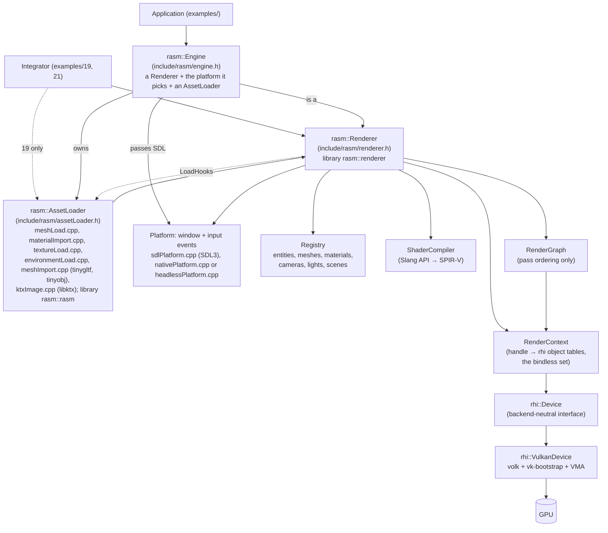
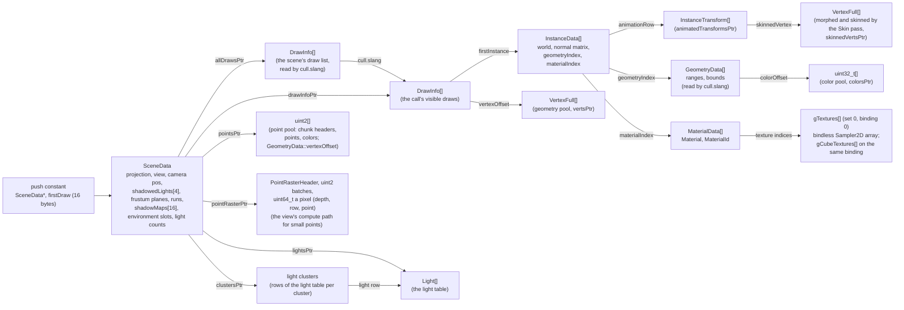

# RASM Architecture

This document describes how RASM is built **today** (branch `feat/pbr`, Oct 2026). Planned changes live in [development_plan.md](development_plan.md); known defects are tracked by ID (e.g. `B1`, `D4`) in [code_review.md](code_review.md).

## 1. Overview

RASM is a C++20 rendering engine with a single implemented backend (Vulkan 1.4). It is built as two static libraries, `rasm::renderer` (the renderer alone) and `rasm::rasm` (the renderer, the SDL platform and the file loaders), and driven by small example programs. Its rendering core is *GPU-driven*: compute passes cull the scene's draws against the camera frustum and, in two passes, against a hierarchical depth buffer (Hi-Z), and the visible ones are drawn with one `vkCmdDrawIndexedIndirectCount` call per run of draws with the same alpha mode and cull mode (usually one to three), through one pipeline per alpha mode. See-through (glTF `BLEND`) draws come last, sorted back to front on the GPU. Vertices are pulled from one engine-wide geometry pool through buffer device addresses, textures are accessed through one bindless descriptor array, and the only per-draw binding is a 16-byte push constant.



| Layer | Files | Responsibility |
|---|---|---|
| Public API | `include/rasm/` (`rasm.h`, `renderer.h`, `engine.h`, …) and `include/rasm/render/` (`renderGraph.h`, `renderContext.h`, `resource.h`) | `Renderer`: the renderer alone, on the application's windows (`RendererConfig::nativeWindow`) or offscreen images; everything is created through it and referenced by handles. `Engine` (`engine.h`, `src/engine.cpp`): a `final` `Renderer` that picks its platform from `EngineConfig::platform` (SDL opens windows and reads their events); it adds behaviour only by the `Platform` it passes in, and overrides nothing. `RendererConfig` is `EngineConfig` without `platform`; `toRendererConfig` (`types.h`) converts, and `tests/rendererConfigTests.cpp` checks every field. The low-level API (render graph, `RenderContext`, the resource descriptors) lives in `render/`. |
| Renderer frame | `src/renderer/renderer.cpp` | Construction, frame loop (`beginFrame`/`render`/`endFrame`), windows and swapchain recreation; it calls the attached `AssetLoader`'s `finishLoads` through `LoadHooks` (`src/renderer/loadHooks.h`) at the start of `beginFrame`. |
| Asset loader | `include/rasm/assetLoader.h`, `src/assets/assetLoader.cpp` (`AssetLoader::Impl` in `assetLoaderImpl.h`), `meshLoad.cpp`, `materialImport.cpp`, `textureLoad.cpp`, `environmentLoad.cpp` | `AssetLoader(Renderer&, AssetLoaderConfig)`: the worker pool, the loads in flight and the path caches; it finishes the ready loads within the frame's budget (§6). It reaches the renderer's objects as its friend (`friend struct AssetLoader::Impl`), and the renderer reaches it only through `LoadHooks`. |
| Libraries | `src/CMakeLists.txt`, `cmake/rasmConfig.cmake.in` | `rasm::renderer` (`rasm_renderer`): everything but the files below; it links no SDL3, tinyobjloader or libktx and compiles no tinygltf. `rasm::rasm`: `engine.cpp`, `sdlPlatform.cpp`, the loader and the importers, `thirdparty_loaders_impl.cpp`; it links `rasm::renderer` PUBLIC and SDL3, tinyobjloader and libktx. Both are installed, each in its own export set; `find_package(rasm COMPONENTS renderer)` loads only `rasm::renderer` and finds only its dependencies. `examples/21_renderer` links only `rasm::renderer`. |
| C API | `include/rasm/rasm_c.h`, `src/c/` | A stable C ABI over `Renderer`, `Engine` and `AssetLoader` (§13), built into two shared libraries: `rasm_c` (`rasm::c`, links `rasm::rasm`) and `rasm_c_renderer` (`rasm::c_renderer`, links `rasm::renderer`, without `cLoader.cpp`). |
| Core utilities | `src/core/` | Handle manager, file reading, range allocator, the worker pool (`workerPool.h/.cpp`: the loader's and the shader compiler's), `lowerThreadPriority` (`include/rasm/threadPriority.h`, `threadPriority.cpp`), which every pool thread calls. |
| Platform | `src/platform/` | `Platform` (`platform.h`): the window, as a `Window` with a `NativeWindow`, and its events, as `InputEvent`s the engine applies (`input.cpp`, §8). `sdlPlatform.cpp` opens an SDL3 window, turns its events into `InputEvent`s and does the UI's cursor, clipboard and text input; `nativePlatform.cpp` wraps the application's window (`EngineConfig::nativeWindow`) and reads nothing; `headlessPlatform.cpp` has no window (`EngineConfig::platform`). No file here has a Vulkan type. |
| Assets | `src/assets/` | The mesh data on its way in (`meshData.h`, private: `ObjRaw`, `GLTFRaw`, `GltfImportCache`), glTF/OBJ import on the load workers (`meshImport.h/.cpp`, also used by tests; `loadJobs.h`, what a load's jobs write), LOD building with meshoptimizer (`meshLod.h/.cpp`), meshes and the geometry pool (`mesh.cpp`), textures (`texture.cpp`), KTX2 reading and Basis transcoding with libktx (`ktxImage.h/.cpp`), materials and glTF material/texture import (`material.cpp`). |
| Scene | `src/scene/` | Scenes, entities, cameras, lights, transforms. |
| Renderer | `src/renderer/` | Readbacks (`readback.cpp`: `Renderer::readFrame`, `readTexture`, `takeReadback`, `writePng`; §3), picking (`picking.cpp`: `Renderer::pick`, `isPickReady`, `takePick`; §3), the GPU-driven scene path (`gpuScene.cpp`: GPU scene tables, `syncGpuScene`, the scene passes of `addScenePasses`; `viewGraph.cpp`: `ViewGraph`, the graph behind `Renderer::render`, for a list of views; `view.cpp`: `getViewPixels`, `getInputArea`; `gpuTable.cpp`: per-slot tables with dirty-range uploads; `geometryPool.cpp`: the geometry pool and its table; `lightClusters.cpp`: the light table, the scenes' light lists and each shaded view's light clusters), the tone-map pass (`toneMap.cpp`: `Renderer::addToneMapPass`), the bloom passes (`bloom.cpp`: `Renderer::addBloomPasses`), the MSAA resolve (`msaaResolve.cpp`: `Renderer::addMsaaResolvePass`), TAA (`taa.cpp`: `Renderer::addTaaPass`), the frame stats and GPU timers (`frameStats.cpp`) and their overlay (`statsOverlay.cpp`), render graph, Slang shader compiler, GPU struct definitions (`uberMaterialTypes.h`). |
| Render context | `src/rhi/renderContext.cpp` | Backend-neutral API over handles; owns the handle → `rhi::` object tables, the creation-dedup caches and render targets. |
| RHI | `src/rhi/device.h` | The backend-neutral GPU interface: `Device`, `CommandBuffer`, `Queue`, `Swapchain` and the resource objects (§12). |
| Vulkan backend | `src/rhi/vulkan/` | `VulkanDevice` (instance, device, VMA, resource creation), `VulkanCommandBuffer` (recording, barriers), `VulkanSwapchain` (surface swapchain and its semaphores), `VulkanQueue` (submission), one `.h`/`.cpp` pair each. `vulkanTypes.h`: the Vulkan objects behind each `rhi::` struct. |
| Third-party implementations | `src/thirdparty_impl.cpp`, `src/thirdparty_loaders_impl.cpp` | The only translation units with `*_IMPLEMENTATION` defines: the renderer's (stb_image, stb_image_write, stb_image_resize2, VMA) and the loaders' (tinygltf, tinyobjloader; tinygltf calls the renderer's stb_image). |
| Shaders | `shaders/lib/`, `shaders/passes/` | `lib/`: shared modules: GPU structs (`core.slang`), PBR BRDF (`pbr.slang`), unlit shading (`unlit.slang`), the shadow map lookup (`shadow.slang`), a terrain tile's lifted grid (`terrain.slang`), vector features (`vector.slang`), the light clusters' layout and slices (`lightClusters.slang`), the frustum test (`frustumCulling.slang`) and the Hi-Z occlusion test (`occlusionCulling.slang`). `passes/`: entry shaders: the uber shader (`rasm.slang`), the depth-only scene pass (`shadow.slang`), culling (`cull.slang`), the Hi-Z build (`hiz.slang`), the light assignment (`lightClusters.slang`) and the stats overlay (`statsOverlay.slang`). |

Applications compile against `include/rasm/` and glm only. `src/`, the backend libraries and the tinygltf/stb include paths are PRIVATE to the `rasm` target, and static linking still pulls the libraries in. `RenderContext` keeps its `rhi::Device` and object tables in a private `RenderContext::Impl`, defined in `src/rhi/renderContext.cpp`; it knows no `Renderer`: it is made from a `RenderContextDesc`. `Renderer` holds `ShaderCompiler` and `Platform` through forward declarations.

The dependencies go one way: `Engine` → `Renderer` → `RenderContext` → `rhi::Device`, `Renderer` → `Platform`, and `AssetLoader` → `Renderer`. The renderer calls a loader only through the `LoadHooks` interface, so `rasm::renderer` links no loader. The renderer must outlive its loader: an `Engine`'s is a member, made after its `Renderer` base and destroyed before it; a renderer destroyed first logs an error and calls `LoadHooks::detach`, after which the loader drops its loads and refuses every call. Scenes, entities, cameras, lights, materials and meshes stay the `Renderer`'s by design (D3): the GPU tables mirror them row by row, and a `Scene` class of their own would only add change lists, for no use. `RenderGraph` and the private `ViewGraph` (the graph behind `Renderer::render`) hold a `Renderer`. `Renderer` has a virtual destructor (an application may delete an `Engine` through a `Renderer*`) and no other virtual function, so no frame call is virtual.

## 2. Object model: handles and registries

**Handles** (`rasm/handle.h`) are typed `Handle<Tag>{ uint64_t index; uint64_t generation; }` values. `generation == 0` means invalid. Every table hands out its handles from a `HandlePool` (`src/core/handle.cpp`): `allocate` pops the index released last (a stack, so indices stay low) or adds a new one from 1, with the slot's current generation; `release` adds 1 to the generation and pushes the index; `isAlive` is true only for the handle the slot gave out last, while it is not released. A pool made with a limit holds at most `limit - 1` live indices (index 0 means full), which is how the `MAX_*` limits work; a slot whose generation reaches `UINT64_MAX` is not reused. Unit tests: `tests/handleTests.cpp`.

There are two kinds of handle owner:

- **CPU-side objects** live in `Renderer::registry` (a private struct of `std::vector`s) and are indexed directly by `handle.index`. These are `Entity`, `Mesh`, `Material`, `Camera`, `Light` and `Scene` (environments in `Environments::environments`, readbacks in `Readbacks::pending`). Each has a `HandlePool` in the registry (`entityHandles`, …, `readbackHandles`): `MAX_ENTITIES`, `MAX_CAMERAS`, `MAX_SCENES`, and `EngineConfig::maxLights + 1` and `maxMaterials + 1` (set by the constructor) are their limits. Slot 0 is an unused default-constructed element, and a vector grows to its pool's `size`. Every public call checks its handles with `Renderer::isLive` (the pool's `isAlive`), so a destroyed object's handle is refused. Every object can be destroyed (below).
- **GPU objects** live in `RenderContext`. Each type has a table (`BufferTable`, `TextureTable`, …, in `renderContext.cpp`): a `HandlePool` and a `std::vector<rhi::Xxx*>` indexed by `handle.index`, pointing at objects the `rhi::Device` created (null when free). A lookup checks the generation and reads the vector: no hash (`P4`). A stale or unknown handle logs `<caller>: <kind> handle {i, g} is invalid or was destroyed.` and fails. `TextureTable::slots` holds each texture's bindless slot (§5). Render targets are in `std::deque`s (`renderTargets`, `renderTargetInfos`), so a `getRenderTarget` reference survives a new target. Each `rhi::` struct carries a copy of the descriptor it was created from, and the backend derives from it to add its native objects (§12).

**Deferred destruction** (`docs/guides/resource-lifetime.html`). `RenderContext::destroyTexture`, `destroyBuffer` and `destroyRenderTargets` (`Renderer::destroyTexture`, `destroyBuffer`, `destroyRenderTarget` for applications) release the handle at once and give the free to `rhi::ReleaseQueue` (`src/rhi/releaseQueue.cpp`): a list of `std::function` frees, untagged until the frame ends. `Renderer::endFrame` calls `RenderContext::tagReleases` after `submitBatches`, also for a dropped frame: the untagged entries wait for `frameFenceValue`, `computeFenceValue` and the `lastSubmit` of both upload managers, the frames' and the loads' (`RELEASE_TIMELINES` = 4), the values signaled last. `beginFrame` tags and collects at its start too, before it may skip the frame, so frees go on while frames are skipped (a minimized window): nothing is recorded then, so the values signaled last cover everything. It collects again after the slot's fence wait. `collectReleases` reads the four fences (no wait) and runs the entries they all reached, in order; with nothing tagged it returns at once. A render target's textures are marked (`TextureTable::attachments`) and `destroyTexture` refuses them; only the target frees them. A transient target that is destroyed leaves its group at once, since its index may go to a new target. The graphics value covers the frame's compute work (the last graphics batch waits for it); the compute value covers a frame whose later batches failed; the upload values cover a copy flushed after the frame, on the graphics queue or the transfer queue. What waits: a texture (then `textureStates.forget`, `cancelUploads`, destroy) and its bindless slot (back to `freeBindlessSlots`), a buffer (also the old buffer of `resizeBuffer`), the heaps of transient render targets, and storage slots of destroyed storage targets. `RenderContext::cleanup` waits for the device and runs them all (`releaseAll`). Rows of a `GpuTable` need no queue: each frame slot has its own copy, written only after its fence (§4). Shaders, pipelines and descriptor set layouts are deduplicated, so another holder may share a handle: they have no destroy and live as long as the device. Unit tests: `tests/releaseQueueTests.cpp`.

**Destroy calls** (`docs/guides/resource-lifetime.html`, example `17_streaming`). Every object the public API creates can be destroyed; the handle dies at once.

| Call | Through the release queue | Reused at once | Users |
|---|---|---|---|
| `destroyEntity` (`entity.cpp`) | nothing | its instance rows (`releaseEntityRows`), its animated row (written stopped, `clip` -1) and its ranges of the animation buffers (`releaseEntityAnimation`) | its scenes' draw lists rebuild; `Scene::entities` is compacted there |
| `destroyMesh` (`mesh.cpp`) | the five geometry pool ranges and the geometry table row of each sub-mesh, the animation pool range (`releaseMeshAnimation`) | index; `loadedMeshes` entry dropped | entities on it lose their rows and their mesh (searched only while `Mesh::users` > 0); `Mesh::ownedMaterials` and `ownedTextures` (what its glTF import made) are destroyed with it |
| `destroyMaterial` (`material.cpp`) | nothing | its material table row | `detachMaterial`: entities made with it (`Registry::materialUsers`) and the sub-meshes of its import's mesh (`Registry::materialOwners`) let go; their rows are rewritten; the default material is refused |
| `destroyTexture` (`texture.cpp`) | image, bindless slot | index | materials lose it |
| `destroyLight` (`light.cpp`) | nothing | its light table row | its scenes' light lists rebuild and are compacted there; a shadow of it casts nothing (`isLive` in `prepareSceneView`) |
| `destroyEnvironment` (`environment.cpp`) | its four textures and slots | index | scenes have none; a bake recorded in the frame being made keeps the storage slots (`Environments::bakeDestroyed`) |
| `destroyCamera`, `destroyScene` (`camera.cpp`, `scene.cpp`) | a scene's draw list and light list buffers | index (the scene's bit is cleared in its entities and lights) | refused with an error naming the view while a graph other than `Renderer::render`'s holds a view of them (`viewHolds`); then `ViewGraph::release` lets that graph go |

`removeEntityFromScene` and `removeLightFromScene` clear the scene's bit and rebuild its list; the vectors are compacted at that rebuild, which keeps an entry only while its object lives, is in the scene, and was not met before in the same rebuild (`listStamp`). `addEntityToScene` refuses an entity already in the scene, and compacts a full list before it checks `MAX_ENTITIES_PER_SCENE`. `GeometryPool::check` refuses a sub-mesh whose streams do not add up before any range is taken, so only a real lack of space logs the pool's use. Ranges come from `RangeAllocator` (`src/core/rangeAllocator.cpp`, tests in `tests/rangeAllocatorTests.cpp`): free ranges in a `std::map` by offset, first fit, neighbours joined on free, `grow` for buffers that grow. `Renderer::getPoolStats` returns the live objects and pool use (`PoolStats`); nothing walks the objects for it but the 1024 bindless slots.

**Descriptors** (`rasm/render/resource.h`). Each GPU resource has its own creation descriptor: `BufferDesc`, `TextureDesc`, `ShaderDesc`, `PipelineDesc`, `RenderTargetDesc`, `BindlessDescriptorSetLayoutDesc` and `DescriptorPoolDesc` (fixed `D5`). Each is an aggregate with a `std::string name` and default member initializers, so it is filled with designated initializers and a field left unset has a defined value. Each has a defaulted `operator==`, so every field takes part in equality. Passing the wrong kind of descriptor is a compile error. `ShaderDesc` owns its SPIR-V (`std::vector<uint8_t> code`). A `PipelineDesc` with `computeShader` set describes a compute pipeline (§12). Descriptor sets, command buffers and fences only take a name. `DescriptorType` names the descriptor kind of a layout or pool.

**Creation dedup.** Only immutable objects are deduplicated: `createShader`, `createPipeline` and `createBindlessDescriptorSetLayout` first look the desc up in a `*DescCache` (`unordered_map<XxxDesc, Handle, XxxDescHash>`) and return the existing handle for an equal desc. Equality is the defaulted one, so it covers every field, including the name and the SPIR-V bytes. The hashes (`ShaderDescHash`, `PipelineDescHash`, `BindlessDescriptorSetLayoutDescHash`, defined in `src/rhi/resource.cpp`) fold the fields with `hashCombine` from `rasm/handle.h`, which is order-sensitive, unlike the old XOR. `HandleHash` uses it too. Buffers, textures, descriptor pools and descriptor sets are mutable, so every `create*`/`allocate*` call makes a new object (fixed `B1`). Callers that want sharing cache at the asset level: `loadTexture` caches by path and format, and glTF import caches per model by image index and color space.

## 3. Engine lifetime and the frame loop

### Construction (`Renderer::Renderer`, `src/renderer/renderer.cpp`)
`Renderer(const RendererConfig&)` takes the native platform when `RendererConfig::nativeWindow` has a type, else the headless one; `Engine(const EngineConfig&)` (`src/engine.cpp`) calls the protected `Renderer(const RendererConfig&, std::unique_ptr<Platform>)` with `toRendererConfig(config)` and the platform of `EngineConfig::platform` (`createSdlPlatform`, `createNativePlatform` or `createHeadlessPlatform`), then makes its `AssetLoader` member from `toAssetLoaderConfig(config)` (§6), after the renderer has started. Both run these steps.
0. Resolve `shaderDir` beside the binary that holds RASM, the executable or the C API's shared library (the `AssetLoader` resolves `assetRoot` the same way), check the window size, then resolve `EngineConfig::cacheDir` (`resolveCacheDir`, `src/platform/paths.cpp`, §7): the folder is made and a test file written in it; a relative one that fails moves to the user's local cache folder plus `rasm/<executable name>`; one that still fails, or `""`, leaves the engine without disk caches. `getConfig().cacheDir` is the folder in use, or empty.
1. Create the main window through the platform (`Platform::createWindow(WindowDesc)`, with `EngineConfig::nativeWindow` for `NATIVE`), the first of `Renderer::windows` (handle index `MAIN_WINDOW_INDEX`, from `Renderer::windowHandles`, a `HandlePool` of `MAX_WINDOWS` (8)). An SDL or `NATIVE` window carries its `NativeWindow` (handles, type) and its content scale; a window without a native handle stops startup, except headless. A headless window has no handle, and its pixel size is `windowWidth` × `windowHeight`; a headless engine runs `EngineConfig::ui` with only the input the application sends (§8).
2. `RenderContext::initialize(RenderContextDesc)` gets the backend, the validation, queue and cache settings, the main window, `headless` (`Platform::type()` is `HEADLESS`) and `sampledDepth` (`occlusionCulling`), and calls `rhi::createDevice` for `RenderContextDesc::backend`. For Vulkan, `VulkanDevice::initialize`:
   - loads Vulkan (`loadVulkan`, §12): the loader volk finds, with a window or headless. No loader, or one older than 1.3, stops startup with an error,
   - creates the instance. `EngineConfig::enableValidation` turns on the Khronos validation layer; with it, `enableSyncValidation` and `enableGpuValidation` (copied into `DeviceDesc`) add the `validate_sync` and `gpuav_enable` layer settings through `VK_EXT_layer_settings`. Without validation (or without the layers installed) those two are ignored with a warning,
   - creates the surface from the main window's `NativeWindow` (`DeviceDesc::window`; `createVulkanSurface` in `src/rhi/vulkan/vulkanSurface.cpp`: `vkCreateWin32SurfaceKHR`, `vkCreateMetalSurfaceEXT`, `vkCreateXlibSurfaceKHR`, `vkCreateXcbSurfaceKHR` or `vkCreateWaylandSurfaceKHR`, loaded with `vkGetInstanceProcAddr` because volk is built without `VK_USE_PLATFORM_*`; the X11, XCB and Wayland types are declared there, so no development package is needed). A window's instance enables `VK_KHR_surface` and every platform surface extension the loader has (vk-bootstrap). A headless engine passes no window: the instance is made with `set_headless`, there is no surface, and the device needs no `VK_KHR_swapchain`,
   - selects a physical device with Vulkan 1.4 and the required features (below). When none fits, each GPU older than 1.4 is named with its version,
   - creates the device, loads its function table, loads the pipeline cache (`VulkanPipelineCache::load`, §7) from `DeviceDesc::cacheDir`, and creates the graphics queue and the VMA allocator. With `EngineConfig::asyncCompute` (copied into `DeviceDesc`) it also takes a compute queue from a queue family without graphics, if the GPU has one whose timestamps have as many valid bits as the graphics queue's. Then every buffer and image is created `VK_SHARING_MODE_CONCURRENT` for both families, so either queue can use any resource without ownership transfers. With `EngineConfig::transferQueue` (on by default) it also takes the queue of the first family that only copies (transfer, and at most sparse binding or protected) whose `minImageTransferGranularity` is 1 × 1 × 1, since the uploads copy rows at any offset: the GPU's copy engine (NVIDIA, AMD). Without one (lavapipe, MoltenVK, most Intel GPUs) the loads' copies run on the graphics queue (§12). Buffers are then shared by every family in use; images filled from the staging ring are shared by all three when there is a compute queue, and otherwise stay exclusive to the graphics family and move to it by an ownership transfer after their copies (`rhi::Texture::ownershipTransfer`, §12). The log says which (`Load uploads on the transfer queue of family 1.`).

   It then creates the main window's swapchain (`RenderContext::createSwapchain`, on the device's surface; `B8G8R8A8_SRGB`, with `TRANSFER_SRC` usage when the surface's `supportedUsageFlags` has it, so `readFrame` can copy it), registers its images as texture handles, and creates the shared sampler set. A headless engine gets an `OffscreenSwapchain` instead (`src/rhi/offscreenSwapchain.cpp`, backend-neutral, on `rhi::Device` textures): `MAX_FRAMES_IN_FLIGHT` readable `R8G8B8A8_SRGB` color attachments with an `R8G8B8A8_UNORM` view (`TextureDesc::encodedView`: `VK_IMAGE_CREATE_MUTABLE_FORMAT_BIT` and a format list of the two), which the UI draws through as through a window's (§12), handed out in turn. Its `acquireNextImage` waits for the frame fence value of the last submit that drew into the image (`submitted`, called by `RenderContext::submit` for the present submit), `present` does nothing, and submits get no acquire or present swapchain.
3. Create the frame fence (a timeline), the compute fence when there is a compute queue, and, for each of the `MAX_FRAMES_IN_FLIGHT = 2` slots, a command buffer and a depth texture (`D32_SFLOAT`, `SAMPLED_DEPTH_ATTACHMENT`, so occlusion culling can read it).
4. Initialize the shader compiler (§7): the main thread's Slang session (SPIR-V 1.4, scalar layout, column-major matrices, search path `lib/` under `EngineConfig::shaderDir`), the shader workers (`RendererConfig::shaderThreads`; 0: half the hardware threads, at most 8) and, with a cache folder, the shader cache's base key. A missing folder fails here, so a wrong path stops startup instead of failing every frame. After the geometry pool and the GPU scene (step 5), `warmPipelines` queues every shader a frame can need for the shader workers (§7, Warm-up), before the stats overlay and the UI make the first pipelines on the main thread (their shaders are not queued: they are made right away, while the workers start).
5. Create the geometry pool (`GeometryPool::create`, `src/renderer/geometryPool.cpp`): one device-local vertex buffer of `EngineConfig::geometryPoolVertices` `Vertex`es (STORAGE, read through its device address), one index buffer of `EngineConfig::geometryPoolIndices` `uint32_t`s, a color pool of `EngineConfig::geometryPoolColors` packed vertex colors for the meshes that have them, a skin pool of `EngineConfig::geometryPoolSkins` `SkinVertex`es (joints and weights) for the skinned meshes, a morph pool of `EngineConfig::geometryPoolMorphs` `MorphDelta`s (morph target deltas) for the morphed meshes, and the geometry table of `EngineConfig::geometryPoolSubMeshes` rows. Every mesh lives in these buffers (§6). Their size is fixed for the engine's lifetime, so an app that draws little can make them smaller and one with big scenes larger. `createGpuScene` then creates the instance and material tables and the scene data buffers (§4), `createGpuLights` the light table of `EngineConfig::maxLights` + 1 rows (§4, lights; 0 or `UINT32_MAX` stops startup with an error, and so does a table larger than the device's `maxBufferSize`, which `VulkanDevice::createBuffer` checks for every buffer), and `createStatsOverlay` the timestamp query pools and the overlay's text buffers (§3, frame stats). With `EngineConfig::ui` (and `RASM_IMGUI`), `createUi` makes the ImGui context and the UI pipeline after them (§3, the UI).
6. Take the single bindless descriptor set, which `RenderContext::initialize` made after the samplers (`getBindlessDescriptorSetLayout`, `getBindlessDescriptorSet`): layout, pool and set. Binding 0 of set 0 is an array of `RendererConfig::maxBindlessTextures` (16384 by default) `COMBINED_IMAGE_SAMPLER`s, lowered with a warning to the device's update-after-bind sampled image and sampler limits and to `MAX_BINDLESS_TEXTURES` (65536, so a slot fits the 16 bits TAA packs it into; `getBindlessTextureCapacity`, and the renderer's `getConfig`), binding 1 an array of `MAX_BINDLESS_STORAGE_IMAGES` (1024) `STORAGE_IMAGE`s (`BindlessDescriptorSetLayoutDesc::storageImageCount`; `VulkanDevice::createBindlessDescriptorSetLayout` fails with an error that names both numbers when the device allows fewer update-after-bind storage images, `maxDescriptorSetUpdateAfterBindStorageImages` and the per-stage limit), both with `UPDATE_AFTER_BIND | PARTIALLY_BOUND` and visible to every shader stage (`ShaderType::ALL`), so compute shaders can sample too.
7. Create the BRDF LUT of image-based lighting (`createEnvironments`, §4), which the first frame bakes.
8. `isRunning = true`. Any failure returns early and leaves `running() == false`.

**Required Vulkan features**: API 1.4.
- 1.0: `multiDrawIndirect`, `drawIndirectFirstInstance` (each draw names its instance row in `firstInstance`), `samplerAnisotropy`, `shaderInt64`.
- 1.1: `shaderDrawParameters`.
- 1.2: descriptor indexing (runtime arrays, partially bound, update-after-bind for sampled and storage images, variable count, non-uniform sampled image indexing), `drawIndirectCount`, `bufferDeviceAddress`, `scalarBlockLayout`, `hostQueryReset`, `timelineSemaphore`, `shaderInt8`, `storagePushConstant8`.
- 1.3: `dynamicRendering`, `synchronization2`, `shaderDemoteToHelperInvocation` (`discard` demotes, §7).
- Extensions: `VK_EXT_memory_budget`, and `VK_KHR_swapchain` with a window.
- Optional, each on when the GPU has it: `textureCompressionBC`, `textureCompressionASTC_LDR`, `textureCompressionETC2` (1.0), for block-compressed textures (§5), `hostImageCopy` (1.4, with `EngineConfig::hostImageCopy`), for textures copied on the host where that costs the GPU nothing (§5), and `shaderBufferInt64Atomics` (1.2, `RenderContext::hasBufferInt64Atomics`), for the compute path of small points (§4, Point clouds). The log says which are on (`Host image copy: N formats, in video memory` or `off`, `64-bit buffer atomics: yes`).

### Per frame (`Renderer::render`)

`Renderer::render(views, count)` calls `ViewGraph::render` (`src/renderer/viewGraph.cpp`); `Renderer::render(scene, camera)` is one `View` of the whole window. A `View` (`rasm/view.h`) is a scene, a camera, a `ViewOutput` (a `ViewRect` of the window, or of a color `target`: a view texture) and the overrides `bloom` (`ViewToggle`) and `antiAliasing` (`AntiAliasing::DEFAULT` takes `EngineConfig`'s). The `ViewGraph` keeps one `RenderGraph` with, per view in list order, the scene passes into the view's HDR target (`Renderer::addScenePasses`, §4, with the view textures of the views before it as `sampled`), the MSAA resolve or TAA, the bloom, and the `Tone Map` pass into the view's output (`Renderer::addToneMapPass`, §11), then `addUiPass` with every view texture as `shown`. Before it builds or runs anything, `render` polls the events and calls `Renderer::updateSwapchain` (the minimized check and the swapchain recreation `beginFrame` also does), so the sizes are this frame's. It compares the list (`View::operator==`) and each view's size in pixels (`getViewPixels` of its rect on the swapchain or its target) with the ones the graph was built from, in vectors that keep their capacity, and builds the graph again only when one differs (also after a view failed: its failures come from bad handles, a full `MAX_SCENE_VIEWS` or a failed allocation; the failed view is left out with an error, and the others draw). What a view keeps lives outside the graph in a `ViewState`, found by the view's camera and `ViewOutput::target` and never by its place in the list: its HDR target (`Renderer::createRenderTarget`, named `scene_hdr`, then `scene_hdr_1`, ... by the lowest free `number`), with TAA its history target (`getTaaHistoryDesc`) and `TaaState`, given to a private `Renderer::addTaaPass` overload. The new graph is built before the old one is replaced, so the views it adds again find their `SceneView` still held and keep its Hi-Z, visibility and light clusters. A view whose size changed gets `Renderer::resizeRenderTarget` on its targets; one whose scene or anti-aliasing changed gets new targets; a state no view of the list has is destroyed (`destroyRenderTarget`). Two views with one camera and target: the second is left out with an error. `beginFrame` takes the camera of the first view in the window (no output target) for the built-in controller. A destroyed output target sizes its view at 0, so the graph is built again without it; `Renderer::destroyRenderTarget` also takes the target's colors out of the materials that sample them (`detachTexture`, as `destroyTexture` does). An application with its own graph calls `addScenePasses` and `addToneMapPass` itself and runs its graph instead; the frame is the same.

```mermaid
sequenceDiagram
    participant App
    participant E as Engine
    participant C as RenderContext/rhi
    App->>E: render(views, count) → ViewGraph::render: pollEvents, updateSwapchain, build the graph if the views or sizes changed → RenderGraph::execute(the first window view's camera)
    E->>E: beginFrame: pollEvents() unless the app called it (events, frameTime and deltaTime), then the camera's controller unless NONE
    E->>E: finishLoads → publish loads whose copies the GPU has, fill loads that are ready, their copies out at once (§6)
    E->>E: updateSwapchain: per window, recreateSwapchain(window) if resized or out of date; skip frame if no window can show (all minimized / 0×0 / failed)
    E->>C: waitForFence(frameFence, frameResources[frame].fenceValue), and computeFence with async compute
    E->>C: collectReleases: free what was destroyed and the fences now cover (no wait, §2)
    E->>E: readPicks(slot): the slot's picks, before its sync gives rows away and its endFrame records new ones
    E->>C: updateFrameStats: read the slot's last timers and cull counts, reset them, write the overlay text (without the UI)
    E->>E: buildUi (EngineConfig::ui): ImGui::NewFrame, the RASM window, the app's callback, ImGui::Render, UI textures, vertices into the slot's buffers
    E->>C: syncGpuScene: assign instance rows, rebuild dirty draw lists and light lists, upload this slot's dirty rows (§4)
    E->>C: acquireNextImage(window) for each window that can show (WindowFrame::acquired; OUT_OF_DATE → that window sits out); skip frame if none has an image
    E->>C: open the graphics batch (useQueue), clear new history copies and new kept targets (clearNewHistory)
    E->>C: recordEnvironmentBakes: the BRDF LUT and at most one loaded environment, before any pass (§4)
    loop each pass in the graph's order (scene view: Cull 1 with the light clusters, Scene 1, Hi-Z, Cull 2, Scene 2, Label Depth, Transparent, then Tone Map and UI)
        E->>E: useQueue: an async compute pass records into the compute batch, any other pass into the graphics batch
        E->>E: waits for the other queue's batches that used the pass's resources (closes an open one)
        E->>C: aliasingBarrier before a transient target's first pass, one memoryBarrier for the pass's declared buffers if needed, read textures and depths → SAMPLED
        alt compute pass
            E->>C: GPU timer around the pass's dispatches (Cull: prepareSceneView, then countMain, COMPUTE→COMPUTE, writeMain)
        else graphics pass
            E->>C: beginPass: attachments → COLOR / DEPTH (discard unless the pass loads them), beginRendering with the graph's AttachmentOps, viewport/scissor, cull NONE
            E->>C: the pass's draws (Scene: per run setCullMode, push constant, drawIndexedIndirectCount)
            E->>C: endPass: endRendering (a render target's color → SAMPLED)
        end
    end
    E->>C: endFrame: an empty "Clear" pass on each acquired window no pass drew, on the main window a "UI" pass if the UI has draws and no UI pass ran and the stats overlay pass (without the UI), the picks waiting (`recordPicks`), the readbacks asked for since the last frame (`recordReadbacks`), each acquired window's image → PRESENT_SRC (not headless), COMPUTE → HOST barrier (cull stats; without a compute queue), close the batches
    E->>C: submitBatches: end every batch (the last compute one after a COMPUTE → HOST barrier), then one submit per batch in the order they were closed, each signals its queue's fence; the first graphics one waits for every acquired window's image, the last presents them all; a failed one or a dropped frame → discardRecording
    E->>C: tagReleases(frameFenceValue, computeFenceValue): what was destroyed since waits for them (§2)
    E->>E: finishEnvironmentBakes: a bake whose textures stayed SAMPLED went out (READY), one in a dropped frame waits again
    E->>C: present(window) for each acquired window (SUBOPTIMAL / OUT_OF_DATE → recreate that window next frame)
    E->>E: frameCount = (frameCount + 1) % 2
```

Notes:
- `frameCount` is the frame-in-flight **slot index** (0 or 1), not a running frame counter.
- A steady frame makes **no heap allocation** on the main thread (`P27`, `docs/guides/frame-allocations.html`): per-frame lists are members that keep their capacity (`syncGpuScene` swaps `movedEntities` and `settlingEntities` instead of moving one into the other), text is built in stack buffers, `RenderContext::getTextureDesc` returns a reference. `rasm_image_tests` checks it: after each test it counts `operator new` on the main thread over 4 more frames (`tests/image/allocationCounter.cpp`, Windows only). Dear ImGui still allocates when it bakes a new glyph, and creating or destroying objects allocates.
- Input handling and delta-time measurement run in `pollEvents`, once per frame: the application may call it before `render`/`beginFrame` to read the frame's input first, else `beginFrame` does. `beginFrame` then runs the controller of the camera passed to it, unless the camera's controller is `NONE` or the handle is invalid.
- `beginFrame` returns `false` when the frame is skipped. The caller then records nothing and does not call `endFrame`.
- Frame pacing uses one timeline fence per queue, `Renderer::frameFence` for graphics and `Renderer::computeFence` for the compute queue. Every submit signals the next value of its queue's fence, and the slot remembers the last one in `FrameResources::fenceValue` and `computeFenceValue`. Before reusing a slot, `beginFrame` waits for both. A slot takes a new value only when the submit succeeds, because waiting for a value nothing signals would block forever. Nothing is reset, so a skipped frame needs no cleanup.
- **Batches.** A frame is one batch, or with async compute a few: a batch is one command buffer and one submit on one queue. Each queue records into one open batch at a time (`Renderer::useQueue`), and `FrameResources::commandBuffer` names the one being recorded, so code that records through it follows the graph between the queues. A batch is closed when the other queue needs what it did (`waitForQueue`, called by the graph, §9) or at the end of the frame, and its waits for the other queue's fence are fixed then. `endFrame` makes the last graphics batch wait for all of the frame's compute work, so a slot's graphics value covers the whole frame. All batches are submitted at the end of the frame, in the order they were closed (`submitBatches`), so every wait is on a submit that went out before it, and the GPU starts the frame once it is recorded. A closed batch is ended only in `submitBatches`, so its last compute batch can still take the cull stats barrier. A frame's command buffers per queue are made as needed and kept per slot (`batchCommandBuffers`). If one can't be made or begun, `useQueue` returns false and sets `recordingFailed`: the graph stops recording, `endFrame` records nothing more, and `submitBatches` ends every batch and submits none of them, like a failed submit. The scene view's passes make four batches: compute `Cull 1`, graphics `Scene 1`, compute `Hi-Z` + `Cull 2`, graphics `Scene 2` + `Tone Map` + overlay.

  ```
  compute : [Cull 1]                 [Hi-Z, Cull 2]
  graphics:      ↘ [Scene 1] ──────────↗        ↘ [Scene 2, Transparent, Tone Map, overlay] → present
  ```
- **Windows** (`docs/guides/multiple-views.html#windows`). `Renderer::addWindow(WindowDesc)` asks the platform for another window (an SDL window, `WindowDesc::native` for `NATIVE`, nothing headless), gives it a `WindowHandle` and a swapchain (`RenderContext::createSwapchain`: a surface of its own, whose present support on the graphics family `VulkanDevice::createSwapchain` checks; headless an `OffscreenSwapchain` of its size), and `createSwapchainResources(window)` reads its images and size into its `Renderer::WindowFrame`. `removeWindow` refuses the main window and a recording frame, then `RenderContext::destroySwapchain` waits for the device to be idle, destroys the swapchain and its surface, and the platform closes the window. Each `WindowFrame` holds the window's `Swapchain`, the frame's `imageIdx`, `acquired` (an image this frame), `rendered` (a pass drew it) and `outOfDate`. The graph skips a pass whose window has no image (`writeSwapchain(window)`), and `beginPass` draws `currentWindow`'s image, which the graph sets per pass; a hand-written pass on a window without an image is an empty pass (`RenderContext::beginEmptyPass`: its draws record nothing). `beginFrame` calls `RenderContext::beginSwapchainFrame` before its acquires, so a window that kept an image from a frame that never went out takes part again only once acquired again, and an acquire that fails marks the window out of date, so its swapchain is made again. The UI, the stats overlay and the swapchain-scaled targets and camera aspect follow the main window. `RenderContext` keeps a `WindowSwapchain` per window (its swapchain, its images' handles, `acquired`): a submit that waits for or presents the swapchain names every window with an acquired image (`SubmitDesc::acquireSwapchains`, `presentSwapchains`), and `present(window)` clears it.
- Every frame presents each acquired window, and present needs the image in `PRESENT_SRC_KHR`. A window that no pass drew gets an empty swapchain pass in `endFrame`, so it presents the clear color. A headless frame "presents" its offscreen image: it stays a color attachment, and the next acquire of it drops what it holds.
- Acquire, present and `recreateSwapchain` return `SwapchainStatus` (`OK`, `SUBOPTIMAL`, `OUT_OF_DATE`, `FAILURE`). `SUBOPTIMAL` from acquire still renders the frame, because the image was acquired and its semaphore will be signaled. The window's `WindowFrame::outOfDate` schedules its recreation.
- Swapchain-sized resources (render targets with `swapchainScale`, viewport, camera aspect) use the swapchain extent in pixels (`Swapchain::width`/`height`). `Window::width`/`height` are logical and are only used for mouse input.
- The swapchain always uses `VK_PRESENT_MODE_FIFO_KHR`, so the frame rate is capped at the display's refresh rate (see `B21` in the code review).
- `beginPass(name)` and `endPass` put a GPU timer around each graphics pass, the graph puts one around each compute pass, and the frame's graphics work gets one, from the first graphics batch to the last (frame stats, below).
- `endFrame` emits the Tracy frame mark, so skipped frames add none. Zones cover the frame functions, the backend-neutral `RenderContext` calls that block or submit, and whole upload loops. `fillBuffer` has no zone of its own because it runs per primitive per frame. See the [build guide](build_guide.md#profiling-with-tracy) for connecting a profiler.

### Readbacks

`Renderer::readFrame(ReadbackFormat)` and `readTexture(texture, format, layer, mip)` copy an image back to the CPU without stalling the frame (`src/renderer/readback.cpp`, state in `Readbacks`). The concept: `docs/guides/headless-readback.html`.

```
frame F    readFrame()            → PendingReadback (handle, texture or the frame's swapchain image, format)
           endFrame: recordReadbacks → a hostReadable buffer, RenderContext::copyTextureToBuffer into the last graphics batch
           submitBatches            → finishReadbackSubmit: fenceValue = the frame's graphics value (a dropped frame records it again next frame)
frame F+2  beginFrame waits slot F  → isReadbackReady(h) is true
           takeReadback(h, image)   → readBuffer, convertReadback, destroy the buffer
```

- Only a readable texture can be copied: `TextureDesc::readable` adds `TRANSFER_SRC` usage, and `RenderTargetDesc::readable` gives every color and the depth of a target that usage. A graph makes a readable target in memory of its own, like a history target (`RenderGraph::createRenderTarget`), and `createTransientRenderTarget` refuses one, since a later pass could reuse the memory before the copy at the end of the frame. The offscreen swapchain's images are always readable; a window's are when its surface allows it. Multisampled textures are refused (read the resolve).
- `rhi::CommandBuffer::copyFromTexture` copies a width × height corner (the whole mip for a readback, the used corner for picks: `RenderContext::copyTextureToBuffer` with a size and a buffer offset). It moves the layer and mip to `TRANSFER_SRC_OPTIMAL` and back to its tracked state around `vkCmdCopyImageToBuffer2`, so the texture states do not change, then makes the bytes visible to the host (`COPY` → `HOST` buffer barrier). With a compute queue the copy waits for all of the frame's compute work first, and the compute batches of later frames wait for the frame that made it (`readbackComputeWait`), since no graph sees the copy's use of the texture.
- `convertReadback` turns the tightly packed texels into a `ReadbackImage` on the CPU, when the image is taken: 8-bit sources keep their bytes as `RGBA8_SRGB` (BGRA swizzled), float sources are clamped and sRGB-encoded for it; `RGBA32_FLOAT` decodes sRGB and widens halves; a depth reads only as `RGBA32_FLOAT`. Formats: RGBA8 and BGRA8 (UNORM, sRGB), `R16G16B16A16_SFLOAT`, `R16G16_SFLOAT`, `R32G32B32A32_SFLOAT`, `R32G32_SFLOAT`, `D32_SFLOAT`. `writePng` writes an `RGBA8_SRGB` image through `stbi_write_png_to_func` to a UTF-8 path, and `readPng` reads one back (`stbi_load_from_file`).
- `takeReadback` blocks on the frame fence when the copy is recorded but not done, and returns false without blocking when no frame has recorded it yet.

### Picking

`Renderer::pick(view, PickDesc)` (or `pick(scene, camera, renderTarget, desc)` for an application's graph) asks what a view drew under a rect of its pixels (`src/renderer/picking.cpp`, `include/rasm/picking.h`, private state `Picks` in `src/renderer/picking.h`; guide `docs/guides/picking.html`; example `26_picking`). Nothing runs while no pick waits.

```
any time    pick(view, desc)      → PickRequest (WAITING) from Picks::spare, a PickHandle of Picks::handles
endFrame    recordPicks           → per pick: the view (ViewGraph::getSceneTarget, then the shaded SceneView prepared this frame),
                                    its SceneData with the unjittered projection, the rect's planes (getPickClipMatrix), the slot's
                                    cull buffer; countMain + writeMain (frustum only); the draws with the pick pipelines into the
                                    pick's column of the slot's targets; one copy of the used corner (RECORDED)
            finishPickSubmit      → SUBMITTED with the frame's fence value, or WAITING again for a dropped frame
F + 2       readPicks(slot)       → after beginFrame's fence wait (or from isPickReady once the fence passed): group the pixels,
                                    rows → entities (InstanceOwners), toWorldPosition (DONE)
            takePick(h, hits)     → copies the hits, gives the request back to Picks::spare
```

- **The view's frame.** `prepareSceneView` keeps the view's `gfx::SceneData` of the frame (`SceneView::sceneData`), its projection without jitter (`SceneView::projection`), its origin and `preparedSync` (`GpuScene::syncCount`). A pick whose view did not prepare in the frame that records it fails; a view with nothing to draw (`ready` false) answers no hits.
- **The pick's SceneData.** A copy of the view's at `MAX_SCENE_VIEWS` + its index in `GpuScene::sceneData[frame]` (`MAX_FRAME_PICKS`, 8, more slots), with `jitter` 0, the frustum planes of `getPickClipMatrix(rect) · projection · view` (`getFrustumPlanes`, now in `gpuScene.h`), `hizLevelCount` 0, no meshlets, no blend sort and no debug view, and `drawInfoPtr`, `cullSlotsPtr`, `groupCountsPtr`, `drawCountsPtr` and `cullStatsPtr` in the slot's cull buffer (`PickCullLayout`; the stats words are scratch). The LOD plane, `lodPixelsPerUnit`, the viewport size and `labelsPtr` stay the view's, so LODs, vector widths and label alphas match the view. A view drawn unculled (no culling pipelines) is picked from its whole draw list with `drawIndexedIndirect`.
- **Recording.** Up to `MAX_FRAME_PICKS` picks a frame, side by side in a row up to `MAX_PICK_ROW_WIDTH` (2048) pixels wide; the others wait. They share the slot's cull buffer one after another (`GRAPHICS → COMPUTE` before each cull but the first, `COMPUTE → GRAPHICS` after it). After a `COMPUTE → COMPUTE | GRAPHICS` barrier for the frame's compute work (`waitForQueueWork` with async compute, as readbacks do), each pick begins rendering on the slot's `Pick Ids` and `Pick Positions` (`R32G32B32A32_UINT`) and `Pick Depth` (`D32_SFLOAT`) textures (the first clears them, the others load), with the viewport at (column − x, −y, W, H) and the scissor on its column, and draws each run with the pick pipeline of its alpha mode and cull mode. Push constant `argument` = `getPickArgument(desc)`: the skip mask and `minAlpha` in 1/255 steps, rounded down. Then `copyTextureToBuffer` of both textures' used corner into the slot's host-readable buffer. The textures, the cull buffer and the buffer grow ×2 and stay (GPU timer `Pick`).
- **Pipelines.** `shaders/passes/rasm.slang` compiled with `RASM_PICK` (and `RASM_ALPHA_MASK` or `RASM_ALPHA_BLEND`), `vertMain` and `pickMain`, no blending, depth test, depth write but for the sorted `BLEND` run (`Picks::pipelines[2]`; the weighted and additive runs, not sorted, take the same shaders with depth write, `pipelines[3]`, so the nearest surface with alpha at least `minAlpha` is hit), made on the first pick (`P31`). When the view sorts its blend run (`SceneView::sortBlend`), the pick's SceneData names that run with sort buffers in the slot's cull buffer, and `recordBlendSort(sceneDataAddress, capacity)` sorts it after the cull as the view's (draw order, then back to front), so with no depth write the see-through draw the view shows on top writes last. Through a mirrored view the cull modes swap, as in `drawSceneView`. `getVertexOutput` takes the instance row: the pick varyings carry the row, a vector's feature id (`tangent.w`) and `PICK_HIT_*` flags; a vector's position is `VectorVertex::depthPoint` (its point under the pixel without the bias; an overlay's too) and its normal the ground's up. `isPickSkipped` collapses the triangles of a skipped kind. `pickMain` cuts `MASK` at the cutoff, drops `BLEND` single-sided back faces and alpha below `minAlpha` (a vector's alpha from `shadeVector` / `shadeGlyph`), and writes (row + 1, feature, flags, material row) and (render-space position bits, `packPickNormal`). The point run has its own pick pipeline (`Picks::pointPipeline`, `shaders/passes/points.slang`'s `vertMain` and `pickMain` with `RASM_PICK`), made with the first pick of a scene that has one: it writes the point's index in its chunk's order as the feature and `PICK_HIT_FEATURE | PICK_HIT_POINT`, and `readPicks` turns the index into the application's through the mesh's `Mesh::pointOrder`; `PICK_SKIP_POINTS` collapses the points. A view that drew glyphs has them culled again through the rect into the slot's own glyph buffer (`PickSlot::glyphCull`) and drawn with `Picks::glyphPipeline` (below, instanced glyphs): the feature is the glyph's index, with `PICK_HIT_FEATURE | PICK_HIT_GLYPH`.
- **Rows to entities.** `InstanceOwners` (`picking.h`) keeps the owner (entity index, generation, sub-mesh) of each instance row per frame slot: `syncGpuScene` calls `assign` when it gives rows to an entity, and `sync(slot)` before the slot's instance upload, so a slot's map is its table's. `readPicks` reads a slot before its next sync (in `beginFrame` right after the fence wait), so a row given to a new entity at once still names the destroyed one (`Renderer::isAlive` false). The owner also keeps the mesh the rows were given for, through which a point pick maps its index (`Mesh::pointOrder`; a destroyed mesh: no feature). CPU only: 20 B a row per slot and current.
- **Hits.** `groupPickSamples` sorts the rect's samples by (row, feature) and keeps per group its count and its pixel nearest the centre of the rect asked for (a rect cut at the view's edge keeps it), then nearest the camera; the groups are sorted the same way. Requests, their hit vectors and the scratch keep their capacity (`Picks::spare`), so a pick every frame allocates nothing (the `picking` image tests count it).
- **Cost.** 0 while nobody picks. A 1 × 1 pick: 0.153 ms in `05_city --pick` (145 000 entities, the cull of the whole draw list is most of it) and 0.033 ms in `26_picking` (RTX 3060, Release, 1920 × 1080, `--bench`).
- **Window points.** `getViewPixel(window, rect, x, y, ...)` (`src/renderer/view.cpp`) turns a mouse position into the pixel of a window view.

### Exports

`Renderer::exportView(view, ExportDesc)` draws a still of a view at any size in tiles and writes it to a PNG or EXR file as it goes, or keeps it in memory for `takeExport` (`src/renderer/export.cpp`, `include/rasm/export.h`, private state `Exports` and `ExportJob` in `src/renderer/export.h`; guide `docs/guides/tiled-export.html`; example `32_export`). Nothing runs while no export does.

```
exportView        -> ExportJob (RUNNING), queued behind the running one
render(views)     -> ViewGraph::render: updateExports (start: camera copy, target, buffers, ImageWriter; the phase's plan into
                     Exports::view), the graph built again when Exports::graphKey changed (addExportPasses after the views),
                     collectExports (finished and cancelled jobs give their resources back once the graph lets go)
beginFrame        -> readExports(slot): the tile the slot's last frame finished, its rows into the band (or the image), a full
                     band to the writer; prepareSceneView of the export's view reads Exports::view
the frame         -> scene passes into the render rect, MSAA resolve, bloom, Export pass (recordExport)
endFrame          -> finishExportSubmit: a submitted frame moves the phase on; a dropped one is drawn again
```

- **Layout.** `getExportLayout` rounds the image up to `EXPORT_ALIGNMENT` (64), cuts tiles of `ExportDesc::tileSize` (`DEFAULT_EXPORT_TILE_SIZE`, 2048, a multiple of 64, lowered so a tile and two guards fit `RenderContext::getMaxImageSize`) and gives every tile one render rect size: the tile with `EXPORT_GUARD` (64) on each side, or `EXPORT_BLOOM_GUARD` (384, the bloom's reach) when the view has bloom; one tile across draws the virtual image's whole width. `getExportTile` places a tile's rect with its guard before it and moves it back inside the virtual image at its edges, so the image's edges are where the passes clamp, as in a single render, and every rect origin is a multiple of 64 (the bloom levels' texels fall on the whole image's grid).
- **The view.** An `ExportJob` owns a copy of the camera (`registry.cameras`, controller `NONE`), a target of one render rect (`export_hdr`: `SCENE_COLOR_FORMAT` and `D32_SFLOAT`, cleared to 0 with `ExportDesc::transparent`, the view's MSAA samples only with `ExportDesc::msaa`), an RGBA32F sum buffer (`Export Sum`, the tile size squared times 16 B, device-local) and per frame slot a host-readable output buffer and an `ExportParams` buffer. `addExportPasses` adds `addScenePasses` (with the view textures as `sampled`), `addMsaaResolvePass`, `addBloomPasses` as the view has them, and the `Export` compute pass. `prepareSceneView` of that scene view (`getExportViewFrame`) projects with `ExportViewFrame::tileClip` times P (P at the whole image's aspect; `getExportTileClip`, then the sample's jitter), takes its LOD from P and the image's height, divides `lodPixelsPerUnit` by the pixel scale, writes `SceneData::pixelScale`, drops the sky with a transparent background, skips debug views, and draws nothing while `idle`. `placeViewLabels` places on the whole image's pixels with sizes, cells and the depth bias times the pixel scale and no fade; `getExportLabelProbe` turns the probes: in the survey only the anchors the tile keeps are tested, at once (`LABEL_PROBE_RESET`, in render rect pixels), elsewhere every depth label keeps its fade (`labelFadeStep` 0) and overlays stay as placed. `prepareWeightedBlend` gathers the survey frames' weighted words (`gatherExportWeightedWords`, by `ExportJob::surveySlots`) and, in the tiles, uses the span they found.
- **Phases** (`ExportPhase`). `SETTLE`: the view draws tile 0 until its pipelines exist (3 frames), the attached loader is idle and no `TileStreamer` of the scene reports work (`setExportStreamSettled`), at most `EXPORT_SETTLE_FRAMES`. `SURVEY` (when the scene has labels or weighted surfaces): one unjittered frame a tile. `DRAIN`: 2 frames, so the last survey words are read; then the span is snapped (`stepWeightedRange` from nothing) and fixed. `TILES`: `ExportDesc::samples` frames a tile, the jitter of `getExportJitter` (a stratified grid for a square count, Halton (2, 3) otherwise) and `TAA_TEXTURE_LOD_BIAS`; a new row of tiles waits while the writer has `EXPORT_MAX_QUEUED_BANDS` bands. `FLUSH`: idle until every tile is read and the writer closed the file. From the survey to the last tile `isExportFrozen` keeps the scene's tile streamers from changing what they draw (`TileStreamer::update` polls loads only); while the export runs `getExportStreamView` adds its view (the image's size, errors in pixel-scaled pixels) to their screen error.
- **Export pass** (`shaders/passes/export.slang`, `exportMain`, warmed at startup; push constant `ExportPushConstants`, its `ExportParams` through a device address). Per kept pixel: the resolved HDR color, the bloom sampled as the tone-map pass samples it, exposure, AgX (`shaders/lib/agx.slang`, the tone map's) unless `toneMap` is false; with a transparent background the color is divided by its coverage before and multiplied after. It adds color times alpha, and alpha, times 1 / samples to the sum (the first sample writes it), and on the last writes the sum to the slot's output buffer: `EXPORT_OUTPUT_SRGB8` / `EXPORT_OUTPUT_SRGB16` (straight, 0 below alpha 1e-6), `EXPORT_OUTPUT_HALF` or `EXPORT_OUTPUT_FLOAT` (premultiplied), then a `COMPUTE -> HOST` barrier. A frame that is not submitted adds nothing: its sample is drawn again.
- **Writing.** `readExports` copies the tile's rows from the output buffer after the slot's fence wait: into the image without a path, else into the band (image width times tile height), which goes to the `ImageWriter` when its last tile is in. `ImageWriter` (`src/renderer/imageWriter.cpp`) runs on a thread of its own: a PNG through one zlib deflate stream (level 3, Paeth-filtered rows, 16-bit samples big-endian), an EXR as scanline ZIP blocks of 16 lines (channels A, B, G, R planar, reordered and delta-predicted, stored raw when deflate does not shrink them) with the offset table written at the end. Destroyed before it finished (a cancel), it stops and removes the file. zlib links `PRIVATE` to `rasm_renderer`.
- **Seams.** A tile matches a single render (an export of one tile) but in the pixels where the off-center matrix's rounding moves an edge sample: 0.02 % of the pixels of `32_export`'s check at 3072 x 1728, a few by more than 3 levels.
- **Shader variant.** An export's scene view (`SceneView::exported`) draws with its own shaded pipelines, `GpuScene::shaded[EXPORT_VARIANTS + log2 samples]`, compiled with `EXPORT_VIEW_DEFINE` (`#define RASM_EXPORT_VIEW`; `getMotionDefine` gives it, `warmScenePipelines` warms them when the export's view is made): `sky.slang` and `grid.slang` add the projection's offset terms (`projection[i][2]`) to their rays, and sizes in pixels read `SceneData::pixelScale` (`getPixelScale` in `core.slang`). In every other view `getPixelScale` is 1 and folds away, so a frame without an export runs the same shader code as before; `cull.slang` and `pointRaster.slang`, one pipeline for every view, define `RASM_PIXEL_SCALE` and read it.
- **Cost.** Nothing while no export runs: `updateExports` and `collectExports` look at an empty list. An export's frame costs one render rect of its scene, plus the Export pass.

### Image tests

`rasm_image_tests` (`tests/image/imageTests.cpp`) renders 15 scenes headless at 512 × 288 and compares each frame with `tests/golden/lavapipe/<test>.png`. The concept: `docs/guides/image-tests.html`.

```
tools/image_tests.py --lavapipe   fetch Mesa 26.3.0 (lavapipe) and Sponza, SHA-256 checked, into build/test-assets/
                                  VK_DRIVER_FILES = lavapipe's manifest, LP_NATIVE_VECTOR_WIDTH = 256
rasm_image_tests                  for each group: one headless Engine, one camera, the sunset environment, a cube
  for each test of the group      the scene (built once, shared by the tests of one build function)
                                  a graph: shadows, scene passes, MSAA resolve or TAA, bloom, tone map
                                  (views: Renderer::render with the content's four views instead)
                                  waitForLoads, N frames at a fixed animation time, readFrame, takeReadback
                                  compareImages with the golden (readPng): fail when > F of the pixels differ by > T
```

- `ImageTest` holds a test: its build function, samples, TAA, bloom, debug view, frame count, animation time, T (`threshold`, 0 to 255), F (`fraction`) and `views`, which draws with `Renderer::render(views, count)` (`buildViews`: split screen, a map in the corner without bloom, and a view texture a screen in the scene shows) instead of a graph. Every test uses T = 3, F = 0.1%; `determinism` renders the helmet again and compares it with `helmet_ibl`'s image of the same run, T = 0, F = 0 (`sameAs`).
- One engine runs every test, in the order of `TESTS`. Tests that share a build function share its scene, so their pipelines and loads are made once. Each test resets the camera's history and sets its projection, transform, bloom strength and debug view.
- A failure writes `actual.png`, `expected.png` and `diff.png` (gray same, orange ≤ T, red > T) to `build/<preset>/image-tests/<test>/`. `--update` writes the goldens; `--scenes` picks tests; `--sponza` points at the fetched Sponza.
- The goldens are lavapipe's. The script fails when the log names a device other than llvmpipe, or has a validation or engine error. The presets' `ctest` excludes the label `image`. CI's Windows job registers lavapipe and the validation layer in the registry (its processes are elevated, so the loader ignores `VK_DRIVER_FILES`) and runs the script after the Release tests.

### Frame stats and the overlay

`Renderer::getFrameStats()` returns a `FrameStats` (`rasm/renderer.h`), and with `EngineConfig::showStats` (F1 toggles it) the engine shows it: in the RASM window with `EngineConfig::ui` (below), else in a panel in the top-left corner. Measuring is in `src/renderer/frameStats.cpp` (state in `FrameStatsCollector`, `frameStats.h`), the panel in `src/renderer/statsOverlay.cpp` (state in `StatsOverlay`, `statsOverlay.h`); `Renderer` holds both through forward declarations like `GpuScene`. Frames are measured only while the overlay is shown or once `getFrameStats` has been called; until then there are no timestamps, read-backs or budget queries. `Renderer::beginGpuTimer`/`endGpuTimer` are public, so an application can time its own work into the frame's command buffer; the render graph uses them for compute passes.

| Value | Source |
|---|---|
| `cpuFrameMs` | `frameTime`, the time between the starts of the last two frames (measured, also under `fixedDeltaTime`) |
| `gpuFrameMs`, `gpuTimers` | timestamp queries: a pair around the frame's command buffer, each `beginPass`/`endPass` and each render graph compute pass, named after the pass (a scene view's `"Cull 1"`, `"Scene 1"`, `"Hi-Z"`, `"Cull 2"`, `"Scene 2"`, or `"Cull"` and `"Scene"` without occlusion culling), or after `Pass::timerName`, which compute passes next to each other in the order on one queue share (the 11 bloom passes are one timer, `"Bloom"`). At most `MAX_GPU_TIMERS` (64) per frame (`D21`); later ones are not timed, with one warning. `getTimestamps` takes each value as a distance from the first query it reads, modulo `timestampValidBits`, so a counter wrap inside a frame does not break the times. `gpuFrameMs` runs from the frame timer's start (query 0) to the latest end of a graphics-queue timer, and the timers are listed in the order they were recorded. Async compute timers are left out of `gpuFrameMs`, because timestamps of two queues may count from different origins; each one's time is read from its own two queries (`getTimestamps(pool, 2 * timer, 2, ...)`), since it begins and ends on one queue. |
| `uploadGpuMs` | timestamp queries around each upload batch, on its queue (`UploadManager`, where `Device::hasTimestamps` says that queue's timestamps count like the graphics queue's): the GPU time of the copies whose batches finished since the last frame, on both upload queues. Taken every frame, measured or not. |
| `draws`, `triangles` | CPU sums over the frame's scene views (`GpuScene::drawTotals`, added in `prepareSceneView`), from each draw list's size and `triangleCount` |
| `drawsVisible`, `trianglesVisible`, `trianglesVisibleLod0`, `drawsPerLod` | `cull.slang`: each group of `countMain` (early and late) adds the draws and triangles it keeps to the slot's `Cull Stats Buffer` (`SceneData::cullStatsPtr`, `CULL_STATS_WORDS` = 22 × u32, named by the `STATS_*` constants in `cull.slang` and `CULL_STATS_*` in `gpuScene.h`: draws; triangles at the picked LOD, low and high; the same triangles at LOD 0, low and high; draws per LOD; then the two light counts and the meshlets: drawn, culled, draws over budget; then the visible draws' triangles at their LOD before meshlet culling, low and high; then the glyphs in the chunks `glyphCull.slang` tested and those it drew, `FrameStats::glyphs` and `glyphsVisible`, whose triangles count with the visible ones) with atomics; `cullMeshletChunk` (in `meshletCountMain` or `taskMain`) adds the triangles of the meshlets it keeps. The triangles are 64-bit as two words with a carry (`addCount64`), since Metal and WebGPU lack 64-bit atomics. A view drawn without culling counts all its draws, at LOD 0. The overlay shows `trianglesVisibleLod0 − trianglesVisibleLod` as "LOD saved", `trianglesVisibleLod − trianglesVisible` as "Meshlets saved" and `drawsPerLod` as "LOD draws". |
| `lightsGlobal`, `lightsVisible`, `lightsDropped` | the global lights of the frame's shaded views (CPU); the local lights `lightsMain` found in a view's frustum, and the lights that did not fit a cluster (`MAX_CLUSTER_LIGHTS`, counted per cluster) or a tile's list, both added to the `Cull Stats Buffer` (words 13 and 14) by `lightClusters.slang`. A view without clusters counts all its local lights as visible. |
| `memory` | `queryVRAMStats` (`VK_EXT_memory_budget`) |

```
frame N in slot s                         frame N+2 in slot s (after the fence wait)
 record: timestamps, scene view totals ──▶ updateFrameStats: read timestamps + Cull Stats Buffer[s]
 cull:   atomics into Cull Stats[s]          reset the query pool on the host, zero the counters
 COMPUTE → HOST barrier, in endFrame or      updateStatsOverlay: write the overlay text into Stats Overlay Text[s]
   the frame's last compute batch
```

- The cull stats are zeroed every frame, measured or not, and the dropped lights are read every frame: the first time a frame drops lights, `updateFrameStats` logs a warning with the count and what to do, and again at most every 10 seconds while it goes on.
- The GPU values are `MAX_FRAMES_IN_FLIGHT` frames old: a slot is read only after its fence wait. A frame that was recorded but not submitted leaves its slot's fence value unchanged, so `updateFrameStats` skips it, since its queries were never written.
- One `COMPUTE → HOST` barrier per frame makes the counters visible to the CPU after the fences: `endFrame` records it after the last pass, or with a compute queue, where the culling runs, `submitBatches` records it at the end of the frame's last compute batch. `RenderContext::readBuffer` reads a buffer created with `hostReadable` (cached memory).
- The text is rebuilt every 0.25 s of frame time (`gridAge` adds up `deltaTime`), so the numbers can be read, and with `EngineConfig::fixedDeltaTime` the same frames rebuild it in every run (`C15`). It is copied into the slot's host-visible text buffer every frame. It is a grid of at most 40 × 76 characters (`MAX_TEXT_ROWS`: room for every GPU timer).
- `endFrame` draws the overlay in a pass of its own after every other (`drawStatsOverlay`), so it covers whatever the frame drew: the pass loads the swapchain image's color and has no depth attachment (`beginRendering` with an invalid depth handle; the overlay pipeline is made with `Format::UNKNOWN` depth), so it costs no depth clear. It has no GPU timer. `statsOverlay.slang` draws two triangles over the panel at depth 1 (the near plane) and looks up each pixel's character and glyph bit in an 8x8 bitmap font (the public-domain IBM VGA font, `'!'` to `'~'`) kept in the shader. Its 16-byte push constant holds the text's address, the grid size and scale, and the screen size. Each font pixel covers `max(1, height / 1080)` screen pixels on each side. It sets a full-swapchain viewport and scissor and `CullMode::NONE` first, since it works in window pixels and its triangles wind clockwise.
- The overlay pipeline is created at startup, after the bindless layout. If it fails to compile, the error is logged once and the overlay stays off.
- With the UI on, the overlay is neither written nor drawn: `updateStatsOverlay` and `drawStatsOverlay` are skipped.

### The UI (Dear ImGui)

`EngineConfig::ui` runs Dear ImGui (`src/renderer/ui.cpp`, `src/renderer/engineUi.cpp`, `src/platform/uiPlatform.cpp`, `src/renderer/inspector.cpp`, `shaders/passes/ui.slang`), in a rasm built with the CMake option `RASM_IMGUI` (on by default). The option adds the `imgui` feature of `vcpkg.json` (the plain port, no backends: RASM feeds the input and draws), compiles those four files, links `imgui::imgui` PUBLIC and defines `RASM_IMGUI` PUBLIC; `rasmConfig.cmake` finds `imgui` only then. Without the option `renderer.cpp` defines `addUiPass`, `setUiCallback` and `getUiTexture` as stubs, and `ui` logs a warning. The engine owns the one ImGui context (`Ui::context`), which the application's `ImGui::` calls use.

- **Startup** (`createUi`): the context with `IniFilename = nullptr` (no `imgui.ini`), `ImGuiBackendFlags_RendererHasVtxOffset` and `RendererHasTextures`, the style and `FontScaleDpi` scaled by `Window::contentScale` (`setUiScale`; 1 headless), RASM's platform side (`initUiPlatform`: `BackendPlatformName` "rasm", `ImGuiBackendFlags_HasMouseCursors` when the platform has cursors, and the clipboard through `Platform::getClipboardText` / `setClipboardText`), and the UI pipeline: no vertex input, no depth, `PREMULTIPLIED_ALPHA` blending, for the swapchain's encoded format with `#define RASM_UI_ENCODED` when it has one (§12), else for its sRGB format. A failure leaves the UI off and the stats overlay on.
- **Input** (`pollEvents`, §8): no ImGui platform backend runs (the vcpkg port has no backend feature). Every `InputEvent`, from any platform or from `addInputEvent`, goes to `processUiEvent` while a UI is built (`Ui::active`): `AddKeyEvent` (the four `ImGuiMod_*` first, then the key by `InputEvent::key`, or by `physicalKey` when the meaning has no `Key`), `AddMousePosEvent`, `AddMouseButtonEvent` (with its position first), `AddMouseWheelEvent` (x negated), `AddInputCharacter`, `AddFocusEvent`, and `-FLT_MAX` for `MOUSE_LEAVE`. With ImGui's `WantCaptureMouse` a button press and the wheel do not reach the camera, with `WantCaptureKeyboard` neither do W/A/S/D, and with `WantTextInput` Escape and F1–F3 are ignored. `newUiPlatformFrame` sets `DisplaySize` to the window's size in points and `DisplayFramebufferScale` to pixels per point (1 headless). After `Render`, `updateUiPlatform` tells the platform when `WantTextInput` changes (`Platform::setTextInput`: SDL starts and stops its text events) and when the cursor changes (`Platform::setCursor`, hidden with `MouseDrawCursor`, skipped with `ImGuiConfigFlags_NoMouseCursorChange`); a UI that stops building frames gets the arrow back and text input off (`suspendUiPlatform`). When `Window::contentScale` changes (the window moved to another display), `buildUi` scales the current style by the ratio of the new scale to the old (`setUiScale`), so the application's colors and sizes stay (ImGui's `ScaleAllSizes` rounds each size down, so a size can lose a pixel over moves between displays). A UI that resumes gets its keys and mouse cleared and the pointer from `InputState` (`resumeUiInput`). With or without a window, ImGui's `DeltaTime` is the engine's `deltaTime` (1/60 s on the first frame), so `EngineConfig::fixedDeltaTime` steps the UI too.
- **Building** (`buildUi`, in `beginFrame` after `updateFrameStats` and before `syncGpuScene`, Tracy zone `UI`): only while the RASM window is shown (`showStats`) or a callback is set; otherwise nothing runs and no events are fed. `NewFrame`, `drawFrozenFrustums` (below), `drawEngineWindow` (stats renewed every 0.25 s of frame time, `Ui::statsAge`, the forced LOD, the debug view and Freeze culling, the Buffers and GPU tables sections (§4), the last F3 dump), `Ui::callback`, `Render`. Then texture requests, and the draw data: each list's vertices and 16-bit indices are copied (`fillBuffer`) into the frame slot's host-visible `UI Vertices` and `UI Indices` buffers, which grow to the next power of two (at least 64 KiB and 16 KiB) and are made again only then. Each `ImDrawCmd` becomes a `UiDraw`: the device address of its first vertex, its index range, its texture and its clip rectangle in framebuffer pixels (`getUiScissor`). A user draw callback runs here.
- **Textures** (ImGui's `RendererHasTextures` protocol): a texture ImGui asks for, and one it changed, becomes a new `R8G8B8A8_UNORM` texture with all its pixels (an `Alpha8` one expanded to RGBA) in a free bindless slot (`LINEAR_CLAMP`). The old texture goes to `RenderContext::destroyTexture`, so it and its slot are freed once no submitted frame samples them (`releaseUiTexture`, §2 deferred destruction). A texture that cannot be made keeps ImGui's request and its old texture, and the next frame tries again. An `ImTextureID` is the bindless slot + 1, with bit 32 for a texture in an sRGB format (`getUiTexture`, which also gives a loaded texture without a slot one).
- **Drawing** (`drawUi`): the pass `addUiPass` adds (`UI`, `writeSwapchain`, `Pass::encodedSwapchain`), or `drawUiFallback` in `endFrame` (`beginPass("UI", {.loadColor = true, .encodedColor = true})`, with a debug-level log line the first time) when no UI pass ran and there are draws. Per draw: a scissor, the 16-byte `UiPushConstants` (`vertices` address, `texture` slot with bit 31 for sRGB, `displaySize` in points), `drawIndexed` with vertex offset 0. The vertex shader reads `vertices[SV_VertexID]`, so the base vertex travels in the address (D3D12's `SV_VertexID` leaves it out).
- **Color.** ImGui's colors are sRGB numbers, blended as numbers. Through the encoded view the shader passes them as they are and encodes an sRGB texture's samples back, which matches ImGui's own backends. Without it, the shader decodes the vertex colors and a UNORM texture's samples, and the blend happens in linear light (`D31`). Either way an image shows the texture's stored colors.

## 4. The GPU-driven path: GPU scene tables + the scene passes

The scene lives on the GPU in tables that last for the engine's lifetime. They are created in `Renderer::createGpuScene` (`src/renderer/gpuScene.cpp`), and their state is `GpuScene` (`src/renderer/gpuScene.h`), which `Renderer` holds through a forward declaration, like the `GeometryPool`. Only `gpuScene.cpp` touches `GpuScene`: the scene, entity and material code calls `Renderer` methods (`queueInstanceRows`, `writeInstanceRows`, `writeMaterialRow`, `addEntityToDrawList`, `refreshEntitiesAfterMaterialChange`).

```
ENGINE-WIDE (all scenes share them)                                        PER SCENE
 geometry table        material table          instance table              draw list
 1 row per sub-mesh    1 row per material      1 row per entity x sub-mesh DrawInfo[]
 GeometryData          MaterialData            InstanceData                firstInstance = instance row
 written once          rows rewritten when     rows rewritten when         rebuilt when the scene changes,
 (GeometryPool)        a material changes      a transform changes         stored as runs by alpha and cull mode
```

| Table | Buffer(s) | Row | Written by |
|---|---|---|---|
| Geometry | `GeometryPool::tableBuffer()`, one copy, `EngineConfig::geometryPoolSubMeshes` rows | `gfx::GeometryData`: `vertexOffset`, bounding sphere (center, radius), `lodCount` and `lods[MAX_MESH_LODS]` (`firstIndex`, `indexCount`, error, `firstMeshlet`, `meshletCount` per LOD), `colorOffset` (the sub-mesh's first vertex color in the color pool, -1 without colors), `skinOffset` (its first `SkinVertex` in the skin pool, -1 when not skinned), `morphOffset` and `morphTargetCount` (its first `MorphDelta` in the morph pool, -1 without morph targets) | `GeometryPool::upload`, once per sub-mesh. No frame has read a new row yet, so one copy is enough. |
| Materials | `GpuTable materials`, `EngineConfig::maxMaterials` + 1 rows, row = material handle index, reused at once after `destroyMaterial` | `gfx::MaterialData` (352 B): `gfx::Material`, `gfx::MaterialId` (`PBR`, `UNLIT`, `TERRAIN`, `VECTOR`, `POINTS`, `GLYPHS`), `alphaMode`, `alphaCutoff`, `flags` (`MATERIAL_DOUBLE_SIDED`, `MATERIAL_TEXTURE_TRANSFORM`), one `TextureTransform` per texture slot, then `gfx::TerrainData` (a `TERRAIN` material's heights) `gfx::VectorData` (a `VECTOR` material's style) and `gfx::PointData` (a `POINTS` material's, and the colormap of a `GLYPHS` material or a `VECTOR` one with scalars), zero for the others (below) | `writeMaterialRow`, from `createMaterial`, `loadMaterial` and `updateMaterial` |
| Meshlets | `GeometryPool::meshletBuffer()`, one copy, `EngineConfig::geometryPoolMeshlets` rows | `gfx::GeometryMeshlet`: sphere, cone axis and cutoff, `firstIndex`, `indexCount`, `firstData`, `vertexCount` (below, meshlets) | `GeometryPool::write`, once per sub-mesh |
| Meshlet data | `GeometryPool::meshletDataBuffer()`, one copy, `EngineConfig::geometryPoolMeshletData` words, only with mesh shaders | per meshlet: its vertices, then a word per triangle (three local indices, a byte each), at `SceneData::meshletDataPtr` | `GeometryPool::write`, once per sub-mesh |
| Instances | `GpuTable instances`, `EngineConfig::maxInstances` rows | `gfx::InstanceData` (160 B): `world` (the three rows of the affine world matrix, w = the high part of the translation) and `translationLow` (render space, below), normal matrix, geometry index, material index, `previousWorld` (the rows of the affine matrix the frame before drew, w = its translation minus this one, for motion), `meshletVisibility` (its first word of the views' meshlet bits, -1 for none; a vector mesh's first label slot, a point chunk's `PointChunkLod`, a glyph chunk's shape's geometry row), and `animationRow` (the row's `InstanceTransform` while a clip moves its sub-mesh, -1 otherwise; below, node animation) | `writeInstanceRows`, from `updateTransform` and when an entity gets its rows |
| Lights | `GpuLights::lights` (a `GpuTable`), `EngineConfig::maxLights` + 1 rows, row = light handle index | `gfx::Light` (68 B): position (the high part), intensity, color, range, direction, type, the spot cone's `spotScale` and `spotOffset`, `positionLow` | `writeLightRow`, from `createLight` and `updateLight` |
| Scene light list | `SceneLightList::buffers[2]` per scene, grown 2x | `uint32_t` light rows: the scene's global lights, then its local ones, each in the scene's order (`buildSceneLightList`); a 0 after them, which the local loop of a scene with only global lights reads on lavapipe; a scene without one has no buffer, and a shaded view's `SceneData::sceneLightsPtr` names the light table, whose row 0 is zero, so the light loops never index a null pointer (`B38`) | `syncGpuLights`, when `addLightToScene` added a light or `updateLight` moved one between global and local |
| Light clusters | `ViewClusters::buffers[2]`, one per frame slot and shaded view, grown to the scene's local lights | the slices' depths, a count and `MAX_CLUSTER_LIGHTS` rows per cluster, the tiles' lists, the lights' view-space spheres and visible bits (below) | `lightClusters.slang`, on the GPU, in the view's first cull pass |
| Draw list | `SceneDrawList::buffers[2]`, grown 2x when too small | `gfx::DrawInfo{indexCount, 1, firstIndex, firstVertex, firstInstance = instance row}` | `rebuildDrawList` + `uploadDrawList` |
| Visible draws | `SceneView::visibleDraws[2]`, one per frame slot and scene view, grown 2x when too small | `gfx::DrawInfo`, the draw list's rows that pass culling, packed per run in list order. Then culling's scratch: a `uint32_t` slot per draw (`cullSlotsPtr`) and a visible count per group of 64 (`groupCountsPtr`). Then the draw counts: `MAX_DRAW_RUNS` `uint32_t`s (`drawCountsPtr`), the visible draws of each run, which `drawIndexedIndirectCount` reads. The meshlet draws sit between the draws and the scratch, and the meshlet scratch after it (below, meshlets; `getVisibleDrawLayout`) | `cull.slang`, on the GPU (`writeMain`, the run's last group, writes the counts) |
| Visibility | `SceneView::visibility`, one copy per scene view, `EngineConfig::maxInstances` `uint32_t`s, zero when the view is made | 1 if the instance row passed its last occlusion test | `cull.slang` (late `countMain`) |
| Meshlet visibility | `SceneView::meshletVisibility`, one copy per scene view with occlusion culling, `EngineConfig::maxInstances` `uint32_t`s, zero when made | a bit per meshlet of an instance row's LOD, at `InstanceData::meshletVisibility` | `cullMeshletChunk`, late phase: `meshletCountMain` in `Cull 2`, or `taskMain` in `Scene 2` with mesh shaders |
| Hi-Z | `SceneView::hiz[2]`, one per frame slot and scene view, grown to the target's size | `float`: the farthest depth under each texel, all levels packed | `hiz.slang` (`hizMain`) |

**`GpuTable`** (`src/renderer/gpuTable.h`) is N rows of a fixed size with a CPU copy and one device-local buffer per frame slot. `setRow` writes the CPU copy and marks the row dirty for both slots. `upload(frame)` sorts that slot's dirty rows, merges neighbours into ranges (`mergeRows`) and writes each range with `fillBuffer`. If a write fails, the rows stay dirty and the slot sends them again in its next frame. A slot is written only in its own frame, after the fence wait, so the GPU is done with it. This holds on both `fillBuffer` paths (a staged copy, or a direct write into ReBAR memory).

**Instance rows.** An entity created with a mesh goes on `entitiesWaitingForMesh` (`queueInstanceRows`). Once the mesh is READY, `syncGpuScene` takes a range of one row per sub-mesh from `GpuScene::instanceRows` (a `RangeAllocator`) (`GpuScene::entities[entity]`, an `EntityDrawState`: first row, row count, a bit per scene that holds the entity, and whether it waits for textures) and writes them. An entity whose mesh failed to load leaves the list with a warning and never gets rows. The rows go back when the entity or its mesh is destroyed, and the next entity may take them at once (each slot has its own copy of the table). A row's matrix is entity transform (`Transform::toMatrix`: scale, then rotate, then translate, in doubles) x node transform, computed in doubles and written by `writeWorldRows` (`src/renderer/renderSpace.cpp`): the linear part as floats, the translation split in a high and a low float (render space, below). Its material is the primitive's, else the entity's, and `getMaterial` resolves an invalid one to the default material. Each row also keeps its `CullMode` and its material's `AlphaMode` on the CPU (`instanceCullModes`, `instanceAlphaModes`): `NONE` for a double-sided or a `BLEND` material, otherwise `BACK`, or `FRONT` when the matrix has a negative determinant (a mirror turns the front faces clockwise, as glTF specifies). A row whose cull mode or alpha mode changes (`updateDrawModes`) marks the draw lists of the entity's scenes for a rebuild. A sub-mesh missing vertices or indices gets a row but no draw, with a warning.

**Waiting for textures.** An entity is drawn only once every texture of every sub-mesh's material (the primitive's, else the entity's) is loaded, so nothing is drawn half-loaded. When it gets its rows with a texture still loading, it goes on `entitiesWaitingForTextures` instead of into the draw lists. `finishLoads` sets `GpuScene::texturesFinished` when a texture load finishes (its copies are on the GPU, `publishUploadedLoads`), and only then does `syncGpuScene` check the waiting entities again. `updateMaterial` calls `refreshEntitiesAfterMaterialChange` when `doubleSided` or `alphaMode` changed or a new texture still loads. It recomputes every entity's cull modes and alpha modes and moves entities with a texture that still loads back to waiting. It uploads no instance rows: the material keeps its row index.

**Draw lists.** `SceneDrawList::rebuild` is set by `addEntityToDrawList` (from `addEntityToScene`, when the entity already has rows) and by `markDrawListsDirty(entity)`, which marks only the scenes that hold the entity. That happens when the entity becomes drawable (rows and textures ready), starts waiting for a texture again, or changes cull mode. `rebuildDrawList` walks the scene's entities in order. It adds one `DrawInfo` per drawable sub-mesh of each entity that has rows and does not wait for textures. The draws are stable-sorted by alpha mode (`NONE`, `MASK`, `BLEND`), then cull mode, the `BLEND` ones by blend method (`getRunKey`), and stored as runs `{alphaMode, cullMode, points, blendMethod, first, count}`: at most `MAX_DRAW_RUNS` (10), three cull modes for each of `NONE` and `MASK`, one point run (`DrawRun::points`, the point cloud chunks with a `POINTS` material and the glyph chunks with a `GLYPHS` material, below) and three `BLEND` runs, weighted, additive and sorted (`GpuScene::instanceBlendMethods`, from `getBlendMethod`), all with cull mode `NONE`, the sorted one last so that it can be drawn in one sorted order. The list is then stale in both slots (`staleSlots`), and `uploadDrawList` writes it into each slot's buffer in that slot's frame. Growing a slot's buffer destroys the old one, which only that slot's last frame used.

**`syncGpuScene`** runs in `beginFrame`, after the fence wait for the frame's slot. It assigns rows to entities whose mesh is ready, checks the entities waiting for textures, rebuilds dirty draw lists, then uploads this slot's dirty instance and material rows and its stale draw lists. Its cost follows what changed, except that a scene holding a changed entity rebuilds its whole draw list (`P7`). A change made after `beginFrame` reaches the GPU in the next frame.

**The scene passes.** `Renderer::addScenePasses(graph, scene, camera, renderTarget, shadows, shadowCount)` adds the passes that draw a scene into `renderTarget`. They are ordinary graph passes: the graph sorts them, records their barriers from what they declare (§9), and gives later passes on the same target `load` ops. A depth-only `renderTarget` (no colors, `D32_SFLOAT` depth) gets the scene's depth only, and its passes are named `Shadow Cull 1`, `Shadow 1`, … instead (`Cascade 0 Cull 1`, `Cascade 0 1`, … for a shadow cascade, `Spot 2 Cull 1`, `Spot 2 1`, … for the map of spot light 2, `Cube 3 Face 0 Cull`, `Cube 3 Face 0`, … for the cube of point light 3); `shadows` (below, at most `MAX_VIEW_SHADOWS`, 4) are such targets that the shaded view samples.

```
Cull 1 (compute)          Scene 1 (graphics)     Hi-Z (compute)          Cull 2 (compute)          Scene 2 (graphics)      Transparent (graphics)
prepareSceneView,         early draws,           readDepth(target),      late countMain,           late draws, the sky     the blend run, back to
early countMain,          clears the target      hizMain per level       writeMain, blend sort     loads the target        front; loads the target
writeMain, light clusters
readPrevious: visibility  read: visible draws,   write: hiz              read: hiz                 read: visible draws,    read: visible draws,
write: visible draws,       light clusters                               write: visible draws,       light clusters          light clusters
  sort buffers, clusters                                                   visibility, sort buffers
```

A shaded view has a `Label Depth` compute pass between `Scene 2` (or `Scene`) and `Transparent`: `readDepth(target)`, read the label probes, write the label buffers, `readPrevious` and write the label fades (see **Label placement** below). The visible draws hold the draw counts too. The cull stats are not declared: views only add to them with atomics, and only the CPU reads them, after the slot's fence, so views need no order between them. Without `EngineConfig::occlusionCulling`, or when the view's visibility or Hi-Z buffers cannot be made (an error, then frustum culling only), it adds only `Cull` and `Scene`. A shaded view always ends with `Transparent` (`drawGrid`, then `drawTransparent`), also while its scene has no `BLEND` draws, since the graph is fixed and the scene is not; a depth-only view has none. Adding the same view twice to one graph logs an error, adds nothing and returns `false`. An invalid scene, camera or render target, a render target that has neither one `SCENE_COLOR_FORMAT` color and `D32_SFLOAT` depth (the uber pipeline's formats) nor `D32_SFLOAT` depth only, or a `shadow` on a depth-only view, or one that `addShadowPasses` did not make for the same scene and camera in this graph, logs an error, adds nothing and returns `false`.

**Shadows.** A light's shadow is a set of depth-only maps, each drawn by a scene view of its own. `Renderer::addShadowPasses(graph, scene, camera, ShadowDesc{light, cascadeCount, size, distance, splitLambda})` creates the maps of `size`² in the graph, adds the scene passes of each as a view of `camera` (whose LODs they use), and returns the `SceneShadow{light, maps, mapCount, distance, splitLambda}` to give to `addScenePasses` for the shaded view (`examples/06_shadows`, `examples/07_lights`). It depends on the light's type:

| Light | Maps (`SceneShadow::maps`) | Views | `distance` |
|---|---|---|---|
| `DIRECTIONAL` | `cascadeCount` (1 to `MAX_SHADOW_CASCADES`, 4) cascades `shadow_cascade_i`, each an orthographic box around a slice of the camera's view | one per cascade | from the camera, beyond its near plane |
| `SPOT` | one map `shadow_spot_<light>`, a perspective camera at the light along its direction, field of view 2 × `outerConeAngle` (at most 160°) | one | the far plane, from the light |
| `POINT` | one cube `shadow_cube_<light>` (`RenderTargetDesc::cube`), six 90° faces | one per face (6) | the far plane, from the light |

It rejects an invalid light, a zero size, for a directional light a count outside 1–4, a `distance` not beyond the camera's near plane or a `splitLambda` outside 0–1, for the others a `distance` that is not finite and above 0, and fewer free scene views than the shadow's views; it adds nothing then, and returns a shadow with `mapCount` 0. A spot or point light's near plane is `distance` / 200 (`localShadows.cpp`). `addScenePasses` takes up to `MAX_VIEW_SHADOWS` (4) shadows, of different lights, each only for the scene and camera it was made for in the same graph, and each for one view: cascades are fitted to that view's aspect ratio. Every view of a shadow computes the maps' matrices again every frame in `prepareSceneView` with the same function (`getShadowMaps` in `gpuScene.cpp`), so the maps are drawn and read with the same matrices and no light camera exists. The maps' views are world-space `glm::dmat4`s, made in doubles from the camera's world view and the light's double position, and each view moves them into its render space with `toRenderMatrix` (below):
- `getShadowSplits` (`src/renderer/shadowCascades.cpp`) puts the end of cascade *i* at `splitLambda` · logarithmic + (1 − `splitLambda`) · even split of near…`distance`; the last split is `distance`. An orthographic camera's near plane can be at or behind it, and then the split is even. When the near plane has moved to `distance` or beyond since `addShadowPasses` (`setCameraProjection`), or the light is no longer in the scene, the shaded view has no shadow from that light and its maps' views draw nothing.
- `fitShadowCascade` takes the smallest sphere centred on the view axis around the slice, in doubles. It depends only on the projection and the two depths, so turning the camera keeps its size. The box around it is an orthographic camera along the light, moved in whole texels in the light's x and y, so moving the camera does not move the texel grid and shadow edges do not crawl. The snap is in world space, in doubles: in render space, whose origin moves with the camera, the grid would move too. The box reaches `distance` past the sphere toward the light, for casters outside the slice.
- `getSpotShadowView` and `getSpotShadowProjection` (`src/renderer/localShadows.cpp`) look from the light along its direction; the map's square holds the whole cone.
- `getCubeFaceView` and `getCubeFaceProjection` give face *f* of a point light's cube in Vulkan's order (+X, −X, +Y, −Y, +Z, −Z). Vulkan samples a face's texel (s, t) at direction `forward + S·(2s − 1) + T·(2t − 1)` (the spec's cube map face table, `CUBE_FORWARD`, `CUBE_S` and `CUBE_T` in both `localShadows.cpp` and `shadow.slang`), so the face's view has rows S, −T and −forward. That frame is mirrored, so the face's view (`getShadowMaps` with the view's `face`) sets `SceneView::mirrored` (its 3x3 has a negative determinant) and `drawSceneView` swaps `BACK` and `FRONT` culling. `tests/localShadowsTests.cpp` checks every face against the table.

A map's view uses the map's matrices for its frustum planes and culling, and the camera's own projection and the shaded view's target size for LOD. A cube's faces are frustum culled only (no Hi-Z: the Hi-Z build reads a 2D depth). The shaded view's draw passes declare `readDepth` on every map, so the graph runs them after the map passes, makes the last pass of each store its depth and moves it to `SAMPLED` before them; the next frame's first map pass moves it back. `prepareSceneView` writes the maps into `SceneData::shadowMaps` (`MAX_SHADOW_MAPS`, 16 = 4 lights × 4 maps), one table for all the view's shadows: each `gfx::ShadowMap` has a `matrix` (projection times view for a cascade or a spot map, the faces' projection for a cube), the depth's bindless `texture` and a cascade's `split`. Each shadowed light is a `gfx::ShadowedLight` in `SceneData::shadowedLights` (`shadowedLightCount` of them): its row in the light table, the index of its first map and their number; a light no longer in its scene (`GpuLights::lightScenes`, a bit per scene for each light) has none. `shadePBR` shades these lights in a loop of their own (below, lights) and calls `sampleShadow` (`shaders/lib/shadow.slang`) only where the light reaches the surface (`P12`); the ambient term is not shadowed. Per light type:
- A directional light takes the fragment's view depth, picks the first cascade whose split is beyond it, and reads it with `sampleShadowMap`. A lookup that the offset pushes off a cascade's edge goes to the next cascade. The cascade loop is unrolled, so each cascade's texture index is a constant element of `SceneData`, uniform over the draw: neighbouring pixels may pick different cascades without `NonUniformResourceIndex`, which would make Slang raise the SPIR-V profile. Past the last split a fragment is lit, faded in over the last tenth of `distance` so the shadow does not end in a line.
- A spot light reads its one map with `sampleShadowMap`; outside the map it is lit.
- A point light reads its cube with `sampleShadowCube` through `gCubeTextures[]`, a `SamplerCube` array declared on the same binding as `gTextures[]` (`rasm.slang`): a slot is read only through the declaration that matches its view type. It picks the face by the biggest axis of fragment − light, whose length along that axis is the depth in the face's projection (`getCubeDepth`), and builds the PCF on that face; each gather turns a texel corner back into a direction, so a gather on a face's edge reads the next face (Vulkan's cube sampling is seamless), and compares with the depth along the axis of the face its corner falls on.

Both lookups move the point off the surface by about one texel of the map in world units, along its normal (more where the light grazes the surface) and toward the light (`offsetLookup`). A texel covers `2 · w / (|row 0 of the matrix| · size)`, with `w` the point's clip w: 1 everywhere in an orthographic cascade, the depth from the light in a perspective map. Then a 3x3 PCF with bilinear weights (`getPcfWeights`) compares the 4x4 texels around it, read as four 2x2 `Gather`s (reversed-Z: lit when its depth is at least the map's). Slang counts any gather as the `spvImageGatherExtended` capability, so `ShaderCompiler::getTargetDesc` names it for SPIR-V; a plain gather emits no such SPIR-V capability. `examples/07_lights` has a directional light (4 cascades), a spot light and a point light: 11 map views and the shaded view take 12 of the `MAX_SCENE_VIEWS` (16) (`D20`).

**Scene views.** Each (scene, camera, target, face, shadows) is a `SceneView` in `GpuScene::views`, at most `MAX_SCENE_VIEWS` (32) at once (one more logs an error naming the limit, and that view adds nothing); `face` is the cube face a point light's map view draws, and a map's view holds its own shadow as `shadows[0]`. A view lives while a graph holds it: the graph keeps the views it added (`RenderGraph::sceneViews`), and graphs built for the same five share one view (`createSceneView` counts them in `SceneView::graphs`). A destroyed or replaced graph lets go of its views (`releaseSceneView`); the last one waits for the submitted frames and frees the view's buffers, and its slot is free for a new view. A view owns a visible-draw buffer (with its draw counts) and a Hi-Z buffer per frame slot and its visibility flags, and has its own slot in `GpuScene::sceneData[frame]`. The GPU reads `SceneData` after the whole frame is recorded, so each view needs its own slot, visible list and counts; that is what lets one frame draw scenes with several cameras. A graph's declarations are fixed when the passes are added, so the passes declare the per-slot buffers of both slots; the frame order needs those barriers anyway. The buffers start small and grow with `RenderContext::resizeBuffer`, which keeps the handle, so the declarations stay valid. Two graphs that draw the same view share its buffers, and the graph does not order buffers between graphs (§9).

**`prepareSceneView`** runs at the start of the view's `Cull` pass, every frame, and decides what the view's passes record:
1. Nothing when the scene's draw list is empty or this slot's copy could not be uploaded. The scene passes keep their cleared attachments. A color view still writes the camera and the environment into its `SceneData` then, so the sky shows while the meshes load.
2. Creates the uber pipeline on first use: `Renderer::createScenePipeline` with `shaders/passes/rasm.slang` (`vertMain`/`fragMain`), no vertex input, the bindless set layout and the formats and sample count of the view's target (`SCENE_COLOR_FORMAT` and `D32_SFLOAT` depth). A shaded view's pipelines (uber, `MASK`, `BLEND`, sky) are a `ShadedPipelines` set of `GpuScene::shaded`, one per sample count (1, 2, 4, 8; `getShadedPipelines`), so views with and without MSAA can share a frame. A depth-only view uses `GpuScene::depthPipeline` instead, from `shaders/passes/shadow.slang` (the same vertex pulling, an empty `fragMain`) and the target's formats: no color. The pipelines of the other alpha modes are made the first time the scene's draw list has their run (below), so a scene without them compiles nothing more; a failed one leaves out only its runs. With a `BLEND` run and culling, it also makes the four sort pipelines of `shaders/passes/sort.slang` and grows the slot's sort buffer to the run. The culling pipelines come from `Renderer::createComputePipeline` with the `countMain` and `writeMain` entry points of `shaders/passes/cull.slang` and (with `EngineConfig::occlusionCulling`) `hizMain` of `shaders/passes/hiz.slang`. If either of the first two fails, the view draws its whole list unculled with `drawIndexedIndirect`, so a culling shader error does not blank the scene. Without `hizMain` it is frustum culled only. A shader error logs and retries next frame, for the failed pipelines only, so a shader fixed on disk is picked up while the application runs. Cull mode is dynamic state, so one pipeline serves all cull modes.
3. Grows the slot's visible-draw buffer to the draw list's size if needed, and for occlusion culling the slot's Hi-Z buffer to the target's size. It samples the target's depth texture through the bindless array (`NEAREST_CLAMP`), where the texture went when it was created: `createSwapchainResources` (a depth texture replaced by a resize takes the old one's slot) and `RenderContext::createAttachments`, both only with `EngineConfig::occlusionCulling`, which also gives the depth textures `SAMPLED` usage (a depth-only target's depth, and the depth of a target with a `MOTION_FORMAT` color for TAA, always have both). The view is frustum culled only this frame (`hizLevelCount` 0) when the depth texture has no slot or the Hi-Z buffer cannot grow: the Hi-Z covers the whole attachment and `isOccluded` maps NDC onto it.
4. Writes the view's slot of `GpuScene::sceneData[frame]`, which holds `MAX_SCENE_VIEWS` host-visible `gfx::SceneData`s per frame slot: the view's origin (`originHigh`, `originLow`: its camera's position, split), camera (its projection fitted to the target's aspect ratio, its view in render space), the six render-space frustum planes, lights, the scene's environment (`writeSceneEnvironment`, below; none for a depth-only view), the run starts and the blend run (`blendRun`, `MAX_DRAW_RUNS` for none and for a depth-only view), the weighted and additive runs and the weighted fields (`weightedRun`, `additiveRun`, `weightedRangePtr`, `weightedDepths`, the weighted target's bindless indices and samples: `prepareWeightedBlend`, below), the target's size, the depth texture's bindless index, the Hi-Z level count (0 without occlusion culling), the shadow map table (above), and the addresses of the geometry pool and its color pool (`colorsPtr`), this slot's animated transforms and skinned vertices and the other slot's skinned vertices (`animatedTransformsPtr`, `skinnedVertsPtr`, `previousSkinnedVertsPtr`), the blend sort's keys and copied draws (`sortKeysPtr`, `sortDrawsPtr`, with `sortCapacity`), the scene's whole draw list (`allDrawsPtr`), the view's visible draws (`drawInfoPtr`), draw counts and culling scratch, the visibility flags and the Hi-Z, the instance and material tables, and the geometry table.
5. Counts the view's cull groups and adds its draws and triangles to `GpuScene::drawTotals`.

`recordSceneCulling` (both `Cull` passes) dispatches `countMain`, records a `COMPUTE → COMPUTE` barrier inside the pass, and dispatches `writeMain`; in the phase that keeps the blend run's draws it then sorts them (`recordBlendSort`, below). `drawSceneView` (both `Scene` passes) binds the geometry pool's index buffer, then per run the run's pipeline when it changes (`NONE`: the uber or the depth-only pipeline; `MASK`, and `BLEND` in a depth-only view: the mask ones) with the bindless set, `setCullMode`, push constant `{SceneData address, firstDraw = run.first, argument = CULL_EARLY or CULL_LATE}` (the pass; only the culling view reads it), and `drawIndexedIndirectCount(visible draws + run.first, count = the run's draw count, max = run.count)` (unculled: `drawIndexedIndirect` of the whole list). A shaded view leaves its blend run to `drawTransparent`. It sets the cull mode back to `NONE`, which is what `beginPass` sets for every other pipeline. `Hi-Z`, `Cull 2` and `Scene 2` record nothing in a frame without a late half (`SceneView::late`: false when `hizLevelCount` is 0 or culling is frozen, below). The view's last draw pass of the frame (`Scene 2`, or `Scene 1` in such a frame, or `Scene` without occlusion culling) then calls `drawSky` (below).

**GPU frustum culling.** Each run of the draw list is split into groups of 64 draws (`getCullGroup`), the groups of run 0 first:
- `countMain` tests each draw. It transforms the geometry table's bounding sphere with the instance's world matrix and scales the radius by the matrix's largest stretch, bounded from above with Gershgorin's theorem on `transpose(M) * M`. The bound is exact when the columns are orthogonal, and never too small under a non-uniform scale followed by a rotation.
- A sphere fully outside one of the frustum planes is culled. The planes come from the rows of projection × view (`getFrustumPlanes`), normalized, in the view's render space. The infinite reversed-Z far plane comes out as `(0, 0, 0, nearZ)`, which every sphere passes.
- `countMain` picks each visible draw's LOD and writes the draw's slot among its group's visible draws, with the LOD above it (`slot | lod << 16`, or `CULLED`), to `cullSlotsPtr`, and the group's visible count to `groupCountsPtr`. The group's last thread also adds its visible draws and triangles (at the picked LOD and at LOD 0) to `cullStatsPtr`, and threads 0 to 7 add the group's draws per LOD, for the frame stats (§3).
- `writeMain` adds up the counts of the run's earlier groups, copies each visible `DrawInfo` to `drawInfoPtr[runFirst[run] + that sum + slot]` with the index range of the LOD `countMain` picked (below), and the run's last group writes the run's count. The visible draws therefore keep the draw list's order every frame, and no count needs zeroing.

**Occlusion culling** (`EngineConfig::occlusionCulling`, on by default) is the two-pass Hi-Z scheme. The push constant's `argument` tells `countMain` the phase.

```
Cull 1                   Scene 1        Hi-Z                         Cull 2                                Scene 2
in frustum AND           early draws    depth → SAMPLED (the graph)  seen = in frustum AND not occluded    late draws
visibility[row] == 1     (stores        hizMain, one dispatch        visibility[row] = seen                (depth → DEPTH and
                          its depth)    per level                    draw if seen AND not drawn early       loaded, beginPass)
```

- `Cull 1` reads the visibility flags that the last frame's `Cull 2` wrote. It declares them with `PassBuilder::readPrevious(buffer)`: that adds no edge from `Cull 2`, makes `Cull 1` run before this frame's `Cull 2`, and still waits for the previous write. Rows start at 0, so a new instance is drawn by the late pass first. The late culling reuses the view's visible-draw list and counts: `Scene 1` read them, so the graph records a `GRAPHICS | COMPUTE → COMPUTE` barrier before `Cull 2`. The late `countMain` reads the early pass's `cullSlotsPtr` entry of the draw before it overwrites it, so it knows what was drawn early.
- Each view has its own flags, one per instance row, shared by both frame slots because the GPU runs the frames in order: only the compute passes use them, and those run on one queue.
- `Cull 1`, `Hi-Z` and `Cull 2` are async compute passes (`addAsyncComputePass`, §9), so with `EngineConfig::asyncCompute` they run on the compute queue. The visible draws and the Hi-Z are declared per frame slot (`PassBuilder::write(perFrame)`), so `Cull 1` of a frame waits only for the frame two before, which the slot's fences cover, and not for the last frame's draws. It can then run next to them.
- The Hi-Z is a buffer of `float`s. Level 0 is half the target's size, rounded up, and each level halves the one before down to 1x1 (`getHizLevelCount`; in the shaders `getHizLevel` gives a level's offset and size). A level-L texel holds the farthest depth (reversed-Z: the smallest value) of the 2^(L+1)-pixel square it covers; an odd size repeats the last row or column. `hizMain` reads level 0 from the depth texture with `Load` through the bindless array (`loadDepth`: with `SceneData::depthSamples` above 1, every sample through `Sampler2DMS`, keeping the farthest, so a multisampled target needs no depth resolve), and every other level from the level before; `recordHiz` records a `COMPUTE → COMPUTE` barrier between levels.
- `isOccluded` projects the eight corners of the view-space box around the bounding sphere, so it works for perspective and orthographic cameras. A box that reaches behind the camera or past the near plane is visible. Otherwise it takes the first level where the box's pixel rectangle covers at most 2x2 texels, and the draw is occluded when its nearest depth is farther than the farthest of those texels.
- The `Hi-Z` pass declares `readDepth(target)`. So the graph makes `Scene 1` store its depth, moves the depth to `SAMPLED` before `Hi-Z`, and `Scene 2`'s `beginPass` moves it back to an attachment and loads it. Depth is otherwise `DONT_CARE` at the end of a pass unless a later pass loads or reads it.

**Level of detail.** The draw list always holds LOD 0. For each visible draw, `selectLod` (`shaders/lib/lodSelection.slang`) picks the coarsest LOD whose error, seen from the view's LOD camera, stays under `SceneData::lodErrorPixels` (`EngineConfig::lodErrorPixels`, 1 pixel by default; 0 keeps LOD 0), and replaces the draw's `firstIndex` and `indexCount` with that LOD's range. Only `countMain` calls it: it counts the LOD's triangles and keeps the LOD in `cullSlotsPtr` for `writeMain`. The LOD camera comes in as `SceneData::lodPixelsPerUnit` (pixels per world unit at view depth 1) and `lodDepthPlane` (a point's view depth is its dot product with the plane; zero for an orthographic camera). It is the view's own camera. A shadow cascade's view has the camera of the view that reads it, and takes the size of that view's target (the first one, if several read it), so a caster is drawn into the map at the LOD the main view shades it with, and a surface is not shadowed by a different version of itself.

```
 pixels = lods[i].error × sphere.scale × |projection[1][1]| × viewportHeight / 2 / depth
 depth  = clip w of the sphere center − sphere radius   (≤ 0: the sphere reaches the camera plane, LOD 0)
```

- `EngineConfig::forcedLod` (`SceneData::forcedLod`, -1 by default) overrides the error test for debugging: from 0 up, every draw uses that LOD, or its mesh's coarsest one if it has fewer. F2 cycles it at runtime through -1, 0, …, `MAX_MESH_LODS - 1` (`pollEvents`), and the stats overlay shows the mode.
- `sphere.scale` is the world matrix's largest stretch, the same bound the frustum test uses for the radius. An orthographic projection (`projection[3][3] == 1`) skips the division by depth. The view depth, not the distance, is what `projection[1][1]` divides by: off the screen's centre an object is nearer in depth than in distance, and the distance would pick too coarse a LOD there.
- All LODs of a sub-mesh share its vertices, so `vertexOffset` stays the same and the vertex shader needs no change. An unculled view draws LOD 0.

**Meshlets** (guide: `docs/guides/meshlets.html`; example `18_meshlets`). With `EngineConfig::meshletPath` other than `MeshletPath::OFF` (`Renderer::setMeshletPath` at run time), a visible draw whose LOD has at least `MESHLET_MIN_DRAW` (8) meshlets, in a run that is not the blend run, is culled again per meshlet. `VERTEX_PULLING` culls the meshlets in two more compute passes and draws one indirect draw per visible meshlet; `MESH_SHADERS` culls them in a task shader inside the draw pass and draws them with mesh shaders (below). The default, `AUTO`, is `MESH_SHADERS` where `RenderContext::hasMeshShaders`, else `OFF` (`P28`); `MESH_SHADERS` without them draws by vertex pulling (`resolveMeshletPath`).

```
countMain (per draw)        writeMain (per draw)                meshletCountMain (per chunk)         meshletWriteMain (per chunk)
frustum, Hi-Z, LOD;         small draws → visible draws;        frustum, cone (object space), Hi-Z   slot = Σ earlier chunkSums +
a LOD with ≥ 8 meshlets     meshlet draws → chunks of 64        per meshlet; mask → chunkMasksPtr;   earlier chunks of its 64 + bits
→ CULL_MESHLETS, its        meshlets in list order, each run's  count → chunkSumsPtr (atomic);      below it → a DrawInfo per meshlet
chunks and meshlets per     from runChunkFirst; per run: the    late: the view's meshlet bits        at runMeshletFirst; the run's last
group (groupMeshletsPtr)    dispatch args (meshletArgsPtr)                                           chunk writes meshletDrawCountsPtr
```

- **Build** (`src/assets/meshlets.cpp`). `buildMeshlets` runs after `buildMeshLods` in the same child job (`createMesh`: on the calling thread), always, whatever the path: every LOD of a sub-mesh with at least `MIN_MESHLET_TRIANGLES` (1024) triangles and no skin and no morph targets is cut with `meshopt_buildMeshlets` (`MESHLET_MAX_VERTICES` 64, `MESHLET_MAX_TRIANGLES` 124, cone weight 0.25), each meshlet reordered with `meshopt_optimizeMeshlet` and bounded with `meshopt_computeMeshletBounds`, and the LOD's indices are written again in meshlet order (`ObjRaw::meshlets`, `lodMeshletCounts`). For the mesh shaders each meshlet also writes its vertices (sub-mesh vertex numbers) and then its triangles, three local numbers of a byte in one word each, to `ObjRaw::meshletData` (`Meshlet::firstData`, `vertexCount`). A meshlet is a range of them, so a whole draw of the LOD draws the same triangles and the image does not depend on the path (the `meshlets` and `meshlet_sponza` image tests compare both with threshold 0). Skinned and morphed vertices move, so their meshlets' bounds would not hold (`D37`).
- **Storage.** `GeometryPool::allocate` takes a range of the meshlet stream when it fits (otherwise the sub-mesh has no meshlets and is drawn whole, with one warning) (`EngineConfig::geometryPoolMeshlets`, `gfx::GeometryMeshlet`, 48 B: sphere, cone axis and cutoff, `firstIndex` in the index pool, `indexCount`, `firstData` in the meshlet data stream, `vertexCount`), freed with the mesh; where the device has mesh shaders, also a range of the meshlet data stream (`EngineConfig::geometryPoolMeshletData` words, `GeometryPool::meshletDataBuffer`, `SceneData::meshletDataPtr`; a sub-mesh whose data does not fit has no meshlets); each `GeometryLod` names its `firstMeshlet` and `meshletCount`. `MeshGeometry::maxLodMeshlets` sizes an instance's bits.
- **Bits.** Each instance row of a mesh with meshlets takes `ceil(maxLodMeshlets / 32)` words of `GpuScene::meshletWords` (`EngineConfig::maxInstances` words, freed with the rows; a row that finds none has `InstanceData::meshletVisibility` -1 and no bits) when it gets its rows. Each view with occlusion culling has its own `SceneView::meshletVisibility` of that many words, zero when made: `Cull 1` reads it with `readPrevious`, `Cull 2` writes it. The early phase draws a meshlet in the frustum, facing, and with its bit set; the late one tests every meshlet of a seen instance against the Hi-Z, writes the chunk's two words, and draws the seen ones the early phase did not (`CHUNK_DRAWN_EARLY`, `CHUNK_EARLY_MESHLETS`). The bits are a hint: the late phase draws what the early one left out whatever they hold.
- **Cone test.** `isMeshletBackFacing` moves `SceneData::cullViewPoint` (the view's camera position, or an orthographic view's direction; kept with frozen culling) into object space with the transposed normal matrix, so it is exact under any affine matrix, mirrors included, and only runs in runs with a cull mode (`SceneData::coneRuns`).
- **Buffers.** The visible draw buffer (`getVisibleDrawLayout`) holds the draws, then the meshlet draws (so both are `DrawInfo`s at `drawInfoPtr`, and `drawSceneView` draws a run's meshlets with `firstDraw` = `visibleCapacity` + `runMeshletFirst`), then the scratch. `prepareSceneView` gives each meshlet run, in order, `min(DrawRun::meshlets, budget left)` of `EngineConfig::maxViewMeshlets` plus one draw per meshlet draw of the run (`DrawRun::meshletDraws`): `writeMain` draws a draw whose meshlets do not fit by the budget prefix whole (`CHUNK_WHOLE`, `FrameStats::meshletDrawsWhole`). Chunks get `DrawRun::chunks`, each run's from a multiple of 64. The buffer grows only for views that draw meshlets, to what their meshes can need: in `18_meshlets` (the camera and 4 cascades, 2756 draws of meshes with meshlets) about 1.6 MiB per view and frame slot, 16 MiB in all, plus 256 KiB of bits per view (2¹⁶ words).
- **Dispatches.** `recordMeshletCulling` (inside each `Cull` pass, GPU timer `Meshlet Cull`, vertex pulling only): a barrier, `meshletCountMain` per run with `RenderContext::dispatchIndirect` (x up to 65535, then rows), a barrier, `meshletWriteMain` the same way.
- **Mesh shaders** (`MESH_SHADERS`, `VK_EXT_mesh_shader`, enabled by `VulkanDevice::enableMeshShaders` whenever the GPU has it with limits that hold 64-thread workgroups, 64 vertices and 124 triangles; then the shared pipeline layout's push constants and `PipelineStage::GRAPHICS` barriers include the task and mesh stages). `writeMain` writes the same chunks and per-run group counts, with no budget (`runMeshletBudget` = `UINT32_MAX`, no meshlet draws, no `recordMeshletCulling`). `drawSceneView` draws a meshlet run's chunks with `RenderContext::drawMeshTasksIndirect` on `meshletArgsPtr` (`PushConstants::argument` = phase | run << `MESHLET_RUN_SHIFT`): `taskMain` (`shaders/lib/meshletTask.slang`), a workgroup per chunk, runs `cullMeshletChunk` (`shaders/lib/meshletCulling.slang`, the test `meshletCountMain` runs too, so both paths keep the same meshlets) and launches a mesh workgroup per visible meshlet in chunk order with the chunk and the lanes in its payload. `meshMain` (`rasm.slang`, `shadow.slang`; `meshMask` for depth-only MASK) reads the meshlet's vertices through `getVertexOutput` / `getDepthPosition`, the same functions `vertMain` uses, and its packed triangles. So the draw passes now touch the meshlet bits: `Scene 1` reads them (`readPrevious`), `Scene 2` reads the Hi-Z and writes them. Pipelines (`Renderer::createMeshletPipelines`, `createMeshScenePipeline`): shaded and MASK (alpha-to-coverage with MSAA), per debug view, OVERDRAW and depth-only, made the first time a view needs them; one that fails leaves the view on vertex pulling (on whole draws under `AUTO`). Without the meshlet data stream (`geometryPoolMeshletData` = 0) the path resolves as on a GPU without mesh shaders.
- **Cost** (`P28`; `--bench`, Release, headless, 1920 × 1080, RTX 3060, 600 frames after 120; off / vertex pulling / mesh shaders): `18_meshlets` with LODs 1.97 / 2.18 / 1.99 ms (3.32 → 2.33 M triangles); without shadows 0.58 / 0.61 / 0.54 ms; every mesh at LOD 0 5.81 / 5.59 / 5.15 ms (21.4 → 15.9 M by vertex pulling, which hits its budget, 13.1 M by mesh shaders); LOD 0 without shadows 1.71 / 1.17 / 1.19 ms (4.72 → 1.80 M); async compute 1.96 / 2.22 / 1.97 ms. `05_city`: 1.91 / 1.92 / 1.93 ms. The mesh shaders cost about 1% where LODs already cut the triangles and save up to 30% where they do not, so `AUTO` takes them where the GPU has them; vertex pulling stays an explicit choice.

### Render space

Positions are doubles on the CPU (`Transform::position`, `Light::position`, `CameraController::TrackBall::center` are `glm::dvec3`; `Transform::toMatrix` and `getViewMatrix` return `glm::dmat4`), so a scene in Earth-centred coordinates (millions of metres from the origin) keeps nanometres. The GPU never sees world space: each scene view draws in its camera's **render space**, the world moved so that the camera's position is the origin (guide: `docs/guides/large-world-precision.html`; example `23_large_world`).

```
CPU, on change                                   CPU, each frame per view                       GPU
writeWorldRows(entity x node, doubles)           prepareSceneView                               toRenderSpace (core.slang)
  row.world[3]: linear part, w = float(t)          SceneData::originHigh/originLow =              subtractSplit (renderSpace.slang):
  row.translationLow = float(t - float(t))           splitPosition(camera position)               (high - originHigh) + (low - originLow)
writeLightRow: position, positionLow             view, shadow matrices = toRenderMatrix(         getWorldMatrix, getLight,
writeAnimationRow: AnimatedEntity::entity[3]       world-space dmat4, origin)                    getPreviousWorldPosition
```

- **Rows.** `splitPosition` (`src/renderer/renderSpace.cpp`) keeps a double as two floats, `high = float(d)` and `low = float(d − high)`. `InstanceData`, `InstanceTransform` and `AnimatedEntity` store the three rows of their affine matrix with the translation's high part in w, and `translationLow`; `gfx::Light` stores `position` and `positionLow`. Moving the camera rewrites no row: the CPU cost of a frame does not grow with the entities (`examples/23_large_world --pillars 12000`, a flying camera, Release, RTX 3060: 1.34 ms per frame on main and on this path, `syncGpuScene` 0.3 µs).
- **Shaders.** `toRenderSpace` subtracts the view's origin part by part with `subtractSplit`: near the camera the high parts are equal or a few float steps apart, so their difference is exact, and the low parts carry the rest (error about 2⁻⁴⁸ of the distance from the origin, `tests/renderSpaceTests.cpp`). Every step is ORed with `SceneData::zero` (`AnimatePushConstants::zero` in the Animate pass), a 0 the compiler cannot know, so no compiler or driver regroups the sums: Slang drops `precise`, and the NVIDIA driver regroups across SPIR-V's `NoContraction` (lighting then falls in 0.5 m blocks). `getWorldMatrix` gives a row's matrix in render space and `getLight` a light with its render-space position; nothing reads a world position. The camera is at 0, so `fragMain` uses `float3(0)` as the camera position.
- **Animated rows.** `animateMain` keeps the entity's high part and adds the node's offset, turned and scaled by the entity, to its low part.
- **Matrices.** View, shadow and LOD matrices are built in world space in doubles and moved with `toRenderMatrix(matrix, origin)` (`matrix × translate(origin)`, then floats): the view becomes the rotation alone, the frustum planes, `lodDepthPlane` and `cullViewPoint` come out in render space. A shadow map's views use the camera of `addShadowPasses`, so a map is drawn and read in the same render space.
- **Across frames.** The origin moves with the camera, so what a view keeps from the last frame is kept in world space or with its origin: `SceneView::previousViewProjection` is a world-space `glm::dmat4` moved into this frame's render space by `writeViewMotion`; a row's `previousWorld` holds last − this translation in w (`writePreviousRows`, `EntityDrawState::syncedTransform`; `animateMain` from the other slot's rows); frozen culling keeps `frozenOrigin` and moves its planes and LOD plane with `moveRenderPlane`. The Hi-Z and the visibility flags need nothing: the Hi-Z is built from this frame's depth, and the flags hold no position.
- **Conversions.** RASM's own targets build with `GLM_FORCE_EXPLICIT_CTOR` (`src/CMakeLists.txt`, PRIVATE), so a `glm::dvec3` or `glm::dmat4` becomes a float type only through a written cast; applications keep glm's implicit conversions. `toRenderPosition` and `toWorldPosition` (`rasm/renderSpace.h`) convert a position between world space and a view's render space, for picking and readbacks.
- **Depth.** Unchanged: reversed-Z with `D32_SFLOAT` and an infinite far plane is a distance from the camera, about 2⁻²³ of the distance per step (12 cm at 1000 km).

### Terrain

A terrain tile is an entity whose `MaterialType::TERRAIN` material holds the tile's heights (guide: `docs/guides/terrain.html`; example `24_map_tiles`). The code is `include/rasm/terrain.h`, `src/scene/terrain.cpp` (with the private `src/scene/terrain.h`) and `shaders/lib/terrain.slang`.

```
CPU, once per tile                                          GPU, every vertex of a TERRAIN draw (main and shadow passes)
createTerrainTile(TerrainTileDesc)                          getVertexOutput / getDepthPosition: materialId == TERRAIN
  material: TerrainMaterial -> gfx::TerrainData row           getTerrainVertex: load sample (i + 1, j + 1) and its 4 neighbours,
  entity on getTerrainMesh(heights width - 3)                   h = offset + scale x value, minus d^2 / 2R, minus the skirt,
  transform: getTerrainTransform (the tile's box)               y = (h - box floor) / box height; normal from the slopes
```

- **The grid.** `Renderer::getTerrainMesh(cells)` builds `buildTerrainGrid` once per size (1 to `MAX_TERRAIN_CELLS`, 256) straight into the geometry pool, with no LODs and no meshlets (their bounds would be the flat grid's), and keeps it in `Renderer::terrainMeshes` until the renderer goes; `destroyMesh` refuses it. Its (cells + 1)² vertices sit at y = 1 and a skirt of 4 (cells + 1) at y = 0, so its bounds are the unit box; `uv[0]` is (u, v), `uv[1]` the grid point (i, j), `uv[2].x` the cells. Each cell is two triangles split from (i, j + 1) to (i + 1, j).
- **The box.** `getTerrainTransform` stretches the unit box to the tile: x and z by its size, y from `minHeight` lowered by the skirt and by the curvature at the corners (size² / 4R) to `maxHeight` (at least 1 mm), in the tile's orientation. Culling, Hi-Z and LOD selection use the grid's sphere through that matrix like any mesh's. The shader reads the box's size and height back from the matrix's columns.
- **Heights.** `R16_UNORM` (a sample is its integer: `round(s × 65535)`) or `R32_SFLOAT`, (cells + 3)² samples with a border of one, read with `Load` (no filtering), through a `NEAREST_CLAMP` bindless slot that `updateMaterial` gives the texture. Metres = `heightOffset` + `heightScale` × value, in floats. A power-of-two scale and an offset that is a multiple of it make neighbours' edges bit-equal (`tests/terrainTests.cpp`). A heights texture is waited for like any material texture (`texturesLoaded`), and `detachTexture` clears it (the shader then draws the tile flat).
- **Normals.** Per vertex, from the central differences of the four samples around the point (the border gives an edge point the same four on both tiles) plus the curvature's slope, in the box's coordinates; the normal matrix takes them to world space. `fragMain` shades `TERRAIN` as `PBR`, with the imagery as base color (`textures[ALBEDO]`, `textureTransforms[ALBEDO]` its sub-rect; `createTerrainTile` gives an imagery without a slot a `LINEAR_CLAMP` one).
- **CPU.** `sampleTerrainHeight` follows the shader's rule (the grid point's float sum, then the cell's two triangles), and `getTerrainPosition` adds the curvature and the tile's frame, in doubles: for placing objects and cameras, and to check a picked point.
- **Checks.** `createTerrainTile` refuses heights that are not a square `R16_UNORM` or `R32_SFLOAT` texture of 4 to `MAX_TERRAIN_CELLS` + 3 samples; `updateMaterial` drops heights of another format (an error). A `TERRAIN` material on a mesh that is not a terrain grid (`uv[2].x` below 1) draws the mesh as it is. The heights' width must match the entity's grid; nothing checks it after `createTerrainTile`.
- **Limits.** The curvature is a parabola: d⁴ / 8R³ off the sphere, 5 cm at 100 km, so whole-globe roots are not covered (`D44`). No geomorphing between levels.

### Vector features

Lines, polygons and points are entities whose mesh the vector builders made and whose material is `MaterialType::VECTOR` (guide: `docs/guides/vector-rendering.html`; examples `25_vector_map`, `24_map_tiles`). The code is `include/rasm/vector.h`, `src/scene/vector.cpp` and `shaders/lib/vector.slang`.

```
any thread                                       renderer's thread              GPU
addVectorLines / Polygons / Points ->            createMesh(MeshBuild&&):       cull.slang: getWorldSphere pads VECTOR spheres per view;
  VectorGeometry (anchor, offset, kind)            upload only                    depth-only views skip them; overlays never occluded
buildVectorMesh -> MeshBuild (no LODs,           entity at the origin,          sort.slang: key = order << 24 | depth >> 8
  no meshlets)                                     VECTOR material              getVectorVertex (spread), shadeVector (coverage), motion
```

- **Vertices.** `pos` the anchor (offset from the entity's origin, in floats), `normal` the ground's up, `tangent.xyz` the direction the offset is measured from (`tangent.w` the feature id's bits, `std::bit_cast`), `uv[0]` the offset in half widths (x along, y across = `cross(along, up)`, falling back to `getGroundAxis(up)` on both sides), `uv[1]` the distance along a line in metres and, at a join, the turn from its frame's outer normal to the other segment's plus 8 times the outer side, or an icon's coordinates, `uv[2]` the kind (`FILL`, `LINE`, `POINT`) and the metric of the distance to the edge (`ROUND`: length; `BOX`: the larger of |x| and |y|; `ACROSS`: |y|; `FILL`: none). A segment is a quad; a join (miter up to `LineShape::miterLimit` ≤ `MAX_VECTOR_MITER` half widths, else bevel; bevel; a round fan in steps of 1/16 of a turn) fills the outer side, each miter triangle in its own segment's frame, a bevel measured round; caps are butt, square (a box quad) or round (a half fan). Polygons go through earcut (`mapbox/earcut.hpp`, vcpkg `earcut-hpp`, header-only, PRIVATE: no `find_dependency`) in the ground's plane through the origin. Points are a quad of corner offsets.
- **Draping.** With `VectorPlacement::drapeTile` and `drapeHeights`, points are placed across the tile in grid units, segments are cut where they cross x = k, z = k and x + z = k (the grid's split), polygons' triangles are cut by the same lines into convex pieces (`cutTriangle`), and every point is lifted by `getTerrainPosition` with the triangle's normal as its up: each piece lies flat on one terrain triangle. That holds for a line's middle only: its width spreads in the plane of the triangle under it. With `LineShape::drapeWidth` > 0 a draped line is a band instead (`pushDrapedLine`): `pushLine` builds it that wide on the flat grid (metres along the grid's x and z, up +y, the points not clamped to the tile), each of its triangles is clipped to the tile's square (`clipHalf`, the rest is the neighbour's: give a tile the lines within half the width of it, as `examples/24_map_tiles` does) and cut by `cutTriangle`, each corner snapped to a lattice of 2⁻²⁰ cells (so pieces that share a point lift it to the same ground and up) and lifted by `liftOnGrid`. Its vertices are kind `BAND`: `pos` on the ground, `normal` the triangle's up there, `tangent` the segment's direction in that plane, `uv[0]` the offset interpolated in the triangle, `uv[1]` the distance along and the built half width (`B35`).
- **The style.** `VectorMaterial` → `gfx::VectorData` (64 B): color, outline color, width, outline width, dash and gap, flags (`VECTOR_METRES`, `VECTOR_GROUND`, `VECTOR_OVERLAY`, `VECTOR_ICON` when the albedo slot has a texture, `VECTOR_TEXT` when it names a live font), `drawOrder` clamped to ±127, and the font atlas's bindless index and distance range. `createMaterial` and `updateMaterial` force a `VECTOR` material to `BLEND` and double-sided, so its draws are in the blend run of the Transparent pass.
- **Vertex stage** (`getVertexOutput` → `getVectorVertex`): the width in pixels at the anchor (`getPixelWorld`: 2w / (|P₁₁| · height)), at least one pixel, with `fade` below; the geometry reaches one pixel past the edge. `GROUND`: the offset in the ground's plane, widened to half a pixel and faded where it is seen edge-on. `SCREEN`: the offset across the line's direction on screen (a point: the screen's axes), a join's offsets turned from the ground's turn to the screen's (`getScreenJoinOffset`), and each corner's depth point is the nearer of the anchor and the ground under its pixel (`getGroundPoint`, through the ground plane's screen Jacobian). A width in pixels (either facing) also moves the depth point toward the camera by its half width in the world, as the ground beside a draped anchor may rise above the plane the corners take their depth from. `BAND`: the vertex is where it is drawn; it only moves out in its plane by the smooth edge's pixel (or to a pixel's width when the band is thinner), keeps the depth of its unmoved point moved toward the camera by the distance it moved, and the built width, in the material's unit, goes to the fragment stage (`VectorVertex::width`, `worldTangent.z`) in place of `VectorData::width`. Then the depth of the depth point moved toward the camera by 1/4096 of its distance (`VECTOR_DEPTH_BIAS`, along the view's +z, so any projection), or for an overlay, and for a label when the Label Depth pass runs, the near plane. Sizes use a w no smaller than the near plane's (`getSafeW`), so a vertex behind the camera stays bounded. Motion is the anchor's.
- **Fragment stage** (`fragMain` → `shadeVector`): coverage from the distance and `fwidth`, the outline band, dashes, the fade, an icon's texel; `toVectorOutput` writes the motion times alpha, which the premultiplied blend mixes with what is behind.
- **Culling.** `getWorldSphere` adds `getVectorPadding` to a `VECTOR` draw's sphere: `MAX_VECTOR_MITER` half widths and 3 pixels, each pixel the view's own size at the sphere's far side (`lodPixelsPerUnit`, `lodDepthPlane`), so the frustum test, the Hi-Z test, the blend sort and the culling debug view all use it. `countMain` leaves vector draws out of depth-only views (`SceneData::viewFlags`, `VIEW_DEPTH_ONLY`), never occlusion-culls an overlay, and never draws them by meshlets.
- **Order.** `sortKeysMain`'s key is the draw's order (`getBlendOrder`: `VECTOR_ORDER_SCENE` + `drawOrder`, other see-through draws at `VECTOR_ORDER_SCENE`) in the top 8 bits, then the top 24 bits of the complemented view depth. Without the sort (frozen culling, a failed sort buffer) the blend run is drawn in list order.
- **Labels** (guide: `docs/guides/text-and-labels.html`). A font is a `FontAtlas` (`rasm/text.h`): one byte a texel, `0.5 + distance / distanceRange`, `GlyphMetrics` sorted by codepoint, `KerningPair`s, ascent, descent, line height, a fallback glyph. `buildFontAtlas` / `AssetLoader::loadFont` (`src/assets/fontLoad.cpp`, `rasm::rasm` only; stb_truetype's `STB_TRUETYPE_IMPLEMENTATION` in `thirdparty_loaders_impl.cpp`) make one from a TrueType/OpenType file: stb's SDF per codepoint (ASCII and Latin-1 by default, 32 texels per em, range 16), packed in rows into an atlas 512 texels wide, doubled while it does not fit, at most 4096 × 4096, kerning for every pair. `Renderer::createFont` (`src/scene/text.cpp`) uploads it as an `R8_UNORM` texture in its own bindless slot (`LINEAR_CLAMP`), at most `MAX_FONTS`; `VectorMaterial::font` names it and `writeMaterialRow` puts its slot and range in `VectorData` with `VECTOR_TEXT`. `addVectorLabels` (`vector.cpp`) decodes UTF-8 (`decodeUtf8`), lays each label out (advance, kerning, centred lines, control characters other than the line feed skipped, a priority that is not finite made the lowest, `LabelAnchor` with a quarter-em gap, `LabelDesc::offset`), and emits per glyph a halo quad then, after all of the label's halo quads, a fill quad: kind `GLYPH`, `uv[0]` the corner in ems, `uv[1]` the atlas coordinate, `uv[2].y` 1 on halo quads, `tangent.x` the label's index in the mesh. Each label's box goes into `VectorGeometry::labels` → `MeshBuild::Data::labels` (`src/assets/meshBuild.h`) → `Mesh::labels` (`MeshLabel`).
- **Label placement.** An entity with labels takes a range of `MAX_LABELS` slots (`GpuScene::labelSlots`, a `RangeAllocator`) when its rows are written, freed with them; `labelStamps` counts each slot's new owners. Its instance rows carry the first slot in `InstanceData::meshletVisibility` (a vector mesh has no meshlets); an entity that finds no slots keeps -1 there, and its glyphs collapse. Placement skips an entity whose material is not `VECTOR` with a live font: its labels draw nothing, so they take no room. A draw-list rebuild lists the drawn entities with labels (`SceneDrawList::labelEntities`). For each shaded view, `prepareSceneView` calls `placeViewLabels`: each label's anchor through the entity's transform and the view-projection in doubles, its box in pixels from `VectorMaterial::width` and the halo (pixels, or metres at the anchor's depth), then `placeLabels` (`src/renderer/labelPlacement.cpp`): sort by priority, then placed last frame, then slot; a box is placed when its anchor is in view and none of its `LABEL_CELL_PIXELS` cells is taken; alpha moves toward placed by `deltaTime / LABEL_FADE_SECONDS`, except on the view's first placement (shown at once), and a slot with a new stamp starts at 0. The view keeps the state (`SceneView::labels`, `labelCandidates`, vectors that keep their capacity: no allocation in a steady frame) and writes the alphas of the slots in use into its buffer for the frame slot (`labelBuffers`, grown ×2), whose address is `SceneData::labelsPtr` (0 for a view without labels: every label shown). `placeViewLabels` also writes each slot's anchor test (`LabelCandidate::probe`: the anchor's pixel, the reversed-Z depth of the anchor moved toward the camera by `LABEL_DEPTH_PIXELS` (4) pixels' size there, and `LABEL_PROBE_DEPTH`, `LABEL_PROBE_OVERLAY`, or `LABEL_PROBE_NONE` for an anchor off the screen or a slot of another scene in the range, plus `LABEL_PROBE_RESET` for a label that was hidden, and for all of them in the frame the fade buffer grows) into `labelProbes` (`SceneData::labelProbesPtr`), with `labelFadesPtr`, `labelFadeStep` and `labelSlotCount`; a view whose labels are all overlays or off the screen sets none, and the pass does nothing. The `Label Depth` compute pass (`recordLabelDepth`, `shaders/passes/labelDepth.slang`), after the view's last draw pass and before `Transparent`, runs a thread per slot from the view's first (the push constant's `argument`) to its last, and reads the depth (`readDepth`; with MSAA each pixel's farthest sample, like the Hi-Z) at the 3 × 3 pixels around each anchor: the label is in view when the anchor's depth is in front of one of them. Its fade (`SceneView::labelFades`, one buffer per view kept across frames, declared `readPrevious` and `write` like the visibility) steps toward the answer, or starts at it after `RESET`, and multiplies the slot's alpha in place. The label buffers, probes and fades are made with the view and grow under the same handles (`resizeBuffer`), since the graph's passes name them (`B36`). The glyph vertex reads its alpha and collapses at 0, collapses a halo quad without a halo, spreads by the text's size across the screen like a point, takes the near plane's depth when the pass ran (else the nearer of the anchor and the ground under it, `getGroundPoint`), and drops TAA's jitter (`removeJitter`); `shadeGlyph` gives the coverage from the distance and `fwidth(uv)`, the halo up to half the screen range less a pixel. `getVectorPadding` pads a `VECTOR_TEXT` draw by `VECTOR_LABEL_REACH` (= `MAX_LABEL_REACH`) ems and the halo.
- **Meshes off the main thread** (`P30`). `buildMesh(vertices, indices, colors, MeshBuildOptions)` checks the data and builds the LODs and meshlets it asks for, on any thread, into a `MeshBuild` (an `ObjRaw` behind a pointer); `Renderer::createMesh(MeshBuild&&)` only writes it into the geometry pool. `createMesh(vertices, indices, colors)` is the two in a row, with LODs as `RendererConfig::meshLods` says. `buildVectorMesh` builds with neither.

### Point clouds

A point cloud is drawn in chunks: each chunk a mesh of up to `MAX_POINT_CHUNK_POINTS` (65 536) points, drawn by an entity with a `MaterialType::POINTS` material (guide: `docs/guides/point-clouds.html`; example `28_point_cloud`). The code is `include/rasm/pointCloud.h`, `include/rasm/colormap.h`, `src/scene/pointCloud.cpp`, `src/scene/colormap.cpp`, `shaders/lib/points.slang` and `shaders/passes/points.slang`.

```
any thread                                  renderer's thread                    GPU, each view
buildPointCloudChunk(PointCloudChunkDesc):  createMesh(MeshBuild&&):             cull.slang, point run (SceneData::pointRun):
  16-bit steps of the box, a 16-bit           GeometryPool::allocate/write:        selectPointCount -> a prefix k, stored as
  scalar, RGBA8 colors; Morton sort read      point pool range + geometry row,     k - 1 above CULL_LOD_SHIFT; draw = 3k indices
  in bit-reversed steps; pointOrder           the shared index range 0, 1, 2 ...   points.slang: a triangle a point, cut, SV_DepthLessEqual
                                                                                   or isRasterChunk -> appendPointBatches (CULL_RASTER):
                                                                                   pointRaster.slang: clear, raster (64-bit atomicMax),
                                                                                   resolve quad in the last draw pass
```

- **Chunk data.** `buildPointCloudChunk` checks the points (1 to `MAX_POINT_CHUNK_POINTS`, finite) and writes `ObjRaw::points`: a `gfx::PointChunkHeader` (48 B: `boxMin`, `pointCount`, `boxStep`, `flags` `POINT_CHUNK_COLORS` / `POINT_CHUNK_SCALARS`, `scalarMin`, `scalarStep`, `colorOffset`, `spacing`), then two words per point (x | y << 16, z | scalar << 16, 16-bit steps of the box and of the scalars' range), then a word per point of RGBA8 colors when given: 8 B a point, 12 B with colors. The order: the points sorted by the Morton code of their 16-bit steps, then taken at the bit-reversed positions of the next power of two, so every prefix is an even sample (`tests/pointCloudTests.cpp` checks one point per cell for prefixes of 4^k). `MeshBuild::Data::pointOrder` keeps each drawn point's index in the desc (2 B a point), which `createMesh` moves to `Mesh::pointOrder` for picks.
- **Storage.** `GeometryPool` keeps a point stream (`RendererConfig::geometryPoolPoints`, 8 B units, the buffer made with the first chunk) beside the others. A chunk takes `pointUnits` from `firstPoint` (`MeshGeometry`, `pointCount` > 0 marks a chunk; `vertexCount` stays 0) and a geometry row: `vertexOffset` its first unit, the sphere around its box, one LOD of `gfx::POINT_INDICES` (3) × `pointCount` indices from the shared range 0, 1, 2, … (`POINT_INDICES` × `MAX_POINT_CHUNK_POINTS` of the index pool, taken and written with the first chunk, never freed). `free` gives back the point range and the row only.
- **The run.** `updateDrawModes` marks an instance row `POINT_RUN_POINTS` in `GpuScene::instancePoints` when its sub-mesh is a chunk and its material is `POINTS` (a chunk with another material is not drawn; a `POINTS` material on triangles shades as `PBR`), and a glyph chunk with a `GLYPHS` material `POINT_RUN_GLYPHS` (below, instanced glyphs); `rebuildDrawList` sorts those rows into one run after the `MASK` runs and before the blend run, with cull mode `NONE`. `prepareSceneView` makes `ShadedPipelines::pointPipeline` (`points.slang`, alpha-to-coverage with more than one sample, the motion target with TAA) once the list has a point run, writes `SceneData::pointRun` and `pointsPtr`; `drawSceneView` binds it for the point run (also in a debug view) and skips the run in a depth-only view, whose cull leaves the chunks out: points cast no shadow.
- **Culling and LOD.** `getWorldSphere` pads a `POINTS` draw's sphere by `getPointPadding` (half the size and a pixel at the sphere's far side). For the point run, `countMain` calls `selectPointCount` instead of `selectLod`, the one place that decides what a chunk draws: k = min(N, ⌈`density` × D² / a⌉), D the sphere's diameter in pixels at its nearest point (`lodPixelsPerUnit`, `lodDepthPlane`), a the point's area (π/4 of the square for `ROUND` and `SPHERE`), all with `lodErrorPixels` 0 or `density` 0, N >> k with a forced LOD k. It stores k − 1 above `CULL_LOD_SHIFT`, counts k triangles, and `writeMain` writes the draw with `getPointDraw` (3k indices). The point run is never drawn by meshlets.
- **The shader.** `vertMain` reads the draw, the instance, the geometry row's `vertexOffset`, the material's `PointData`, the header and the point (`loadPointChunk`), places the point with the instance's render-space matrix, sizes it (pixels, or metres through the pixel's world size at its w, at least one pixel; round shapes under 3 pixels are drawn square), and spreads corner c of 3p + c to (−1, −1), (3, −1), (−1, 3) of its square in clip space; a `SPHERE` point moves its triangle to the sphere's front. Its color is `PointData::color` times the point's color or, for `POINT_SCALAR`, the colormap at the scalar through the range (`POINT_LOG`, `POINT_CLAMP`; out of range without clamp collapses the point). `fragMain` cuts the triangle to the square or the disc (with MSAA as alpha-to-coverage from the distance and `fwidth`), writes `SV_DepthLessEqual` (the sphere's depth for `SPHERE`, else the triangle's) and the centre's motion.
- **The compute path** (`src/renderer/pointRaster.h/.cpp`, `shaders/passes/pointRaster.slang`; Schütz, Kerbl and Wimmer 2021). Where the device has `shaderBufferInt64Atomics` (`VulkanDevice` enables it when present, `RenderContext::hasBufferInt64Atomics`), `createSceneView` gives each shaded view a `Point Raster Buffer` per frame slot (`SceneView::pointRaster`, the header alone at first, grown under the same handle; `writeCulling` writes it and the draw passes read it, so the graph gains no edge). Its layout (`getPointRasterLayout`): a `gfx::PointRasterHeader` (48 B: the raster and clear dispatches' group counts and the rect of pixels the chunks reach), a `uint2` a batch (instance row, first point | count << 16; `getPointBatchCapacity`: 64 a chunk of the point run, at most `POINT_MAX_BATCHES` 65 535), then a 64-bit word a pixel. Each frame `prepareSceneView` calls `preparePointRaster`, which sets `SceneView::rasterPoints` and `SceneData::pointRasterPtr`, `pointBatchesPtr`, `pointPixelsPtr`, `pointBatchCapacity` for a shaded, culled view with a point run, no debug view and `RendererConfig::computePoints` (`Renderer::setComputePoints`); else they stay 0 and every point goes by triangles, as in a pick (`recordPicks` zeroes them) and a depth-only view.
  - **Routing.** `countMain`, after `selectPointCount`, sends a counted chunk with an instance row under `POINT_RASTER_MAX_ROWS` (65 536) to the compute path when `isRasterChunk` holds (its points' diameter in the view's own projection: in a perspective view at most `POINT_RASTER_MAX_SIZE`, 6 pixels, at its sphere's centre and `POINT_RASTER_MAX_NEAR`, 8, at its nearest point; in an orthographic view `POINT_RASTER_MAX_ORTHO`, 4; in a view with MSAA (`SceneData::depthSamples` > 1), where the triangles' edges cover samples by distance, `POINT_PIXELS_MAX_SIZE`, 2, at its nearest point; its box's corners all in front of the camera; at least `POINT_RASTER_MIN_DENSITY`, 0.125, drawn points per pixel of its rect, a point of s pixels at the centre counting as max(s² / 4, 1); the rect reaches max(ceil(s), 2) pixels of the nearest size past the box's corners) and `appendPointBatches` finds room (an `InterlockedCompareExchange` loop on the header's group count that adds only batches that fit, so every batch below the count is written; a chunk that does not fit goes to the triangles). A point the triangles would collapse (clear style color, scalar out of range, clear colormap entry) writes no pixel, so the point behind it shows on both paths. The chunk takes no slot (`cullSlotsPtr` = `CULL_RASTER`, which `writeMain` skips and the late phase reads as drawn early); its points count in the stats as drawn.
  - **Passes.** `recordSceneCulling` runs `recordPointReset` before the early cull (a one-thread dispatch: no batch, an empty rect) and `recordPointRaster` after the view's last cull (the late one, or the early one without a late half): `clearMain` zeroes the rect's words (as many groups as the largest chunk's rect needs, looping over the rect) and `rasterMain`, a group a batch, places each point as `points.slang`'s `vertMain` does and writes the pixels whose centre its shape holds (`rasterPoint`: `getPointShape`'s square, or from 3 pixels a disc tested per pixel; a SPHERE point's centre is its front's and its depth per pixel `getSphereDepth`; the centre snapped to 1/256 of a pixel, at most ceil(s) + 1 columns and ceil(s) rows) with `InterlockedMax` of `asuint(depth) << 32 | row << 16 | point`, both indirect from the header, so a frame without a batch runs no group. The last draw pass (`Scene 2`, or `Scene 1` without a late half) calls `drawPointResolve` before `drawSky`: 6 vertices (`ShadedPipelines::pointResolvePipeline`, depth test and write) whose vertex stage spans the rect, or collapses it when it is empty; `resolveFrag` reads the pixel's word, finds the point, writes its color (the colormap read once a pixel), the centre's motion with TAA and `SV_Depth`, so meshes in front still hide it and `Label Depth`, the grid, `Transparent` and TAA see it. One fragment a pixel writes all its MSAA samples. A pixel that ends empty discards and returns at once: a demoted lane runs on, and would read the point of instance row 0 (id 0), which may be a mesh, and follow its words out of the point buffer (`B39`); a helper lane outside the rect reads no word. An empty pixel takes the nearest of its 8 neighbours' points (`getHoleFill`) when at least `POINT_FILL_MIN_NEIGHBOURS` (6) hold one, their depths are within `POINT_FILL_DEPTH_TOLERANCE` (5 %) and that point's chunk was thinned by the LOD: the batch carries `POINT_BATCH_THINNED` and `rasterMain` stores it in the depth's lowest bit (the resolve writes the depth without it). That closes the LOD's single-pixel holes without growing a silhouette or filling the data's own gaps: in `28_point_cloud` the top view's holes go from 0.044 % to 0 % (main 0.001 %), the perspective view's from 0.027 % to 0.025 %, for 0.025 ms. The triangle path has no fill. An indirect draw of a count in the header drew nothing on lavapipe, so the draw is direct.
  - **Same pixels.** Both paths cut a point to the same shape (`getPointShape` in `shaders/lib/points.slang`: `POINT_SHAPE_PIXELS` up to 2 pixels, a square under 3, then the style's square, disc or sphere) and take a pixel when its centre is in it (edges included) around the same snapped centre and depth (a SPHERE point's per pixel, `getSphereDepth`), and a tie of depth goes to the higher (row, point), as the later triangle with `GREATER_OR_EQUAL`; so a chunk can switch paths between frames. Under MSAA a point of 2 pixels or less covers whole pixels on both paths (`points.slang`'s shape 3); in a view with the compute path its triangle reaches half a pixel past the square, so no sample of a covered pixel lies outside it. A view drawn by triangles only keeps the triangle (that half pixel costs a fifth more there) and differs in 0.7% of the pixels of `points_msaa4`. The image tests `points_triangles`, `points_msaa4_triangles`, `points_taa_triangles` draw the scene by triangles only against the compute path's image, and `points_large_triangles` does for discs of 5 pixels, spheres of 4 and squares of 3 (`points_large`). A centre exactly on the shape's border goes as the rasterizer's top-left rule sends it: kept on the left, right and top sides, left out on the bottom, the triangle's own bottom side (`rasterPoint` takes up to ceil(s) + 1 columns and ceil(s) rows). A SPHERE pixel whose surface lies past a finite far plane (depth ≤ 0) writes nothing. With the hole fill off, `28_point_cloud`'s compute frames differ from the triangles' in 0.012 % of a single-sample view's pixels for squares of 2 pixels, 0.016 % for squares of 3, 2 pixels for discs of 4 and spheres of 5.
- **Colormaps.** `Renderer::createColormap` resamples 1 to `COLORMAP_SIZE` linear colors (or a `ColormapPreset`: matplotlib's tables for viridis, turbo, magma, inferno, plasma, cividis, and gray) to a 256 × 1 `R8G8B8A8_SRGB` texture in a `LINEAR_CLAMP` bindless slot; the shader reads t at (t · 255 + 0.5) / 256. `detachTexture` clears a destroyed colormap from the materials.
- **Cost** (RTX 3060, Release, `28_point_cloud --bench`, 1920 × 1080 in a perspective TAA view and an orthographic 4× MSAA view): by triangles 1.07 ns per drawn point in PR 2 (1.14 ns now, 2 pixels), nearly the same for 1 and 2 pixel points; one triangle a point is 12–16% faster than a quad of two. By compute 0.081 ns per point of 1 pixel and 0.28 ns per point of 2 pixels (four atomics), plus the clear and the resolve of the rect, about 0.3 ms for the two views' 2 M pixels: every point of 20 M (33.5 M drawn) in 3.31 ms against 30.5 ms by triangles; 4 M points at the default density (3.78 M drawn) in 1.09 ms against 4.02 ms. By size, every point (`--all-points`, 10 M against 20 M), one 1920 × 1080 perspective view of one sample, round points (triangles / compute, ns per point): 1 px 1.03 / 0.088, 2 px 1.07 / 0.26, 3 px 1.39 / 0.45, 4 px 1.99 / 0.79, 6 px 3.58 / 1.73, 8 px 5.53 / 3.02; squares 3 px 1.44 / 0.58, 8 px 5.84 / 3.88; spheres as discs. At the LOD's density (`--size N --points 20000000`, both views) a frame costs the same on both paths at about 7 pixels in the perspective view (4 px 2.25 against 3.06 ms on main, 6 px 2.41 against 2.64, 8 px: compute 2.69 against 2.45 by triangles) and 5 in the orthographic one (3 px 3.31 against 3.66, 4 px 3.09 against 3.20, 6 px: compute 2.82 against 2.78): the compute path writes every pixel of every point, while the rasterizer's early depth test drops hidden pixels cheaply. Under 4× MSAA the compute path stays at 2 pixels, as it would turn the triangles' sample-covered edges into whole pixels.
- **Adaptive size** (`PointSizeMode::ADAPTIVE`, `gfx::POINT_ADAPTIVE`, the largest size in `PointData::flags`' high 16 bits, `POINT_MAX_SIZE_SHIFT`). `getPointDiameter` (`shaders/lib/points.slang`) is the one place a point is sized, for `vertMain`, `rasterMain` and `isRasterChunk`: a fixed size, or one grown from where the chunk's spacing on screen times √(density / a) passes the size, √(`POINT_ADAPTIVE_COVER` (4) / density) times faster, up to `maxSize`, so far chunks keep their size and the compute path, and near ones cover their ground about 4 times. The spacing is `PointChunkHeader::spacing` (word 11): `PointCloudChunkDesc::spacing`, or `measurePointSpacing` (`src/scene/pointCloud.cpp`), the cell size at which the points take half as many cells as there are points, counted per octree level along a 63-bit Morton order. `getPointPadding` pads an adaptive chunk's sphere by `maxSize`. A near chunk whose points grow past the compute path's sizes goes to the triangles: `28_point_cloud --adaptive` takes 2.01 ms of GPU frame against 1.62 with fixed points at 1920 × 1080 (3.60 before `P33`); 28 keeps `FIXED` by default, as its scan is dense.
- **A chunk's LOD word** (`PointChunkLod`, `Renderer::setPointChunkLod` in `src/scene/entity.cpp`). `EntityDrawState::pointLod`, -1 until set, goes into a point chunk's `InstanceData::meshletVisibility` (a chunk has no meshlets): bits 24 to 30 the drawn share (of 127), bits 3o to 3o + 2 the finer share (of 7) of octant o = (x ≥ 0) | (y ≥ 0) << 1 | (z ≥ 0) << 2 of the entity's space (`encodePointChunkLod`; read by `getPointDrawnShare`, `getPointFinerShare`). The cull keeps the drawn share of `selectPointPrefix`'s count (`selectPointCount`; 0 draws nothing), and `getPointDiameter` lerps an adaptive point back to the size by the finer share at its position. A changed word rewrites the entity's rows (`writeInstanceRows(entity, false)`).
- **The point raster buffer grows geometrically.** `preparePointRaster` raises `SceneView::pointBatchCapacity` to twice what it held (at most `POINT_MAX_BATCHES`) when the run needs more batches, so a streamed cloud whose chunk count creeps up does not make the buffer (with its 8 B a pixel) again at each new count; before this, each new count allocated it again and freeing the old one stalled frames for 40 to 90 ms.
- **Octrees** (`include/rasm/pointCloudOctree.h`, `src/scene/pointCloudOctree.cpp`; guide `docs/guides/point-octree.html`; example `29_point_streaming`). `buildPointCloudOctree` (any thread) sorts the points by a 63-bit Morton code of their cube (`spreadMortonBits`, `MORTON_LEVELS` 21, `src/scene/pointCloudInternal.h`) and builds each node from its run of that order (`buildNode`): a node with at most `maxNodePoints` (16 384) points left is a leaf with them all (up to `MAX_POINT_CHUNK_POINTS`, the rest dropped with a warning); else it keeps the point nearest the centre of each cell of a `cells`³ grid (128, coarser while the cells pass `maxNodePoints`), compacts the others in order and builds a child per octant run. A node's points are float offsets from its cube's centre (`PointCloudNode::center`), its spacing `measurePointSpacing` of them, capped at its parent's (a few edge points are no surface), its `geometricError` the spacing or 0 for a leaf, its bounds the sphere around its and its children's points grown to hold each child's. `PointCloudOctree::indices` maps a point back to the desc. `getPointCloudNodeChunk` is a node's chunk desc. The octree stays in CPU memory (24 B a point, 28 with colors).
- **LAS and LAZ** (`AssetLoader::loadPointCloud`, `Engine::loadPointCloud`, `src/assets/pointCloudLoad.cpp`, in `rasm::rasm`). RASM's own reader parses the public header (LAS 1.0 to 1.4: scale, offset, bounds, format, the 64-bit count of 1.4), the variable length records (WKT, `LASF_Projection` 2112, and the LASzip record 22204) and the extended ones of 1.4, then the point records of formats 0 to 10 in blocks of 65 536 (`getPointLayout`: sizes, GPS time and RGB offsets; formats 6 to 10 a full classification byte and 4-bit return numbers). A compressed file (format bit 7 or 6, or the LASzip record) goes through LASzip's reader on an `std::ifstream` (`laszip_open_reader_stream`; vcpkg's `laszip`, Apache-2.0, found by `cmake/Findlaszip.cmake`, which `rasmConfig.cmake` installs and uses). Colors take their high byte, or their values when none passes 255; `PointCloudLoadOptions::zUpToYUp` turns (x, y, z) to (x, z, −y).
- **Streaming.** A chunk's tile bytes in `TileStreamer::Impl::measure` are its `pointUnits` × 8 (its indices are the shared range and do not count), and the point pool is a unit of its own (`TileUnit::POINTS`, capacity `RendererConfig::geometryPoolPoints`, in use `PoolStats::points`). `29_point_streaming` makes a tile per node with `TileRefine::ADD`, walks its cut (children wanted while `getScreenError` passes 1.25 pixels, and while they fade out), builds the handed-out nodes' chunks on four threads below the main thread's priority (on Windows a builder woken by `notify_all` at the same priority took the main thread's core for a whole build, 2 to 4 ms: `P34`), and fades each drawn node in or out over 0.35 s with `setPointChunkLod`, its children's fades as its `finer` shares.

### Instanced glyphs

A glyph chunk draws one shape (the first sub-mesh of a mesh, with its LODs) once per data point: up to `MAX_GLYPH_CHUNK_GLYPHS` (65 536) glyphs, each with a position, an orientation, a scale and a color or a scalar, on an entity with a `MaterialType::GLYPHS` material (guide: `docs/guides/instanced-glyphs.html`; example `30_glyphs`). The code is `include/rasm/glyphs.h`, `src/scene/glyphs.cpp`, `src/renderer/glyphCull.h` and `.cpp`, `shaders/lib/glyphs.slang` and `shaders/passes/glyphCull.slang`, with the vertex stage in `shaders/passes/rasm.slang` under `RASM_GLYPHS`.

```
any thread                          renderer's thread                 GPU, each shaded view
buildGlyphChunk(GlyphChunkDesc):    createMesh(MeshBuild&&):          cull.slang countMain, point run: a glyph chunk in view
  header (32 B), 16 B a glyph        point pool range + geometry        -> appendGlyphChunk: a slot, its batches of 256,
  (position, RGBA8 or scalar),       row (lodCount 0), no indices;      a command per LOD of its shape (CULL_RASTER: no slot)
  8 B quaternion, 8 B half scales    Mesh::glyphShape                 glyphCull.slang after the last cull: countMain (frustum,
buildGlyphShape: arrow, sphere,     syncGpuScene: waits for the        Hi-Z, LOD, place per LOD), writeMain (the list, commands)
  cube with LODs                       shape; the row names its       the last draw pass: drawViewGlyphs, one
                                       shape's geometry row             drawIndexedIndirectCount of the commands
```

- **Chunk data.** `buildGlyphChunk` checks the glyphs (1 to `MAX_GLYPH_CHUNK_GLYPHS`, a shape, finite values, orientations not zero, scales above 0 that a half float holds, colors or scalars but not both) and writes `ObjRaw::points` (`raw.glyphCount`): a `gfx::GlyphChunkHeader` (32 B: `glyphCount`, `flags` `GLYPH_CHUNK_COLORS` / `SCALARS` / `ORIENTED` / `SCALED`, `maxScale`, the sphere around the positions), two 8 B units per glyph (the position as floats from the entity's origin, then RGBA8, a scalar's bits, or white), then with orientations a unit per glyph (four snorm16), then with scales a unit per glyph (three half floats): 16 B a glyph, 32 B with both. `MeshBuild::Data::glyphShape` names the shape. `createMesh` keeps it in `Mesh::glyphShape` (a mesh that is not live: an error, no glyphs) and counts the chunk in the shape's `Mesh::glyphChunks`.
- **Storage.** A chunk takes a range of the point pool (`RendererConfig::geometryPoolPoints`, `GeometryPool::allocateGlyphs`) and a geometry row with `lodCount` 0, which marks a glyph chunk for the shaders, its sphere the header's, and no indices; its `MeshGeometry::indexCount` is its glyph count and its draw in the draw list has `instanceCount` 0, so a view drawn unculled draws nothing of it.
- **Rows.** `syncGpuScene` gives a chunk's entity its rows once the chunk and its shape are `READY` (a shape that is not a ready mesh with triangles: a warning, not drawn). `writeInstanceRows` puts the shape's geometry row in the row's `meshletVisibility` (a chunk has no meshlets). `updateDrawModes` marks the row `POINT_RUN_GLYPHS` (`GpuScene::instancePoints`; `POINT_RUN_GLYPHS_TWO_SIDED` for a double-sided material or a mirrored entity) when its material is `GLYPHS`, so `rebuildDrawList` puts it in the point run: no new draw run, and `SceneData` keeps its offsets. The draw list counts the run's glyph chunks and their batches (`SceneDrawList::glyphChunks`, `glyphBatches`) and its `glyphCullMode` (`BACK`, or `NONE` when a chunk is two-sided). `destroyMesh` of a shape releases the rows of its chunks' entities and clears their `glyphShape`.
- **Culling a chunk.** `getWorldSphere` grows a `GLYPHS` draw's sphere (a row with `lodCount` 0) by its shape's reach (`|boundsCenter| + boundsRadius`) times the chunk's `maxScale`. `countMain` sends a counted chunk of the point run with a `GLYPHS` material to `appendGlyphChunk` (`shaders/lib/glyphs.slang`): a `gfx::GlyphChunkSlot` (48 B: row, first batch, first command, LOD count, visible glyphs per LOD) from `GlyphCullHeader::chunkCount`, its batches (`slot << 8 | batch`) by a compare-exchange on the header's group count that adds only what fits, and a command per LOD of its shape from `commandCount`. The chunk takes no slot (`CULL_RASTER`), and the late phase sees it drawn. A depth-only view leaves the point run out: glyphs cast no shadow (`D52`).
- **The glyph buffer** (`SceneView::glyphCull`, one per frame slot and shaded view, made as the header alone with the view and grown under the same handle; `writeCulling` writes it and the draw passes read it). `prepareGlyphCull` sets `SceneView::drawGlyphs` and `SceneData::glyphCullPtr` ... `glyphBatchCapacity` (`writeGlyphCullPointers`) for a shaded, culled view whose point run has glyph chunks, and grows the buffer to twice what it held: `getGlyphCullLayout` is the `gfx::GlyphCullHeader` (32 B: the dispatches' group count, the chunks kept, the command count), a slot per chunk, a word per batch, a `DrawInfo` per chunk and LOD (`MAX_MESH_LODS` each), then a word per glyph of the batches twice: the cull's places, then the list. Chunks at most `GLYPH_MAX_CHUNKS` (65 536, the list keeps a slot in 16 bits), batches `GLYPH_MAX_BATCHES` (65 535, 16.7 M glyphs a view): 8 B a glyph per view and frame slot.
- **The glyph cull** (`recordGlyphReset` before the view's first cull, `recordGlyphCull` after its last one, GPU timer `Glyph Cull`; `shaders/passes/glyphCull.slang`). `resetMain` empties the header. `countMain`, a group of `GLYPH_BATCH_GLYPHS` (256) a batch, indirect: each glyph's sphere (`getGlyphSphere`: the shape's sphere turned, scaled and moved by the glyph, through the entity's render-space matrix; its `scale` times the glyph's largest) against the frustum and, with a Hi-Z, `isOccluded`, then `selectLod` of the shape; the group counts each LOD in shared memory, takes its places with one atomic per LOD on the slot's `counts`, and writes each glyph's place | LOD << `GLYPH_LOD_SHIFT` (or `GLYPH_CULLED`) to `glyphSlotsPtr`. `writeMain`, the same groups: each visible glyph goes to `glyphListPtr` at its chunk's first batch × 256 + the counts of the LODs before its own + its place, as slot << 16 | glyph; the chunk's first group writes its commands (the shape's LOD index range, `instanceCount` the LOD's count, `firstInstance` its place in the list) and adds the glyphs and their triangles to the stats (`CULL_STATS_GLYPHS`, `CULL_STATS_GLYPHS_VISIBLE`; `FrameStats::glyphs`, `glyphsVisible`). The order inside a LOD follows the groups' atomics.
- **Drawing** (`drawViewGlyphs` in the view's last draw pass, before `drawPointResolve` and `drawSky`; GPU timer `Glyphs`). `ShadedPipelines::glyphPipeline` (`rasm.slang` with `RASM_GLYPHS`, made by `prepareGlyphCull`, warmed with the scene pipelines) draws every command with one `drawIndexedIndirectCount` (the count from the header), culled by `glyphCullMode` (swapped through a mirrored view). `vertMain` reads `glyphListPtr[InstanceIndex]` (`getInstanceIndex`: Vulkan's InstanceIndex, which counts from the command's `firstInstance`), the slot, the row, the shape's `vertexOffset`, the glyph (`loadGlyph`), and sets `gGlyph`: the glyph's matrix (`getGlyphMatrix`: translate, rotate, scale), its normal matrix (rotation over scale) and its color (`getGlyphColor`: its own, white, or its scalar through `PointData`'s colormap and range; out of range without clamp collapses it). `getVertexOutput` multiplies the entity's render-space matrix by the glyph's, so a glyph far from the origin keeps its float offset from the entity's double origin. `fragMain` shades the `GLYPHS` material as `PBR` with the glyph's color as the vertex color; motion is the entity's (`previousWorld` times the glyph's matrix).
- **The material.** `writeMaterialRow` writes a `GLYPHS` material's `GlyphMaterial` (`colorMode`, `colormap`, `range`) into the row's `gfx::PointData` (`POINT_SCALAR`, `POINT_LOG`, `POINT_CLAMP`, `colormap`, `rangeMin`, `rangeMax`), so `MaterialData` keeps its 352 B; its PBR params shade the shape.
- **Shapes** (`buildGlyphShape`): `ARROW` (+Y from 0 to 1: a shaft of radius 0.05, a head from 0.68 of radius 0.13), `SPHERE` (diameter 1) and `CUBE` (side 1). An arrow or a sphere of `segments` (16 by default) gets LODs that halve the segments while they divide them (at least 3 for an arrow, 4 for a sphere, whose rings halve too), all on the finest LOD's vertices, each with the error r (1 − cos(π / segments)) at its widest ring; an arrow's last LOD leaves out its two caps (error 0.13, the head's radius). `buildMesh` makes no LODs under 1024 triangles, so the shapes build theirs.
- **Picks.** A pick of a view that drew glyphs culls them again through the rect into the pick slot's own glyph buffer (`PickSlot::glyphCull`, grown to the views' capacities) and draws them with `Picks::glyphPipeline` (`rasm.slang` with `RASM_PICK` and `RASM_GLYPHS`): feature = the glyph's index in the desc, `PICK_HIT_FEATURE | PICK_HIT_GLYPH`; `PICK_SKIP_GLYPHS` collapses them.
- **Data lines.** `addVectorLines(..., featureIds, colors, scalars)` gives each line's points a value: `GroundPoint::value` goes to every vertex the point makes (`VectorGeometry::colors`, one word per vertex: RGBA8 or a scalar's bits), a draped line's cut points take the value between their segment's ends (`mixValue`), a draped band (`drapeWidth`) takes none, and lines without values in a geometry with values are white. `buildVectorMesh` passes the colors to the mesh's color stream. A `VECTOR` material with `VectorMaterial::colorMode` `SCALAR` writes its `colormap` and `range` into the row's `PointData`; its vertices then read the word as a scalar (`getVertexScalar`: (value, 0, 0, −1); a white word, a vertex without a value such as a label's or a polygon's in the same mesh, keeps the material's color), the fragment stage maps the interpolated scalar (`getVectorColor` in `rasm.slang`), and a scalar out of range without clamp draws nothing.
- **Cost** (RTX 3060, Release, `30_glyphs --bench`, 1920 × 1080 in a perspective TAA view and an orthographic 4× MSAA view, 295 K arrows of 16 segments in 36 chunks, 768 streamlines, the last 1500 of 3000 frames): 0.59 M glyphs tested and 0.26 M drawn a frame (56 % culled); `Glyph Cull` 0.20 ms (0.33 ns a glyph tested), `Glyphs` 4.7 ms (18 ns a glyph drawn, 5.0 M triangles; 11.4 ms with no shape LODs, as `buildMesh` makes none under 1024 triangles; the draw is bound by its vertices: an arrow's last LOD without caps saved 12 %), a GPU frame of 6.35 ms. 2.36 M arrows draw 2.05 M a frame in 15.9 ms after a 0.83 ms cull, 5.24 M draw 4.55 M in 31 ms after 1.9 ms. The Hi-Z test costs nothing measurable; behind a wall (`--wall`) it drops 7 % more glyphs (0.258 → 0.241 M drawn, GPU frame 6.26 → 6.10 ms). Memory: 32 B a glyph in the point pool (16 B without orientations and scales), and 8 B a glyph per shaded view and frame slot for the cull's places and the list. `05_city`, `20_views`, `26_picking`, `28_point_cloud` and `29_point_streaming` keep their frame times (within 0.02 ms of main).

### Reference grid

A camera's `Grid` (`rasm/grid.h`, `Renderer::setCameraGrid`; guide: `docs/guides/reference-grid.html`; example `27_cad_views`) is drawn in every shaded view of that camera. It is no entity: no draw, no culling, no pick, no shadow.

```
CPU, prepareSceneView (both paths)          GPU, Transparent pass of a shaded view
makeGridData(camera's grid, view origin):   drawGrid: 3 vertices, grid.slang, PREMULTIPLIED_ALPHA,
  axes, height above the plane (double),      depth test on, write off; fragMain: ray -> plane hit,
  residueX/Z = floor(x / cell) mod period,    SV_Depth = hit depth, levels A/B/C by log_s(d * 32),
  fractionX/Z, originCells, extent          pristine-grid coverage, axes, fades, motion of the hit
  -> SceneData::grid (GridData, 168 B)      then drawTransparent: the blend run goes over it
```

- **Data.** `gfx::GridData` (168 B, in `SceneData` at 2112, before the label depth fields): the plane's `axisX`, `axisZ`, `normal` in the world (render space shares its axes), `height` (the view origin above the plane, from doubles), `cellSize` (a float copy of the double `Grid::cellSize`), `subdivisions`, `residueX`/`residueZ` and `fractionX`/`fractionZ` (the origin's plane coordinates in cells, split in doubles into whole cells modulo `period` and the rest; `period` = `subdivisions^levelCount`, the largest power under 2^32, so every level's size divides it and `(residue mod s^k + fraction + q / cellSize) / s^k` is exact for each level `k`), `originCells` and `extent` (in cells, for the axes and the bounds), the colors (`xAxisColor`/`zAxisColor` alpha 0 without `axes`), the widths, `fadeDistance`, and `levelCount` (0: no grid, also for a view origin more than 2^53 cells from the grid's; `SceneView::grid` follows it). `checkGrid` refuses a `cellSize` outside 10^-9–10^9, `subdivisions` outside 2–1000, negative widths or extents, NaN, or a zero orientation.
- **Shader.** `shaders/passes/grid.slang`: the pixel's ray from the jittered projection (perspective: from the camera; orthographic: across the near plane, along −Z), the plane hit, `cells` relative to the origin's foot and their derivatives before any discard; discard where the hit is behind the camera, outside [0, 1] depth or not finite; the level of detail from the larger derivative times `FADE_PIXELS` (32), clamped to `levelCount − 2`; three levels blended (A minor fading out, B major turning minor, C major fading in), axes at `majorLineWidth` + 0.5 pixels, the extent's edges, a grazing fade (`smoothstep(0.01, 0.06, |cos|)`) and in perspective the `fadeDistance` fade; premultiplied output, and the hit's motion times alpha.
- **Cost.** One full-screen triangle a view while a grid is on, nothing otherwise; the pipeline is made on the first frame that draws one (`P31`). 0.22 ms for four grids in `27_cad_views --bench` (four views at 1920 × 1080, three with 4× MSAA, RTX 3060, Release).

### Lights and light clusters

Lights live in a GPU table, like instances, and a shaded view sorts them into **clusters**, boxes of its view, so each pixel shades only the lights near it. The code is `src/renderer/lightClusters.cpp` (state in `GpuLights`, `lightClusters.h`, held by `Renderer` like `GpuScene`), `shaders/passes/lightClusters.slang` (the assignment) and `shaders/lib/lightClusters.slang` (the layout and the slices, shared with `fragMain`).

```
CPU, only on a change                      GPU, each shaded view, in its Cull pass ("Light Clusters" timer)        fragMain
createLight / updateLight ──setRow──►      lightsMain    1 group: sphere per local light, frustum test,          shadowed lights (≤ 4, SceneData)
  light table (2 slots)                                   visible bits, nearest / farthest depth                 global lights (every pixel)
addLightToScene ──► scene light list       tilesMain     1 group per tile (16 x 9): lights in its column        cluster lights (tile from pixel x, y;
  [global | local], 2 slots                clustersMain  1 thread per cluster: tile lights in its box ──►          slice from view depth)
```

- **Kinds.** A directional light, or a point or spot light without a range (`range` 0, `isGlobalLight`), reaches every point: it is a **global** light, shaded at every pixel like before clusters, so hundreds of them cost what hundreds of lights cost without clusters. A point or spot light with a range is **local**: `shadePBR`'s window takes it to 0 at `range`, so beyond its bounding sphere it adds nothing and a cluster can leave it out. A spot light's sphere is the smallest around its cone of length `range` (`getLightSphere`).
- **`updateLight`** changes every field but the type (an error, since a shadow's maps are made for it) and the handle.
- **CPU cost.** Nothing walks every light every frame. `writeLightRow` changes one row (`GpuTable::setRow`); `syncGpuLights` uploads the slot's dirty rows and rebuilds only the scene lists marked by `addLightToScene` or by an `updateLight` that moves a light between global and local (`markLightListsDirty`, through `lightScenes`). `prepareSceneView` writes the view's `lightsPtr`, `sceneLightsPtr`, `globalLightCount`, `localLightCount`, `nearZ` and `clustersPtr` (`writeSceneLights`). A light is in a scene at most once: adding it again logs a warning.
- **The grid.** `CLUSTER_TILES_X` × `CLUSTER_TILES_Y` × `CLUSTER_SLICES` = 16 × 9 × 24 = `CLUSTER_COUNT` (3456) clusters, whatever the resolution. The slices span the visible local lights' depths: from the nearest sphere's near side (no nearer than the camera's `nearZ`) to the farthest one's far side. A perspective camera's slices each grow by the same factor (`getClusterSliceDepth`: `near · (far / near)^(k / 24)`), an orthographic camera's are even, and may start behind it. A pixel outside that range has no local light.
- **Assignment** (`recordLightClusters`, three dispatches with a `COMPUTE → COMPUTE` barrier between them): `lightsMain` (one group of 256) tests each local light's sphere against the frustum planes, writes the visible ones' view-space spheres and a bit per light, and finds the depth range with workgroup atomic min and max. `tilesMain` (a group of 64 per tile) keeps the visible spheres that touch the four side planes of the tile's column, 64 lights at a time, packed in order with a prefix sum in shared memory, at most `MAX_TILE_LIGHTS` (24 × 256: more could not fit in the tile's clusters). `clustersMain` (a thread per cluster, the threads of one tile side by side) tests its tile's spheres against its box: the tile's rectangle unprojected at the slice's two depths (`getViewPoint`, which takes any projection without skew, so a TAA jitter or an off-centre projection works), grown by 1e-3 of the depth. It writes at most `MAX_CLUSTER_LIGHTS` (256) light rows; the rest are dropped and counted. Nothing appends with a global atomic, so the lists, and the image, are the same on every run. The view's shadowed lights are left out of every list.
- **Shading.** `shadePBR` runs three loops: the view's shadowed lights, the global lights (skipping a shadowed one), and the local lights of its cluster (`getCluster` from `SV_Position` and the view depth). Without clusters (`clustersPtr` null) the third loop walks every local light of the scene. Each light goes through `shadeLight`. The order of the sums is the same either way and a light outside its range adds exactly 0, so `examples/11_many_lights` renders the same pixels with and without clusters.
- **Nothing reads depth.** The clusters come from the camera and the lights only, so they serve the opaque and the `Transparent` pass alike, and do not depend on the depth buffer's samples (MSAA).
- **Buffers.** A view's cluster buffer is `getClusterBufferSize(lights)`: 16 B of header, the counts and lists of the clusters (3.4 MiB) and of the tiles (3.4 MiB), then 16 B and a bit per local light; about 6.8 MiB per frame slot and shaded view. `createViewClusters` makes them for a shaded view when `EngineConfig::clusteredLighting` is on; `writeSceneLights` grows them to the scene's local lights. Without them, while the pipelines fail to compile (retried every frame), or when a buffer cannot grow, the view's pixels shade every light (`totals.unclustered`).
- **Cost** (`examples/11_many_lights --bench`: 1920x1080, RTX 3060, Release, the lights' range shrinking as their number grows; draw passes = `Scene 1` + `Scene 2` + `Transparent`, which also draw a marker cube per light):

  | Lights (visible) | Light Clusters | Draw passes | Draw passes, every light per pixel |
  |---|---|---|---|
  | 256 (254) | 0.13 ms | 2.2 ms | 12.2 ms |
  | 1024 (997) | 0.19 ms | 3.0 ms | 50.5 ms |
  | 4096 (3813) | 0.31 ms | 4.5 ms | 231 ms |
  | 16384 (15069) | 0.69 ms | 10.8 ms | 1254 ms |

  The assignment grows less than linearly, since each cluster tests only its tile's lights; with one level (each cluster against every visible light) it took 0.17, 0.39 and 0.78 ms at 256, 1024 and 4096. At 16384 the far clusters hold many lights each and 10 light and cluster pairs are dropped (`P15`).

### Alpha modes and the Transparent pass

A material's `alphaMode` (`rasm::AlphaMode`, glTF `alphaMode`) decides how its draws are drawn. Alpha is the base color factor's alpha × the base color texture's × the vertex color's (`getBaseAlpha` in `core.slang`).

| Alpha mode | Run | Pipeline (shaded view) | Pipeline (depth-only view) |
|---|---|---|---|
| `NONE` (glTF `OPAQUE`) | one per cull mode | `pipeline`: `fragMain`, no discard, so the early depth test holds | `depthPipeline`, empty `fragMain` |
| `MASK` | one per cull mode | `maskPipeline`: `fragMain` with `RASM_ALPHA_MASK`, discards where alpha < `alphaCutoff`; on a multisampled target also `RASM_ALPHA_TO_COVERAGE`: no discard, alpha-to-coverage on, alpha = `getCoverage` | `depthMaskPipeline` (`vertMask`/`fragMask`): the same cutoff |
| `BLEND`, `BlendMethod::SORTED` | one, cull mode `NONE`, last | `blendPipeline`: `fragMain` with `RASM_ALPHA_BLEND`, `BlendMode::PREMULTIPLIED_ALPHA`, depth test on and write off; a single-sided material discards its back faces | `depthMaskPipeline`: hashed alpha |
| `BLEND`, `WEIGHTED` | one, cull mode `NONE`, after the point run | `weightedPipeline`: `fragMain` with `RASM_ALPHA_BLEND` and `RASM_WEIGHTED` into the view's weighted target, `BlendMode::WEIGHTED` (below) | `depthMaskPipeline`: hashed alpha |
| `BLEND`, `ADDITIVE` | one, cull mode `NONE`, before the sorted run | `additivePipeline`: `fragMain` with `RASM_ALPHA_BLEND` and `RASM_ADDITIVE`, `BlendMode::ADDITIVE_COLOR` | none: no shadow |

- **One entry point.** The three shaded pipelines are `rasm.slang`'s `fragMain`, compiled with a define put before the source (`createScenePipeline`'s `defines`, then `#line 1`). Shading in a function that takes the varyings would read every varying up front, which costs the opaque draws about 5% in `05_city`, and Slang does not compile an entry point that calls another.
- **MASK and MSAA.** With one sample per pixel, alpha-to-coverage would only cut at 0.5, so `MASK` discards below the material's cutoff. On a multisampled target the MASK pipeline is compiled with `RASM_ALPHA_TO_COVERAGE` and made with `PipelineDesc::alphaToCoverage`: it writes the sharpened alpha `saturate((alpha − alphaCutoff) / fwidth(alpha) + 0.5)` (`getCoverage`, through `toTarget`; where alpha does not change, `fwidth` below 1e-4, it covers all or nothing by `alpha >= alphaCutoff`, as discard decides) and does not discard, so the rasterizer covers that share of the samples, the edge stays at the cutoff and is as smooth as a triangle's. Shadow maps have one sample and keep the cutoff. Cut-out edges still lose coverage in the lower mips (`D25`).
- **Order.** `BLEND` draws are drawn after the opaque ones and the sky, in the `Transparent` pass, depth tested but not written: each blends over what is behind it. They must also be drawn back to front. With occlusion culling, the early `countMain` keeps none of the blend run (`group.run != SceneData::blendRun`) and the late one keeps every blend draw in the frustum and not occluded, so all of them are drawn once, after `Scene 2`. In a frame without a Hi-Z (or without occlusion culling) the one culling phase keeps them.
- **The sort.** `recordBlendSort` (after `writeMain` of that phase, behind a `COMPUTE → COMPUTE` barrier, with a GPU timer `Blend Sort`) sorts the run's visible draws in place with a bitonic sort (`shaders/passes/sort.slang`, the plan in `src/renderer/blendSort.cpp`). Each key is (`~asuint(view depth of the bounds' centre)`, draw), so an ascending sort puts the farthest first and equal depths keep a fixed order. The CPU knows only the run's size, not its visible count, so the sort covers `getBlendSortCapacity(run size)` keys, a power of two of at least `BLEND_SORT_BLOCK` (1024), and the keys past the count are the largest. `sortKeysMain` writes a key per element, copies the draws aside and sorts each block of 1024 in shared memory; each merge of size 2048 and more takes a `sortMergeMain` dispatch per step of distance 1024 or more and one `sortLocalMergeMain` for the steps below; `sortWriteMain` writes the draws back in order. Up to 1024 draws that is 2 dispatches, 2048 draws 4, 4096 draws 7. Each shaded view has a sort buffer per frame slot (keys, then the copied draws), grown like the visible draws; depth-only views do not sort. Without the sort pipelines, when the buffer cannot grow, or when the plan would need more than `MAX_BLEND_SORT_DISPATCHES` dispatches (no capacity does today), the run is drawn unsorted (an error). In `examples/09_gltf_materials` (RTX 3060, Release) the sort takes 0.025 ms for 1537 blend draws and 0.018 ms for 501; drawing them takes 1.2 ms and 0.6 ms.
- **Shadows.** A depth-only view draws `MASK` and `BLEND` with `shadow.slang`'s `vertMask`/`fragMask`. `MASK` keeps its cutoff. `BLEND` discards where alpha < a hashed threshold (`getHashedAlphaThreshold`, Wyman and McGuire 2017): white noise fixed on the object, about one cell per texel of the map, blended between the two nearest power-of-two cell sizes, so the share of texels a surface covers follows its alpha and the PCF filter gives a shadow as dense as the surface. The noise does not move from frame to frame.
- `drawTransparent` draws the sorted run with `blendPipeline` (`drawBlendRun`: cull mode `NONE`, the late phase's draws). A debug view draws the weighted and additive runs there too, unsorted, with its blend pipeline.

### Weighted and additive see-through draws

A `BLEND` material's `Material::blendMethod` picks how it goes over what is behind it (guide: `docs/guides/weighted-oit.html`; example `31_oit`). `getBlendMethod` in `gpuScene.cpp` gives each instance row's method (`GpuScene::instanceBlendMethods`): a `GLYPHS` material with `BLEND` is `WEIGHTED`, a `VECTOR` or `POINTS` one `SORTED`, and without `RenderContext::hasIndependentBlend` every one is `SORTED` (a warning once). `toMaterialData` puts `MATERIAL_WEIGHTED` or `MATERIAL_ADDITIVE` in the material row's flags. The code is `src/renderer/weightedBlend.h` and `.cpp`, `shaders/lib/weightedBlend.slang` and `shaders/passes/weightedComposite.slang`.

```
cull.slang (late phase, or the only one)      last draw pass, after the sky              Transparent pass
 weighted, additive runs: late only, like      drawWeighted: endRendering; the view's      drawGrid
 the blend run (SceneData::weightedRun,         weighted target (sums RGBA16F, coverage     drawWeightedComposite: one triangle,
 additiveRun); kept weighted draws and          R8; with TAA motion + coverage RGBA16F)      mean * coverage over the scene
 weighted glyph chunks: their spheres' view     depth (test, no write); the weighted run    drawAdditive: the additive run
 depths -> min/max of two words                 and the weighted glyphs; endRendering;      drawTransparent: the sorted run
 (weightedRangePtr, getDepthBits)               SAMPLED; the scene target again (load)      drawCullingGhosts
```

- **Per view** (`prepareWeightedBlend`, from `prepareSceneView` after `prepareGlyphCull`). `SceneData::weightedRun` and `additiveRun` are the view's runs when culling has a late phase or only one (as `blendRun`), else `MAX_DRAW_RUNS`; a depth-only view has no weighted run, so `drawSceneView` draws it there with `depthMaskPipeline`, and names its additive run only so that `countMain` keeps none of it (no shadow). A debug view stops there. The pipelines are made the first frame they are needed, per `ShadedPipelines` variant (samples, motion): `additivePipeline`, `weightedPipeline` (`createGraphicsPipeline` with the weighted target's formats and the scene's depth format and samples), `weightedGlyphPipeline` (with `RASM_GLYPHS`, when `SceneDrawList::weightedGlyphChunks` > 0 and the view draws glyphs), `compositePipeline` (`createScenePipeline`, `PREMULTIPLIED_ALPHA`, no depth test, with `getCompositeDefines`). All are in the warm-up list (`warmScenePipelines`) where the device has `independentBlend`.
- **The weighted target** (`SceneView::weightedTarget`, `getWeightedTargetDesc`: `WEIGHTED_ACCUM_FORMAT`, then `WEIGHTED_COVERAGE_FORMAT` (R8), or `WEIGHTED_MOTION_FORMAT` (RGBA16F: the motion sums in rg, the coverage in alpha) when the scene target has motion; the scene target's size and samples) is made with `RenderContext::createRenderTarget` the first frame the view has a weighted run or weighted glyphs, outside the graph's memory, and made again when its desc differs (a resize, another sample count); `releaseSceneView` destroys it. 9 B a sample, 16 B with motion: 19 MB at 1920 x 1080, 33 MB with TAA, 75 MB with 4x MSAA; nothing for a view without weighted draws. Both clear to 0 (the coverage target keeps 1 - reveal for that). `BlendMode::WEIGHTED` adds every color but color 1, which blends premultiplied; `WEIGHTED_MOTION` adds color 1's color channels too and premultiplies only its alpha. Two targets, not three: each fragment blends into every target, and in `31_oit` a third target (motion apart) doubled the accumulation's time, an RG16F coverage instead of R8 made it 1.4 times longer.
- **The weights' range.** Two host-readable words per view and frame slot (`SceneView::weightedRange`), reset to the empty range (`0xFFFFFFFF`, 0) after `prepareWeightedBlend` reads what the slot's last frame left. `countMain` writes, per group, the min and max of its kept weighted draws' and weighted glyph chunks' sphere depths (`getSphereDepths`: not nearer than `nearZ` with perspective) with two atomics. `stepWeightedRange` moves `SceneView::weightedDepths` toward them: each end snapped to sqrt(2) steps (perspective, in log2) or an eighth of the range (orthographic), grown at once, shrunk only past two steps, then followed with the time constant `WEIGHTED_RANGE_SECONDS` (0.25 s) of `deltaTime`. `SceneData::weightedDepths` is that range; (0, 0) until one was read, when the shaders read this frame's words instead. A pick's `SceneData` has no `weightedRangePtr`. A frame that measures nothing (no weighted draw, a debug view) empties its slot's words too. With frozen culling (`setCullingFrozen`) `SceneData::weightedRun` is `MAX_DRAW_RUNS`, so only weighted glyph chunks are measured, and the weights keep the range they had. In `31_oit --range-test` (a see-through ball far behind the parts flies in and out of both views), the rest of the weighted layer changes by at most 1/255 a frame in the perspective and the orthographic view; with this frame's raw range instead, by up to 6/255 in one frame.
- **The fragment** (`toWeightedOutput` in `rasm.slang`): its view depth's place in the range (`getWeightedPlace`: log with perspective, linear orthographic), the weight `2^(-5 place)` (`getWeight`, `WEIGHT_HALVINGS`), then color x weight (premultiplied, alpha x weight in alpha) into color 0, and alpha into the coverage of color 1, with motion x alpha x weight in its rg when the view has motion. Emission is part of the premultiplied color, as in a sorted draw.
- **Drawing** (`drawWeighted`, at the end of the last draw pass, GPU timer `Weighted`): the pass's rendering ends (its ops store depth: `Transparent` loads it), the weighted target's colors go to `COLOR_ATTACHMENT` (dropped) and the scene depth gets a barrier, rendering begins on them (`loadDepth`, `storeDepth`), `drawBlendRun` draws the weighted run and `drawGlyphs` the weighted glyph commands, rendering ends, the colors go to `SAMPLED`, and rendering begins again on the scene target with everything loaded. The textures are the view's own and only this queue uses them, so their barriers are recorded there, not by the graph.
- **The composite** (`drawWeightedComposite`, GPU timer `OIT Composite`, after `drawGrid` in `Transparent`): `weightedComposite.slang` reads the sums and coverage through `SceneData::weightedAccum` and `weightedCoverage` (its alpha and rg with motion) and lays `mean * coverage` over the scene (and the mean motion over the motion behind, by the coverage); a pixel with no coverage discards. On a multisampled target it runs per sample (`RASM_PER_SAMPLE`, `SV_SampleIndex`) where `RenderContext::hasSampleRateShading`, else with each pixel's mean (`RASM_MULTISAMPLED`, a warning once).
- **Additive** (`drawAdditive`, GPU timer `Additive`, after the composite): the additive run with `BlendMode::ADDITIVE_COLOR`; it writes its light with alpha 0 and its motion x alpha with alpha, which lays it over the motion behind.
- **Glyphs.** A weighted chunk's commands go after the opaque chunks' room in the glyph buffer (`appendGlyphChunk`: `GlyphCullHeader::weightedCommandCount`, from `glyphChunkCapacity x MAX_MESH_LODS`; `GlyphCullLayout::weightedCommands`), so each list is one `drawIndexedIndirectCount` (`drawGlyphs` with `weighted`). A pick draws both lists; its glyph pipeline discards a `MATERIAL_WEIGHTED` glyph below `minAlpha`.
- **Order.** Grid, weighted composite, additive, sorted: labels and ordered layers stay on top; a sorted surface behind a weighted one is drawn over it (`docs/guides/weighted-oit.html`).
- **Cost** (RTX 3060, Release, `31_oit --bench --no-glyphs`, 1920 x 1080, a perspective TAA view and an orthographic 4x MSAA view, the last 1500 of 3000 frames): `Weighted` 0.59 ms and `OIT Composite` 0.08 ms, a GPU frame of 1.45 ms, against 1.28 ms with `--sorted` (its draws about 0.48 ms, `Blend Sort` 0.04 ms); with its see-through arrows 1.55 ms (sorted meshes and weighted arrows: 1.47 ms); `--additive` 1.58 ms (`Additive` 0.23 ms). With the camera nearer (64 m): both views at one sample, 0.63 ms weighted against about 0.53 ms of sorted draws; a 4x MSAA perspective view, 2.13 against 0.99 ms, as each sample blends into two targets. The composite per sample costs 0.09 ms against 0.06 ms with each pixel's mean, so it stays per sample. Scenes without weighted draws pay nothing: `05_city`, `20_views`, `25_vector_map`, `26_picking`, `27_cad_views` and `30_glyphs` within 1 % of main (medians of interleaved runs).

### Image-based lighting

A scene's environment lights it from all around and shows behind it. `AssetLoader::loadEnvironment(path)` takes an equirectangular Radiance `.hdr` image and `setSceneEnvironment(scene, SceneEnvironment{environment, intensity, rotation, sky})` gives it to a scene; an invalid handle (`SceneEnvironment{}`) takes it away. The code is `src/assets/environment.cpp` (loading), `src/renderer/environmentBake.cpp` (the bake, state in `Environments`, `environmentBake.h`), `shaders/passes/environment.slang` (the bake's compute entry points), `shaders/lib/environment.slang` (shading and sampling) and `shaders/passes/sky.slang`.

```
loadEnvironment ──worker──► stbi_loadf, RGBA16F ──finishLoads──► 4 textures + bindless slots (WAITING)
                                                                         │
beginFrame (recordEnvironmentBakes, before any pass, graphics batch)     ▼
  image ──cubeMain──► cube mip 0 ──downsampleMain──► mips 1..n  (cube: STORAGE ──► SAMPLED)
  cube ──specularMain──► specular mips 0..5     cube ──irradianceMain──► irradiance  (both STORAGE ──► SAMPLED)
endFrame (finishEnvironmentBakes): irradiance still SAMPLED ──► READY, else WAITING again
```

| Texture | Size | Mips | Made by |
|---|---|---|---|
| image | the file's | 1 | the worker (`decodeEnvironment`: floats clamped to 65504, packed to half), uploaded with `fillTexture` |
| cube | `getEnvironmentCubeSize`: a quarter of the image's width as a power of two, 64 to 1024 (`venice_sunset_2k.hdr`: 512) | full chain | `cubeMain`: 4 lookups of the image per texel (`getEquirectUV`: −Z at the image's centre, +Y at its top; v kept half a texel inside the image, since the sampler repeats for u's seam and must not blend the poles), then `downsampleMain`: each mip the 2x2 mean of the one before |
| specular | `SPECULAR_CUBE_SIZE` (256, at most the cube's) | `SPECULAR_MIPS` (6) | `specularMain`: mip m is GGX of roughness m / 5 with n = v, 256 samples (`sampleGgx` on a Hammersley set) each reading the cube's mip that matches its pdf (`getSampleMip`, filtered importance sampling, one mip coarser), weighted by n·l. Mip 0 copies the cube's mip of the same size |
| irradiance | `IRRADIANCE_CUBE_SIZE` (32) | 1 | `irradianceMain`: the mean of 512 cosine-distributed samples, also by pdf mip, so it holds the irradiance divided by π |
| BRDF LUT (one per engine) | `BRDF_LUT_SIZE` (128) | 1 | `brdfMain`, at (n·v, roughness): the split sum's scale and bias of f0 with `V_SmithGGXCorrelated`, 512 samples |

All are `R16G16B16A16_SFLOAT`. The cubes and the LUT are `SAMPLED_STORAGE`: compute writes them through binding 1 of the bindless set (`[format("rgba16f")] RWTexture2DArray<float4> gStorageImages[]`), one slot per mip (`RenderContext::updateBindlessStorageImage`), and they are sampled through binding 0 with `LINEAR_CLAMP` (the image with `LINEAR_REPEAT`, since it wraps in u).
- **When.** `recordEnvironmentBakes` runs at the end of `beginFrame`, into the first graphics batch, before any pass. Its transitions go through `RenderContext::transitionImageLayout`, so the tracked states end `SAMPLED` and every later pass, in a graph or not, starts from there. It bakes the LUT (in the engine's first frame) and at most one `WAITING` environment per frame, and only once the frame fence has passed `Environments::storageFreeValue`, the frame that last wrote the storage slots: every bake writes the same slots (`BRDF_LUT_STORAGE_SLOT` 0, then `ENVIRONMENT_STORAGE_SLOT` 1 onwards: the cube's mips, the specular mips, the irradiance; a `static_assert` keeps one bake within `RESERVED_STORAGE_IMAGES`, the 32 slots below the storage render targets'). The LUT compiles only `brdfMain`; the other four entry points are compiled when the first environment waits. A failed compile logs and retries the next frame. The bake has a GPU timer, `Environment Bake`.
- **A dropped frame.** A recorded bake is `RECORDED`, and the views of the same frame use it. After the submits, `finishEnvironmentBakes` reads the tracked state of the last texture it moved (the irradiance cube, or the LUT): `SAMPLED` means its commands went out (`READY`, and `bakeValue` and `storageFreeValue` take the slot's frame fence value); otherwise `discardRecording` put the states back, and it is `WAITING` again. The next bake writes the same textures from `UNKNOWN`, so nothing is made twice or freed twice. A `READY` environment's image is destroyed once the frame fence passes `bakeValue`. Its bindless slot goes back through the release queue (§2), and environments are never destroyed (`D22`).
- **Shading.** `writeSceneEnvironment` writes `SceneData::environmentSpecular`, `environmentSpecularMips`, `environmentIrradiance`, `brdfLut`, `environmentIntensity` and `environmentRotation` (cos and sin) when both the environment and the LUT are `RECORDED` or `READY`, else `INVALID_TEXTURE_INDEX`. `shadePBR` then replaces its constant ambient (`0.03 × diffuse color`) with `getEnvironmentLight` (`shaders/lib/environment.slang`): the split sum, `specular cube (reflect(−v, n), lod = roughness × 5) × (f0 · LUT.x + LUT.y)`, plus `irradiance cube (n) × diffuse color`, times `intensity` and the material's occlusion. Neither the environment light nor the constant is shadowed, and occlusion is its only specular occlusion (`D23`). `toEnvironment` turns every lookup direction back by `rotation` (counter-clockwise around +Y seen from above), so turning an environment needs no bake.
- **Sky.** With `SceneEnvironment::sky`, `writeSceneEnvironment` also writes `environmentSky`, the cube's slot, and `SceneView::sky` is set. `drawSky` (`gpuScene.cpp`) then draws one triangle with `shaders/passes/sky.slang` (`GpuScene::skyPipeline`, made from the view's target like the uber pipeline) at depth 0, the far plane in reversed-Z: `GREATER_OR_EQUAL` passes only where no draw wrote depth. Each pixel looks up the cube's mip 0 along its view ray (from the projection's `[0][0]` and `[1][1]`; an orthographic camera looks the same way from every pixel), times `intensity`. Every environment lookup (sky, specular, irradiance) goes through `toEnvironment` (`shaders/lib/environment.slang`): out of `SceneEnvironment::orientation` (`SceneData::environmentOrientation`, a quaternion; identity leaves the direction exactly as it is, and `setSceneEnvironment` takes a zero one as the identity), then back by `rotation` around +Y, so a globe's local frame gets a level sky with no new bake.

### Node animation

glTF clips move nodes, and the GPU poses them in one compute pass per frame, so the CPU pays nothing per animated entity and per frame (guide: `docs/guides/keyframe-animation.html`; example `12_animation`). Skinning and morph targets are below.

```
CPU                                          GPU (Animate, a group per table row)          every view of the frame
setAnimationTime(double) ── each frame       1 sample each node's channels → local         Cull, Scene, Transparent,
playAnimation / stopAnimation / a move ──►     (pose buffer, 3 rows per matrix)            the shadow views:
  one row of the animated entity table       2 walk up the parents → world per node        getWorldMatrix(instance)
finishMeshLoad ──► animation pool, once      3 entity matrix × node world → InstanceTransform  = the transform when
  (nodes, samplers, channels, keys)            per animated sub-mesh, this slot's buffer;     animationRow >= 0
                                               previousWorld = the other slot's world
```

- **Import** (`src/assets/animationImport.cpp`). `traverseNodes` fills a `GltfNodeWalk` (visit order, parents, local and world matrices) and records each sub-mesh's glTF node (`SubGLTFRaw::node`). `importAnimations` keeps a node when a channel moves it or one of its parents, and it holds a mesh (not a skinned one) or is the parent of a kept node, and always keeps a skin's joint (skinning, below) and the node of a morphed mesh that is not skinned (morph targets, below), in visit order (parents first). A kept node whose parent is not kept hangs below one extra node whose `rest` is that parent's world matrix (one per such parent), so the GPU never walks static nodes. Kept nodes keep their rest TRS for the paths a clip animates, and `rest` (the local matrix) for the others. A channel on a node with a `matrix` is ignored with a warning (glTF animates TRS only). A `weights` channel becomes one sampler and one `AnimationPath::WEIGHTS` channel per morph target (morph targets, below). Each glTF animation becomes an `AnimationClipRaw` with the same index (named `animation <i>` without a name), also one left with no channels; a sampler that does not parse (unknown interpolation, times that decrease, a value count that does not match, `CUBICSPLINE` with three values per key) is skipped with a warning. Sampler values are `glm::vec4`s. A model whose clips move no mesh has no animation. The accessor readers are shared through `src/assets/gltfAccessor.cpp`.
- **Pool and table** (`src/renderer/animation.cpp`, `GpuAnimation`). `finishMeshLoad` checks before any upload that the mesh's `getAnimationPoolBytes` fits in `EngineConfig::animationPoolBytes` (16 MiB), else the mesh fails with an error that names it; `uploadMeshAnimation` writes `buildAnimationPoolData` into the pool: an `AnimationMeshData` header with the addresses of the `AnimationNodeData` rows (96 B), the `AnimationSamplerData` rows, a channel table (per clip a row of `getChannelRow` `int32_t` samplers: three per node, translation, rotation and scale, then one per morph weight; -1 for rest; one more row for `ALL_ANIMATION_CLIPS` with every clip's channels, the later one winning, and one with none, the rest pose), the node of each animated sub-mesh, the keys (times, then 4 floats per value), and for skinned and morphed meshes the joints, joint spheres, rest weights and morph radii (below). The pool hands out ranges with `GpuAnimation::poolRanges` (every range a multiple of 16 B); a destroyed mesh's range comes back through the release queue. `MeshAnimation` keeps the header's address, the node count and each sub-mesh's row among its entity's transforms. `Mesh::animations` holds the clips' names and lengths.
- **Playing.** `playAnimation` on an entity whose mesh loads, or that has no instance rows yet, keeps the play (`EntityAnimation::pending`) and `syncGpuScene` starts it once the rows exist (`startPendingAnimation`); a mesh that failed or none is an error. `startAnimation` refuses a clip the mesh does not have; on the entity's first play it takes a row of the animated entity table (`GpuTable`, `EngineConfig::maxAnimatedEntities` rows, 120 B, an error that names the setting when full) (from `freeRows`, else a new one) and ranges of the transform and pose buffers (`transformRanges`, `poseRanges`; a buffer grows when no free range fits), which it keeps until it or its mesh is destroyed. It sets `resetSync` to the first sync that draws the new pose and calls `writeInstanceRows`, which writes `InstanceData::animationRow` (`getAnimationRow`: -1 for a static sub-mesh or a stopped entity) and the entity's `AnimatedEntity` row (`writeAnimationRow`: entity matrix, the mesh's address, phase, speed, duration, clip (-1 stopped; the extra row for `ALL_ANIMATION_CLIPS`), loop, first transform and node, `resetSync`). So a move updates the row too, and a stop puts the instance rows back on their own (rest pose) matrices. Rows change only through `GpuTable::setRow`; `syncGpuAnimation` uploads the slot's dirty rows in the sync.
- **Clock.** `setAnimationTime` sets a double; the engine reads no clock. `getAnimationBase` (`animationTime.cpp`) moves the base to the clock when the clock is `ANIMATION_REBASE_SECONDS` (64) past it or behind it, and `syncGpuAnimation` then rewrites every playing row with `getAnimationPhase`: the clip time at the base in doubles, wrapped into one loop, or for a clip that does not loop clamped on the side it moves away from. The GPU computes `phase + float(clock − base) · speed` and wraps or clamps it, so its floats stay under about 64 s plus a clip (`tests/animationTests.cpp`: under 0.1 ms of error after 24 hours).
- **The pass.** The first `addSceneViewPasses` of a graph calls `addAnimationPass` (`RenderGraph::animationPass`), an async compute pass `Animate` that writes this slot's `GpuAnimation::transforms`, reads the other slot's with `PassBuilder::readPrevious` of the pair, and writes the pose buffer; every view's culling and draw passes declare a read of the transforms. `recordAnimation` writes the slot's `AnimationFrame` (host-visible: the table, both transform buffers, the pose buffer, the clock since the base, the sync, the row count) and dispatches a group of 64 threads per table row (at most 65535 rows). `animateMain` returns for a stopped row; the threads go over the nodes in strides: sample each node's channels (`sampleChannel`: binary search, STEP, LINEAR with slerp for rotations, CUBICSPLINE), compose T·R·S, a barrier, each node's world by walking up its parents' locals (any depth, no order between threads), a barrier, then per animated sub-mesh `entity · node world` (the entity's high part kept, the node's offset added to the low part), its normal matrix (cofactors over the determinant) and `previousWorld` from the other slot's row, or this frame's world when the frame before did not run the pass (`AnimationFrame::previousSync`, the sync of the last frame that did, so a frame dropped at acquire counts) or the entity started after it (`resetSync`). A pipeline that fails to compile logs and retries each frame; new transform rows hold zeros until then.
- **Readers.** `getWorldMatrix`, `getNormalMatrix` and `getPreviousWorldPosition` (`core.slang`) return the row's own matrices, or the `InstanceTransform` at `SceneData::animatedTransformsPtr[animationRow]`. `vertMain` and `vertMask` of `rasm.slang` and `shadow.slang` and `getWorldSphere` (culling, LOD, the blend sort) use them, so an animated part is culled, picked a LOD, sorted and shadowed where it is, and every view of the frame reads the one pose. The draw list's cull mode comes from the rest pose (§4, draw lists), so a sub-mesh whose clips can take a scale through 0 on its path (`canMirror`: a key at or below 0, or a cubic segment that dips there) is drawn without face culling (`animationCanMirror`), and depth shows a closed mesh's outside whichever way the winding turns.
- **Growth.** The transform and pose buffers start at 64 transforms and 256 nodes and grow ×2 when a first play needs more (`growAnimationBuffers`). A frame reads the other slot's transforms, so both slots grow together after waiting for the frame and compute fences, and every playing entity's motion starts again (`resetSync`).
- `EngineConfig::maxAnimatedEntities` must be 1 to 65535, else the engine does not start. The pose is GPU-only: an entity cannot hang on another's node yet (`D28`). Every playing entity is posed every frame, paused or not seen (`P18`). A glTF mesh used by several nodes is uploaded once per node (`P17`). On an RTX 3060 at 1080p (`12_animation --bench`, Release) `Animate` takes 0.04 ms for 4 playing entities (about 115 nodes), 0.04 ms with 1000 more `BoxAnimated` (3 kept nodes each), 0.17 ms with 10000 more (30k nodes), and 0.08 / 0.24 ms with 100 / 400 more 100-node chains; the main thread's time outside the fence wait stays at 0.5–0.75 ms from 0 to 10000 extra playing entities, and `recordAnimation` at 0.01 ms.

### Skinning

A skinned glTF mesh's clips move its joints, the `Animate` pass turns them into joint matrices, and a `Skin` pass writes every skinned vertex once per frame, which every view of the frame draws (guide: `docs/guides/skinning.html`; example `13_skinning`).

```
import                                   GPU, once per frame, before any view                    every view
JOINTS_0/WEIGHTS_0 ──► skin pool          Animate (a group per row)                               getVertex: a skinned
  SkinVertex, 16 B, GeometryData::          ... node worlds (above)                                 instance's vertex from
  skinOffset                                4 joint matrix = world(joint node) · inverseBind        skinnedVertsPtr[skinnedVertex
skin ──► AnimationRaw::joints               5 per skinned sub-mesh: world = entity matrix,          + raw index]
  (kept node, inverse bind)                   bounds from the joint spheres, skinnedVertex,         getWorldSphere: the
per joint: a sphere around the                skinnedMotion                                         posed bounds
  vertices it moves                       Skin (x = row, y = 64 vertices of one sub-mesh)         getPreviousObjectPosition:
                                            morph targets first (below), then                       the other slot's vertex
                                            Σ weight · joint matrix → pos, normal, tangent
                                            → this slot's skinned vertices (64 B, Vertex layout)
```

- **Import** (`src/assets/skinImport.cpp`). `extractGLTFRaws` reads a primitive of a node with a skin (`getNodeSkin`) with `readSkinVertices`: every `JOINTS_n` / `WEIGHTS_n` pair (any integer or float type, read with `readFloatAccessor`; a joint named in two sets adds its weights), a weight whose joint is past the skin's joints dropped (one warning per primitive), the 4 largest kept (one warning per primitive that had more), scaled to add up to 1 and quantized to UNORM16 that add up to 65535 exactly, the rounding's rest on the largest (a vertex with no weight follows joint 0). `SkinVertex` is 4 `uint16_t` joints and 4 `uint16_t` weights, 16 B; a skin of more than 65536 joints is not skinned. A skinned primitive's `SubGLTFRaw::transform` is the identity: glTF ignores the node's matrix and the joints place it. `getJointSpheres` builds per joint of the skin the sphere around the bind-pose vertices with a weight on it (box center, farthest vertex; radius -1 for none). `importAnimations` always keeps a skin's joints, moved or not, does not keep a skinned mesh's own node, and `importSkinJoints` appends each used skin once to `AnimationRaw::joints` (the joint's kept node and its inverse bind matrix, the identity without the accessor) and sets the sub-mesh's `firstJoint` and `jointCount`; a skin with a joint outside the scene, or bad inverse bind matrices, is not skinned. `importAnimations` keeps the joints also for a file without clips. `importGltf` then clears the skin stream of a primitive whose skin failed, which draws its bind pose. `weldVertices` welds the skin stream with the vertices, so the LODs share it; they are simplified in the bind pose without looking at the weights (`D29`).
- **Pool.** `GeometryPool::upload` puts a sub-mesh's `SkinVertex`es in the skin pool (`EngineConfig::geometryPoolSkins`, 2^20, 16 MiB) and its row's `skinOffset` names where (-1 without). `uploadMeshAnimation` writes, per animated sub-mesh, an `AnimationSubMeshData` (36 B: the node a rigid one follows, or the skinned one's `jointCount`, `firstJoint`, `firstSphere`, `geometryIndex`, `vertexCount` (0 when the `Skin` pass does not pose it) and `firstSkinnedVertex` among its entity's skinned vertices, rounded up to a multiple of 64 so a `Skin` group holds one sub-mesh; `firstWeight` and `firstMorphRadius` for morph targets, below), the mesh's `AnimationJointData` (the inverse bind matrix's rows and the node, 52 B) and the joint spheres. A skinned sub-mesh can mirror when one of its joints can (`animationCanMirror`).
- **Playing and rest.** An entity's first pose (`takeAnimationRow`) also takes a range of joint matrices (`EntityAnimation::firstJoint`, `MeshAnimation::jointCount`) and of skinned vertices (`firstSkinnedVertex`, `MeshAnimation::skinnedVertexCount`), kept like the transforms, and `AnimatedEntity` carries both. An entity of a skinned or morphed mesh takes its row when it gets its instance rows (`poseAtRest`, from `syncGpuScene` after `startPendingAnimation`): with no clip it is posed by its skeleton's rest pose (`EntityAnimation::rest`; `writeAnimationRow` writes the clip index after `ALL_ANIMATION_CLIPS`'s, whose channel row is all rest, and a duration of 0), so the joint matrices are `restWorld · inverseBind` and the mesh is skinned at rest. `stopAnimation` on a skinned entity goes back to rest with `resetSync` at the next sync (no motion that frame); on a rigid one it keeps putting the rows back on their own matrices. `getAnimationRow` and the growth's motion reset count a resting entity like a playing one. A mesh with more skinned vertices than one dispatch's 65535 × 64 cannot play.
- **The passes.** `addAnimationPass` adds `Animate` (it also writes `GpuAnimation::joints`, one buffer per slot) and then `Skin`, an async compute pass that reads the joints and writes this slot's `GpuAnimation::skinnedVertices`. `animateMain` writes, after the node worlds and a barrier, each joint matrix `world(joint node) · inverseBind` (3 rows) at the entity's `firstJoint`, then a barrier; a skinned sub-mesh's `InstanceTransform` gets the entity matrix as its world, the posed bounds (`getSkinnedBounds`: each joint sphere, its radius first grown by the morph growth (below), moved by its joint matrix, center `J·c`, radius × the matrix's largest stretch, then the box of them and the radius to the farthest edge; a sphere around them holds every weighted mix since a sphere is convex), `skinnedVertex` (the entity's first skinned vertex plus the sub-mesh's) and `skinnedMotion` (0 on the same reset as `previousWorld`); a rigid one gets `boundsRadius` -1 and `skinnedVertex` -1. `recordSkinning` runs only when this frame's `Animate` ran (`recordedSync`), and dispatches (`entityRows`, `ceil(maxSkinnedVertices / 64)`) groups of 64: `skinMain` returns for a stopped row or a group past the entity's vertices, finds the group's posed sub-mesh, adds its morph targets (below), returns for a thread past the sub-mesh's vertices, and when the sub-mesh has joints mixes the 4 joint matrices by weight; it writes the posed `VertexFull` (position, normal through the cofactors over the determinant, tangent with its `w` turned around where the mix mirrors, the UVs as they are). Once an entity with skinned or morphed vertices is posed, `recordAnimation` also creates the Skin pipeline, so `Animate` runs only when `Skin` can follow it; until then a new transform holds zeros and its sub-mesh collapses to a point, whatever its unwritten skinned vertices hold.
- **Readers.** Every vertex shader of a scene draw reads `getVertex` (`core.slang`): a skinned instance's vertex from `SceneData::skinnedVertsPtr`, any other from `vertsPtr`. With motion vectors, `getPreviousObjectPosition` reads the same vertex from `previousSkinnedVertsPtr` (the other slot's) when `skinnedMotion` is 1. `getWorldSphere` takes the `InstanceTransform`'s bounds when `boundsRadius` is not negative, so culling, LOD selection and the blend sort see the posed mesh in every view. A shaded view's draw passes declare `read` of this slot's skinned vertices and `readPrevious` of the pair; a depth-only view only the read.
- **Growth.** The joint and skinned vertex buffers start at 256 joints and 4096 vertices and grow ×2 with the transforms (`growAnimationBuffers`); a growth of the skinned vertices starts every playing entity's motion again, and logs the new size.
- **Memory.** 128 B per skinned vertex per playing or resting entity (64 B in each of the 2 slots), plus 96 B per joint per playing entity (its 48 B matrix in each slot), and 16 B per vertex in the skin pool once per mesh. On `13_skinning` (Release, RTX 3060, 1080p, `--bench`): the default scene (2 CesiumMan, one at rest, 3 foxes, 1 RiggedFigure: 12100 skinned vertices) needs 1.5 MiB; with 100 more CesiumMan (336k vertices) 41 MiB; with 1000 more (3.28M) 401 MiB, in buffers that grew to 512 MiB.
- **Cost.** `Skin` takes 0.03 ms for the default scene, 0.29 ms with 100 more CesiumMan (0.34M vertices), 2.1 ms with 1000 more (3.28M vertices, about 0.64 ns per vertex: it reads 80 B and writes 64 B per vertex), 0.19 / 1.15 ms with 100 / 1000 more foxes (0.18M / 1.73M vertices); `Animate` stays at 0.03–0.09 ms. The 4 shadow cascades add no skinning: with 1000 more CesiumMan `Skin` is 2.10 ms with them and 2.09 ms without. The main thread's time outside the fence wait stays at 1.5–1.8 ms from 0 to 1000 extra skinned entities (Tracy), and `recordAnimation` at 0.02 ms. Every playing entity is skinned every frame, paused or not seen (`P18`), and the dispatch covers every row by the largest skinned mesh (`P19`).

### Morph targets

A glTF primitive's morph targets are deltas added to its vertices by weights. The `Animate` pass writes every posed entity's weights, and the `Skin` pass adds the deltas before it skins, once per frame for every view (guide: `docs/guides/morph-targets.html`; example `14_morph_targets`).

```
import                                   GPU, once per frame, before any view
targets' POSITION/NORMAL/TANGENT ──►     Animate (a group per row)
  morph pool, MorphDelta 24 B,             per weight: weightOverrides (setMorphWeights)
  target-major; GeometryData::               else the clip's weights channel, else the rest weight
  morphOffset, morphTargetCount              → this slot's morph weights
node / mesh weights ──► AnimationRaw::     bounds grow by Σ |w_t| · r_t (getMorphGrowth)
  morphWeights, morphTargetNames         Skin (x = row, y = 64 vertices of one sub-mesh)
per target: longest position delta         weights into shared memory, list those ≠ 0
  r_t ──► animation pool                   pos/normal/tangent += Σ w_t · delta_t, renormalize
                                           then skin when the sub-mesh has joints
```

- **Import** (`src/assets/morphImport.cpp`). `extractGLTFRaws` calls `readMorphTargets` per primitive: at most `MAX_MORPH_TARGETS` (256) targets (a warning for the rest), each target's `POSITION`, `NORMAL` and `TANGENT` (xyz) read with `readFloatAccessor`, which fills in sparse accessors (`gltfAccessor.cpp`); a missing or malformed attribute moves nothing, and a primitive whose targets move nothing keeps none. `packMorphDelta` stores the position as 3 floats and the normal and tangent xyz as 6 half floats, two per `uint32_t` (`MorphDelta`, 24 B). `ObjRaw::morphs` is target-major (target t's delta of vertex v at `t · vertexCount + v`) with `ObjRaw::morphTargetCount`. `importMorphWeights` gives each node that draws a morphed mesh its range of `AnimationRaw::morphWeights` (the node's weights, else the mesh's, else 0) and `morphTargetNames` (`mesh.extras.targetNames`, else `target N`), and sets `SubGLTFRaw::firstWeight`; `getMorphTargetCount` takes the most targets of the mesh's primitives. `importAnimations` splits a weights sampler (all targets per key, `CUBICSPLINE` as in-tangents, values, out-tangents) into one sampler per target, its value in x, and adds one `AnimationPath::WEIGHTS` channel per weight, whose `AnimationChannel::node` is the weight's index. `importGltf` drops the targets of a primitive with no weights or that nothing places while it is posed. `Mesh::morphTargetNames` keeps the names (`getMorphTargetNames`).
- **Pool.** `GeometryPool::upload` puts a sub-mesh's deltas in the morph pool (`EngineConfig::geometryPoolMorphs`, 2^20, 24 MiB) and sets `MeshGeometry::firstMorph`, `morphCount`, `morphTargetCount` and the row's `morphOffset` (-1 without) and `morphTargetCount`; `fits` counts the deltas too. `uploadMeshAnimation` writes the rest weights and `getMorphRadii` (per target its longest position delta) into the animation pool (`AnimationMeshData::weights`, `morphRadii`, `weightCount`), and per sub-mesh `AnimationSubMeshData::firstWeight` and `firstMorphRadius`. A morphed sub-mesh is posed (`isPosed`), so it gets skinned vertices like a skinned one. MorphStressTest's stream is 282 KiB (1504 vertices × 8 targets × 24 B).
- **Weights.** `takeAnimationRow` also takes a range of `EngineConfig::maxMorphWeights` (2^16) weights per entity (`EntityAnimation::firstWeight`, `MeshAnimation::weightCount`, from `weightRanges`, kept; an error that names the setting when full), and `AnimatedEntity::firstWeight` names it. `setMorphWeights` checks the handle, the pointer, that every weight is finite and, once the mesh is `READY`, the count; it stores the values (`EntityAnimation::morphWeights`, `morphOverride`) and, once the entity has its row, `writeMorphWeightRows` writes one row of `GpuAnimation::weightOverrides` (a `GpuTable` of 4 B rows, one buffer per slot, uploaded by `syncGpuAnimation`) per weight: the value, or a quiet NaN (`NO_WEIGHT_OVERRIDE`, bits 0x7FC00000, compared by its bits so fast math cannot drop the test) past the count. A mesh that still loads keeps the values until the row exists and then drops those past its weight count. The first `setMorphWeights` after none and `clearMorphWeights` set `resetSync` (no motion that frame); later calls are motion. With no clip, the rest channel row has no weights channel, so an entity at rest has its rest weights.
- **The passes.** `animateMain` writes each weight, after the node locals and before the barrier, to this slot's `GpuAnimation::weights` (`maxMorphWeights` floats per slot): the override, else the clip's weights sampler (`sampleChannel(...).x`), else `AnimationMeshData::weights`. `getMorphGrowth` sums `|w_t| · r_t` over the sub-mesh's targets: a morphed sub-mesh with no skin follows its node, with its geometry sphere grown by it; a skinned one grows each joint sphere's radius by it before the joint matrix stretches it. `skinMain` loads the group's sub-mesh weights into groupshared memory, thread 0 lists the targets whose weight is not 0, and every thread adds those targets' deltas to its base vertex (position, normal, tangent xyz; `getHalf` decodes the halves with bit math, so the device needs no 16-bit types), renormalizes the normal and, when `tangent.w` is not 0, the tangent, then skins. Every view reads the posed vertices through `getVertex`, so the shadow views cost no morph work; motion vectors come from the other slot's posed vertices as for skinning.
- **LODs.** The LODs share the vertices, so every LOD is morphed. `weldVertices` compares each target's deltas as one more stream and remaps them with the vertices; `meshopt_generateVertexRemapMulti` takes at most 16 streams, so a mesh with more than 13 targets is not welded and gets no LODs. Simplification ignores the deltas (`D29`).
- **Memory.** 24 B per vertex and target in the morph pool once per mesh, 16 B per weight per posed entity (4 B in each slot's weight buffer and override table), plus the posed vertices (128 B per vertex per posed entity, as for skinning). Every entity of a morphed mesh is posed every frame, at rest or not (`P18`). `Skin` takes 0.88 ms for 1000 MorphStressTest (1.5M morphed vertices) with every weight at 0, 0.92 ms with 4 of 8 active and 1.11 ms with 8 (RTX 3060, 1080p, `--bench --crowd 1000 --active K`): a target at weight 0 costs nothing. The crowd shares one mesh, so its 282 KiB of deltas stay in the L2 cache; meshes of their own would read memory.

### Debug views and frozen culling

`Renderer::setDebugView(DebugView)` makes every shaded scene view draw one value per pixel instead of its shading (`NORMALS`, `UVS`, `OVERDRAW`, `LODS`, `CULLING`, `LIGHT_COUNT`, `MESHLETS`), and `Renderer::setCullingFrozen(bool)` keeps each shaded view's culling of one frame. The RASM window has both under "Debug views", with a color key. Both work without the UI. The concept and how to read each view: `docs/guides/debug-views.html`.

```
prepareSceneView (shaded view, debugView != NONE)            Tone Map pass
  first time: ShadedPipelines::debug (BlendMode::NONE)          debugView != NONE: debugDisplayPipeline (fragDebug)
              ShadedPipelines::overdraw (ADDITIVE)                or debugHeatPipeline (fragDebugHeat, OVERDRAW, LIGHT_COUNT)
              = rasm.slang fragMain + RASM_DEBUG_VIEW, x3 alpha   bloomRuns: false, the bloom passes dispatch nothing
              ghostPipeline (debugGhosts.slang, CULLING)
  SceneView::debugView = the view, once its pipeline exists   drawSky: none while SceneView::debugView != NONE
  SceneData::debugView = the view (spare word, no size change)
```

- **Variant.** `rasm.slang` with `#define RASM_DEBUG_VIEW` returns `getDebugColor` (`shaders/lib/debugViews.slang`) after the alpha test and the blend run's back-face discard, so cut-outs still cut. Its MASK variant discards (no alpha-to-coverage), its BLEND variant writes without premultiplying. The vertex shader adds the draw's LOD (`getDrawLod`: its `firstIndex` against `GeometryData::lods`) as a flat varying. The normal variants have no debug code: everything is inside `#if defined(RASM_DEBUG_VIEW)`. `DebugView`'s numbers match `DEBUG_VIEW_*` (a `static_assert` in `gpuScene.cpp`).
- **Pipelines.** Per `ShadedPipelines` set (sample count, motion target): `debug` and `overdraw` (`DebugPipelines`: opaque, MASK and BLEND, made only for runs the scene has), and `ghostPipeline`. Made the first time a view needs them, like MASK and BLEND; a failed one logs and the view draws shaded. Their shaders are not warmed at startup (§7, Warm-up): `setDebugView` queues them first (`warmDebugPipelines`, for each kind of scene target warmed so far, and `warmScenePipelines` for a new kind while a view is on), `createScenePipeline` and `createMeshScenePipeline` get a `pending` pointer, and the view draws shaded until every pipeline it needs (opaque, MASK and BLEND for the runs it has, the ghosts for `CULLING`) is ready, so no run is left out meanwhile. `waitForLoads` waits for them, so a view chosen before it draws in the first frame. A debug mesh shader pipeline still pending draws its meshlets by vertex pulling, or whole with `AUTO`. With a warm cache they are read at once, in the same frame. `drawSceneView` and `drawTransparent` pick them from `SceneView::debugView`, the view of this frame (so a `setDebugView` between two passes cannot mix pipelines): one compare per run.
- **Values.** `NORMALS`: the shading normal (after the normal map, flipped on a back face) × 0.5 + 0.5. `UVS`: `fract(uv0)` as red and green, times 0.7 on every other square of an 8 × 8 per unit checker. `LODS` and `CULLING`: a color per LOD, or green for the early pass and yellow for the late one (`PushConstants::argument`), times `0.35 + 0.65 · N·V`. `LIGHT_COUNT`: the shadowed lights, the non-shadowed global lights and the pixel's cluster's lights (`getDebugLightCount`, the loops of `shadePBR`). `OVERDRAW`: 1, added by `BlendMode::ADDITIVE` with the depth test on, in both draw passes and Transparent; with a motion target the fragments write zero motion, which the blend leaves as it was.
- **Display.** The scene's values are display values: The Tone Map pass and `bloomRuns` follow `getDrawnDebugView(camera)` (`src/renderer/debugViews.cpp`), the view the camera's shaded views drew this frame, so a view still loading or without its debug pipeline is tone mapped as usual. `fragDebug` decodes them for the sRGB swapchain; `fragDebugHeat` rounds the red channel and maps it to a heat color, one step per doubling from 1 (dark blue) to 64 (white). No exposure, no curve, no bloom, no sky: the target's clear color (`BACKGROUND_COLOR`, 0.018) shows behind and rounds to 0. MSAA's resolve and TAA run as usual: the inside of a surface keeps its exact value, edges blend. `setDebugView` bumps every camera's `historyResets`, so TAA starts over on a new view.
- **Ghosts** (`CULLING`). `drawCullingGhosts`, in the `Transparent` pass after the blend run: one `draw` of 36 vertices with an instance per draw of the scene's list (`SV_InstanceID` is the draw), `debugGhosts.slang`, `BlendMode::ADDITIVE`, `PipelineDesc::depthTest` false, back faces culled. Each instance is the world box around the draw's bounding sphere (`getWorldSphere`), not its mesh: the meshes at LOD 0 cost 32 ms in `05_city` (202M triangles), the boxes are 12 triangles each. The vertex shader moves a drawn draw's vertices behind the near plane: drawn is "in the frustum and the visibility buffer saw it" with a Hi-Z this frame, else "culling gave it a slot" (`cullSlotsPtr`). An object the early pass drew and this frame's late test found hidden counts as not drawn, so it gets a ghost too: it is culled next frame. The rest is red in the frustum (occluded), blue outside, in diagonal bands 4 pixels wide so the surface under shows between them. The `Transparent` pass declares a read of the visibility buffer for it.
- **Freeze.** While `cullingFrozen`, `prepareSceneView` keeps a shaded view's frustum planes, `lodPixelsPerUnit` and `lodDepthPlane` of the frame it froze in (`SceneView::frozen`, `frozenPlanes`, `frozenViewProjection`, in the render space of `frozenOrigin`) and writes them into `SceneData`, moved into this frame's render space (`moveRenderPlane`). `SceneView::late` is false, so the `Hi-Z`, `Cull 2` and `Scene 2` passes record nothing and the visibility buffer keeps that frame's results; the early pass culls with them. It also keeps the blend run (`SceneData::blendRun` = `MAX_DRAW_RUNS`), and the blend sort is skipped, so see-through draws go in list order. Depth-only views are not frozen: shadow maps follow the camera, but a frozen reader's maps take its frozen LOD camera, so a surface and its shadow keep the same triangles. A draw the frozen visibility never saw (added or loaded after the freeze) is not drawn until culling is unfrozen. `cull.slang` does not change. With the UI on, `drawFrozenFrustums` draws the edges of each frozen frustum of the frame's camera (the one `beginFrame` got) on ImGui's background draw list, seen through the live camera, out to 10000 times the near distance.

### Inspecting resources: the Buffers and GPU tables sections

With `EngineConfig::ui`, the RASM window has a **Buffers** section that shows one resource of the frame, and a **GPU tables** section. `Renderer::setInspection(const Inspection&)` picks from code what the window picks (`InspectKind`, `Inspection` in `rasm/types.h`); without the UI it logs a warning. All of it is in `src/renderer/inspector.cpp` (state in `Inspector`, `inspector.h`), compiled with `RASM_IMGUI`. The concept: `docs/guides/inspecting-gpu-resources.html`.

```
RenderGraph::execute → Renderer::updateInspectPass(graph)      (before compile; nothing while the section is closed)
  list: each render target of the graph's passes (colors; depth of a target a view draws, if sampleable),
        each scene view's Hi-Z and light clusters                             → Inspector::entries
  pick found, graph has a UI pass, and the graph's pass is not "Inspect <label>":
     removePass(old inspectPass), UI pass stops reading the target
     addComputePass("Inspect <label>"): read(rt) | readDepth(rt) | read(view.hiz) | read(clusters.buffers), write(inspect target)
     RenderGraph::inspectPass = its index; UI pass's inputRenderTargets += the inspect target
compile: after Kahn's sort, inspectPass moves right after the last pass with an edge into it
recordInspect: gfx::InspectParams → host-visible buffer of the frame slot; dispatch inspectMain (inspect.slang)
UI (next buildUi): ImGui::Image(getUiTexture(inspect target)), uv1 = region / INSPECT_SIZE
```

- **The pass.** Named `Inspect` plus the entry's label, so an unchanged pick is one string compare per frame, and a changed one rebuilds the pass and recompiles the graph (a new transient layout may follow, with its device wait). Nothing picked or the section closed (`Inspector::shown` is reset in `buildUi` and set by `drawBuffersSection`): no pass, so the graph, its barriers, timers and dump are those without the UI. The pick reaches the graph one frame after the UI changes it. A graph without a UI pass (`Pass::encodedSwapchain`) gets no pass, since only the graph can move the picture to `SAMPLED`.
- **The picture.** A storage render target `inspect`, `INSPECT_SIZE` (1024) square, `SCENE_COLOR_FORMAT`, one copy (8 MiB), made on the first pick with the parameter buffers (`Inspect Params 0/1`, host-visible, 64 B). Each texel of the region `getInspectRegion` gives (the source scaled to fit, aspect kept) reads the source texel under it, no filtering. The shader writes display values: the UI pass shows a float texture's numbers as they are.
- **Modes** (`gfx::INSPECT_MODE_*`). Color: × exposure, clamped, sRGB-encoded, or one channel as gray. Motion (a `MOTION_FORMAT` color): direction as hue, length in pixels × gain as saturation, full at 16 px; the "no last position" value (2, 2) black. Depth: `getViewDepth` with the drawing view's `SceneData::projection` (the face's view for a cube, sampled through `gCubeTextures` by direction), `1 - z / depthRange`; an orthographic projection (`projection[3][3] == 1`) shows the depth as it is; sky (0) black. Hi-Z: `SceneData::hizPtr` at `getHizLevel`, shown like depth. Clusters: the counts at `CLUSTER_COUNTS` (a slice) or `TILE_COUNTS` (`INSPECT_TILES`) of `SceneData::clustersPtr`, as `getHeatColor` (`shaders/lib/heat.slang`, shared with the tone map's heat display), tile edges darker. Multisampled sources: one sample or `INSPECT_ALL_SAMPLES` (a box average, not the MSAA resolve pass). A view that is not `ready` this frame dispatches nothing.
- **Push constants.** `inspect.slang` defines `RASM_OWN_PUSH_CONSTANTS` before including `core.slang`, which then leaves out its `pc` and the functions that read it (`getDrawIndex`, `sampleMaterial`, `sampleBaseColor`, `getBaseAlpha`). `gfx::InspectPushConstants` holds the address of `gfx::InspectParams`, checked by `validateRasmStructs` and `static_assert`s.
- **GPU tables.** Rows used, capacity, bytes per slot and `GpuTable::uploadedRows` (rows the last upload sent) of the instance, material, light, animated entity and morph weight override tables, then an entity's rows: its instance rows, each one's material row (its `materialIndex` field read through the layout), and its animated entity row. Values come from `GpuTable::row`, the CPU copy every slot receives, so the view shows what was uploaded, not a GPU readback. Field names, types and offsets come from `ShaderCompiler::findStructLayout`: each compile walks its `pc` through every field, array and pointer (`collectStructLayouts`) and keeps each struct's fields flattened (`StructField`), in the scalar layout the shaders read; a shader read from the shader cache brings the layouts its compile stored (§7). No field list is written in C++.
- **Cost.** Nothing picked: the GPU timers of `09_gltf_materials --render-size 1920 1080` are those of main (same passes, within run-to-run noise). One copy of a 1080p source: 0.14 ms (depth) to 0.35 ms (HDR color), Release, RTX 3060. Targets are found by name, which repeats (`D32`); one without a name is listed as its handle, `#index:generation`. Inspecting a bloom level puts the Inspect pass inside the bloom chain, so the shared `Bloom` GPU timer splits in two around it.
- **Examples.** `09_gltf_materials` and `11_many_lights` take `--inspect <target> <color|depth|hiz|clusters> <n>` (09 also `--inspect-rows`), which turn on `showStats` and call `setInspection`.

### GPU data chain



In `vertMain`:
- The draw's index in the list is the SPIR-V `DrawIndex` built-in, read with `spirv_asm` in `core.slang` (`getDrawIndex`), plus `pc.firstDraw`. `DrawIndex` restarts at 0 in each indirect call, so `firstDraw` is the index of the call's first draw.
- `drawInfoPtr[draw].firstInstance` is the instance row (core Vulkan allows a non-zero `firstInstance` only with `drawIndirectFirstInstance`). The matrices come from `instancesPtr[row]`.
- Slang lowers `SV_VertexID` to `VertexIndex - BaseVertex`, so the shader adds the draw's own `vertexOffset` (`drawInfoPtr[draw].vertexOffset`) back before indexing `vertsPtr` (`getVertex`; a posed skinned or morphed sub-mesh's vertex comes from `skinnedVertsPtr` at its `InstanceTransform::skinnedVertex` plus the raw index instead, below). The vertex color comes from the color pool, at the geometry row's `colorOffset` plus the same raw index (`getVertexColor`: white for `colorOffset` -1; RGB decoded from sRGB to linear). It is interpolated in linear space and multiplies the base color, unlit too.
- The instance's `materialIndex` goes to the fragment shader. `fragMain` reads `materialsPtr[materialIndex]`, picks each texture's UV set, and with `MATERIAL_TEXTURE_TRANSFORM` applies the five `KHR_texture_transform`s in one branch, uniform over the draw (a branch per texture costs the opaque draws about 6% in `05_city`). It then branches on `materialId`: `MaterialId.UNLIT` calls `shadeUnlit` in `unlit.slang`, and everything else calls `shadePBR` in `pbr.slang`.
- `shadePBR` adds the scene's environment light, or a small constant without one (§4, image-based lighting), and the scene's lights (`createLight`, `rasm/light.h`; the three loops of §4, lights). A directional light shines along `direction`. A point light falls off with the inverse square of the distance, times a window that reaches 0 at `range` (none when `range` is 0). A spot light (`LightType::SPOT`) is a point light times the glTF `KHR_lights_punctual` cone: `saturate(cos(angle to direction) · spotScale + spotOffset)` squared, full inside `innerConeAngle` and 0 beyond `outerConeAngle`, with `spotScale` and `spotOffset` from the angles in `prepareSceneView` (`setSpotCone`). `createLight` rejects a spot light without 0 ≤ inner < outer ≤ π/2. Each light is then multiplied by its shadow (§4).

### CPU/GPU struct contract

The C++ structs in `src/renderer/uberMaterialTypes.h` and the Slang structs in `shaders/lib/core.slang` (with `geometryTypes.slang` and `animationTypes.slang`, which it includes and which the Animate and Skin passes include alone) must match byte for byte under **scalar layout**. The C++ side `static_assert`s the sizes and key offsets (`SceneData` = 2248 bytes, a multiple of 8 since views sit back to back, `Light` = 68, `ShadowedLight` = 12, `ShadowMap` = 72, `InstanceData` = 160, `InstanceTransform` = 168, `AnimatedEntity` = 120, `AnimationNodeData` = 96, `AnimationMeshData` = 96, `AnimationSubMeshData` = 36, `AnimationJointData` = 52, `AnimationFrame` = 112, `SkinVertex` = 16, `MorphDelta` = 24, `MaterialData` = 312, `GeometryData` = 200 with `MAX_MESH_LODS` = 8, `GeometryLod` = 20, `GeometryMeshlet` = 40, …), and `rasm::Vertex` is asserted equal to `gfx::VertexFull`. Those asserts only pin the C++ side, so `validateRasmStructs` (`shaderCompiler.cpp`) checks each struct's size and member offsets against Slang reflection, in every build: against the `StructLayout`s `collectStructLayouts` took after linking, or the ones a shader cache entry stored with its SPIR-V (§7), so a cached shader is checked like a compiled one and a C++ change is caught without a recompile. A mismatch logs each wrong size and offset and fails the shader, so its pipeline is not created. Read shader layouts by walking from `pc` through the pointers: `ProgramLayout::getTypeLayout` reports std140/std430 padding instead. When you change a struct, change both sides, the asserts and the `validateRasmStructs` tables.

## 5. Materials and textures

- `rasm::Material` (`rasm/material.h`) is a CPU-side record:
  - `textures[PbrSlot::COUNT]` and `texCoords[...]`,
  - a flat `float params[]` indexed by `PbrParam` offsets (albedo is 4 floats at offset 0, its alpha the glTF base color alpha; metallic is at 4, …; `EMISSIVE_STRENGTH` at 11 is `KHR_materials_emissive_strength`, 1 by default, and `convertToGfxMaterial` multiplies it into the GPU emissive factor),
  - `textureTransforms[]`, one `TextureTransform` (`offset`, `rotation` in radians, `scale`: `KHR_texture_transform`) per slot; `METALLIC`'s is the metallic-roughness texture's. `toMaterialData` turns each into the rows of a 2×2 matrix and an offset, `uv' = translation · rotation · scale · uv` (rotation as the glTF sample viewer and three.js read it, checked against `TextureTransformTest`), and sets `MATERIAL_TEXTURE_TRANSFORM` when one is not the identity,
  - `alphaMode` (`AlphaMode::NONE`, glTF's `OPAQUE`, which is a macro in `<windows.h>`; `MASK`; `BLEND`) and `alphaCutoff` (0.5), §4.
- `convertToGfxMaterial` (`gpuScene.cpp`) turns it into the GPU `gfx::Material`, which `writeMaterialRow` puts in the material table (§4). `updateMaterial(handle, values)` replaces a material's values at runtime: it gives new textures bindless slots and rewrites the row. Entities that use a texture still loading stop drawing until it finishes (§4). Texture handles are replaced by bindless slot indices, and `INVALID_TEXTURE_INDEX` (0xFFFFFFFF) means "no texture".
- **Bindless slots.** `Renderer::addBindlessTexture` → `RenderContext::updateBindlessDescriptorSet` writes the texture into a slot and stores it in `TextureTable::slots` (`getBindlessTextureIndex` reads it, no hash). A texture holds one slot: asked for any slot, it returns its own unchanged (a frame in flight may sample it; another sampler than `slotSamplers` holds logs an error), else takes one from `freeBindlessSlots`, else `nextBindlessTextureIndex++`. A named slot is taken from the texture that held it (`slotTextures` names each slot's texture), the counter moves past it, and the slots skipped go on the free list; a slot that waits in the release queue (`slotWaiting`) is refused. Destroying a texture gives its slot back through the release queue (§2), so it is reused only after every frame that may sample it (`B25`). `Renderer::destroyTexture` first removes the texture from every material and rewrites their rows. A render target rebuilt with the device idle takes its old textures' slots (`takeBindlessSlot`) and writes the new textures into them at once. When every slot is held or waits, the error names how many wait.
- **Texture upload** (`P2`; the guide `docs/guides/texture-uploads.html`). Every level of a load is made on a worker (§6): `buildTextureLevels` (`src/rhi/mipChain.cpp`, `stb_image_resize2`, each level from the one above with its default Mitchell filter) packs level 0 and the mips into one `TextureRaw`: `R8G8B8A8_SRGB` in linear light, weighted by alpha; `R8G8B8A8_UNORM` as stored; renormalized (`renormalize`, each texel's xyz made unit length again after the resize) for a glTF normal texture. The count is `getFullMipCount`, the texture's. The main thread only copies: `RenderContext::fillTexture` takes every mip (`TextureLevel` per level; the one-pointer form, for an application's one RGBA8 level, still builds the chain in the calling thread with `buildMipChain`), and checks each level's size (`rhi::getTextureLevelSize`: whole 4 × 4 blocks for a block format):
  - where `VulkanDevice::queryFormatSupport` gave the format host copy, `VulkanDevice::fillTexture` transitions the image on the host and fills it with `vkCopyMemoryToImage`, so no command buffer or staging buffer is involved. The texture was created with `HOST_TRANSFER` usage (`rhi::Texture::hostCopy`). A format gets it only when the `hostImageCopy` feature is on (it is optional) and `EngineConfig::hostImageCopy` is true, its optimal-tiling features have `HOST_IMAGE_TRANSFER`, `VkHostImageCopyDevicePerformanceQuery::optimalDeviceAccess` is true, `SHADER_READ_ONLY_OPTIMAL` is among `pCopyDstLayouts`, and `getHostCopyMemoryTypes` (`vulkanUtils.cpp`) finds a device-local memory type that a 256 × 256 image of the format may use both with `HOST_TRANSFER` and with `TRANSFER_DST` (`vkGetDeviceImageMemoryRequirements`, `VulkanDevice::getImageMemoryTypes`). `FormatSupport::hostCopyTypes` keeps those types, and `createTexture` allocates the image only from them (`memoryTypeBits`); when that fails, it makes the image for the staging ring instead. The NVIDIA driver (RTX 3060, 610) lets `HOST_TRANSFER` images use only host-visible types (system RAM, or VRAM through resizable BAR), and while a model's textures were host-copied into the BAR type its GPU stalled for 50 to 185 ms, so there host copy is off; lavapipe has one memory type and copies 13 formats on the host;
  - otherwise the levels go through the staging ring (`UploadManager::uploadTexture`, §12). An application's fill reaches the image with the next submit, before any frame that samples it. A load's fill goes on the load uploads' queue in parts (`RenderContext::fillTexturePart`, §6), and the texture counts as loaded only once its last part is on the GPU. The texture was created with `TRANSFER_DST` usage instead.
- **Texture memory.** No image asks VMA for host access. Sampled textures are sub-allocated from VMA's blocks (256 MiB on a large heap), so creating and freeing one is rarely a `vkAllocateMemory` or `vkFreeMemory` (`P22`: in `17_streaming`, Release, `collectReleases` takes 0.020 ms per frame on average and at most 0.15 ms, against 0.61 and 1.42 ms with an allocation per texture, so it needs no time budget). Attachments and storage textures keep a dedicated allocation, and transient render targets are placed in heaps (§9). `VRAMStats::vramUsage` (the driver's heap usage) counts whole blocks; `vramAllocated` (VMA's `allocationBytes` in the device-local heaps) counts the resources in them. The stats overlay and the RASM window show both.
- **Block-compressed textures.** `Format` has `BC4_UNORM`, `BC5_UNORM`, `BC7_UNORM`/`_SRGB`, `ASTC_4x4_UNORM`/`_SRGB`, `ETC2_R8G8B8A8_UNORM`/`_SRGB`, `EAC_R11_UNORM` and `EAC_R11G11_UNORM`. `RenderContext::supportsTextureFormat` says which the device samples with linear filtering (`VulkanDevice::queryFormatSupport`, once at startup: the compression feature is on, and the format's optimal-tiling features), and `createTexture` refuses a `SAMPLED` texture in any other. Only KTX2 files use them today (§6); see the guide `docs/guides/texture-compression.html`.
- **Sampling.** `RenderContext::initialize` creates one sampler per `SamplerType`: linear or nearest, each with repeat, mirrored repeat or clamp (linear ones use 8× anisotropy; none clamps the LOD, so each serves any mip count). A bindless slot is written with the sampler passed to `addBindlessTexture`, `LINEAR_REPEAT` by default. glTF textures pick theirs from the glTF sampler (`wrapS` for both axes, `magFilter` for nearest or linear), and render target color attachments use `LINEAR_CLAMP`. A texture handle has one slot, so an image that two glTF samplers share is uploaded once per sampler.
- **Color spaces.** Base color and emissive are uploaded as `R8G8B8A8_SRGB`. Normal, metallic-roughness and occlusion maps are uploaded as `R8G8B8A8_UNORM`. A KTX2 texture follows its slot the same way: an sRGB format for a color slot, a UNORM one for a data slot, whatever the file says.
- **Two-channel normal maps.** A normal texture in `BC5_UNORM` or `EAC_R11G11_UNORM` holds only x and y. `writeMaterialRow` sets `MATERIAL_NORMAL_XY` in the material row from the texture's format (so `updateMaterial` keeps it right), and `getNormalFromMap` rebuilds z = √(1 − x² − y²) before the normal scale.
- Every material uses the uber shader, in the pipeline of its alpha mode (§4). To add a shading path, add a value to `gfx::MaterialId` and its mirror in `core.slang`, map it in `getGfxMaterialId` (`gpuScene.cpp`), and branch on it in `fragMain`. Today's mapping is `UNLIT` → `MaterialId::UNLIT` (base color only, no lights) and `PBR` → `MaterialId::PBR`.

## 6. Asset import

**Background loading (`P6`, `P21`, `P14`).** `loadMesh`, `loadGLTF`, `loadTexture` and `loadEnvironment` return a handle at once and load on the engine's worker pool (an environment is then baked on the GPU, §4). `finishMeshLoad` logs the time it took on the main thread. The guide is `docs/guides/job-system.html`.

```
 main thread                         WorkerPool (loadThreads workers)
 ───────────                         ─────────────────────────────────
 loadMesh(path) ── handle (LOADING) ─▶ load queue ─▶ runMeshImport: parseMeshFile
                                        │              (geometry, animations; images only planned)
                                        │            ├─ child: runImageWork per image (decode or transcode, mips)
                                        │            └─ child: buildMeshLods, then buildMeshlets, per sub-mesh
                                        │            the last child: finishImageWork, finishLoad
 loadTexture(path)                      ├─▶ decodeTexture / decodeKtxFile, finishLoad
   reads header, creates texture        └─▶ (a load starts only if its bytes fit loadMemoryBudget)
 beginFrame → finishLoads ◀── ticket DONE ── GLTFRaw / TextureRaw (every level)
   publishUploadedLoads: what the load uploads' fence passed → mesh READY, texture loaded, environment bakes
   beginLoadUploads
   meshes: materials, textures, geometry → pool (state still LOADING)
     (a glTF's textures go into pendingTextures with their levels)
   textures: fillTexturePart, 4 MiB at a time, the ones begun first
   CPU data handed to a worker (freeOnWorker), which frees it, then gives its bytes back to the budget
   stops after LOAD_BUDGET (4 ms) per frame
   endLoadUploads: the copies go out now (transfer queue, else graphics), value V for all of them
```

- **The loader** (`AssetLoader`, `docs/api/engine.html#AssetLoader`). `AssetLoader(Renderer&, AssetLoaderConfig)` attaches itself to the renderer (`Renderer::loads`, one loader per renderer; a second refuses every call), and the renderer's `beginFrame` calls its `finishLoads` through `LoadHooks`. An `Engine` owns one, made from its `EngineConfig` (`toAssetLoaderConfig`). The loader reads and writes the renderer's objects as its friend; the renderer keeps its own state of a load's result: a mesh's `MeshState`, and `Renderer::loadingTextures`, the textures a loader made that are not filled yet, which `isLoaded(texture)` and the entities that wait for textures read (`textureLoaded` takes one out when its copies are done). `destroyMesh`, `destroyTexture` and `destroyEnvironment` call `LoadHooks::forget`, which drops the object's load and its path from the caches. `waitForLoads` and `getLoadStats` on the renderer ask the attached loader. A loader on a renderer that did not start finishes nothing. A loader destroyed while its renderer lives waits for and publishes the copies in flight, then fails the meshes and environments still loading (`MeshState::FAILED`, `BakeState::FAILED`) and destroys the textures still loading; a refused loader (a second one) starts no workers.
- **The pool** (`src/core/workerPool.cpp`, tests in `tests/workerPoolTests.cpp`). The `AssetLoader` makes it first in its constructor: `AssetLoaderConfig::loadThreads` threads (0: the hardware threads minus one for the main thread, at least 1), named `RASM loader N` in Tracy, each below the main thread's priority (`lowerThreadPriority`: Windows `THREAD_PRIORITY_BELOW_NORMAL`, Linux nice + 5, macOS the default QoS class at relative priority -5), so a worker the main thread wakes takes a free core instead of the main thread's (`P34`). A job is a `std::function`. Workers take the child jobs that a running job pushed (`pushChild`) first, in order, then the loads (`push`, or `pushNext` at the front for a started load's next step) in order, so a started model finishes before new loads start; a priority would be a sort key in the load queue. No job waits for another: `spawnMeshChildJobs` sets `MeshLoadJob::remaining` to its child count, and the child that brings it to 0 runs `completeMeshLoad`, so a pool of one thread runs any load.
- **The budget.** The pool counts the bytes of started loads and of results not yet used (`AssetLoaderConfig::loadMemoryBudget`, 512 MiB). A load starts only when its estimate fits next to them, or when nothing is held; until then it waits in the queue as a path. Child jobs are not held back: their bytes are their load's. Estimates: a texture's levels from its header (and an image's decoded pixels while its job makes the mips); an environment's RGBA16F texels and the floats it is decoded from; a mesh's file size until `parseMeshFile` returns (a `.gltf`'s buffers and images are read during the parse, so the workers' parses are bounded by their count, not by the budget), then its geometry and its images' file bytes (`GltfImageWork::fileBytes`). Its decoded images are a next step (`pushNext`: first in the load queue, gated like a load, its bytes added to the ticket's) that spawns the child jobs once their levels (`GltfImageWork::bytes`, from the headers) fit; the bytes a load already holds never hold back its own next step. `setLoadBytes` sets the real size when the load ends. Once the main thread has used a result (`finishReadyLoads`), `AssetLoader::Impl::freeOnWorker` pushes its last reference as a child job: a worker frees it and only then gives its bytes back, so the budget does not count a result as gone while it is still in memory, and the main thread never frees a block of several MiB (0.15 to 0.3 ms each, which gives pages back to the OS: `P26`, `docs/guides/frame-allocations.html`); a stopping pool frees it on the caller. A glTF texture's levels take their share with them (`PendingTextureLoad::bytes`, counted once per levels in `GltfImportCache::movedBytes`, `PendingMeshLoad::movedBytes`) until that texture is filled. A model bigger than the budget still runs, alone. `Renderer::getLoadStats` returns the workers, the queued and running jobs, and the bytes held now and at most (`LoadStats`); the RASM window shows it on its Loads line.
- **Tickets and cancel.** Each load has a `LoadTicket` (`src/core/workerPool.h`): `cancelled`, a state (`RUNNING`, `DONE`, `DROPPED`) and the bytes it holds. A load's jobs write its `MeshLoadJob`, `TextureLoadJob` or `EnvironmentLoadJob` (`src/assets/loadJobs.h`), which they and the pending entry hold by `shared_ptr`, then `finishLoad` sets `DONE`. `destroyMesh`, `destroyTexture` and `destroyEnvironment` (through `LoadHooks::forget`) erase the pending entry and call `dropPendingLoad`, which calls `dropLoad` and frees a finished result on a worker like `freeOnWorker`: a queued load is skipped when a worker reaches it (a queued next step gives back what the earlier step held), a running one checks `cancelled` between steps, and the side that lets go of the result last gives its bytes back (the state changes by compare-exchange): the job when it ends `DROPPED`, or, for a load already `DONE`, the worker that frees the result, since `dropLoad` returns those bytes instead of giving them back. `~Engine` drops every load and joins the workers before anything else.
- **Waiting.** `finishLoads(false)` is one budgeted pass (`finishReadyLoads`). `waitForLoads` loops: finish everything ready (which gives bytes back), then wait for the load uploads of that pass (`RenderContext::waitForLoadUploads`) if they are not done, else `waitForCompletion` until another load ends; so a load queued behind the budget always gets to start, and everything is loaded when it returns.
- **Load uploads** (`D13`; the guide `docs/guides/transfer-queue.html`). `finishReadyLoads` makes its fills between `RenderContext::beginLoadUploads` and `endLoadUploads`. They go to the load uploads' `UploadManager`: on the transfer queue, or the frames' own on the graphics queue when there is none, and `endLoadUploads` submits them at once and returns the value they are done at. Nothing a load writes is in use: a new texture, or ranges of the geometry and animation pools that the release queue gave back once every queue was done with them; so the copies wait only for the frame and compute values the CPU saw reached (free, and the order the spec asks for). A mesh stays `LOADING` (`uploadingMeshes`), a texture stays in `pendingTextures` (`filled`, `uploadValue`) and an environment does not bake (`Environment::uploadValue`) until `publishUploadedLoads`, at the start of the next `finishReadyLoads`, sees the load uploads' fence (`updateLoadUploadsDone`, no wait) pass the value. The frames' submits then wait for that value, already reached, and the first graphics one acquires the textures it released (§12), so a frame never waits for copies in flight. A mesh whose geometry was written straight into mapped memory (resizable BAR, lavapipe) waits the same way, a frame or two.

- The worker never touches the engine. Everything that creates GPU objects or writes the registry runs on the main thread in `finishLoads`, at the start of `beginFrame`, before anything binds the bindless set or the geometry pool. The bindless set has `UPDATE_AFTER_BIND`, so new slots can be written while the previous frame is still on the GPU, and geometry uploads go out with the frame's submit (§12).
- `finishLoads` finishes meshes, then environments, then textures, and stops once it has spent `LOAD_BUDGET` (4 ms) in a frame; the load that crosses the budget still finishes, so loads that end together spread over several frames. It fills at least one part of a ready texture per frame, so meshes that use up the budget frame after frame do not hold the textures back. A texture is filled in parts of `TEXTURE_FILL_PART` (4 MiB of rows, about 0.6 ms of copying) with the budget checked between them (`PendingTextureLoad::progress`, `TextureFillProgress`), the textures already begun first, and a part stops where the staging ring is full instead of waiting for the GPU to free it (`P24`). An entity whose mesh is `READY` leaves `entitiesWaitingForMesh` and waits for its textures (§4), also while its own glTF's textures fill. A glTF's `finishMeshLoad` creates its textures and puts each in `pendingTextures` with its levels already made (`PendingTextureLoad::levels`, shared with the `GLTFRaw` maps), so a model's copies spread over frames too, after its geometry. One step is still never split: a model's geometry goes in one `finishMeshLoad` (`P24`). `waitForLoads` has no budget, and fills a glTF's textures whole in the same call. Measured with `examples/10_ktx2_textures --measure` (Release, headless, RTX 3060, 23 workers, `tools/load_bench.py`, median of 5, transfer queue on): the whole load takes 109 ms for the Flight Helmet KTX2, 190 ms for the PNG one and 201 ms for Sponza, and the longest frame meanwhile is about 5, 5 and 8 ms (Sponza's is `finishMeshLoad`; up to 16 ms while the workers fill every core, `P25`). `17_streaming --burst` asks for 300 images in one frame and destroys 75 of them a frame later: all in after 433 ms, at most 512 MiB decoded at once.
- **glTF images** (`meshImport.cpp`, `P14`). tinygltf keeps every image's file bytes (`loadImage`). `parseMeshFile` plans the work from the headers: `planKtxImages` picks each KTX2 image's format per kind of slot, then `planImageLevels` adds each PNG or JPEG image that a material reads in a slot without a `KHR_texture_basisu` transcode, once per kind of slot (`getImageLevelsKey`: color, data with occlusion, normal). Each image is one `GltfImageWork` with a `GltfImageTarget` per format or slot, whose empty `TextureRaw` is already in `GLTFRaw::ktxImages` or `imageLevels`. `runImageWork`, one child job per image, decodes the image once (`stbi_load_from_memory` to RGBA8, a 16-bit image to 8 bits with an info line, `D36`) and makes each target's levels, or transcodes it once per format; it reads only its image and writes only its targets, so the levels do not depend on the order. `finishImageWork`, on the last job, takes out targets that failed, gives a failed KTX2 slot back to its PNG or JPEG source (made there), and frees the file bytes. `importMeshFile` does the same on one thread, for the tests. `loadMaterial` takes the transcode or those levels; the texture cache key includes whether the levels are a normal map's.
- **KTX2 textures** (`src/assets/ktxImage.cpp`, libktx; the guide `docs/guides/texture-compression.html`). `loadTexture` on a `.ktx2` path reads only the header on the main thread (`readKtxInfo`: size, levels, channels from the data format descriptor, Basis or not; the file is opened UTF-8-safe by `openFileForReading`). `chooseKtxFormat` picks the GPU format from what the slot reads (`KtxSlot`: `loadTexture`'s `format` gives `COLOR` for `R8G8B8A8_SRGB` and `CHANNELS` for `R8G8B8A8_UNORM`) and the formats the device samples (`getSupportedTextureFormats`): color → `BC7_SRGB`, `ASTC_4x4_SRGB`, `ETC2_R8G8B8A8_SRGB`, `R8G8B8A8_SRGB`; data → the same in UNORM; a two-channel file in a `NORMAL` or `CHANNELS` slot (a normal map's x, y) → `BC5_UNORM`, `EAC_R11G11_UNORM`, `R8G8B8A8_UNORM`; a one-channel file in an `OCCLUSION` or `CHANNELS` slot → `BC4_UNORM`, `EAC_R11_UNORM`, `R8G8B8A8_UNORM`. Any other slot keeps an RGBA format, so a one-channel metallic-roughness file still reads (r, r, r). The texture is created with that format and the file's mip count (`getKtxMipCount`). The worker reads the file and runs `decodeKtx`: a Basis file (ETC1S, UASTC) is transcoded (`ktxTexture2_TranscodeBasis`); any other KTX2 file keeps its format (zstd inflated), which the device must sample, read as sRGB or UNORM by the slot. A two-channel file transcoded to RGBA8 gets z computed on the CPU. A Basis file without mips is transcoded to RGBA8 and its mips are made on the worker with `buildMipChain`, with a warning that names the file and the fix (`warnAboutKtxFormat`); so is a UASTC file whose two channels are R and G (the transcoder's BC5 and EAC RG11 read y from alpha). A non-Basis block file without mips keeps its one level, with a warning. A decode or upload that fails fills the texture with constant blocks (`makeBlankKtxLevels`): white, or a flat normal for a two-channel format. The vcpkg port is built without libktx's ETC software decoder and OpenGL upload (`cmake/triplets/`).
- `isLoaded(mesh)` is true once a mesh is `READY` and none of the textures its import made (`Mesh::ownedTextures`) waits in `pendingTextures`, and false while it is `LOADING` or after it `FAILED`. `isLoaded(texture)` is true once its pixels are on the GPU (a lookup in `pendingTextures`, which is keyed by handle and keeps a filled texture until its copies are done). `isLoaded(environment)` is true once its bake is recorded. `waitForLoads()` blocks until every pending load is finished.
- An entity waits for its mesh and its material's textures (§4), so nothing is drawn half-loaded. A finished load marks the draw lists for a rebuild.
- An error found before the worker starts (unsupported extension, missing mesh file, out of handles, unreadable texture header) returns an invalid handle and caches nothing. A mesh that fails later is `FAILED` and draws nothing; `loadMesh` on its path again retries the load on the same handle. A texture whose decode fails after its header was read stays white, because a material may already point at it. A glTF texture whose fill fails is destroyed instead (`Renderer::destroyTexture` takes it out of its materials), since white in a normal or metallic-roughness slot would be wrong where the slot's default is right. A texture destroyed while it loads drops its load (see tickets above).
- **What stays in memory.** After `finishLoads`, the CPU vertex and index arrays, the `tinygltf::Model` and the decoded pixels are freed. The worker already drops the glTF buffers once every accessor is read. A mesh keeps only its `SubMesh` list (a `MeshGeometry` range in the pool, a node transform, a material and its kept node, `animatedNode`), its clips' names and lengths (`Mesh::animations`) and its morph weights' names (`Mesh::morphTargetNames`); the animations themselves are in the animation pool (§4, node animation).
- **Mesh LODs** (`EngineConfig::meshLods`, on by default). The worker calls `buildMeshLods` (`src/assets/meshLod.cpp`) on each sub-mesh after import, and `createMesh` calls it on the main thread. A sub-mesh under 1024 triangles gets none. Otherwise identical vertices are merged first (`meshopt_generateVertexRemapMulti`, over the vertex and, when the mesh has them, its colors, its skin and each morph target's deltas: at most 13 targets, else the mesh gets no LODs), because simplification only collapses edges between triangles that share vertices and OBJ import gives every corner its own vertex. Then each LOD is simplified from the one before to about half its triangles (`meshopt_simplify` with absolute errors, `meshopt_SimplifySparse` so a coarse level's cost follows its own indices, and `meshopt_SimplifyLockBorder`), and its indices are reordered for the vertex cache (`meshopt_optimizeVertexCache`), until `MAX_MESH_LODS`, under 64 triangles, or a step that removes less than a tenth. A LOD's error is the sum of its steps' errors, so it bounds the distance from LOD 0 and never decreases. The LODs are index lists into the sub-mesh's own vertices (`ObjRaw::lods`), so they cost only indices: up to as many again as LOD 0, about +20% of the mesh's pool memory with 64-byte vertices. Open borders are locked because each sub-mesh picks its LOD on its own: two sub-meshes that share an edge (a glTF mesh split by material) still meet at any pair of LODs. `createMesh` rejects indices that are not whole triangles or point past the vertices, before the builder reads them.
- **Meshlets.** After the LODs, the same job cuts every LOD of a sub-mesh of 1024 triangles or more (not skinned or morphed) into meshlets and writes the LOD's indices in meshlet order (§4, meshlets).
- **Vertex colors.** A vertex is 64 bytes, one cache line, so an attribute that only some meshes have is a stream of its own: `ObjRaw::colors` holds one packed color per vertex or is empty. `packVertexColor(linear)` packs RGBA8 with R in the low byte, RGB sRGB-encoded so 8 bits keep the dark shades, and alpha linear. `GeometryPool::upload` puts a sub-mesh's colors in the color pool and its row's `colorOffset` names where they start (-1 without), so a mesh without colors costs nothing there. `createMesh(vertices, indices, colors)` takes them from the application (`colors` empty, or one per vertex), glTF import from `COLOR_0`. A skinned glTF mesh's joints and weights are the same kind of stream (`ObjRaw::skin`, the skin pool, `skinOffset`, below); morph targets will need one too.
- **Geometry pool.** `GeometryPool::allocate` takes a range of each stream the sub-mesh uses and a table row, from one `RangeAllocator` each (all or none), and `GeometryPool::write` fills them: `firstVertex`/`firstIndex` are where it starts, and the coarser LODs' indices follow LOD 0's (`MeshGeometry::lodIndexCount`; the LOD count is only in the table row). It also computes a bounding sphere (the box center, and the distance to the farthest vertex) and writes the sub-mesh's row of the geometry table (`geometryIndex`, §4). `destroyMesh` gives the ranges back through the release queue, after the frames that may draw them (`GeometryPool::free`). `finishMeshLoad` allocates every sub-mesh's ranges, and checks the animation pool's largest free range, before it creates anything, so a mesh that does not fit logs the pool usage and the largest free ranges and fails without using pool space, materials or bindless slots; a failure after that gives back what it made. `createMesh` uploads straight away and returns a `READY` mesh; it takes the handle after the upload, so a mesh that does not fit uses no index. The pool, its sub-mesh rows and the animation pool are the only limits on meshes: the registry is a `std::vector` with no count cap.
- `AssetLoader::loadMesh(path)` dispatches on the file extension and caches by resolved path in `registry.loadedMeshes`, so a relative and an absolute path to one file share a mesh.
  - **OBJ** (tinyobjloader) is de-indexed into one vertex per index (welded again by `buildMeshLods` when the mesh gets LODs). V is flipped per vertex, because OBJ puts the UV origin at the bottom-left.
  - **glTF/GLB** (tinygltf) goes through `processGLTF`, which walks the default scene's node tree from an identity root transform (glTF is right-handed Y-up, like the engine). The walk uses an explicit stack and imports each node once, skipping out-of-range references and any node reached a second time (a cycle, or a node with two parents, which glTF forbids). For each mesh node, `extractGLTFRaws` reads `POSITION`, `NORMAL`, `TANGENT`, `TEXCOORD_0..2`, `COLOR_0` (VEC3 or VEC4, float or normalized, packed with `packVertexColor`) and the indices through one validated accessor reader (`gltfAccessor.cpp`). The walk also keeps each node's parent and matrices, from which `importAnimations` keeps the nodes and clips that animate a mesh (§4, node animation). That reader handles strides, sparse accessors and quantized or normalized components, which is all `KHR_mesh_quantization` needs: a quantized position is undone by its node's transform, a quantized UV by its texture transform. A file whose `extensionsRequired` names one RASM does not support (only `KHR_materials_unlit`, `KHR_materials_emissive_strength`, `KHR_texture_transform`, `KHR_mesh_quantization` and `KHR_texture_basisu` are) fails to load and logs the names; an unsupported extension it only uses is logged at debug level and ignored. Strips and fans become triangle lists, primitives without indices get generated ones, and point and line primitives are skipped. Missing normals are computed as smooth normals, and in that case `TANGENT` is ignored, as the glTF spec requires. Each primitive keeps its glTF material index, and `finishMeshLoad` calls `loadMaterial` for it on the main thread.
- **Tangents and normal maps.** `Vertex::tangent` holds the glTF tangent with w = ±1, or w = 0 when the mesh has none. The vertex shader transforms it with the model matrix and multiplies w by the sign of the matrix's determinant, so mirroring transforms such as a negative node scale keep the bitangent right. `getNormalFromMap` uses the authored frame (B = cross(N, T)·w) when w ≠ 0. Otherwise it reconstructs a frame from UV derivatives, with B pointing toward decreasing v (glTF normal maps store +Y as up in the image).
- `loadMaterial` maps a glTF PBR material to `rasm::Material`: the base color with its alpha, `alphaMode` and `alphaCutoff`, each texture reference's `KHR_texture_transform` (whose `texCoord`, when present, replaces the reference's), and `KHR_materials_emissive_strength`. Materials with `KHR_materials_unlit` become `MaterialType::UNLIT`, and only their base color texture is uploaded. An image job decodes a PNG or JPEG to RGBA8 (see glTF images above). A KTX2 image is kept as it is (`loadImage`, the importer's tinygltf image loader), and the import picks a format for each (image, slot) that a material uses (`planKtxImages`: base color and emissive `COLOR`, metallic-roughness `DATA`, the normal map `NORMAL`, occlusion `OCCLUSION`; unlit materials only base color); each image is transcoded once per format by its own job, and its file bytes go when the last job of the model ends. `GLTFRaw::ktxFormats` maps `getKtxSlotKey(image, slot)` to the format and `GLTFRaw::ktxImages` maps `getKtxImageKey(image, format)` to the levels, so an ORM image read as occlusion and as metallic-roughness is one BC7 texture. `loadMaterial` uses a texture's `KHR_texture_basisu` source (`getBasisuSource`) when its transcode is there, and the texture's own `source` (a PNG or JPEG fallback) otherwise. `finishMeshLoad` creates a `GltfImportCache` for each import, pointing at the `GLTFRaw` with the transcoded images, and passes it to `loadMaterial`. It caches materials by material index and textures by image index, sampler and format, so primitives that share a material share one `MaterialHandle` and one set of bindless slots.
- A primitive without a material uses its entity's material. `getMaterial` resolves an invalid handle to `defaultMaterial`, the glTF default material (white, metallic 1, roughness 1) created at startup.

**Tile streaming** (`TileStreamer`, `include/rasm/tileStreamer.h`, `src/scene/tileStreamer.cpp`, `src/scene/tileResidency.cpp`; the guide `docs/guides/tile-streaming.html`). It keeps one scene's tiles in GPU memory under a byte budget, on top of the load and destroy paths above; it is in `rasm::renderer` and loads nothing itself.

```
 application (each frame)                     TileStreamer::update                              renderer
 ───────────────────────                      ────────────────────                              ────────
 setViews(views) ─────────────────────▶ TileView per view of its scene (planes, pixels per unit, doubles)
 walk its tree: getScreenError(tile)
 update(cut) ─────────────────────────▶ poll LOADING tiles: READY / FAILED / size so far ──────▶ isLoaded, MeshState, EntityDrawState
                                        limits: budget (memoryBudget, or deviceShare of what  ──▶ getPoolStats, queryMemoryStats
                                          the device budget leaves) and each pool's free rows
                                        TileResidency::update: wanted = cut + ancestors, ranks,
                                          drops (over a limit, unwanted oldest, wanted lower),
                                          hands out (maxLoadsPerFrame, maxLoadsInFlight), cancels
                                          unwanted loads, drawn set (stand-ins), per-update stats
                                        hide (removeEntityFromScene), destroy content, show ─────▶ scene membership, destroy*
 getTilesToLoad → make content → setTileContent(tile, {entities, meshes, materials, textures})
```

- **Split.** `TileResidency` is the policy on plain data (records by `TileHandle` index from a `HandlePool` of `maxTiles`, the held list, the wanted forest linked per update through `firstChild` / `nextSibling`), with no renderer, so `tests/tileResidencyTests.cpp` covers it. `TileStreamer::Impl`, a friend of `Renderer` like `AssetLoader::Impl`, measures content, polls readiness, reads the budget and the pools, and changes scene membership.
- **Cost** (`TileCost`, one number per `TileUnit`): bytes (textures: `RenderContext::getTextureMemoryBytes`, the VMA allocation's size kept in `rhi::Texture::memoryBytes`; meshes: vertices, colors, skins, morph deltas, indices with LODs, meshlets and meshlet data in the geometry pools; a glTF mesh's `ownedTextures` and `ownedMaterials` count with it), vertices, indices, sub-meshes, meshlets, instance rows (each entity's mesh's sub-meshes), materials and bindless slots. A tile holds its measured cost when `READY`, else what it reserved: its last measured cost, else the mean of every measured tile's with `TileDesc::estimatedBytes` for the bytes, raised to what its content holds so far while it loads (`updateLoading`, which also sets its real holdings, `TileRecord::real`). A tile dropped while it loads keeps that as its estimate.
- **Limits** (`Impl::getLimits`): bytes `memoryBudget`, or every 30 updates `deviceShare` × (`vramBudget` − (`vramUsage` − the bytes the tiles' content holds)); each pool its capacity (`RendererConfig` and `getBindlessTextureCapacity`) minus what anything but the tiles' content holds: `getPoolStats` (bindless slots: the capacity less `getFreeBindlessTextureSlots`, so slots that wait for the GPU count) less `TileResidency::getReal`, the tiles' real holdings, since a reservation of a tile still loading is in no pool yet.
- **Order.** Over a limit: first a tile that alone is over one, then the victims in order (unwanted by `lastWanted`, oldest first; wanted by rank, lowest and deepest first), within `maxDropsPerFrame`. Candidates (wanted `EMPTY` tiles, and `FAILED` ones after `retryFailedAfter`) by rank, highest first; one that cannot fit even with every lower victim dropped (`canFree`) waits and the next tries, up to 16 misses. A full `maxLoadsInFlight` cancels the longest-unwanted tile in flight. Rank: the screen error of max(own error, parent's error) at the tile's sphere, raised to its wanted children's.
- **Drawn set.** `cover` (bottom up: ready, or REPLACE with every wanted child covered) and `draw` (top down: a leaf if ready; an ADD tile if ready, and its children; a REPLACE tile in place of its children when one is not covered and it is ready, else its children). The update hides first, destroys the dropped content (entities first), then shows, so a tile and its stand-in swap in one frame. Entities join the scene only while drawn; `Renderer::rebuildDrawList` does the rest.
- **Ready** means the renderer's state: every content mesh `isLoaded` (`READY`, its import's textures out of `loadingTextures`), every texture `isLoaded`, every entity with `instanceCount > 0` and not `waitingForTextures` (so it draws as soon as it joins the scene). A content mesh `FAILED`, a handle the application destroyed, or an entity whose mesh is in but that has no instance rows for more than `ROWLESS_UPDATES` (4) updates (`syncGpuScene` gives up on it when the instance table is full) fails the tile and destroys the rest. `setTileContent` takes content only for a `REQUESTED` tile; content for a tile cancelled meanwhile is destroyed.
- **Allocations.** Every list keeps its capacity, and the C layer's conversion lists too, so an update with no tile change allocates nothing (the image test `tile_streaming`). Content changes allocate (handles' lists, the engine's creates and destroys).

## 7. Shader compilation

- `ShaderCompiler` has a `SlangContext` (a Slang global session and a session) for `compileFromString`'s thread, and one per shader worker (`WorkerPool` "RASM shaders", `RendererConfig::shaderThreads` threads). Slang's global session is not thread-safe and its objects are used by one thread at a time (`slang.h`), so no two threads share a context. A worker makes its context on its first cache miss (about 40 to 85 ms and 100 MB), and `endPrefetch` frees every worker's context once no prefetch is open: a warm run makes none, a cold one holds them for about 1 s (`Stats::workerSessions` counts them). A context keeps each module it loaded, named by the 128-bit hash of the source, so the stages of a pipeline and the entry points of a file parse their source once per context; the SPIR-V is the same as a lone compile's.
- `compileFromString(source, moduleName, entryPoint)` returns SPIR-V: from the shader cache, or from `compileWithSlang`, which loads a module, finds the entry point, composes, links, collects the struct layouts and gets the code. The session keeps every module and rejects a second one with the same name and different source, so the name it loads includes a hash of the source. Callers can reuse a name. A graphics pipeline compiles each stage (`P23`), on one module when one thread compiles both.
- **Warm-up (`P31`).** `Renderer::warmPipelines` (`src/renderer/pipelineWarmup.cpp`) queues `ShaderCompiler::Request`s (source, module name, entry point) with `ShaderCompiler::prefetch`, in the order the frames ask for them: the BRDF LUT, the tone map, culling, Hi-Z and light clusters; the shaded variants of `EngineConfig::antiAliasing` (`warmScenePipelines`: opaque and its mesh shader pipeline, sky, MASK, BLEND, grid, points, the point resolve, the MASK mesh pipeline, TAA or the MSAA resolve); shadows, meshlet culling, the environment bake, blend sort, Animate and Skin, Label Depth, bloom and the point raster; last the debug display tone maps, Inspect and the picks. `createSceneView` calls `warmScenePipelines(..., true)` for a view on a new kind of target (a second color: motion; several samples), which puts its shaders first. A variant's source is `getShaderVariant(defines, file)`, the same function the pipelines use, so both sides have one key; a shader asked under another key is compiled on the main thread, counted in the shutdown line and logged at debug level. A shader that failed is queued again the next time it is asked for (with `wait`, compiled at once on the main thread), and a context whose compile failed takes a new Slang session (`createSlangContext` keeps its global session), whose file reads are new, so a fix on disk, also of a `lib/` file, is picked up while the application runs. A worker's job (`runPrefetch`) takes the first queued shader and every other queued shader of its source, reads each from the disk cache or compiles it, and keeps the result in memory for the run (`prefetches`, about 50 KB a shader). `compileFromString` then takes a prefetched shader from memory, waits for it while a worker compiles it (Tracy `waitForShader`), or takes a queued one off the queue and compiles it itself. With `wait` false it returns `CompiledShader::pending` instead of waiting, and queues a shader no one asked for first (a disk cache hit is read at once): `createScenePipeline` and `createMeshScenePipeline` take a `pending` pointer for that, which only the debug views pass (§4, Debug views). Pipelines, `RenderContext`, the pipeline cache and the descriptor layouts stay on the main thread. `Renderer::waitForLoads` ends with `ShaderCompiler::waitForPrefetches`, so a run with `--wait-for-loads` (the image tests, `verify-change`) draws its first frame with every warmed pipeline ready. The mesh shader variants are warmed where the device can make them (`hasMeshShaderPipelines`), whatever the configured path, since `setMeshletPath` may pick them later. `ShaderCompiler::shutdown` drops the queued prefetches and joins the running ones before the renderer goes. Measured cold (`24_map_tiles --no-cache`, 8 threads): first frame 759 → 280 ms, longest later frame 451 → 84 ms, peak working set 510 → 1381 MB for about 1 s; warm: no change.
- Shaders are compiled **at runtime from source**, or read from the **shader cache** (`P8`, `docs/guides/shader-caching.html`), in `<cacheDir>/shaders/<key>.shader` (`readCachedShader`, `writeCachedShader`, `src/renderer/shaderCache.cpp`):
  - **Key.** A 128-bit FNV-1a `CacheKey` (`src/core/cacheFile.cpp`). `ShaderCompiler::initialize` makes the base key once: `SHADER_CACHE_KEY_VERSION`, the Slang build tag (`getBuildTagString`, the release, such as 2026.2) and the Slang library file's name, size and write time (`getModulePath` of `slang_createGlobalSession`, so a patched build of one release misses too), the target's format and profile, every entry of the target's and the session's option arrays, and every file under `shaders/lib` (relative path and bytes, `hashFolder`). Each compile adds the module name, the entry point and the source, which holds the variant's `#define` lines. A module that read a file outside `lib/` (`IModule::getDependencyFilePath`) is compiled but not cached.
  - **Entry.** `writeCacheFile`'s header (magic, `SHADER_CACHE_VERSION`, the full key, payload size, FNV-1a 64 checksum) and a payload: the SPIR-V, the push constants' struct name, and the `StructLayout` (size, members with the struct each holds, flattened fields) of every struct `pc` reaches, by its full name (`getFullName`: namespaces and generic arguments; a global struct's plain name), so two structs never share an entry. A wrong magic, size or checksum, or another version or key, is a miss: compile and write again. Writes go to a temporary file renamed over the entry.
  - **Check.** `validateRasmStructs` runs on those layouts for a compile and a hit alike (§4, CPU/GPU struct contract); `findStructLayout` reads them too.
  - **Size.** `pruneCacheFolder` at startup: past `MAX_SHADER_CACHE_BYTES` (256 MiB), the files written or read longest ago go until 3/4 remain; a hit sets the file's time.
  - `ShaderCompiler::shutdown` (from `~Renderer`) logs the hits, the compiles, their time and how many ran on the main thread. Tracy zones: `compileFromString`, `prefetch`, `runPrefetch`, `waitForShader`, `createSlangContext`, `compileWithSlang`, `loadModule`, `readCachedShader`, `warmPipelines`, and `VulkanPipelineCache::load` / `save`.
- **Pipeline cache** (`src/rhi/vulkan/vulkanPipelineCache.cpp`). `<cacheDir>/vulkan-<vendorID>-<deviceID>.pipelines`, one per GPU, holds the `VkPipelineCache` data behind a `writeCacheFile` header whose key is the vendor, device, driver version and `pipelineCacheUUID`. `load` also checks Vulkan's own header (`VkPipelineCacheHeaderVersionOne`) and starts empty on any difference, with one log line; every `vkCreate*Pipelines` gets the cache. `save` (in `~VulkanDevice`) writes only when the data's checksum changed, first merging a file another run saved since (`vkMergePipelineCaches`), and deletes the file past 256 MiB.
- `EngineConfig::cacheDir = ""` turns both off; the image tests and the unit tests do, and the examples take `--no-cache`. Release, headless, RTX 3060: `09_gltf_materials` starts in 2.43 s without caches and 1.02 s warm; its 24 pipelines take 1449 ms and 14 ms.
- The SPIR-V target is profile `spirv_1_4` with two capabilities (`getTargetDesc`): `spvImageGatherExtended`, which only silences a warning, and `spvDemoteToHelperInvocation`, which makes every `discard` an `OpDemoteToHelperInvocation` instead of an `OpKill`. A demoted lane stays in its 2x2 quad as a helper, so a cut-out's samples after its `discard` (the MASK `fragMain` reads the material's other textures) keep defined derivatives (`B33`). The device enables `shaderDemoteToHelperInvocation`, a core Vulkan 1.3 feature.
- The examples set `shaderDir` to the repo's `shaders/`, so a shader edit reaches an example the next time it starts, with no build.
- `tools/compile-shaders.bat` is an offline `slangc` invocation that is useful for checking compile errors. The engine does not consume its output.

## 8. Camera and input

- `Camera` holds a `CameraProjection` (a union of perspective and orthographic), a `CameraRig` (`rig`: a `CameraController`, trackball, free-fly or `NONE`, plus `easingSpeed`; the rendered `transform`; the `targetTransform`), an `exposure` that the tone-map pass multiplies the scene color by (§11; `setCameraExposure`, `getCameraExposure`), and a `Grid` its shaded views draw (§4, "Reference grid"; `setCameraGrid`, `getCameraGrid`).
- **Pan, zoom and the button map** (`docs/guides/camera-controllers.html#pan-zoom`). `CameraInput` has the orbit drag (`mouseStart`, `mouseEnd`), the pan drag (`panStart`, `panEnd`) and the `pointer`, all in the input's NDC. `CameraInputState::buttons` (`CameraButtons`) maps each mouse button, and Shift + left, to a `CameraDrag` (`NONE`, `ORBIT`, `PAN`; defaults: left orbits, right, middle and Shift + left pan, back and forward nothing); one drag at a time, ended only by its button's release; `pointerNdc` keeps the pointer. `Renderer::setCameraButtons` sets the engine's own. A trackball orbits with the orbit drag, moves `center` by the pan drag (at once, by the world units per NDC unit at the center: `radius * tan(fovY / 2) * min(1, aspect)`, or half the orthographic box's smaller side; 45° without a projection), and scales `radius` by `CAMERA_WHEEL_ZOOM` (0.9) a wheel step, between `MIN_TRACK_BALL_RADIUS` and `MAX_ZOOM_SIZE` (10^9); a pan or an orthographic zoom moves the rendered pose with the center, so the easing keeps the distance. `updateCameraRig(rig, projection, input)` takes the camera's projection: for an orthographic one the wheel scales the box (`left`, `right`, `bottom`, `top`) instead and moves `center` by the pointer's offset in the box times (1 − the scale) (`zoomOrthographic`), so the point under the pointer stays; the box's smaller half side stays in the same range. The box must have the view's aspect for the pointer to map right (the engine fits the width to the view; `D49`). `Renderer::updateCamera`, and so `beginFrame` and `rasm_update_camera`, pass the camera's projection. A free-fly camera looks with both drags. A trackball's `TrackBall::style` is `OrbitStyle::TURNTABLE` (the default: the drag's motion yaws around `TrackBall::up`, zero meaning +Y, and pitches, clamped to ±89° and rebuilt with `quatLookAt`, through `turnAroundUp`, so it never rolls and turns the same at the center and the edge; a step with no motion changes nothing) or `OrbitStyle::ARCBALL` (the two drag points on Holroyd's ball, `projectOnTrackBall`: a sphere for d² ≤ ½ and the hyperbola z = 1 / 2d beyond, so a drag past the rim goes on turning; a step that starts more than one unit from the center moves back to start there). A drag follows the motion: each `MOUSE_MOVE` adds `InputEvent::dx`, `dy` (else its change of position) to the drag's end, and a drag released within a frame gives its motion to `takeCameraInput` before it ends (a press before that starts nothing). `Renderer::setMouseGrab` calls `Platform::setMouseGrab`: the SDL platform's relative mouse mode hides the pointer and sends motion only, and puts the pointer back where the grab began; `beginFrame` grabs while the engine's own camera input drags (for a camera with a controller), and lets go only of the grab it took (`engineMouseGrab`). The SDL platform fills a button event's `modifiers` from `SDL_GetModState`, so Shift + left pans.
- **Controller helpers** (`docs/guides/camera-controllers.html`). The controllers are free functions on plain structs, with no `Engine`, so an application drives its own cameras with the same code: `createCameraRig(controller, transform)` (both poses at `transform`; a free-fly takes its yaw and pitch from the rotation) and `updateCameraRig(rig, input)` (the controller moves `targetTransform`, then the easing moves `transform`; `NONE` only eases; a free-fly controller with its own `FreeFly::up` turns its forward around it and rebuilds the rotation with `quatLookAt(forward, up)`, so up may change every frame; zero or +Y keeps the yaw and pitch angles of before; `setCameraTransform` makes the rig again at the new pose), in `include/rasm/cameraController.h` / `src/scene/cameraController.cpp`. `CameraInputState` turns `InputEvent`s into a `CameraInput` for one `InputArea` (a rectangle in window points): `addCameraInputEvent` (a press in the area starts a drag that lasts until the release, the wheel counts with the pointer in the area or before any event told where it is, a lost focus lets go of every key) and `takeCameraInput` (the frame's input without what the UI took, `UiInputCapture`), in `include/rasm/cameraInput.h` / `src/platform/cameraInput.cpp`. `getInputArea(window, rect)` (`rasm/view.h`) gives a view's `InputArea` from its `ViewRect` and the window's size in points (`examples/20_views`: one `CameraInputState` per view). The engine's path uses them: `setCameraController` is `createCameraRig` from the rendered pose, `updateCamera` is `updateCameraRig` on the camera's rig. An application turns the engine's controller off with `CameraController::Type::NONE`, keeps its own `CameraRig`, and sets the pose with `setCameraTransform` (`examples/05_city` on `getCameraInput`, `examples/19_embedding` with its own `CameraInputState` on `getInputEvents`).
- **Input events** (`docs/guides/platform-layer.html`). Every input is an `InputEvent` (`rasm/input.h`: a type and plain fields, for a later C API): `KEY` (`key`, the meaning in the layout; `physicalKey`, the position named after the US layout, `Key::NONE` meaning the same as `key`; `down`, `repeat`, `KEY_MOD_*` modifiers), `MOUSE_BUTTON`, `MOUSE_MOVE` (window points), `MOUSE_WHEEL`, `MOUSE_LEAVE`, `TEXT` (a codepoint), `FOCUS` and `WINDOW_CLOSE` (a window other than the main one was closed), each with the `window` it happened in (invalid: the main window). The SDL platform turns SDL's events into them, tagged by SDL's window id (`findWindow`) (`SDL_KEYS` maps keycodes and scancodes, UTF-8 text becomes one `TEXT` per codepoint) and captures the mouse while a button is held (`SDL_CaptureMouse`); the application of a `NATIVE` engine, or a script of a headless one, sends them with `Renderer::addInputEvent`. They queue in `Renderer::pendingInputEvents`. The first `pollEvents` after a `beginFrame` swaps that vector with `Renderer::inputEvents`, appends the platform's events and applies the main window's in order (another window's are only the application's, through `getInputEvents`): to Dear ImGui (`processUiEvent`) while it builds frames, and to `InputState` (`applyInputEvent`, `src/platform/input.cpp`) with the last UI frame's capture (`readUiInputCapture`, public as `getUiInputCapture`). Later calls in the same frame, and the one in `beginFrame` after the application's, leave the frame's input as it is: they only queue the platform's new events into `pendingInputEvents` and stop the engine on a window close, so a loop that renders no frames can still end. An event added after the poll waits for the next frame; `getInputEvents` returns the frame's list until the next poll. Both vectors keep their capacity (256 reserved, so a steady frame allocates nothing, `P27`). `InputState` holds the engine's `CameraInputState` for the whole main window (keys held by position, the pointer in points, the drag, the frame's wheel) and the frame's F-key and Escape presses. F1–F3 count by `key`, once per press without repeats, and not while a text field takes typing; Escape quits only with `PlatformType::SDL`. `setWindowSize` (points and pixels; 0 pixels skips frames as a minimized window does) and `setWindowContentScale` are the `NATIVE` and headless side of SDL's window events; with SDL they warn and do nothing. Unit tests: `tests/inputTests.cpp`.
- `pollEvents` measures `frameTime` (capped at 0.1 s) and sets `deltaTime`, the step the cameras, the UI and the stats' refresh use, to `EngineConfig::fixedDeltaTime` when it is above 0, else to `frameTime`. It applies the frame's `InputEvent`s (§8) and takes the frame's `CameraInput` (`takeCameraInput`, `getCameraInput`): mouse drag in NDC normalized by the smaller window dimension (`toInputNdc`), wheel delta, W/A/S/D held by position and the frame's `deltaTime` (`getDeltaTime`). `beginFrame` feeds that input to `updateCamera` for its camera, which updates the target with the active controller and then eases the rendered transform toward it with exponential smoothing. Within 1e-6 of the target (an absolute 1e-6 for the double position, so it holds far from the origin) it snaps to it, so a camera at rest does not move by rounding noise that depends on `deltaTime` (`B24`). The trackball eases along the orbit sphere.
- Window resize (SDL's pixel-size event, or `setWindowSize(window, ...)`) marks that window's swapchain for recreation; the main window's also updates every camera's aspect ratio. With the SDL platform, Escape or closing the main window sets `isRunning = false`, and closing another window is a `WINDOW_CLOSE` event for the application; a `NATIVE` or headless engine never stops by itself.
- `prepareSceneView` fits the camera's projection to the view's target with `getProjectionMatrix(camera, aspect)` and leaves the camera unchanged, so a render target of any shape renders undistorted. A perspective camera keeps its vertical field of view, and an orthographic one keeps its width.
- View matrix = `conjugate(rotation)` × `translate(−position)`, a `glm::dmat4` (`getViewMatrix`); the views draw with it moved into render space, where it is the rotation alone (§4, render space). The projection is reversed-Z: the near plane maps to depth 1 and the far plane to 0. A perspective `farZ` of 0 or infinity (0 is what an omitted `farZ` gives) means an infinite far plane, depth = `nearZ / distance`. Otherwise a perspective camera needs `0 < nearZ < farZ`, and an orthographic one needs a finite `farZ` greater than `nearZ` (it has no infinite form). `createCamera` returns an invalid handle and `setCameraProjection` keeps the old projection when these fail, with an error. `toProjectionMatrix` in `camera.cpp` gets the finite matrices from `glm::perspective`/`glm::ortho` (Vulkan [0, 1] range, `GLM_FORCE_DEPTH_ZERO_TO_ONE`, see `B2`) with near and far swapped, and writes the infinite one by hand.

## 9. Render graph (low-level path)

- `RenderGraph::addPass(name, setup, execute)` records the resources each pass reads and writes through `PassBuilder`. `compile()` builds edges between the passes and topologically sorts them (Kahn's algorithm, with cycle detection). The passes that write one resource (texture, buffer, render target or the swapchain) run in the order they were added. A reader runs after the last writer added before it and before the writer after that one, so a resource can be written twice in a frame, as a scene view's visible draws and depth are. A reader added before every writer reads the last one, unless it also writes the resource: then it reads what the resource held before this frame's writes. A depth read orders like a read of the target. `readPrevious(buffer)` reads what the previous frame wrote: it adds no edge from the writers and runs before this frame's first one. A cycle logs an error and empties the execution order, so `execute()` draws no passes and tries again next frame. It still runs the frame, which keeps the window handling events.
- `execute(camera)` runs `beginFrame(camera)` once, then for each pass in order records its barriers (below), then calls `setRenderTarget(pass.outputRenderTarget)`, `beginPass`, `pass.execute(ctx)` and `endPass`. A graphics pass declares where it draws, with `write(renderTarget)` or `writeSwapchain()`: exactly one of them, or `compile()` fails. Last comes `endFrame`.
- `addComputePass` adds a pass that `execute` runs outside any rendering scope: `pass.execute(ctx)`, with no attachments or clear. It sorts by its reads and writes like any other pass. Every pass gets a GPU timer named after it (§3, frame stats); compute passes next to each other with one `Pass::timerName` share one. It may write buffers, storage render targets and storage textures (below); a write of a target that is not `storage`, or of the swapchain, is dropped with an error, because it has no attachments. `addAsyncComputePass` drops a render target write too: a transient target's first pass must run on the graphics queue (Across queues, below). `examples/04_compute` animates particles in one and draws them in the next.
- **Storage render targets.** A target made with `RenderTargetDesc::storage` has colors, all `R16G16B16A16_SFLOAT` (the format shaders declare binding 1 with), and no depth (`checkRenderTargetDesc`; no cube). Its colors are `SAMPLED_STORAGE` textures, in the bindless set like any target's colors, and each color of each copy holds a slot of binding 1 for the target's life, both frame slots sharing one without history (`RenderTarget::storageSlots`, from `RenderContext::Impl::allocateStorageSlots` at `createRenderTarget` or `createTransientRenderTarget`: slots from `RESERVED_STORAGE_IMAGES` (32) up, all or none, with an error that names `MAX_BINDLESS_STORAGE_IMAGES` when they run out, so the target is not made). `createAttachments` writes each new texture into its slots, so a resize or a new placement keeps them; `destroyRenderTargets` gives them back (`releaseStorageSlots`), after its wait for the device. `Renderer::getRenderTargetStorageIndex(rt, attachment)` returns it. Only a compute pass writes one (`compile()` fails for a graphics pass that draws into it): before the pass, `execute` moves each color to `STORAGE` (from `STORAGE` it is a write-after-write barrier; the first pass of a transient target drops the contents, from `UNKNOWN`, since its memory held another target), and before any pass that reads a target (`read(rt)`) it moves each color to `SAMPLED`, which records nothing after a draw, whose `endPass` left it there. A compute pass's `write(TextureHandle)` moves the texture to `STORAGE` the same way; the texture must be `SAMPLED_STORAGE`. The bloom passes (§11) use 11 of them.
- `addAsyncComputePass` adds a compute pass that runs on the compute queue when the engine has one (`EngineConfig::asyncCompute` and a GPU with a compute family without graphics), and is a plain compute pass otherwise. The order is the same either way; only the batch it records into changes (§3).
- **Per-frame buffers.** `PassBuilder::read(perFrame)` and `write(perFrame)` take an array of `MAX_FRAMES_IN_FLIGHT` buffers, one per frame slot (`FrameBuffers` in the pass). Every slot orders the passes, but a barrier or wait covers only the slot of the frame being recorded, so a frame does not wait for the other slot's users.
- **Barriers come from the declared reads and writes** (`D9`). Before a pass begins, the graph records them, outside any rendering scope:

  ```
  pass declares         recorded before the pass begins
  read(texture)         transitionImageLayout(texture, SAMPLED)              nothing when it is SAMPLED already
  read(render target)   nothing: endPass of the pass that drew it left the color SAMPLED
  readPrevious(rt)      transitionImageLayout(previous slot's color, SAMPLED) first a clear, if no frame drew that copy yet
  readDepth(rt)         transitionImageLayout(the slot's depth, SAMPLED)     needs D32_SFLOAT, and occlusionCulling except for a depth-only or motion rt
  write(render target)  beginPass: attachments → COLOR / DEPTH               from UNKNOWN (contents dropped) when the pass clears them
  read(buffer)          memoryBarrier(last write's stage → this stage)       once per stage after each write
  readPrevious(buffer)  like read(buffer)                                    the last write is the previous frame's
  write(buffer)         memoryBarrier(last write + reads since → this stage) nothing for a buffer no pass used yet
  read/write(perFrame)  like read/write(buffer) of this frame slot's buffer
  ```

  For buffers the graph keeps an `Access` per buffer (`bufferAccess`): per queue, the stage of the last write, the stages that have read it since behind a barrier, and the value of that queue's batch that used it last. `bufferBarrier` folds all of a pass's buffers into one global `memoryBarrier` (§12), since shaders reach buffers through device addresses; a pass is `COMPUTE` or `GRAPHICS` as a whole. The state carries over between frames, so a compute pass that rewrites a buffer the previous frame drew from waits for those draws, and a draw at the start of a frame waits for a compute write at the end of the previous one. A pass that touches nothing another pass wrote or read gets no barrier. A pass must declare every buffer it uses, because an undeclared one gets no barrier at all. `compile()` fails, like on a cycle, for declarations that cannot be right: a compute pass with no write (of a buffer, a storage target or a texture, so one is missing), a pass that reads the render target it draws to, its color or its depth (it would be sampled while it is an attachment), a graphics pass that draws into a storage target, and a graphics pass that does not write exactly one render target or the swapchain. The graph tracks only its own passes, so a buffer two graphs share is not ordered between them. A pass with several dependent dispatches records `ctx.memoryBarrier(COMPUTE, COMPUTE)` between them.
- **Across queues.** A use on the other queue gets no barrier but a wait: before a pass, the graph calls `Renderer::waitForQueue(queue, other, value)` for each declared buffer the other queue wrote (for a read) or used (for a write), with the value of the batch that used it last. That closes the other queue's open batch if the value is its own, and makes this queue's batch wait for it at the start. The semaphore wait blocks all commands and makes the other queue's writes visible, so no barrier is needed. Textures (declared textures, render targets' attachments of this slot, the previous copy of a history target, the swapchain image and depth) are tracked the same way in `textureAccess`, but only across queues and with every use counted as a write, since the first use on a queue is often a layout transition. Before a transient target's first pass the graph also waits for the other queue's last pass this frame that used a transient target (`transientUses`), since it may have used the memory; the frame before is covered by `endFrame`'s wait, as a first pass draws, or writes a storage target in a compute pass that is not async, and so runs on the graphics queue. Undeclared resources get no wait, like they get no barrier. The state carries over between frames like the barriers', so a frame's compute pass waits for a previous frame's draw only through a resource they share. A graphics pass's `write(TextureHandle)` only orders passes. `examples/01_render_graph` and `examples/04_compute` use it.
- The scene's passes come from `Renderer::addScenePasses` (§4). Any other pass records through its own pipeline from `Renderer::createPipeline`. That example's full-screen passes (`Trail`, `Background`, `Present`) do the second: each binds a pipeline and draws a screen-covering triangle. A compute pass uses a pipeline from `Renderer::createComputePipeline`, which compiles an entry point of a Slang source string (`compMain` unless another is named) and uses the bindless set layout. `ShaderDesc::entryPoint` carries the entry point name to the pipeline, so the name is written only where the shader is compiled.
- **Load and store.** Each graphics pass carries `AttachmentOps` (`rasm/render/resource.h`): `loadColor` and `loadDepth` keep what the attachment holds instead of clearing it, `storeDepth` keeps depth at the end of the pass (color is always stored), and `firstWrite` says no earlier pass drew into the target this frame. `compile()` sets them in `assignAttachmentOps`: passes that draw to one target already run in the order they were added, so the first clears it, and each later one loads color and depth, which makes the one before store its depth. A depth read makes the last pass before it that drew the target store its depth too. Each face of a cube target counts as a target of its own for this (a pass draws face `f` with `PassBuilder::write(rt, f)`), so each face's first pass clears it; but the barrier before a pass covers all the cube's faces, so only the cube's first pass of the frame gets `firstWrite`. `execute` passes them to `beginPass` (with the face, through `Renderer::setRenderTarget(rt, face)`), which transitions an attachment it loads, or a cube depth without `firstWrite` (so a cube drawn by hand, with default ops, keeps every face), without `discard`, so the barrier keeps the contents and orders the earlier writes before the load.
- **Transient render targets.** `RenderGraph::createRenderTarget` (or `PassBuilder::createRenderTarget` inside a setup) makes a render target without `history` transient: `RenderContext::createTransientRenderTarget` gives its handle at once, with no textures yet. After a successful `compile()`, `transientLifetimes` records for each one the first and last position in the execution order of a pass that reads, reads the depth of, or draws it (a target no pass declares spans the whole frame), and fails the compile when its first use is a read, since its memory holds another target's data until a pass draws it. The next `execute` hands the targets and lifetimes to `RenderContext::placeTransientRenderTargets` (again after a recompile only when the lifetimes changed, or when a target has no textures because an earlier placement failed; until a placement works the frames draw no passes). It asks the device for each color and depth texture's memory requirements, packs them with `rhi::packAliased` (`src/rhi/memoryAliasing.cpp`, tested in `tests/memoryAliasingTests.cpp`): biggest first, each at the lowest offset that no texture with an overlapping lifetime uses, lifetimes inclusive at both ends, one heap per set of memory types. It then creates the heaps (`rhi::Device::createHeap`) and the textures inside them (`createPlacedTexture`), and logs the size against the size without sharing (`examples/01_render_graph`: two targets with five textures, 25.3 MiB instead of 42.2 MiB at 1920 × 1080). A texture that takes over memory needs a global barrier: its first use is `beginPass`, whose transition from `UNKNOWN` is an image barrier and orders only writes to that image, not the writes of the target that used the bytes before. So `execute` records `RenderContext::aliasingBarrier` (attachment writes and fragment/compute reads → attachment reads and writes, a `VkMemoryBarrier2`) before the first pass of each transient target, which also covers the previous frame's last use. Placing a group again (a recompile) first waits for the device to be idle, then frees the old heaps. The graph owns its transient targets: `~RenderGraph` (and a move assignment over a graph) calls `RenderContext::destroyRenderTargets`, which waits for the device to be idle, destroys their textures and handles, and frees each group's heaps once no target of it is left; a `RenderGraph` is move-only. A history target has its own memory; one made by the graph (`RenderGraph::historyTargets`) is destroyed with it, like the transient ones (`RenderContext::destroyRenderTargets`), so a graph built again (the `ViewGraph` after a change of view) does not keep the old one. One made with `Renderer::createRenderTarget` lives until shutdown.
- **Size.** `RenderTargetDesc::swapchainScale` above 0 sizes a target from the swapchain extent times the scale (at least 1 × 1), and ignores `width` and `height`. `Renderer::createSwapchainResources` calls `RenderContext::resizeRenderTargets` with the device idle: it rebuilds every such target that is not transient, and places again each transient group that holds one. Rebuilt textures take the old ones' bindless slots and keep their `TextureHandle`s (`RenderContext::createAttachments`: `Impl::replaceTexture` puts the new `rhi::Texture` behind the old handle and gives the old one to the release queue), so a resize does not use up the set, and a material or a UI image that holds a target's texture keeps working; `RenderTarget::version` counts the times the textures were made, for readers of their contents (TAA). A target that is not transient, history or not, is cleared again (below). `Renderer::resizeRenderTarget(rt, width, height)` gives a fixed-size target (not `swapchainScale`, not a cube) a new size: the same size returns at once; otherwise, between frames only (`Renderer::recordingFrame`), it waits for the last values the graphics and compute fences were given (the frames in flight may read the slots, which are written again), not for the device, then `RenderContext::resizeRenderTarget` makes the textures again (`createAttachments`), or places a transient target's group again (`placeGroup`).
- A render target has up to `MAX_COLOR_ATTACHMENTS` (4) color textures, one per format in `RenderTargetDesc::colorFormats` up to the first `UNKNOWN` (`colorAttachmentCount`; `Format::UNKNOWN` is the enum's first value, so unset entries are `UNKNOWN`), and one depth texture, all shared by both frame slots, and a `clearColor` that every color starts from when a pass clears. `beginPass`, `endPass`, `beginRendering` and the history clear work on every color; `createRenderTarget` and `createTransientRenderTarget` reject a desc with a gap in `colorFormats`, neither a color nor a depth format, or no color with `history` (`checkRenderTargetDesc`), since the pipeline formats would not match a target with a gap, and history keeps only colors. A desc with colors and no depth is a color-only target, a view texture for the tone map: its passes draw with no depth attachment (`beginPass` binds none), and `createPipeline(name, source, renderTarget)` makes its pipelines without depth. A desc with `cube` is a depth-only, square target of fixed size whose depth is a cube texture (`TextureDesc::cube`: an image of `CUBE_FACES` (6) layers, created `CUBE_COMPATIBLE`, with a cube view that the bindless set and `getRenderTargetDepthTexture` sample and a 2D view per face that `beginRendering` draws into); its passes name a face (`compile()` rejects a face past the target's), it gets no Hi-Z, and barriers cover all its layers, like every texture's. A desc with no color is a depth-only target, such as a shadow map: its passes have no color attachment (`VulkanCommandBuffer::beginRendering` takes the render area from the depth), and `createPipeline(name, source, renderTarget)` gives a pipeline without colors for it (it rejects a handle that resolves to no target, which has no depth format); `getRenderTargetTexture(rt, i)` returns color `i`. A pipeline for such a target comes from `Renderer::createPipeline(name, source, renderTarget)`, which copies the target's color and depth formats into `PipelineDesc::colorAttachmentFormats`; every color gets the same blend state, and `bindPipeline` compares all the formats with the pass's. `addScenePasses` needs a target with one `SCENE_COLOR_FORMAT` color, or a depth-only one. `examples/01_render_graph`'s `Background` pass writes two colors (the trail and a coverage mask) that `Present` combines. One copy is enough because a frame's passes run before the next frame's on the one queue, and the next frame's first use transitions from the old state, which waits for this frame's reads. A render target created with `RenderTargetDesc::history` has one copy per frame slot instead: a pass draws this frame's copy and reads the previous frame's with `PassBuilder::readPrevious` and `Renderer::getPreviousRenderTargetTexture` (invalid for a target without history, and `readPrevious` then logs an error and ignores the read). That read adds no edge, so a pass may read the previous copy of the target it draws to, as an accumulation pass does. A new copy is undefined until a frame draws it, so `createAttachments` queues every copy it makes for a history target (`HistoryClear` in `pendingClears`), and the colors of any target that is not transient and not storage, which may be sampled before a pass draws it (a view texture), and `Renderer::beginFrame` records `RenderContext::clearNewHistory` before any pass: each copy is cleared to `clearColor` and left `SAMPLED`, so `getPreviousRenderTargetTexture` and a view texture are safe to sample in a graph or not. Recorded clears move to `recordedClears` until the frame is submitted; `discardRecording` puts them back in `pendingClears`, and destroying a copy drops its clear. `examples/01_render_graph` keeps a fading trail of the bunny this way. `beginPass` moves the current slot's attachments (or the swapchain image and the slot's depth texture) to `COLOR_ATTACHMENT` and `DEPTH_STENCIL_ATTACHMENT`, with `discard` for the ones the pass clears, and sizes the viewport from the render target. `endPass` moves a render target's color to `SHADER_READ_ONLY_OPTIMAL`, the layout its bindless descriptor promises (`B10`), so later passes, in a graph or not, read it with `getRenderTargetTexture` and `getBindlessTextureIndex`. `endFrame` moves the swapchain image to `PRESENT_SRC`, once per frame, so two passes that draw to the swapchain get a `COLOR → COLOR` barrier between them instead of a present layout in the middle. A `D32_SFLOAT` depth texture is always created `SAMPLED_DEPTH_ATTACHMENT` and enters the bindless array, so a pass can sample it (`PassBuilder::readDepth`, `Renderer::getRenderTargetDepthTexture`), as the `Hi-Z` pass, the shadowed scene passes and `TAA` do; between passes it stays an attachment unless a pass reads it. Other depth formats are not sampled, since a depth/stencil view cannot be.
- **Inspect pass.** `RenderGraph::inspectPass` is the index of the pass `Renderer::updateInspectPass` adds for the RASM window's Buffers section (§4); `compile` moves it right after the last pass it depends on, after the sort and before the transient lifetimes. `removePass` takes a pass out and keeps `inspectPass` pointing at the same pass.
- **Debugging.** `RenderGraph::dump()` returns the graph as text: the passes in the order they run (or in the order they were added, when the graph did not compile), each with its queue, reads, writes, attachment ops and the passes that wait for it, then a lifetime table with one column per pass: `W` write, `R` read, `P` read of the frame before, `-` alive between the first and last use, `.` not used. A pass shows `async compute` only when `Renderer::asyncCompute` is on; otherwise an async pass runs on the graphics queue and shows `compute`. A per-frame buffer is one row named after its first slot, the swapchain's depth has its own row (a swapchain pass writes both), and transient targets are marked. The dump and the ordering walk the same access list (`accessesOf`). Names come from the buffer, texture and render target descs (`RenderContext::getRenderTargetDesc`); an unnamed resource, or any resource in a graph without an engine as in the tests, shows `#index:generation`. F3 (`Renderer::pollEvents`), or the RASM window's Dump button, sets `Renderer::graphDumpRequested`; the next `RenderGraph::execute` that reaches the end of its frame clears it, keeps its dump in `Renderer::graphDump` (which the RASM window shows) and logs it with `spdlog::info`, whether `Renderer::render` or the application runs the graph. Each pass also has a GPU timer (§3).
- **Texture state.** `RenderContext` keeps each texture's current usage in `rhi::Texture::state`, so `transitionImageLayout(cmd, texture, newUsage)` takes only the new one. A texture starts as `UNKNOWN`, `fillTexture` leaves it `SAMPLED`, and `acquireNextImage` sets the acquired swapchain image back to `UNKNOWN`. A transition from `SAMPLED` to `SAMPLED` records nothing, since reads after reads need no barrier; any other one records a barrier, even to the same attachment layout, because attachments are written, and `STORAGE` to `STORAGE` too, since storage images are written. `discard` makes the barrier start from `UNKNOWN`, which drops the contents and still waits for every earlier use. The rules live in `rhi::TextureStates` (`src/rhi/textureStates.h`, tested in `tests/textureStatesTests.cpp`). The state changes when the barrier is recorded, and `TextureStates` remembers every change not yet submitted, with its command buffer and the state from before it. A successful `submit` forgets the changes of its command buffers only, since a frame with async compute is several submits; `discardRecording` puts the rest back, last first, for commands that will not run. `submitBatches` calls it when a submit failed, so the next frame starts from the layouts the GPU really has, those of the batches that went out included. This holds because a texture's changes on two queues are ordered by waits, so they go out in the order they were recorded. Each history clear also remembers its command buffer and is forgotten only when that one goes out. Like `memoryBarrier`, it refuses to record inside a rendering scope.
- `transitionImageLayout` takes the barrier's source scope from the old usage and its destination scope from the new one. `SAMPLED` covers the fragment and compute shaders, and the attachment usages include reads, so a transition to the same attachment layout orders earlier attachment writes before a `beginRendering` with `load`. `STORAGE` is the `GENERAL` layout with compute shader storage reads and writes; only a `SAMPLED_STORAGE` texture may take it (`transitionImageLayout` checks). `UNKNOWN` discards the contents and waits for every stage the image could have been used in, attachment and storage writes included, and `COLOR_ATTACHMENT_OUTPUT`, which chains the barrier to the acquire semaphore of a swapchain image. A usage without a defined scope logs an error, records no barrier and returns `false`.

## 10. Compile-time limits

| Constant | Value | Where |
|---|---|---|
| `MAX_FRAMES_IN_FLIGHT` | 2 | `rasm/types.h` |
| `MAX_COLOR_ATTACHMENTS` | 4 | `rasm/types.h` |
| `RendererConfig::maxBindlessTextures` (bindless texture slots) / `MAX_BINDLESS_TEXTURES` (the most it may be, and the "any slot" value) | 16384, lowered to the device's limit / 65536 | `rasm/types.h` |
| `MAX_BINDLESS_STORAGE_IMAGES` / `RESERVED_STORAGE_IMAGES` | 1024 / 32 (the environment bake's; a bake uses up to 19) | `rasm/types.h` |
| `BLOOM_LEVELS` / `BLOOM_MIN_LEVEL_SIZE` | 6 (1/2 to 1/64) / 2 | `src/renderer/bloom.h` |
| Environment sizes: cube / `SPECULAR_CUBE_SIZE` × `SPECULAR_MIPS` / `IRRADIANCE_CUBE_SIZE` / `BRDF_LUT_SIZE` | 64 to 1024 / 256 × 6 / 32 / 128 | `src/renderer/environmentBake.h` |
| `MAX_ENTITIES` / `MAX_ENTITIES_PER_SCENE` | 262144 (2¹⁸) | `rasm/entity.h`, `rasm/scene.h` |
| `EngineConfig::maxMaterials` (materials alive at once) | 4096 by default (2 × 0.9 MiB) | `rasm/types.h` |
| `MAX_CAMERAS` / `MAX_CAMERAS_PER_SCENE` | 32 / 32 | `rasm/renderer.h`, `rasm/scene.h` |
| `MAX_TONE_MAP_FORMATS` (output formats with tone-map pipelines) | 4 | `rasm/renderer.h` |
| `EngineConfig::maxLights` (lights; a scene holds any of them) | 16384 by default | `rasm/types.h` |
| `MAX_CLUSTER_LIGHTS` (lights per cluster of a view) / clusters | 256 / 16 × 9 × 24 | `rasm/light.h`, `src/renderer/lightClusters.h` |
| `MAX_SCENES` | 16 | `rasm/scene.h` |
| `MAX_SCENE_VIEWS` | 32 | `rasm/scene.h` |
| `MAX_FONTS` / `MAX_LABELS` (label slots of every entity alive) / `MAX_LABEL_REACH` (ems, culling's pad) | 64 / 65536 / 12 | `rasm/text.h` |
| `MAX_WINDOWS` (windows at once, the main one included; 7 fit) / `MAIN_WINDOW_INDEX` | 8 / 1 | `rasm/types.h` |
| `MAX_SHADOW_CASCADES` / `MAX_VIEW_SHADOWS` | 4 / 4 (shadowed lights per view) | `rasm/scene.h` |
| `MAX_GPU_TIMERS` | 64 (the frame and the passes) | `rasm/renderer.h` |
| `MAX_VERTEX_UV_SETS` | 3 | `rasm/mesh.h` (mirrored in `core.slang`) |
| `MAX_MORPH_TARGETS` (per glTF primitive) | 256 | `rasm/mesh.h` (mirrored in `geometryTypes.slang`) |
| `MAX_TERRAIN_CELLS` (cells per side of a terrain grid) | 256 | `rasm/terrain.h` |
| `MAX_VECTOR_MITER` (a miter join's reach, in half widths) | 2 | `rasm/vector.h` |
| `EngineConfig::geometryPoolVertices` / `geometryPoolIndices` / `geometryPoolColors` (defaults) | 2²¹ (128 MiB) / 2²⁴ (64 MiB) / 2²⁰ (4 MiB) | `rasm/types.h` |
| `EngineConfig::geometryPoolSkins` / `geometryPoolMorphs` (defaults) | 2²⁰ (16 MiB) / 2²⁰ (24 MiB) | `rasm/types.h` |
| `MAX_DRAW_RUNS` | 10 (3 cull modes × `NONE`, `MASK`, the point run and the weighted, additive and sorted `BLEND` runs) | `src/renderer/uberMaterialTypes.h` (mirrored in `core.slang`) |
| `MAX_GLYPH_CHUNK_GLYPHS` / `GLYPH_BATCH_GLYPHS` / `GLYPH_MAX_BATCHES` / `GLYPH_MAX_CHUNKS` (a view's glyph cull) | 65536 / 256 / 65535 / 65536 | `rasm/glyphs.h`, `src/renderer/uberMaterialTypes.h` (mirrored in `glyphs.slang`) |
| `EngineConfig::geometryPoolSubMeshes` / `maxInstances` (defaults) | 2¹⁴ (3.1 MiB) / 2¹⁶ (2 × 10.3 MiB) | `rasm/types.h` |
| `EngineConfig::geometryPoolMeshlets` / `maxViewMeshlets` (defaults) | 2¹⁷ (5 MiB) / 2¹⁶ meshlet draws per view and frame slot (1.3 MiB) | `rasm/types.h` |
| `EngineConfig::maxAnimatedEntities` / `animationPoolBytes` / `maxMorphWeights` (defaults) | 2¹⁴ (2 × 1.9 MiB), at most 65535 / 16 MiB / 2¹⁶ (4 × 256 KiB) | `rasm/types.h` |

## 11. Conventions that cross files

- **Paths.** Nothing depends on the working directory unless the application asks for it.
  - `EngineConfig::shaderDir` is the folder holding `lib/` and `passes/`. When empty, it takes the `RASM_SHADER_DIR` default, which is `shaders`.
  - `AssetLoaderConfig::assetRoot` (`EngineConfig::assetRoot` for an `Engine`) is the folder that relative paths passed to `loadMesh`, `loadGLTF`, `loadTexture` and `loadEnvironment` resolve against. Absolute paths ignore it. When empty, paths are opened as given, which means relative to the working directory.
  - A relative `shaderDir`, `assetRoot` or `cacheDir` resolves against the folder of the binary that holds RASM (`getBaseDir`, `src/platform/paths.cpp`): the executable's directory (`getModulePath`, its links resolved) for a program linked to the static libraries, or the shared library's own for the C API, which calls `setBaseModule` with an address in its code before anything resolves, so its installed `shaders/` beside it are found under any host process (`python.exe`). `getConfig()` returns the absolute result. `resolveAssetPath` gives the path a load would open.
  - Paths are UTF-8. `src/platform/paths.h` converts them, because `std::filesystem::path` otherwise assumes the Windows ANSI code page. A string that isn't valid UTF-8 is read in that code page instead, which is what `path::string()` returns. `resolveAssetPath` always returns UTF-8, and stb_image (through `STBI_WINDOWS_UTF8`), tinygltf and the `std::ifstream` that `loadMesh` gives tinyobjloader all open it as such.
- **Coordinate system.** The world is right-handed and Y-up, like glTF (`D8`). Positions are doubles on the CPU, and the GPU works in each view's render space (§4). Cameras look down −Z, and clip space is Y-up on every backend. The Vulkan backend flips Y with a negative-height viewport inside `setViewport`, so callers pass a normal rectangle. Front faces are counter-clockwise. Single-sided materials are back-face culled, double-sided ones are not (glTF `doubleSided`, or the `doubleSided` argument of `createMaterial`, which defaults to `false`), and their back faces are lit with the reversed normal (`PBRInfo::backFace`). Mouse positions reach the camera controllers in Y-up NDC.
- **Depth.** Reversed-Z. The swapchain has no depth: `beginPass` on the window attaches only color, and the two-argument `Renderer::createPipeline` makes a pipeline without depth (depth test and write off, `createGraphicsPipeline` in `vulkanDevice.cpp`). Anything with a depth test draws into a render target, which always has one. A graph pass on the swapchain loads only color after an earlier one (`assignAttachmentOps`), and `dump` shows it as `no depth`. Render target depths and the scene pipeline use `D32_SFLOAT` without stencil, cleared to 0.0, compare `GREATER_OR_EQUAL`. Depth is stored only for a later pass that reads it (the `Hi-Z` pass of occlusion culling, a shadowed scene view) or loads it (`AttachmentOps::storeDepth`). The clear value (`VulkanCommandBuffer::beginRendering`, which clears each attachment unless its `AttachmentOps` load flag is set) and the compare op (`createGraphicsPipeline`) are fixed for every pass and pipeline, so a custom pass that writes its own depth must use the same convention: a skybox at the far plane writes depth 0 (`z = 0`), not `z = w`. A render target may ask for a stencil format (`D32_SFLOAT_S8_UINT`, `D24_UNORM_S8_UINT`); the Vulkan backend then adds the stencil aspect and attachment. The image aspect comes from the format alone. A pipeline must declare the same depth format, which `Renderer::createPipeline(name, source, renderTarget)` takes from the target. `RenderContext::bindPipeline` checks a pipeline's color and depth formats against the current pass's attachments; on a mismatch it logs an error, does not bind, and skips the pass's draws until a matching pipeline is bound.
- **Output.** Shaders output linear color. The scene passes write unbounded radiance into a `SCENE_COLOR_FORMAT` (`R16G16B16A16_SFLOAT`) target. `Renderer::addToneMapPass(graph, source, camera, bloom)` adds a `Tone Map` pass that reads color 0 of `source`, mixes in the bloom target when one is given and the bloom ran (`lerp(color, bloom, Camera::bloomStrength)`, bilinear from half size), multiplies it by the camera's exposure (`Camera::exposure`, a linear factor, 1 by default; `setCameraExposure` takes only a positive value) and maps it to [0, 1] with AgX (`shaders/passes/toneMap.slang`: Blender's inset matrix, a log2 encoding over 16.5 stops (2^-12.47 to 2^4.03, 10 stops below middle gray 0.18 and 6.5 above), the polynomial fit of its curve, the outset matrix, then a 2.2 power to undo the curve's display encoding), into its `ViewOutput`: by default the whole swapchain; `rect` (a `ViewRect`, fractions of the image) sets the viewport and the scissor to `getViewPixels` of the swapchain's or the target's size when the pass runs, and `target` writes a color target with one color, no depth and one sample instead (a view texture; anything else, or `source` or `bloom` as the target, is refused). Passes on one output run in add order, so the first clears it and a later one draws its rect over the earlier ones. The exposure is read when the pass runs, so changing it needs no new graph. The sRGB swapchain format does the final encoding. Every color of the scene goes through the curve, unlit materials and the clear color too (`BACKGROUND_COLOR` in `src/renderer/viewGraph.h`, 0.018 linear, so exposure changes the background); a frame with no pass on the swapchain shows that color unmapped (`endFrame`'s `Clear` pass). The pipeline is made the first time the pass runs for an output format (`getToneMapPipeline`: an `Renderer::ToneMapPipelines` per format, at most `MAX_TONE_MAP_FORMATS` (4), each with its tone map and its two debug pipelines); if the shader fails, the pass logs an error, draws nothing and tries again the next frame, like the scene pipeline. Its push constants are `gfx::ToneMapPushConstants` in `uberMaterialTypes.h`, which `validateRasmStructs` checks against `ToneMapPushConstants` in the shader by name.
- **MSAA.** `RenderTargetDesc::samples` (1, 2, 4 or 8) gives a target's color and depth that many samples per pixel (`TextureDesc::samples`, the Vulkan image's `samples`). `checkRenderTargetDesc` takes only a power of two the device can draw into and sample for color and depth (`Device::supportedSampleCounts`: the four `framebuffer*`/`sampledImage*SampleCounts` limits; `RenderContext::supportsSampleCount`), and only for a target with colors and no history, storage or cube; `createTexture` takes samples only for a color or depth attachment of one mip. Pipelines carry `PipelineDesc::samples` (hashed, `createPipeline(name, source, renderTarget)` and `createScenePipeline` take the target's), and `RenderContext::createPipeline` refuses a graphics pipeline with another count; `beginRendering` refuses attachments of different counts, and `bindPipeline` skips the draws of a pipeline whose count is not the pass's (`passSamples`). Counts above 8 are refused too (`isSampleCount`), since the scene passes keep one pipeline set per count up to 8 (`SAMPLE_VARIANTS`). `addScenePasses` draws into such a target as into any (§4: pipelines per count, alpha-to-coverage for `MASK`, Hi-Z from every depth sample; the light clusters read no depth). `Renderer::addMsaaResolvePass(graph, source, camera)` (`src/renderer/msaaResolve.cpp`, `shaders/passes/msaaResolve.slang`) adds the `MSAA Resolve` compute pass, which reads each pixel's samples of color 0 through `Sampler2DMS<float4>` on the bindless binding and writes `<source>_resolved`, a transient storage target (§9) of the source's size: Σ c·w / Σ w with w = 1 / (1 + luminance(c) · exposure), the camera's exposure read when the pass runs. A plain mean (a resolve attachment) lets a bright sample win: an edge pixel of sky 8.0 and roof 0.05 shows byte 239 after AgX, the weighted mean 197, against 159 for the mean on screen. `addBloomPasses` and `addToneMapPass` refuse a multisampled source. `EngineConfig::antiAliasing` (`NONE`, `MSAA_2X`, `MSAA_4X`, `MSAA_8X`) makes `ViewGraph::render` create `scene_hdr` with that count (or the most the device has below it, with a warning, `getSceneSamples`) and add the resolve before the bloom and the tone map. At 1920x1080 color RGBA16F and depth D32 take 47.5, 94.9 and 189.8 MiB at 2, 4 and 8 samples, plus 15.8 MiB for the resolved target; `examples/09_gltf_materials --render-size 1920 1080` (RTX 3060, Release, median of 5 runs) measures `MSAA Resolve` 0.12, 0.14 and 0.38 ms and `Hi-Z` 0.06, 0.11, 0.16 and 0.41 ms at 1, 2, 4 and 8 samples. Its push constants are `gfx::ResolvePushConstants`, checked like the tone map's.
- **TAA.** `Renderer::addTaaPass(graph, source, camera)` (`src/renderer/taa.cpp`, `shaders/passes/taa.slang`) takes a single-sample target with colors `{SCENE_COLOR_FORMAT, MOTION_FORMAT}` (`R16G16_SFLOAT`) and `D32_SFLOAT` depth that `addScenePasses` drew in the same graph (it refuses a multisampled one: TAA and MSAA exclude each other), sets `SceneView::jitter` on that view, and adds the `TAA` compute pass, which writes `<source>_taa`, a storage target with history (two copies, owned by the graph). Its declarations: `read(source)` (both colors to `SAMPLED`), `readDepth(source)`, `readPrevious` and `write` of the history; the graph moves last frame's copy to `SAMPLED` and this frame's to `STORAGE`. A new copy of a storage history target is not cleared, so the pass drops its history (writes the current frame alone) on its first frame, after a resize, when `Camera::historyResets` changed (`Renderer::resetCameraHistory`) and on a camera jump (`isCameraJump`: a turn above `TAA_JUMP_ANGLE`, 30°, or a move above `TAA_JUMP_NEAR_PLANES`, 100, near planes, half the width of an orthographic camera), all from a `TaaState` the pass keeps.
  - **Jitter.** `writeViewMotion` (`gpuScene.cpp`, in `prepareSceneView`) gives a jittered view's projection a translation of clip space by `getTaaJitter(SceneView::jitterFrame++)` (Halton 2 and 3, points 1 to `TAA_JITTER_PHASES` = 8, −0.5 to 0.5 pixels) times 2 / size, writes it to `SceneData::jitter`, and sets `SceneData::textureLodBias` to `TAA_TEXTURE_LOD_BIAS` (−1), which `sampleMaterial` (`core.slang`) adds to every material texture lookup. Culling, the clusters and the Hi-Z use the jittered projection; shadow fitting and LOD use the camera's. The counter is the view's, so the same frames give the same pixels (`09` and `02` with `--aa taa`: two runs to frame 60 are equal to the pixel).
  - **Motion.** A target with a motion color gets the shaded pipelines of `ShadedPipelines` slot `MOTION_VARIANT`, compiled with `RASM_MOTION_VECTORS`: `vertMain` also outputs the point's clip position without the jitter (`removeJitter`) and through `InstanceData::previousWorld` and `SceneData::previousViewProjection` (the view's last unjittered view-projection, kept in world space as a `glm::dmat4` in `SceneView::previousViewProjection` and moved into this frame's render space; this frame's on the view's first), and `fragMain` writes `getMotion` (UV now minus UV then) to `SV_TARGET1`. The sky writes the motion of its direction (w = 0, so only the camera's turn), none for an orthographic camera. A `BLEND` pipeline writes zero motion with alpha 0, which its premultiplied blend keeps the motion behind with.
  - **Previous transforms.** `writeInstanceRows(entity, moved)` writes `previousWorld = EntityDrawState::syncedTransform × sub-mesh transform`, in doubles, with its translation minus this one in w (`writePreviousRows`), and, for a move, puts the entity on `GpuScene::movedEntities` once per sync window (`movedSync`). `syncGpuScene` first rewrites the rows of `settlingEntities` that did not move again (`previousWorld = world`), then makes each moved entity's transform its `syncedTransform` and moves the list to `settlingEntities`. Rows are only changed through `GpuTable::setRow`, uploaded in the sync. `InstanceData` is 160 bytes: 20 MiB for the 65536 rows × 2 frame slots of the default `maxInstances`. An animated sub-mesh's `previousWorld` comes from the `Animate` pass instead (§4, node animation).
  - **The pass** (`taaMain`): the 3×3 neighbors' colors, compressed by `1 / (1 + luminance · exposure)` and in YCoCg, give a mean and a standard deviation; the nearest depth among them picks the motion; the history is read at `uv − motion` with a 5-tap Catmull-Rom filter, clipped toward the box mean ± 1 σ, and blended at 10 % (up to 30 % for a pixel moving 8 pixels a frame), then decompressed. A history position off the screen uses the current frame, and so does a point that was behind the camera last frame (`getMotion` gives it a motion of 2, off the screen). Without a sky (`SceneView::sky` false) nothing writes the background's motion, which holds the clear color, so the pass takes a pixel with no depth around it as still (flag bit 17). The history starts over on the pass's first frame, when its first copy's texture changes (a resize or a new swapchain made new, uncleared copies), after `resetCameraHistory` and on a jump. Its push constants are `gfx::TaaPushConstants` (two 16-bit indices per word). At 1920x1080 on an RTX 3060 (Release, median of 5 runs of `09 --render-size 1920 1080 --aa taa`) the pass takes 0.37 ms and the motion output adds about 0.13 ms to the draw passes; the motion target takes 7.9 MiB of the transient heap, the history 31.6 MiB.
  - `EngineConfig::antiAliasing = AntiAliasing::TAA` (or `View::antiAliasing`) makes `ViewGraph::render` add the motion color and the pass before the bloom and the tone map; the view's history target and `TaaState` outlive its graph (above). The pass resets on a new `RenderTarget::version` of its history (textures made again under the same handles: a resize, a new swapchain). A scene view held by two graphs is jittered when either has a TAA pass (`D27`). See-through surfaces keep the motion of what is behind them, so a moving background under glass can smear; it does not show in the examples, whose glass and background are still.
- **Bloom.** `Renderer::addBloomPasses(graph, source, camera)` (`src/renderer/bloom.cpp`, `shaders/passes/bloom.slang`) adds 11 compute passes on the graphics queue that write transient storage render targets (§9) of `SCENE_COLOR_FORMAT`, and returns the last, for `addToneMapPass`: `Bloom Down 1` to `Bloom Down 6` halve the source into `bloom_down_1` … `bloom_down_6` with Jimenez's 13-tap filter (five 2x2 boxes of bilinear taps, 0.5 for the inner one and 0.125 for each corner one; `firstDownsampleMain` weights each box by 1 / (1 + luma), Karis's average against fireflies), and `Bloom Up 5` to `Bloom Up 1` write `bloom_up_i` = `bloom_down_i` + a 3x3 tent of the level below (`upsampleMain`), `Bloom Up 1` times 1 / the levels, so the bloom has the source's light. Each pass samples its inputs (`LINEAR_CLAMP`) and writes one image, never reading the one it writes. The levels take `swapchainScale` / 2^level of a window-sized source, or its size halved (`getBloomLevelSize`, at least 1 x 1); every frame the chain reads the levels' sizes and runs `getBloomLevelCount` of them, the levels from the first that are at least `BLOOM_MIN_LEVEL_SIZE` (2) on each side, at least one (`tests/bloomTests.cpp`); the rest record nothing. `Bloom Down 1` finds the count and shares it with the others. With `Camera::bloomStrength` 0 (0.04 by default, `setCameraBloomStrength` takes 0 to 1) or before the three pipelines compile (`createBloomPipelines`, in the first pass, retried each frame) they dispatch nothing (the graph still records their barriers) and the tone map does not sample the bloom: both ask `Renderer::bloomRuns`. The passes share the GPU timer `Bloom` (`Pass::timerName`): about 0.2 ms at 1280x720 (0.10 to 0.27 ms from run to run), 0.37 ms at 1920x1080, 0.75 ms at 3840x2160 (`examples/09_gltf_materials --gpu-times --render-size`, RTX 3060, Release). The 11 targets take 13.4 MiB at 1080p each in its own memory; in that example they reuse the shadow cascade's memory and add nothing at 1080p, 27.2 MiB at 4K. `EngineConfig::bloom` (off by default) makes `ViewGraph::render` add them. Its push constants are `gfx::BloomPushConstants`, checked like the tone map's.

## 12. RHI

`src/rhi/device.h` is the boundary between the engine and a graphics API. Code above it (`RenderContext`, and through it `Renderer`) never sees a native type, and each backend implements it under `src/rhi/<backend>/`. Vulkan is the only implementation today.

**Objects.**
- `rhi::createDevice(Backend, DeviceDesc)` picks the implementation for `EngineConfig::preferredBackend`. `DX12`, `METAL` and `WEBGPU` log that they are not implemented and return null.
- Resources are plain structs (`Buffer`, `Texture`, `Heap`, `Sampler`, `Shader`, `Pipeline`, `DescriptorSetLayout`, `DescriptorPool`, `DescriptorSet`, `Fence`) that hold their neutral description. A backend derives from each (`VulkanBuffer : Buffer`) and adds its native objects. An object passed to a device always came from that device, so the backend `static_cast`s it to its own type. `CommandBuffer`, `Queue` and `Swapchain` are interfaces with virtual functions.
- A `PipelineDesc` describes either a graphics pipeline (`vertexShader` + `fragmentShader`, attachment formats, topology, `blendMode` (`NONE`, `PREMULTIPLIED_ALPHA` or `ADDITIVE`, the same for every color), `depthWrite` and `depthTest` (only with a depth format; with the test off nothing is written either), `samples` and `alphaToCoverage` (`rasterizationSamples` and `alphaToCoverageEnable`)) or a compute pipeline (`computeShader` only; the graphics fields are unused). `RenderContext::createPipeline` picks `createGraphicsPipeline` or `createComputePipeline` from the shaders set, and rejects a desc that sets both kinds. Both share one handle type and one dedup cache, and one pipeline layout (`P8`): the one `VulkanDevice::createBindlessDescriptorSetLayout` makes with the set layout (`VulkanDescriptorSetLayout::pipelineLayout`, destroyed with it, so `RenderContext::cleanup` destroys set layouts after pipelines), the set plus one `PUSH_CONSTANTS_SIZE` range for the vertex, fragment and compute stages (`PUSH_CONSTANT_STAGES`). `VulkanPipeline::layout` points to it. The set therefore stays bound across pipeline changes.
- **Placed textures.** `getTextureMemoryRequirements(desc)` returns the size, alignment and memory types a texture would need (`vkGetDeviceImageMemoryRequirements`, without creating it). `createHeap` allocates one block of device memory (`vmaAllocateMemory`, dedicated), and `createPlacedTexture(desc, heap, offset)` creates a texture inside it (`vmaCreateAliasingImage2`). The texture does not own its memory: `destroyTexture` frees only the image, and the heap must outlive every texture in it. Several textures may share bytes of a heap when they are never used at the same time.
- `create*` logs a failure and returns null. `rhi::Device::destroy*` releases at once, so the caller must know the GPU is done with the object: `RenderContext` calls it from the release queue (§2), from `cleanup` after `waitIdle`, or for objects no frame has used. Swapchain images belong to the swapchain, and `RenderContext::destroyTexture` refuses them.
- `RenderContext` maps handles to these pointers and adds what no API provides per object: handle allocation, dedup of shaders, pipelines and layouts, render targets, bindless slot allocation and the shared sampler set, and the one bindless set (made in `initialize`, read with `getBindlessDescriptorSetLayout` and `getBindlessDescriptorSet`), which it fills itself for render targets. It is made from a `RenderContextDesc` and knows no `Renderer`: `createSwapchain` and `recreateSwapchain` take the `Window` (its handle, `NativeWindow` and pixel size), and `RenderContextDesc::headless` gives every window an offscreen swapchain.

**Function loading (Vulkan, `D24`).** Nothing links `vulkan-1.dll` or `libvulkan`: volk loads every function at run time. RASM compiles with `VK_NO_PROTOTYPES` and `VOLK_NO_DEVICE_PROTOTYPES` (`src/CMakeLists.txt`), and the Vulkan headers come from vcpkg's `vulkan-headers` at volk's version, the one VMA and vk-bootstrap see too.
- Loader and instance functions are volk's globals, one set per process. `loadVulkan` fills them with `volkInitialize`, with a window or headless (volk also tries `/usr/local/lib/libvulkan.dylib` on macOS). The surface is made from the window's native handles through that loader (`createVulkanSurface`), so no windowing library loads a second copy. `volkLoadInstanceOnly` loads the instance's; they are the loader's trampolines, which work for any instance.
- Device functions live in the device: `VulkanDevice::vk`, a `VolkDeviceTable` from `volkLoadDeviceTable` (`vkGetDeviceProcAddr`), so each call goes to the first layer or the driver without the loader's trampoline. `VulkanCommandBuffer`, `VulkanQueue` and `VulkanSwapchain` keep a reference to it (`getVkTable`). There are no global device functions, so a call that skips the table does not compile. `vkSetDebugUtilsObjectNameEXT` is an instance extension's command and stays global.
- vk-bootstrap gets volk's `vkGetInstanceProcAddr` (`SystemInfo::get_system_info`, `InstanceBuilder`) and VMA `vmaImportVulkanFunctionsFromVolk` (`VMA_STATIC_VULKAN_FUNCTIONS` and `VMA_DYNAMIC_VULKAN_FUNCTIONS` are 0).
- A 1.3 loader is enough: Vulkan 1.4 added only device-level commands, and they come from the driver through the table. The device must have 1.4. See the [Vulkan loader guide](guides/vulkan-loader.html).

**Command buffers.** Each frame slot records one command buffer per batch (§3), on the queue the batch is for (`Device::createCommandBuffer(queueType)`). `begin` resets it, so the GPU must have finished its previous submission, which the frame fence wait guarantees. On Vulkan each command buffer owns a command pool, and `begin` resets the pool. Barriers are `TextureUsage` transitions from each texture's tracked state (§9).

**Compute.** `CommandBuffer::dispatch` records a dispatch (`dispatchIndirect` one whose group counts a buffer of `BufferUsage::INDIRECT` holds), and `memoryBarrier(before, after)` orders memory between `PipelineStage::COMPUTE` (compute shader storage reads and writes, and an indirect dispatch's group counts), `PipelineStage::GRAPHICS` (indirect arguments, index fetch, vertex and fragment shader storage and uniform reads and writes) and `PipelineStage::HOST` (host reads and writes; as `after` it makes shader writes visible to CPU reads that follow a fence wait). `PipelineStage` is a set of flags, so one barrier can name several stages (`GRAPHICS | HOST`). Shaders reach buffers through device addresses, so it is a global memory barrier (`VkMemoryBarrier2`), not a per-buffer one: it waits for the `before` stages, makes their writes available, and makes them visible to the `after` stages' reads and writes. Its first scope includes earlier submissions on the queue, so a `GRAPHICS → COMPUTE` barrier at the start of a frame also covers the previous frame's draws on that queue; work on the other queue is ordered by a semaphore wait instead (Queues, below). A command buffer for a compute-only queue fits every barrier to it (`fitToComputeQueue` in `vulkanCommandBuffer.cpp`): graphics stages in the source scope become `ALL_COMMANDS`, which chains to the submit's semaphore wait, graphics stages leave the destination scope, and graphics-only accesses (attachments, index and vertex reads) are dropped, since the semaphore already made the other queue's writes available. `RenderContext::dispatch` and `memoryBarrier` refuse to record inside a rendering scope (between `beginRendering` and `endRendering`), where Vulkan forbids both, and draws refuse to record outside one. `dispatch` also needs a compute pipeline bound since `beginCommandBuffer`; a failed `bindPipeline` clears that and skips draws, so nothing records with a stale pipeline. `pushConstants` takes no stage: every push names `PUSH_CONSTANT_STAGES`, as Vulkan requires for a range those stages share. `createPipeline` checks each shader's `ShaderType` against its slot. Binding a compute pipeline skips the attachment-format check and leaves the pass's graphics pipeline bound. Compute writes buffers and storage images. It reads textures through the bindless set, which every stage sees: bind it to the compute pipeline with `bindDescriptorSet` (the Hi-Z build does).

**Storage images.** A texture created `TextureUsage::SAMPLED_STORAGE` can be written by compute and sampled. `TextureDesc::mipLevels` sets its mip count (0 keeps the old rule: one level, or the full chain for a sampled RGBA8 texture; any count is clamped to the full chain; `RenderContext::createTexture` refuses more than one for any other texture, since attachments are drawn into one mip and `fillTexture` makes mips only for RGBA8), and with `cube` it is a cube of 6 layers. The Vulkan backend gives it one `VK_IMAGE_VIEW_TYPE_2D_ARRAY` view per mip with every layer (`VulkanTexture::mipViews`), so a shader writes a 2D texture and a cube alike, as `RWTexture2DArray`. `RenderContext::updateBindlessStorageImage(set, slot, texture, mip)` writes one mip into slot `slot` (below the layout's `storageImageCount`, which `rhi::DescriptorSet` keeps; `MAX_BINDLESS_STORAGE_IMAGES` for the engine's set, whose first `RESERVED_STORAGE_IMAGES` are the environment bake's and the rest the storage render targets', §9) of binding 1 of the bindless set, in the `GENERAL` layout. The binding is `UPDATE_AFTER_BIND` (`descriptorBindingStorageImageUpdateAfterBind`), so a slot may be rewritten while earlier frames are pending, but not while one of them still uses it: the caller waits for those frames. Before the dispatches that write it, the texture moves to `TextureUsage::STORAGE`; between a dispatch that writes a mip and one that reads it, a `memoryBarrier(COMPUTE, COMPUTE)` is enough, since the texture stays in `GENERAL`. Shaders declare the binding with the format: `[format("rgba16f")]`, so no `shaderStorageImage*WithoutFormat` feature is needed. `RenderContext::getTextureState` reads a texture's tracked state, and `getFenceValue` a fence's current value without waiting.

**Timestamps.** `Device::createTimestampQueryPool` makes a pool of timestamp queries, or returns null when the graphics queue has none (`timestampValidBits` is 0), which is not an error. `CommandBuffer::writeTimestamp` writes one once all earlier commands are done (`ALL_COMMANDS`), so two of them bracket the commands between them. `resetQueries` resets the whole pool from the host (`vkResetQueryPool`, `hostQueryReset`), so the GPU must be done with it. `getTimestamps(pool, firstQuery, count, ...)` returns `count` queries from `firstQuery` in nanoseconds since the first of them: the distance is masked to the valid bits, one in the upper half of that range reads 0 (it is before the first), and the rest is scaled by `timestampPeriod` and clamped, since a query of another queue may count from another origin. It returns false while any of them is unwritten. `RenderContext` gives pools a `QueryPoolHandle`.

**Fences are timelines.** A submit signals a 64-bit value and `waitForFence(fence, value)` blocks until the GPU has reached it. Values only grow and are never reset. This maps to Vulkan timeline semaphores, `ID3D12Fence` and `MTLSharedEvent`, and on WebGPU to counting `onSubmittedWorkDone` callbacks.

**Swapchain.** `acquireNextImage`, `present` and `resize` return `SwapchainStatus`. The swapchain owns whatever synchronizes it with the queue, so no semaphore crosses the interface: a `SubmitDesc` lists swapchains in `acquireSwapchains` to wait for each one's image of the last acquire, and in `presentSwapchains` to make each one's next `present` wait for it (at most `MAX_SUBMIT_SWAPCHAINS`, 8). A frame of several submits lists the acquired windows' swapchains for waiting on every graphics submit: only the first of them waits on each, since the semaphore is binary and a second wait would never end. The last graphics submit lists them for presenting; a single submit does both.
- The swapchain enforces acquire → submit → present. A submit that names the swapchain without an image acquired since the last such submit fails, and so does a present without such a submit. Acquiring again while the last image is still unsubmitted (e.g. its submit failed) returns that image again rather than acquiring another, and acquiring while the last submitted image is unpresented fails.
- Vulkan keeps one acquire semaphore per frame in flight and uses them in turn. Every presenting submit also signals a timeline semaphore the swapchain owns, and acquire waits until the submit that last waited on a semaphore has finished before reusing it, so correctness doesn't depend on the caller's frame pacing.
- Vulkan keeps one present semaphore per image: an image is acquired again only after its present finished. They survive `resize`, because the presentation engine may still wait on one after the device is idle; a larger new swapchain only adds semaphores.
- `resize` returns `OUT_OF_DATE` on a 0×0 surface and `FAILURE` if the surface query fails, and both keep the old swapchain. Otherwise it consumes any pending acquire or present signal with a wait-only submit, waits for the device to be idle and replaces the images. `RenderContext::recreateSwapchain` re-registers the image handles when the images changed, so earlier `getSwapchainImages` handles are invalid then; `getSwapchainImages` returns a copy. If building the new swapchain fails there are no images, and acquire reports `OUT_OF_DATE` until a resize succeeds.
- A swapchain presents to the window the device was created for (`DeviceDesc::window`, a `NativeWindow`), or with `SwapchainDesc::window` to another window, whose surface it makes (`createVulkanSurface`), checks with `vkGetPhysicalDeviceSurfaceSupportKHR` on the graphics family, and destroys with itself (`VulkanSwapchain::ownsSurface`; `getSurfaceDevice` gives vk-bootstrap the device with that surface).
- **Encoded view.** Where the device has `VK_KHR_swapchain_mutable_format` (enabled when present), the `B8G8R8A8_SRGB` swapchain is created `MUTABLE_FORMAT` with a format list of the sRGB and the UNORM format, and each image gets a second, `B8G8R8A8_UNORM` view (`VulkanTexture::encodedView`). `Swapchain::getEncodedFormat` (and `RenderContext::getSwapchainEncodedFormat`) returns that format, or `UNKNOWN` without the view. A pass begun with `AttachmentOps::encodedColor` draws color 0 through it when the attachment is a swapchain image: it stores and blends the sRGB numbers as they are, and a clear stores the encoded clear color. `RenderContext::beginRendering` records that format as the pass's, so `bindPipeline`'s format check expects pipelines made for it. Only the UI pass uses it (§3, the UI).

**Buffers and uploads (`P1`).** `BufferDesc::hostVisible` marks data the CPU rewrites every frame. Such a buffer is always mapped, and `fillBuffer` writes it at once. `BufferDesc::hostReadable` asks for cached host memory (`HOST_ACCESS_RANDOM`) instead of write-only memory, for buffers the CPU reads: `RenderContext::readBuffer` accepts only those, and reads (after invalidating the range) once a barrier to `PipelineStage::HOST` and a fence wait have passed. Any other buffer is device-local. VMA maps it too when that memory is also host-visible (ReBAR, integrated GPUs, Apple), and then `fillBuffer` is a plain write as well, except for a `BufferDesc::staged` buffer on a discrete GPU (the geometry pools and the animation pool, filled once), which asks for no host access (`P35`): Windows clears new video memory before the device's next submit runs, about 8 times slower when it is host-visible, and the mapped geometry pools held back the first frame by up to 50 ms. Otherwise `Buffer::mapped` is false, and `RenderContext::fillBuffer` hands the data to `rhi::UploadManager` (`src/rhi/uploadManager.cpp`):
- The data is copied into a 64 MB host-visible staging ring and a `BufferCopy` is recorded. A ring is a `BufferUsage::TRANSFER` buffer, which has no device-address bit, so VMA puts it in system memory; where all of video memory is host-visible (resizable BAR, memory shared with the CPU: `VulkanDevice::wholeVramMapped`) it asks for video memory instead, since the GPU then copies within video memory (on the RTX 3060 2.6 times faster than across the bus) and no small BAR heap is used up (`P10`). Writes over 16 MB are split into chunks. Back-to-back copies into the same buffer merge into one.
- `RenderContext::submit` flushes the pending copies first: one command buffer that calls `CommandBuffer::copyBuffers`, submitted on the graphics queue, signalling the upload fence. The barriers inside `copyBuffers` order the copies after earlier submissions and before later ones on the same queue, so a graphics submit needs no semaphore wait. The compute queue is outside those barriers: every flush, the ones made while recording (full ring, overlap) too, waits for the last compute submit, which may still read what the copies overwrite (`UploadManager::waitFor`, set by each compute submit), and a compute submit waits for the last upload (`UploadManager::lastSubmit`).
- Two upload command buffers alternate. Ring space is freed once the upload fence passes the batch that used it (`Device::getFenceValue`, which doesn't block). A full ring flushes and waits for every copy, except for a texture fill in parts, which stops there (`uploadTexture` with a byte limit, `hasRoom`).
- **Two upload managers.** `RenderContext` has the frames' (`uploads`, on the graphics queue, as above) and, with a transfer queue, the loads' (`transferUploads`, on that queue, with its own 64 MB ring, fence and timers). `beginLoadUploads` / `endLoadUploads` route the fills between them to the loads' (`fillUploads`); without a transfer queue both are the frames' one. The loads' copies wait for the frame and compute values the CPU saw reached (`waitFor`), not for the last submits, since what they write is new or given back by the release queue; every graphics and compute submit waits for the load uploads' value `updateLoadUploadsDone` saw reached, once per new value (`loadWaited`). `finishReadyLoads` counts an environment whose image is still copied as a pending load, so `waitForLoads` returns with it ready to bake. An application's `fillTexture` of a texture a load still fills is refused (`UploadManager::isFilling`).
- The data reaches the buffer with the next submit, not at once. Destroying a buffer drops its pending copies and waits for submitted copies into it, which a mid-frame flush (full ring, overlap) can leave in flight.
- A batch whose flush fails stays pending and goes out with the next flush, since `fillBuffer` already returned true for it.
- Copies in one batch have no barriers between them, so a write that overlaps a range already written in the batch starts a new batch.

**Texture uploads through the ring.** `UploadManager::uploadTexture` copies each mip into the ring in whole rows of blocks (`rhi::getFormatBlock`), as many as fit in a chunk, each chunk 16-byte aligned, and adds a `TextureCopy` (mip, first row, rows, `discard` on the texture's first copy, `last` on its last). A level or a texture larger than a chunk or the ring spans chunks and batches; with a byte limit and a `TextureFillProgress` it copies one part and stops, and the next call goes on from there. `CommandBuffer::copyToTextures` records, per batch: each texture to `TRANSFER_DST` (from `UNDEFINED` in the batch with its first copy, else it is in `TRANSFER_DST` still, keeping what an earlier batch wrote), the `vkCmdCopyBufferToImage2` copies, then each texture whose last copy is in the batch to `SHADER_READ_ONLY`. On the graphics queue that barrier's second scope is every later command on the queue. On the transfer queue it has none (the frames wait for the submit's semaphore), and for an exclusive texture it is the release half of an ownership transfer, transfer family → graphics family; `UploadManager` keeps the texture (`releases`) until a graphics submit runs the acquire half: `recordAcquires(loadDone)` records the same barrier with the graphics stages into one of three graphics command buffers (`acquireTextures`), `RenderContext::submit` puts it first in the next graphics submit with a signal fence, and `acquiresSubmitted` forgets them once that submit went out; a frame that is skipped, dropped or fails its submit takes them again next time. Filling a texture twice in one batch flushes first. A destroyed texture's release (§2) cancels copies still pending and waits for submitted ones, like a buffer's; by then the upload fence has passed them, so it does not block. `RenderContext::fillTexture` sets the tracked state to `SAMPLED` at once: the copy goes out with the next submit, before any frame command buffer.

**Draws.** Besides direct draws there are `drawIndexedIndirect` and `drawIndexedIndirectCount`; the second reads the draw count from a buffer on the GPU, clamped to `maxDrawCount`. Both buffers need `BufferUsage::INDIRECT`.

**Queues.** There is a graphics queue (`QueueType::GRAPHICS`), used for frames and uploads, with `DeviceDesc::asyncCompute` a compute queue (`QueueType::COMPUTE`) from a family without graphics, and with `DeviceDesc::transferQueue` a transfer queue (`QueueType::TRANSFER`) from a family that only copies, for the loads' copies; `Device::hasAsyncCompute` and `hasTransferQueue` say whether there is one, and without it `getQueue` and command buffers for that type use the graphics queue. `RenderContext::createCommandBuffer` and `submit` refuse `TRANSFER`: it is the uploads' own. `RenderContext::submit(SubmitInfo)` names the queue and takes several command buffers, which run in the given order as one submission, plus `FenceValue` waits (`MAX_SUBMIT_WAITS` less the one a compute submit keeps for the frames' uploads, and less one when the submit waits for a new load uploads' value; a graphics submit that runs acquires takes one command buffer fewer): the submit starts once each fence reaches its value, with the wait at `ALL_COMMANDS`, since the first commands are often barriers whose layout transitions must come after it. `P11` has what async compute costs and saves today; the transfer queue's measurements are in `D13` (with a busy GPU loads end 6 to 11 % sooner, with an idle one the same). Vulkan submits with `vkQueueSubmit2` and waits for the acquired image at `COLOR_ATTACHMENT_OUTPUT`, the stage the barrier out of `UNKNOWN` also waits for.

**Adding a backend.**
1. Implement `Device`, `CommandBuffer`, `Queue` and `Swapchain`, and derive the resource structs, under `src/rhi/<backend>/`.
2. Add a case to the switch in `src/rhi/device.cpp`, the sources to `target_sources(rasm ...)`, and the libraries to `src/CMakeLists.txt` and `cmake/rasmConfig.cmake.in`.
3. The shader target follows the backend (`getShaderCompilerTarget` in `renderer.cpp`: MSL, HLSL or WGSL). The shaders still read buffers through device addresses and `spirv_asm`, so D3D12 and WebGPU need the binding work in `D12` first, and WebGPU also the Tier B path of the development plan.
4. A window reaches the device as a `NativeWindow` (`DeviceDesc::window`), with no API type: the Vulkan backend makes its surface in `createVulkanSurface`; D3D12 takes the `HWND`, Metal the `CAMetalLayer`, and WebGPU makes its surface from the same handles.

## 13. C API

`include/rasm/rasm_c.h` is a C99 header over the C++ API, for C programs and language bindings (`docs/guides/stable-c-abi.html`, `docs/api/c-api.html`). The C layer in `src/c/` is thin: each function checks its arguments, converts them, calls one C++ function and converts the result back. It adds no engine feature.

| File | Holds |
|---|---|
| `src/c/cApi.h`, `src/c/cApi.cpp` | The opaque `rasm_renderer` and `rasm_image`; handle and struct conversions (`toC`, `toCpp`); `readSized`, `writeSized`, `initSized` for sized structs and their 1.0 sizes; `checkVersion`, `checkEnum`; the `static_assert`s that tie every C constant to its C++ enum value and `rasm_vertex` to `Vertex`; the spdlog sink (`CSink`) behind `rasm_get_last_error` and `rasm_set_log_callback`; `initialize` (the sink, `setBaseModule`); `rasm_get_version`, `rasm_get_base_path`. |
| `src/c/cRenderer.cpp` | `rasm_renderer_config_init`, create and destroy, the frame (`rasm_render`), readbacks and `rasm_image`. |
| `src/c/cScene.cpp` | Scenes, entities, meshes, materials, textures (`rasm_create_texture` is `createTexture` + `RenderContext::fillTexture`), lights, cameras and their grids (1.8), environments. |
| `src/c/cInput.cpp` | Windows, input events (one by index, never an array), camera controllers, the button map (1.8), and the application-driven helpers: `rasm_camera_rig` (a `CameraRig`) and `rasm_camera_input_state` (a `CameraInputState`), `rasm_to_input_ndc`, `rasm_get_input_area`. |
| `src/c/cViews.cpp` | `rasm_render_views`: the caller's `rasm_view` array, stepped by the first element's size, turned into `View`s in an array of `MAX_SCENE_VIEWS` on the stack; render targets for view textures; `rasm_get_view_pixels`. |
| `src/c/cAnimation.cpp` | Animation playback and morph weights; clip and morph target names by index (`copyString`). |
| `src/c/cPicking.cpp` | 1.7: `rasm_pick_view` (a `rasm_view` read by `readViews`), `rasm_pick_target`, `rasm_is_pick_ready`, `rasm_take_pick` (the hits through an array of 64 on the stack, a vector beyond, at most `MAX_PICK_SIZE`² of them, written into the caller's array stepped by `hits[0].size`, each element's size set to it), `rasm_pick_desc_init`, `rasm_pick_hit_init`. `rasm_is_entity_alive` is in `cScene.cpp`, `rasm_get_view_pixel` in `cInput.cpp`. |
| `src/c/cText.cpp` | 1.6: `rasm_font_atlas` (a `FontAtlas`, defined in `cApi.h`) destroy, `rasm_create_font`, `rasm_destroy_font`, `rasm_label_desc_init`. `rasm_build_font_atlas`, `rasm_asset_loader_load_font` and `rasm_font_load_options_init` are in `cLoader.cpp` (`rasm_c` only); `rasm_vector_add_labels` in `cVector.cpp`, reading the `rasm_label_desc` array by the first element's size. |
| `src/c/cVector.cpp` | 1.5: `rasm_build_mesh`, `rasm_create_mesh_from_build` (`rasm_mesh_build` is defined in `cApi.h`) and `rasm_vector_geometry` (the vector builders), with their sized structs; both may be used on any thread. |
| `src/c/cPointCloud.cpp` | 1.10: `rasm_create_colormap`, `rasm_create_colormap_preset`, `rasm_point_cloud_chunk_desc_init` and `rasm_build_point_cloud_chunk` (on any thread); 1.11: `rasm_set_compute_points`, `rasm_get_compute_points`. |
| `src/c/cExport.cpp` | 1.16: `rasm_export_desc_init`, `rasm_export_progress_init`, `rasm_export_view` (a `rasm_view` read by `readViews`, the path copied), `rasm_get_export_progress`, `rasm_cancel_export`, `rasm_take_export`. |
| `src/c/cTerrain.cpp` | 1.4: `rasm_terrain_tile_desc` and terrain tiles (`rasm_create_terrain_tile`, `rasm_get_terrain_mesh`), and the CPU helpers (`rasm_get_terrain_transform`, `rasm_sample_terrain_height`, `rasm_get_terrain_position`). |
| `src/c/cTiles.cpp` | 1.3: `rasm_tile_streamer` (a `TileStreamer` and the lists a call converts handles into, kept between calls), its sized structs and calls; its views through `readViews`, which `rasm_render_views` uses too. |
| `src/c/cLoader.cpp` | `rasm_engine` (an `Engine` with the C views of its renderer and loader) and `rasm_asset_loader`. Only in `rasm_c`. |

- **Libraries.** `rasm_c_objects` (an OBJECT library: `cApi`, `cRenderer`, `cScene`, `cInput`, `cViews`, `cAnimation`, `cTiles`, `cTerrain`, `cVector`, `cText`, `cPicking`, `cExport`) goes into both shared libraries; `rasm_c` adds `cLoader.cpp` and links `rasm::rasm`, `rasm_c_renderer` links `rasm::renderer`. Option `RASM_C_API` (ON) builds them; `rasm_renderer` and `rasm` then get `POSITION_INDEPENDENT_CODE`. Only `rasm_*` leaves them: `RASM_C_BUILD` makes `RASM_C_API` `dllexport`, the C files are compiled with hidden visibility, and the static libraries inside are hidden by `-exported_symbol,_rasm_*` (macOS) or `--exclude-libs,ALL` (Linux). An application links exactly one of them: both export the renderer functions, each from its own copy of RASM.
- **Install.** `install(TARGETS ... EXPORT rasmCTargets)`, the component `c` of `rasmConfig.cmake` (no `find_dependency`), the header, `shaders/` beside the libraries (`bin/` on Windows, `lib/` elsewhere), and on Windows the vcpkg DLLs they load (`RUNTIME_DEPENDENCIES` from `vcpkg_installed/<triplet>/bin`, or `debug/bin` for a Debug build).
- **ABI rules.** Version `RASM_C_API_VERSION` = `major << 16 | minor` (1.1: 1.0 plus windows, input, views, render targets, camera helpers, animation and stats, appended; 1.2: positions in doubles, below, `free_fly_up` and the environment's `orientation`; 1.3: tile streaming, `src/c/cTiles.cpp`, and the renderer config's `max_bindless_textures`; 1.4: terrain tiles, `src/c/cTerrain.cpp`, the formats `R16_UNORM` and `R32_SFLOAT`, `RASM_MATERIAL_TYPE_TERRAIN` and `rasm_material_desc::terrain`; 1.5: mesh builds and vector features, `src/c/cVector.cpp`, `RASM_MATERIAL_TYPE_VECTOR` and `rasm_material_desc::vector`; 1.6: fonts and labels, `src/c/cText.cpp`, `RASM_FORMAT_R8_UNORM` and `rasm_material_desc::font`; 1.7: picking, `src/c/cPicking.cpp`, `RASM_FORMAT_R32G32B32A32_UINT`, `rasm_is_entity_alive` and `rasm_get_view_pixel`; 1.8: `rasm_camera_buttons` with `rasm_camera_drag`, `rasm_set_camera_buttons`, `rasm_camera_input_state_set_buttons`, `rasm_camera_rig_update_projection`, `pan_start`, `pan_end` and `pointer` at the end of `rasm_camera_input`, and `rasm_grid` with `rasm_set_camera_grid` and `rasm_get_camera_grid`; 1.9: `rasm_line_shape::drape_width`; 1.10: colormaps and point cloud chunks, `RASM_MATERIAL_TYPE_POINTS`, `rasm_material_desc::points`, `rasm_renderer_config::geometry_pool_points`, `RASM_PICK_SKIP_POINTS`, `RASM_PICK_HIT_POINT`; 1.11: `rasm_renderer_config::compute_points`, `rasm_set_compute_points`, `rasm_get_compute_points`; 1.12: point cloud streaming, `rasm_point_chunk_lod` with `rasm_set_point_chunk_lod`, the octree (`rasm_build_point_cloud_octree` and its getters, `src/c/cPointCloud.cpp`), `rasm_asset_loader_load_point_cloud` with `rasm_point_cloud_info` (`src/c/cLoader.cpp`), `rasm_point_material::size_mode` and `max_size`, `rasm_point_cloud_chunk_desc::spacing`, `rasm_pool_stats::points`; 1.13: `rasm_renderer_config::shader_threads`; 1.14: instanced glyphs and data lines, `RASM_MATERIAL_TYPE_GLYPHS`, `rasm_scalar_colors` with `rasm_material_desc::glyphs` and `vector_colors`, `rasm_glyph_chunk_desc` with `rasm_build_glyph_chunk`, `rasm_build_glyph_shape`, `rasm_get_glyph_orientation`, `rasm_vector_add_data_lines` (`src/c/cGlyphs.cpp`, `src/c/cVector.cpp`), `RASM_PICK_SKIP_GLYPHS`, `RASM_PICK_HIT_GLYPH`, `rasm_frame_stats::glyphs` and `glyphs_visible`; 1.15: `rasm_blend_method` and `rasm_material_desc::blend_method`; 1.16: exports, `src/c/cExport.cpp`, `rasm_export_desc`, `rasm_export_progress`, `rasm_export_view`, `rasm_get_export_progress`, `rasm_cancel_export`, `rasm_take_export`); within a major version only appending (functions, constants, fields at the end of a sized struct). `rasm_renderer_create` and `rasm_engine_create` take the caller's version and return `RASM_ERROR_VERSION` for another major or a newer minor. Enums are `uint32_t` typedefs with constants, booleans `rasm_bool` (`uint32_t`), every function `RASM_CALL` (`__cdecl` on 32-bit Windows).
- **Sized structs** start with `uint32_t size`: `rasm_renderer_config`, `rasm_asset_loader_config`, `rasm_engine_config` (pointers to the two parts), `rasm_material_desc`, `rasm_texture_desc`, `rasm_light_desc`, `rasm_scene_environment`, `rasm_camera_projection`; in 1.1 also `rasm_window_desc`, `rasm_window_info`, `rasm_input_event`, `rasm_camera_input`, `rasm_camera_controller`, `rasm_view`, `rasm_render_target_desc`, `rasm_animation_play`, `rasm_frame_stats`, `rasm_pool_stats`, `rasm_load_stats`. A size below the struct's size in the version that added it (`*_SIZE_1_0`, `*_SIZE_1_1` in `cApi.h`) is refused. Create reads the caller's size over the defaults, update over the object's current values, get writes only the caller's size. In 1.7 `rasm_pick_desc` is read and `rasm_pick_hit` written, as an array stepped by its first element's size (`PICK_DESC_SIZE_1_7`, `PICK_HIT_SIZE_1_7`).
- **Positions in doubles (1.2).** `rasm_dvec3` and `rasm_transform_d` are new small structs with their own functions beside the float ones (`rasm_get_transform_d`, `rasm_update_transform_d`, `rasm_get_camera_transform_d`, `rasm_set_camera_transform_d`, `rasm_get_light_position_d`, `rasm_set_light_position_d`, `rasm_camera_rig_create_d`, `rasm_camera_rig_get_transform_d`, `rasm_to_render_position`, `rasm_to_world_position`). The sized structs get a `rasm_dvec3` at their end that adds to the float field (`rasm_light_desc::position_d`, `rasm_camera_controller::track_ball_center_d`): a get writes the nearest float and the rest (`toFloatPart`, `toRemainder`), so get and update keep a position bit for bit, and a 1.1 caller, whose size stops before them, gets the float plus 0. `rasm_update_light` from a 1.1 caller keeps the exact position when the caller left the float part as it got it. `tests/c_api/ctypes_smoke.py` renders 6370 km from the origin and reads the positions back bit for bit. The `_init` functions fill the defaults from the C++ structs' (`toC(RendererConfig{})`).
- **Handles** are `{ uint64_t id; }` per type, `generation << 32 | index` (`packHandle`). `HandlePool` retires a slot at `MAX_HANDLE_GENERATION` (`UINT32_MAX`), so every handle packs with no loss and a valid one is never 0; a handle that would not fit packs to 0.
- **Errors.** Every entry point is a function try block ending in `RASM_C_CATCH`: an exception becomes `RASM_ERROR_OUT_OF_MEMORY` or `RASM_ERROR_INTERNAL`. Boundary errors go through `reportError` (`spdlog::error`). The sink, added once to spdlog's default logger, stores each error line as the logging thread's last error and counts it (`getErrorCount`); a wrapper of a C++ call that returns nothing compares the count (`CallErrors`) and returns `RASM_ERROR_FAILED` when RASM logged an error. A call on one object rejects the handle 0 (`checkHandle`), since some C++ getters answer it with a default and no error. The log callback runs on whichever thread logged, with no lock held (the sink copies it under its mutex first), so it may call RASM. On Windows spdlog is a DLL whose default logger the whole process shares (`D41`).
- **Memory.** Inputs are borrowed for the call. `rasm_create_mesh` copies the caller's vertices into the vectors `createMesh` takes, as a C++ caller builds them. Readbacks fill a caller-owned `rasm_image` (a `ReadbackImage`), which keeps its capacity. Strings out follow `snprintf` (`copyString`).
- **C++ only.** The render graph, `RenderContext` and buffers, custom passes, shadows in `render(views)`, Dear ImGui and `setUiCallback`, inspection, GPU timers and the debug views (an open plan item): callbacks into command recording, or C++ UI code. The stats structs leave out the GPU timer list and the memory numbers.
- **Tests.** `rasm_c_tests` (`tests/cApiTests.cpp`) links only `rasm_c`; `rasm_c_header_c99` and `rasm_c_header_c11` (`tests/cApiHeaderCheck.c`) compile the header as strict C and link `rasm_c_renderer`; `tests/cApiHandleTests.cpp` (in `rasm_tests`) checks the packing. `tools/check_install.py` installs a build, builds the consumers in `tests/consumer/` for the components `renderer`, `rasm` and `c`, runs the C ones, checks the libraries' exports and imports, and with `--ctypes` renders with the installed `rasm_c` from Python (`tests/c_api/ctypes_smoke.py`); CI runs it on the release build.
