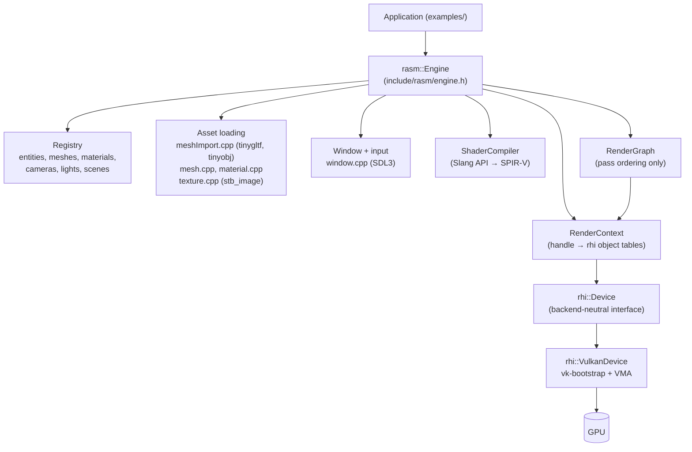
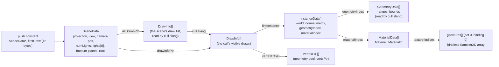

# RASM Architecture

This document describes how RASM is built **today** (branch `feat/pbr`, Oct 2026). Planned changes live in [development_plan.md](development_plan.md); known defects are tracked by ID (e.g. `B1`, `D4`) in [code_review.md](code_review.md).

## 1. Overview

RASM is a C++20 rendering engine with a single implemented backend (Vulkan 1.4). It is built as a static library (`rasm`, alias `rasm::rasm`) and driven by small example programs. Its rendering core is *GPU-driven*: compute passes cull the scene's draws against the camera frustum and, in two passes, against a hierarchical depth buffer (Hi-Z), and the visible ones are drawn with one pipeline and one `vkCmdDrawIndexedIndirectCount` call per run of draws with the same cull mode (usually at most three). Vertices are pulled from one engine-wide geometry pool through buffer device addresses, textures are accessed through one bindless descriptor array, and the only per-draw binding is a 16-byte push constant.



| Layer | Files | Responsibility |
|---|---|---|
| Public API | `include/rasm/` (`rasm.h`, `engine.h`, …) and `include/rasm/render/` (`renderGraph.h`, `renderContext.h`, `resource.h`) | Single facade class `Engine`; everything is created through it and referenced by handles. The low-level API (render graph, `RenderContext`, the resource descriptors) lives in `render/`. |
| Engine | `src/engine.cpp` | Construction, frame loop (`beginFrame`/`render`/`endFrame`), swapchain recreation, finishing background loads within the frame's budget. |
| Core utilities | `src/core/` | Handle manager, file reading. |
| Platform | `src/platform/window.cpp` | SDL3 window, event polling and camera input. |
| Assets | `src/assets/` | glTF/OBJ import on the worker thread (`meshImport.h/.cpp`, also used by tests), LOD building with meshoptimizer (`meshLod.h/.cpp`), meshes and the geometry pool (`mesh.cpp`), textures (`texture.cpp`), materials and glTF material/texture import (`material.cpp`). |
| Scene | `src/scene/` | Scenes, entities, cameras, lights, transforms. |
| Renderer | `src/renderer/` | The GPU-driven scene path (`gpuScene.cpp`: GPU scene tables, `syncGpuScene`, the scene passes of `addScenePasses`; `renderer.cpp`: `Renderer`, the graph behind `Engine::render`; `gpuTable.cpp`: per-slot tables with dirty-range uploads; `geometryPool.cpp`: the geometry pool and its table), the frame stats and GPU timers (`frameStats.cpp`) and their overlay (`statsOverlay.cpp`), render graph, Slang shader compiler, GPU struct definitions (`uberMaterialTypes.h`). |
| Render context | `src/rhi/renderContext.cpp` | Backend-neutral API over handles; owns the handle → `rhi::` object tables, the creation-dedup caches and render targets. |
| RHI | `src/rhi/device.h` | The backend-neutral GPU interface: `Device`, `CommandBuffer`, `Queue`, `Swapchain` and the resource objects (§12). |
| Vulkan backend | `src/rhi/vulkan/` | `VulkanDevice` (instance, device, VMA, resource creation), `VulkanCommandBuffer` (recording, barriers), `VulkanSwapchain` (surface swapchain and its semaphores), `VulkanQueue` (submission), one `.h`/`.cpp` pair each. `vulkanTypes.h`: the Vulkan objects behind each `rhi::` struct. |
| Third-party implementations | `src/thirdparty_impl.cpp` | The single translation unit with the `*_IMPLEMENTATION` defines (stb, tinygltf, tinyobjloader, VMA). |
| Shaders | `shaders/lib/`, `shaders/passes/` | `lib/`: shared modules: GPU structs (`core.slang`), PBR BRDF (`pbr.slang`), unlit shading (`unlit.slang`), the frustum test (`frustumCulling.slang`) and the Hi-Z occlusion test (`occlusionCulling.slang`). `passes/`: entry shaders: the uber shader (`rasm.slang`), culling (`cull.slang`), the Hi-Z build (`hiz.slang`) and the stats overlay (`statsOverlay.slang`). |

Applications compile against `include/rasm/` and glm only. `src/`, the backend libraries and the tinygltf/stb include paths are PRIVATE to the `rasm` target, and static linking still pulls the libraries in. `RenderContext` keeps its `rhi::Device` and object tables in a private `RenderContext::Impl`, defined in `src/rhi/renderContext.cpp`. `Engine` holds `ShaderCompiler` through a forward declaration.

## 2. Object model: handles and registries

**Handles** (`rasm/handle.h`) are typed `Handle<Tag>{ uint64_t index; uint64_t generation; }` values. `generation == 0` means invalid. `HandleManager` hands out a monotonically increasing `index` per type, starting at 1, with `generation` always 1. Handles are never recycled or invalidated, and there is no destroy API (see `D4`).

There are two kinds of handle owner:

- **CPU-side objects** live in `Engine::registry` (a private struct of `std::vector`s) and are indexed directly by `handle.index`. These are `Entity`, `Mesh`, `Material`, `Camera`, `Light` and `Scene`. Slot 0 is an unused default-constructed element. Each `create*` checks `index` against a compile-time `MAX_*` constant.
- **GPU objects** live in `RenderContext`. Each type has an `unordered_map<Handle, rhi::Xxx*>` table (`buffers`, `textures`, `pipelines`, `commandBuffers`, …) pointing at objects the `rhi::Device` created. Each `rhi::` struct carries a copy of the descriptor it was created from, and the backend derives from it to add its native objects (§12).

**Descriptors** (`rasm/render/resource.h`). Each GPU resource has its own creation descriptor: `BufferDesc`, `TextureDesc`, `ShaderDesc`, `PipelineDesc`, `RenderTargetDesc`, `BindlessDescriptorSetLayoutDesc` and `DescriptorPoolDesc` (fixed `D5`). Each is an aggregate with a `std::string name` and default member initializers, so it is filled with designated initializers and a field left unset has a defined value. Each has a defaulted `operator==`, so every field takes part in equality. Passing the wrong kind of descriptor is a compile error. `ShaderDesc` owns its SPIR-V (`std::vector<uint8_t> code`). A `PipelineDesc` with `computeShader` set describes a compute pipeline (§12). Descriptor sets, command buffers and fences only take a name. `DescriptorType` names the descriptor kind of a layout or pool.

**Creation dedup.** Only immutable objects are deduplicated: `createShader`, `createPipeline` and `createBindlessDescriptorSetLayout` first look the desc up in a `*DescCache` (`unordered_map<XxxDesc, Handle, XxxDescHash>`) and return the existing handle for an equal desc. Equality is the defaulted one, so it covers every field, including the name and the SPIR-V bytes. The hashes (`ShaderDescHash`, `PipelineDescHash`, `BindlessDescriptorSetLayoutDescHash`, defined in `src/rhi/resource.cpp`) fold the fields with `hashCombine` from `rasm/handle.h`, which is order-sensitive, unlike the old XOR. `HandleHash` uses it too. Buffers, textures, descriptor pools and descriptor sets are mutable, so every `create*`/`allocate*` call makes a new object (fixed `B1`). Callers that want sharing cache at the asset level: `loadTexture` caches by path and format, and glTF import caches per model by image index and color space.

## 3. Engine lifetime and the frame loop

### Construction (`Engine::Engine`, `src/engine.cpp`)
1. Create the SDL3 window (`createWindow`).
2. `RenderContext::initialize` calls `rhi::createDevice` for `EngineConfig::preferredBackend`. For Vulkan, `VulkanDevice::initialize`:
   - creates the instance. `EngineConfig::enableValidation` turns on the Khronos validation layer; with it, `enableSyncValidation` and `enableGpuValidation` (copied into `DeviceDesc`) add the `validate_sync` and `gpuav_enable` layer settings through `VK_EXT_layer_settings`. Without validation (or without the layers installed) those two are ignored with a warning,
   - creates the surface from the main window (`createWindowSurface` in `src/platform/`, which wraps `SDL_Vulkan_CreateSurface`),
   - selects a physical device with the required features (below),
   - creates the device, graphics queue and VMA allocator.

   It then creates the swapchain (`B8G8R8A8_SRGB`), registers its images as texture handles, and creates the shared sampler set.
3. Create the frame fence (a timeline) and, for each of the `MAX_FRAMES_IN_FLIGHT = 2` slots, a command buffer and a depth texture (`D32_SFLOAT`, `SAMPLED_DEPTH_ATTACHMENT`, so occlusion culling can read it).
4. Initialize the Slang session (SPIR-V 1.4, scalar layout, column-major matrices, search path `lib/` under `EngineConfig::shaderDir`). A missing folder fails here, so a wrong path stops startup instead of failing every frame.
5. Create the geometry pool (`GeometryPool::create`, `src/renderer/geometryPool.cpp`): one device-local vertex buffer of `EngineConfig::geometryPoolVertices` `Vertex`es (STORAGE, read through its device address), one index buffer of `EngineConfig::geometryPoolIndices` `uint32_t`s, and the geometry table of `EngineConfig::geometryPoolSubMeshes` rows. Every mesh lives in these buffers (§6). Their size is fixed for the engine's lifetime, so an app that draws little can make them smaller and one with big scenes larger. `createGpuScene` then creates the instance and material tables and the scene data buffers (§4), and `createStatsOverlay` the timestamp query pools and the overlay's text buffers (§3, frame stats).
6. Create the single bindless descriptor set: layout, pool and set. It is binding 0 of set 0, an array of 1024 `COMBINED_IMAGE_SAMPLER`s with `UPDATE_AFTER_BIND | PARTIALLY_BOUND`, visible to every shader stage (`ShaderType::ALL`), so compute shaders can sample too.
7. `isRunning = true`. Any failure returns early and leaves `running() == false`.

**Required Vulkan features**: API 1.4.
- 1.0: `multiDrawIndirect`, `drawIndirectFirstInstance` (each draw names its instance row in `firstInstance`), `samplerAnisotropy`, `shaderInt64`.
- 1.1: `shaderDrawParameters`.
- 1.2: descriptor indexing (runtime arrays, partially bound, update-after-bind, variable count, non-uniform sampled image indexing), `drawIndirectCount`, `bufferDeviceAddress`, `scalarBlockLayout`, `hostQueryReset`, `timelineSemaphore`, `shaderInt8`, `storagePushConstant8`.
- 1.3: `dynamicRendering`, `synchronization2`.
- 1.4: `hostImageCopy`.
- Extensions: `VK_KHR_swapchain`, `VK_EXT_memory_budget`.

### Per frame (`Engine::render`)

`Engine::render(scene, camera)` calls `Renderer::render` (`src/renderer/renderer.cpp`). The `Renderer` keeps one `RenderGraph` that holds the scene passes of that view drawing into the swapchain (`Engine::addScenePasses`, §4), builds it again only when the scene or the camera changes, and runs it with `RenderGraph::execute`. An application with its own graph calls `addScenePasses` itself and runs its graph instead; the frame is the same.

```mermaid
sequenceDiagram
    participant App
    participant E as Engine
    participant C as RenderContext/rhi
    App->>E: render(scene, camera) → Renderer::render → RenderGraph::execute(camera)
    E->>E: beginFrame: pollEvents(camera) → SDL events, camera controller, deltaTime
    E->>E: finishLoads → upload background loads that are done (§6)
    E->>E: skip frame if minimized / 0×0
    E->>C: recreateSwapchain() if resized or out of date (skip frame if it fails)
    E->>C: waitForFence(frameFence, frameResources[frame].fenceValue)
    E->>C: updateFrameStats: read the slot's last timers and cull counts, reset them, write the overlay text
    E->>C: syncGpuScene: assign instance rows, rebuild dirty draw lists, upload this slot's dirty rows (§4)
    E->>C: acquireNextImage (skip frame on OUT_OF_DATE)
    E->>C: begin command buffer, clear new history render target copies (clearNewHistory)
    loop each pass in the graph's order (scene view: Cull 1, Scene 1, Hi-Z, Cull 2, Scene 2)
        E->>C: aliasingBarrier before a transient target's first pass, one memoryBarrier for the pass's declared buffers if needed, read textures and depths → SAMPLED
        alt compute pass
            E->>C: GPU timer around the pass's dispatches (Cull: prepareSceneView, then countMain, COMPUTE→COMPUTE, writeMain)
        else graphics pass
            E->>C: beginPass: attachments → COLOR / DEPTH (discard unless the pass loads them), beginRendering with the graph's AttachmentOps, viewport/scissor, cull NONE
            E->>C: the pass's draws (Scene: per run setCullMode, push constant, drawIndexedIndirectCount)
            E->>C: endPass: endRendering (a render target's color → SAMPLED)
        end
    end
    E->>C: endFrame: an empty "Clear" pass if no pass drew the swapchain, the stats overlay pass, swapchain image → PRESENT_SRC, COMPUTE → HOST barrier (cull stats), end the command buffer
    E->>C: submit (waits for the acquired image, signals frameFence = ++frameFenceValue); not submitted → discardRecording
    E->>C: present (SUBOPTIMAL / OUT_OF_DATE → recreate next frame)
    E->>E: frameCount = (frameCount + 1) % 2
```

Notes:
- `frameCount` is the frame-in-flight **slot index** (0 or 1), not a running frame counter.
- Input handling, delta-time measurement and the camera controller run inside `beginFrame`. The caller passes the camera that should receive input.
- `beginFrame` returns `false` when the frame is skipped. The caller then records nothing and does not call `endFrame`.
- Frame pacing uses one timeline fence, `Engine::frameFence`. Every frame submit signals the next value (`frameFenceValue + 1`), and the slot remembers it in `FrameResources::fenceValue`. Before reusing a slot, `beginFrame` waits for that value. A slot takes the new value only when the submit succeeds, because waiting for a value nothing signals would block forever. Nothing is reset, so a skipped frame needs no cleanup.
- Every frame presents, and present needs the image in `PRESENT_SRC_KHR`. A frame that only draws to render targets gets an empty swapchain pass in `endFrame`, so it presents the clear color. There is no offscreen-only frame yet (`D7`).
- Acquire, present and `recreateSwapchain` return `SwapchainStatus` (`OK`, `SUBOPTIMAL`, `OUT_OF_DATE`, `FAILURE`). `SUBOPTIMAL` from acquire still renders the frame, because the image was acquired and its semaphore will be signaled. `Engine::swapchainOutOfDate` schedules recreation.
- Swapchain-sized resources (depth textures, viewport, camera aspect) use the swapchain extent in pixels (`Swapchain::width`/`height`). `Window::width`/`height` are logical and are only used for mouse input.
- The swapchain always uses `VK_PRESENT_MODE_FIFO_KHR`, so the frame rate is capped at the display's refresh rate (see `B21` in the code review).
- `beginPass(name)` and `endPass` put a GPU timer around each graphics pass, the graph puts one around each compute pass, and the frame's command buffer gets one (frame stats, below).
- `endFrame` emits the Tracy frame mark, so skipped frames add none. Zones cover the frame functions, the backend-neutral `RenderContext` calls that block or submit, and whole upload loops. `fillBuffer` has no zone of its own because it runs per primitive per frame. See the [build guide](build_guide.md#profiling-with-tracy) for connecting a profiler.

### Frame stats and the overlay

`Engine::getFrameStats()` returns a `FrameStats` (`rasm/engine.h`), and with `EngineConfig::showStats` (F1 toggles it) the engine draws it in a panel in the top-left corner. Measuring is in `src/renderer/frameStats.cpp` (state in `FrameStatsCollector`, `frameStats.h`), the panel in `src/renderer/statsOverlay.cpp` (state in `StatsOverlay`, `statsOverlay.h`); `Engine` holds both through forward declarations like `GpuScene`. Frames are measured only while the overlay is shown or once `getFrameStats` has been called; until then there are no timestamps, read-backs or budget queries. `Engine::beginGpuTimer`/`endGpuTimer` are public, so an application can time its own work into the frame's command buffer; the render graph uses them for compute passes.

| Value | Source |
|---|---|
| `cpuFrameMs` | `deltaTime`, the time between the starts of the last two frames |
| `gpuFrameMs`, `gpuTimers` | timestamp queries: a pair around the frame's command buffer, each `beginPass`/`endPass` and each render graph compute pass, named after the pass (a scene view's `"Cull 1"`, `"Scene 1"`, `"Hi-Z"`, `"Cull 2"`, `"Scene 2"`, or `"Cull"` and `"Scene"` without occlusion culling). At most `MAX_GPU_TIMERS` per frame; later ones are not timed, with one warning. `getTimestamps` takes each value as a signed distance from the first, modulo `timestampValidBits`, so a counter wrap inside a frame does not break the times. `gpuFrameMs` runs from the earliest timestamp to the latest, and the timers are listed by start time. |
| `draws`, `triangles` | CPU sums over the frame's scene views (`GpuScene::drawTotals`, added in `prepareSceneView`), from each draw list's size and `triangleCount` |
| `drawsVisible`, `trianglesVisible`, `trianglesVisibleLod0`, `drawsPerLod` | `cull.slang`: each group of `countMain` (early and late) adds the draws and triangles it keeps to the slot's `Cull Stats Buffer` (`SceneData::cullStatsPtr`, `CULL_STATS_WORDS` = 13 × u32, named by the `STATS_*` constants in `cull.slang` and `CULL_STATS_*` in `gpuScene.h`: draws; triangles at the picked LOD, low and high; the same triangles at LOD 0, low and high; draws per LOD) with atomics. The triangles are 64-bit as two words with a carry (`addCount64`), since Metal and WebGPU lack 64-bit atomics. A view drawn without culling counts all its draws, at LOD 0. The overlay shows `trianglesVisibleLod0 − trianglesVisible` as "LOD saved" and `drawsPerLod` as "LOD draws". |
| `memory` | `queryVRAMStats` (`VK_EXT_memory_budget`) |

```
frame N in slot s                         frame N+2 in slot s (after the fence wait)
 record: timestamps, scene view totals ──▶ updateFrameStats: read timestamps + Cull Stats Buffer[s]
 cull:   atomics into Cull Stats[s]          reset the query pool on the host, zero the counters
 endFrame: COMPUTE → HOST barrier           updateStatsOverlay: write the overlay text into Stats Overlay Text[s]
```

- The GPU values are `MAX_FRAMES_IN_FLIGHT` frames old: a slot is read only after its fence wait. A frame that was recorded but not submitted leaves its slot's fence value unchanged, so `updateFrameStats` skips it, since its queries were never written.
- `endFrame` records one `COMPUTE → HOST` barrier after the last pass, so the counters are visible to the CPU after the fence. `RenderContext::readBuffer` reads a buffer created with `hostReadable` (cached memory).
- The text is rebuilt every 250 ms, so the numbers can be read, and copied into the slot's host-visible text buffer every frame. It is a grid of at most 40 × 24 characters.
- `endFrame` draws the overlay in a pass of its own after every other (`drawStatsOverlay`), so it covers whatever the frame drew: the pass loads the swapchain image's color and has no depth attachment (`beginRendering` with an invalid depth handle; the overlay pipeline is made with `Format::UNKNOWN` depth), so it costs no depth clear. It has no GPU timer. `statsOverlay.slang` draws two triangles over the panel at depth 1 (the near plane) and looks up each pixel's character and glyph bit in an 8x8 bitmap font (the public-domain IBM VGA font, `'!'` to `'~'`) kept in the shader. Its 16-byte push constant holds the text's address, the grid size and scale, and the screen size. Each font pixel covers `max(1, height / 1080)` screen pixels on each side. It sets a full-swapchain viewport and scissor and `CullMode::NONE` first, since it works in window pixels and its triangles wind clockwise.
- The overlay pipeline is created at startup, after the bindless layout. If it fails to compile, the error is logged once and the overlay stays off.

## 4. The GPU-driven path: GPU scene tables + the scene passes

The scene lives on the GPU in tables that last for the engine's lifetime. They are created in `Engine::createGpuScene` (`src/renderer/gpuScene.cpp`), and their state is `GpuScene` (`src/renderer/gpuScene.h`), which `Engine` holds through a forward declaration, like the `GeometryPool`. Only `gpuScene.cpp` touches `GpuScene`: the scene, entity and material code calls `Engine` methods (`queueInstanceRows`, `writeInstanceRows`, `writeMaterialRow`, `addEntityToDrawList`, `refreshEntitiesAfterMaterialChange`).

```
ENGINE-WIDE (all scenes share them)                                        PER SCENE
 geometry table        material table          instance table              draw list
 1 row per sub-mesh    1 row per material      1 row per entity x sub-mesh DrawInfo[]
 GeometryData          MaterialData            InstanceData                firstInstance = instance row
 written once          rows rewritten when     rows rewritten when         rebuilt when the scene changes,
 (GeometryPool)        a material changes      a transform changes         stored as cull-mode runs
```

| Table | Buffer(s) | Row | Written by |
|---|---|---|---|
| Geometry | `GeometryPool::tableBuffer()`, one copy, `EngineConfig::geometryPoolSubMeshes` rows | `gfx::GeometryData`: `vertexOffset`, bounding sphere (center, radius), `lodCount` and `lods[MAX_MESH_LODS]` (`firstIndex`, `indexCount`, error per LOD) | `GeometryPool::upload`, once per sub-mesh. No frame has read a new row yet, so one copy is enough. |
| Materials | `GpuTable materials`, `MAX_MATERIALS` rows, row = material handle index | `gfx::MaterialData`: `gfx::Material` + `gfx::MaterialId` | `writeMaterialRow`, from `createMaterial`, `loadMaterial` and `updateMaterial` |
| Instances | `GpuTable instances`, `EngineConfig::maxInstances` rows | `gfx::InstanceData`: world matrix, normal matrix, geometry index, material index | `writeInstanceRows`, from `updateTransform` and when an entity gets its rows |
| Draw list | `SceneDrawList::buffers[2]`, grown 2x when too small | `gfx::DrawInfo{indexCount, 1, firstIndex, firstVertex, firstInstance = instance row}` | `rebuildDrawList` + `uploadDrawList` |
| Visible draws | `SceneView::visibleDraws[2]`, one per frame slot and scene view, grown 2x when too small | `gfx::DrawInfo`, the draw list's rows that pass culling, packed per run in list order. Then culling's scratch: a `uint32_t` slot per draw (`cullSlotsPtr`) and a visible count per group of 64 (`groupCountsPtr`) | `cull.slang`, on the GPU |
| Draw counts | `GpuScene::drawCounts[2]`, `MAX_DRAW_RUNS` `uint32_t`s per scene view | visible draws of each run | `cull.slang` (`writeMain`, the run's last group) |
| Visibility | `SceneView::visibility`, one copy per scene view, `EngineConfig::maxInstances` `uint32_t`s, zero when the view is made | 1 if the instance row passed its last occlusion test | `cull.slang` (late `countMain`) |
| Hi-Z | `SceneView::hiz[2]`, one per frame slot and scene view, grown to the target's size | `float`: the farthest depth under each texel, all levels packed | `hiz.slang` (`hizMain`) |

**`GpuTable`** (`src/renderer/gpuTable.h`) is N rows of a fixed size with a CPU copy and one device-local buffer per frame slot. `setRow` writes the CPU copy and marks the row dirty for both slots. `upload(frame)` sorts that slot's dirty rows, merges neighbours into ranges (`mergeRows`) and writes each range with `fillBuffer`. If a write fails, the rows stay dirty and the slot sends them again in its next frame. A slot is written only in its own frame, after the fence wait, so the GPU is done with it. This holds on both `fillBuffer` paths (a staged copy, or a direct write into ReBAR memory).

**Instance rows.** An entity created with a mesh goes on `entitiesWaitingForMesh` (`queueInstanceRows`). Once the mesh is READY, `syncGpuScene` bump-allocates one row per sub-mesh (`GpuScene::entities[entity]`, an `EntityDrawState`: first row, row count, a bit per scene that holds the entity, and whether it waits for textures) and writes them. An entity whose mesh failed to load leaves the list with a warning and never gets rows. Nothing is freed, because entities are never destroyed yet (`D4`). A row's matrix is entity transform (`Transform::toMatrix`: scale, then rotate, then translate) x node transform. Its material is the primitive's, else the entity's, and `getMaterial` resolves an invalid one to the default material. Each row also keeps its `CullMode` on the CPU (`instanceCullModes`): `NONE` for a double-sided material, otherwise `BACK`, or `FRONT` when the matrix has a negative determinant (a mirror turns the front faces clockwise, as glTF specifies). A row whose cull mode changes (`updateCullModes`) marks the draw lists of the entity's scenes for a rebuild. A sub-mesh missing vertices or indices gets a row but no draw, with a warning.

**Waiting for textures.** An entity is drawn only once every texture of every sub-mesh's material (the primitive's, else the entity's) is loaded, so nothing is drawn half-loaded. When it gets its rows with a texture still loading, it goes on `entitiesWaitingForTextures` instead of into the draw lists. `finishLoads` sets `GpuScene::texturesFinished` when a texture load finishes, and only then does `syncGpuScene` check the waiting entities again. `updateMaterial` calls `refreshEntitiesAfterMaterialChange` when `doubleSided` changed or a new texture still loads. It recomputes every entity's cull modes and moves entities with a texture that still loads back to waiting. It uploads no instance rows: the material keeps its row index.

**Draw lists.** `SceneDrawList::rebuild` is set by `addEntityToDrawList` (from `addEntityToScene`, when the entity already has rows) and by `markDrawListsDirty(entity)`, which marks only the scenes that hold the entity. That happens when the entity becomes drawable (rows and textures ready), starts waiting for a texture again, or changes cull mode. `rebuildDrawList` walks the scene's entities in order. It adds one `DrawInfo` per drawable sub-mesh of each entity that has rows and does not wait for textures. The draws are stable-sorted by cull mode and stored as runs `{cullMode, first, count}`. The list is then stale in both slots (`staleSlots`), and `uploadDrawList` writes it into each slot's buffer in that slot's frame. Growing a slot's buffer destroys the old one, which only that slot's last frame used.

**`syncGpuScene`** runs in `beginFrame`, after the fence wait for the frame's slot. It assigns rows to entities whose mesh is ready, checks the entities waiting for textures, rebuilds dirty draw lists, then uploads this slot's dirty instance and material rows and its stale draw lists. Its cost follows what changed, except that a scene holding a changed entity rebuilds its whole draw list (`P7`). A change made after `beginFrame` reaches the GPU in the next frame.

**The scene passes.** `Engine::addScenePasses(graph, scene, camera, renderTarget)` adds the passes that draw a scene into `renderTarget`, or into the swapchain when it is invalid (what `Engine::render` does). They are ordinary graph passes: the graph sorts them, records their barriers from what they declare (§9), and gives later passes on the same target `load` ops.

```
Cull 1 (compute)          Scene 1 (graphics)     Hi-Z (compute)          Cull 2 (compute)          Scene 2 (graphics)
prepareSceneView,         early draws,           readDepth(target),      late countMain,           late draws,
early countMain,          clears the target      hizMain per level       writeMain                 loads the target
writeMain
readPrevious: visibility  read: visible draws,   write: hiz              read: hiz                 read: visible draws,
write: visible draws,           draw counts                              write: visible draws,           draw counts
  draw counts, cull stats                                                  draw counts, cull
                                                                           stats, visibility
```

Without `EngineConfig::occlusionCulling` it adds only `Cull` and `Scene`. An invalid scene or camera, or a render target that does not have one color in the swapchain's format and `D32_SFLOAT` depth (the uber pipeline's formats), logs an error, adds nothing and returns `false`.

**Scene views.** Each (scene, camera, target) is a `SceneView` in `GpuScene::views`, at most `MAX_SCENE_VIEWS` (8), kept for the engine's lifetime; building a graph again for the same three reuses its view (`createSceneView`). A view owns a visible-draw buffer and a Hi-Z buffer per frame slot and its visibility flags, and has its own slot in `GpuScene::sceneData[frame]` and in `drawCounts[frame]`. The GPU reads `SceneData` after the whole frame is recorded, so each view needs its own slot, visible list and counts; that is what lets one frame draw scenes with several cameras. A graph's declarations are fixed when the passes are added, so the passes declare the per-slot buffers of both slots; the frame order needs those barriers anyway. The buffers start small and grow with `RenderContext::resizeBuffer`, which keeps the handle, so the declarations stay valid. Two graphs that draw the same view share its buffers, and the graph does not order buffers between graphs (§9).

**`prepareSceneView`** runs at the start of the view's `Cull` pass, every frame, and decides what the view's passes record:
1. Nothing when the scene's draw list is empty or this slot's copy could not be uploaded. The scene passes keep their cleared attachments.
2. Creates the uber pipeline on first use: `Engine::createPipeline` with `shaders/passes/rasm.slang` (`vertMain`/`fragMain`), no vertex input, the bindless set layout, the swapchain's color format and `D32_SFLOAT` depth. The culling pipelines come from `Engine::createComputePipeline` with the `countMain` and `writeMain` entry points of `shaders/passes/cull.slang` and (with `EngineConfig::occlusionCulling`) `hizMain` of `shaders/passes/hiz.slang`. If either of the first two fails, the view draws its whole list unculled with `drawIndexedIndirect`, so a culling shader error does not blank the scene. Without `hizMain` it is frustum culled only. A shader error logs and retries next frame, for the failed pipelines only, so a shader fixed on disk is picked up while the application runs. Cull mode is dynamic state, so one pipeline serves all cull modes.
3. Grows the slot's visible-draw buffer to the draw list's size if needed, and for occlusion culling the slot's Hi-Z buffer to the target's size. It samples the target's depth texture through the bindless array (`NEAREST_CLAMP`), where the texture went when it was created: `createSwapchainResources` (a depth texture replaced by a resize takes the old one's slot) and `RenderContext::createAttachments`, both only with `EngineConfig::occlusionCulling`, which also gives the depth textures `SAMPLED` usage. The view is frustum culled only this frame (`hizLevelCount` 0) when the depth texture has no slot or the Hi-Z buffer cannot grow: the Hi-Z covers the whole attachment and `isOccluded` maps NDC onto it.
4. Writes the view's slot of `GpuScene::sceneData[frame]`, which holds `MAX_SCENE_VIEWS` host-visible `gfx::SceneData`s per frame slot: camera (its projection fitted to the target's aspect ratio), the six world-space frustum planes, lights, the run starts, the target's size, the depth texture's bindless index, the Hi-Z level count (0 without occlusion culling), and the addresses of the geometry pool, the scene's whole draw list (`allDrawsPtr`), the view's visible draws (`drawInfoPtr`), draw counts and culling scratch, the visibility flags and the Hi-Z, the instance and material tables, and the geometry table.
5. Counts the view's cull groups and adds its draws and triangles to `GpuScene::drawTotals`.

`recordSceneCulling` (both `Cull` passes) dispatches `countMain`, records a `COMPUTE → COMPUTE` barrier inside the pass, and dispatches `writeMain`. `drawSceneView` (both `Scene` passes) binds the pipeline, the bindless set and the geometry pool's index buffer. Then, per run: `setCullMode`, push constant `{SceneData address, firstDraw = run.first}`, and `drawIndexedIndirectCount(visible draws + run.first, count = the run's draw count, max = run.count)` (unculled: `drawIndexedIndirect` of the whole list). It sets the cull mode back to `NONE`, which is what `beginPass` sets for every other pipeline. `Hi-Z`, `Cull 2` and `Scene 2` record nothing in a frame whose `hizLevelCount` is 0.

**GPU frustum culling.** Each run of the draw list is split into groups of 64 draws (`getCullGroup`), the groups of run 0 first:
- `countMain` tests each draw. It transforms the geometry table's bounding sphere with the instance's world matrix and scales the radius by the matrix's largest stretch, bounded from above with Gershgorin's theorem on `transpose(M) * M`. The bound is exact when the columns are orthogonal, and never too small under a non-uniform scale followed by a rotation.
- A sphere fully outside one of the frustum planes is culled. The planes come from the rows of projection × view (`getFrustumPlanes`), normalized. The infinite reversed-Z far plane comes out as `(0, 0, 0, nearZ)`, which every sphere passes.
- `countMain` picks each visible draw's LOD and writes the draw's slot among its group's visible draws, with the LOD above it (`slot | lod << 16`, or `CULLED`), to `cullSlotsPtr`, and the group's visible count to `groupCountsPtr`. The group's last thread also adds its visible draws and triangles (at the picked LOD and at LOD 0) to `cullStatsPtr`, and threads 0 to 7 add the group's draws per LOD, for the frame stats (§3).
- `writeMain` adds up the counts of the run's earlier groups, copies each visible `DrawInfo` to `drawInfoPtr[runFirst[run] + that sum + slot]` with the index range of the LOD `countMain` picked (below), and the run's last group writes the run's count. The visible draws therefore keep the draw list's order every frame, and no count needs zeroing.

**Occlusion culling** (`EngineConfig::occlusionCulling`, on by default) is the two-pass Hi-Z scheme. The push constant's `argument` tells `countMain` the phase.

```
Cull 1                   Scene 1        Hi-Z                         Cull 2                                Scene 2
in frustum AND           early draws    depth → SAMPLED (the graph)  seen = in frustum AND not occluded    late draws
visibility[row] == 1     (stores        hizMain, one dispatch        visibility[row] = seen                (depth → DEPTH and
                          its depth)    per level                    draw if seen AND not drawn early       loaded, beginPass)
```

- `Cull 1` reads the visibility flags that the last frame's `Cull 2` wrote. It declares them with `PassBuilder::readPrevious(buffer)`: that adds no edge from `Cull 2`, makes `Cull 1` run before this frame's `Cull 2`, and still waits for the previous write. Rows start at 0, so a new instance is drawn by the late pass first. The late culling reuses the view's visible-draw list and counts: `Scene 1` read them, so the graph records a `GRAPHICS | COMPUTE → COMPUTE` barrier before `Cull 2`. The late `countMain` reads the early pass's `cullSlotsPtr` entry of the draw before it overwrites it, so it knows what was drawn early.
- Each view has its own flags, one per instance row, shared by both frame slots because the GPU runs the frames in order.
- The Hi-Z is a buffer of `float`s. Level 0 is half the target's size, rounded up, and each level halves the one before down to 1x1 (`getHizLevelCount`; in the shaders `getHizLevel` gives a level's offset and size). A level-L texel holds the farthest depth (reversed-Z: the smallest value) of the 2^(L+1)-pixel square it covers; an odd size repeats the last row or column. `hizMain` reads level 0 from the depth texture with `Load` through the bindless array, and every other level from the level before; `recordHiz` records a `COMPUTE → COMPUTE` barrier between levels.
- `isOccluded` projects the eight corners of the view-space box around the bounding sphere, so it works for perspective and orthographic cameras. A box that reaches behind the camera or past the near plane is visible. Otherwise it takes the first level where the box's pixel rectangle covers at most 2x2 texels, and the draw is occluded when its nearest depth is farther than the farthest of those texels.
- The `Hi-Z` pass declares `readDepth(target)`, or `readSwapchainDepth()` for the swapchain. So the graph makes `Scene 1` store its depth, moves the depth to `SAMPLED` before `Hi-Z`, and `Scene 2`'s `beginPass` moves it back to an attachment and loads it. Depth is otherwise `DONT_CARE` at the end of a pass unless a later pass loads or reads it.

**Level of detail.** The draw list always holds LOD 0. For each visible draw, `selectLod` (`shaders/lib/lodSelection.slang`) picks the coarsest LOD whose error, seen from the camera, stays under `SceneData::lodErrorPixels` (`EngineConfig::lodErrorPixels`, 1 pixel by default; 0 keeps LOD 0), and replaces the draw's `firstIndex` and `indexCount` with that LOD's range. Only `countMain` calls it: it counts the LOD's triangles and keeps the LOD in `cullSlotsPtr` for `writeMain`.

```
 pixels = lods[i].error × sphere.scale × |projection[1][1]| × viewportHeight / 2 / depth
 depth  = clip w of the sphere center − sphere radius   (≤ 0: the sphere reaches the camera plane, LOD 0)
```

- `EngineConfig::forcedLod` (`SceneData::forcedLod`, -1 by default) overrides the error test for debugging: from 0 up, every draw uses that LOD, or its mesh's coarsest one if it has fewer. F2 cycles it at runtime through -1, 0, …, `MAX_MESH_LODS - 1` (`pollEvents`), and the stats overlay shows the mode.
- `sphere.scale` is the world matrix's largest stretch, the same bound the frustum test uses for the radius. An orthographic projection (`projection[3][3] == 1`) skips the division by depth. The view depth, not the distance, is what `projection[1][1]` divides by: off the screen's centre an object is nearer in depth than in distance, and the distance would pick too coarse a LOD there.
- All LODs of a sub-mesh share its vertices, so `vertexOffset` stays the same and the vertex shader needs no change. An unculled view draws LOD 0.

### GPU data chain



In `vertMain`:
- The draw's index in the list is the SPIR-V `DrawIndex` built-in, read with `spirv_asm` in `core.slang` (`getDrawIndex`), plus `pc.firstDraw`. `DrawIndex` restarts at 0 in each indirect call, so `firstDraw` is the index of the call's first draw.
- `drawInfoPtr[draw].firstInstance` is the instance row (core Vulkan allows a non-zero `firstInstance` only with `drawIndirectFirstInstance`). The matrices come from `instancesPtr[row]`.
- Slang lowers `SV_VertexID` to `VertexIndex - BaseVertex`, so the shader adds the draw's own `vertexOffset` (`drawInfoPtr[draw].vertexOffset`) back before indexing `vertsPtr`. Only `cull.slang` reads the geometry table, for the bounds and the LOD ranges.
- The instance's `materialIndex` goes to the fragment shader. `fragMain` reads `materialsPtr[materialIndex]` and branches on its `materialId`: `MaterialId.UNLIT` calls `shadeUnlit` in `unlit.slang`, and everything else calls `shadePBR` in `pbr.slang`.

### CPU/GPU struct contract

The C++ structs in `src/renderer/uberMaterialTypes.h` and the Slang structs in `shaders/lib/core.slang` must match byte for byte under **scalar layout**. The C++ side `static_assert`s the sizes and key offsets (`SceneData` = 768 bytes, `InstanceData` = 108, `MaterialData` = 84, `GeometryData` = 120 with `MAX_MESH_LODS` = 8, …), and `rasm::Vertex` is asserted equal to `gfx::VertexFull`. Those asserts only pin the C++ side, so debug builds also run `validateRasmStructs` (`shaderCompiler.cpp`), which asserts each struct's size and field offsets against Slang reflection after linking. Read shader layouts by walking from `pc` through the pointers: `ProgramLayout::getTypeLayout` reports std140/std430 padding instead. When you change a struct, change both sides, the asserts and the `validateRasmStructs` tables.

## 5. Materials and textures

- `rasm::Material` (`rasm/material.h`) is a CPU-side record:
  - `textures[PbrSlot::COUNT]` and `texCoords[...]`,
  - a flat `float params[]` indexed by `PbrParam` offsets (albedo is 3 floats at offset 0, metallic is at 3, …).
- `convertToGfxMaterial` (`gpuScene.cpp`) turns it into the GPU `gfx::Material`, which `writeMaterialRow` puts in the material table (§4). `updateMaterial(handle, values)` replaces a material's values at runtime: it gives new textures bindless slots and rewrites the row. Entities that use a texture still loading stop drawing until it finishes (§4). Texture handles are replaced by bindless slot indices, and `INVALID_TEXTURE_INDEX` (0xFFFFFFFF) means "no texture".
- **Bindless slots.** `Engine::addBindlessTexture` → `RenderContext::updateBindlessDescriptorSet` writes the texture into the next free slot (`nextBindlessTextureIndex++`), or into a slot the caller names, which also moves `nextBindlessTextureIndex` past it. The slot is remembered in `registry.bindlessTextureIndexMap`. Automatic allocation never reuses a slot; naming a slot that is already taken replaces its descriptor.
- **Texture upload.** `loadTexture` decodes on a worker (§6) and frees the pixels after the upload. The upload itself is `VulkanDevice::fillTexture`, on the main thread:
  - the image is transitioned on the host and filled with `VK_EXT_host_image_copy` (core in 1.4), so no command buffer or staging buffer is involved;
  - the full mip chain is generated on the CPU with `stb_image_resize2`, sRGB-aware for sRGB formats.
- **Sampling.** `RenderContext::initialize` creates one sampler per `SamplerType`: linear or nearest, each with repeat, mirrored repeat or clamp (linear ones use 8× anisotropy; none clamps the LOD, so each serves any mip count). A bindless slot is written with the sampler passed to `addBindlessTexture`, `LINEAR_REPEAT` by default. glTF textures pick theirs from the glTF sampler (`wrapS` for both axes, `magFilter` for nearest or linear), and render target color attachments use `LINEAR_CLAMP`. A texture handle has one slot, so an image that two glTF samplers share is uploaded once per sampler.
- **Color spaces.** Base color and emissive are uploaded as `R8G8B8A8_SRGB`. Normal, metallic-roughness and occlusion maps are uploaded as `R8G8B8A8_UNORM`.
- Every material uses the uber shader. To add a shading path, add a value to `gfx::MaterialId` and its mirror in `core.slang`, map it in `getGfxMaterialId` (`gpuScene.cpp`), and branch on it in `fragMain`. Today's mapping is `UNLIT` → `MaterialId::UNLIT` (base color only, no tone mapping) and `PBR` → `MaterialId::PBR`.

## 6. Asset import

**Background loading (`P6`).** `loadMesh`, `loadGLTF` and `loadTexture` return a handle at once and load on a worker thread. Each load is one `std::async` task, with no thread pool.

```
 main thread                         worker (std::async)
 ───────────                         ───────────────────
 loadMesh(path) ── handle (LOADING) ─▶ importMeshFile: read + decode file
                                      buildMeshLods per sub-mesh (meshLods)
 loadTexture(path)                    decodeTexture: stbi_load
   reads header, creates texture
   handle ──────────────────────────▶
 beginFrame → finishLoads ◀── done ── GLTFRaw / TextureRaw
   meshes: materials, textures, geometry → pool, state READY
   textures: fillTexture
   CPU data freed
   stops after LOAD_BUDGET (4 ms) per frame
```

- The worker never touches the engine. Everything that creates GPU objects or writes the registry runs on the main thread in `finishLoads`, at the start of `beginFrame`, before anything binds the bindless set or the geometry pool. The bindless set has `UPDATE_AFTER_BIND`, so new slots can be written while the previous frame is still on the GPU, and geometry uploads go out with the frame's submit (§12).
- `finishLoads` stops once it has spent `LOAD_BUDGET` (4 ms) in a frame, and the load that crosses the budget still finishes, so loads that end together spread over several frames. A single big glTF still finishes in one frame: the mip chain of every texture is generated on the main thread inside `fillTexture`. `waitForLoads` has no budget.
- `isLoaded(mesh)` is true once a mesh is `READY`, and false while it is `LOADING` or after it `FAILED`. `isLoaded(texture)` is true once its pixels are in (a lookup in `pendingTextures`, which is keyed by handle). `waitForLoads()` blocks until every pending load is finished.
- An entity waits for its mesh and its material's textures (§4), so nothing is drawn half-loaded. A finished load marks the draw lists for a rebuild.
- An error found before the worker starts (unsupported extension, missing mesh file, out of handles, unreadable texture header) returns an invalid handle and caches nothing. A mesh that fails later is `FAILED` and draws nothing; `loadMesh` on its path again retries the load on the same handle. A texture whose decode fails after its header was read stays white, because a material may already point at it. A texture destroyed while it decodes is skipped.
- **What stays in memory.** After `finishLoads`, the CPU vertex and index arrays, the `tinygltf::Model` and the decoded pixels are freed. The worker already drops the glTF buffers once every accessor is read. A mesh keeps only its `SubMesh` list: a `MeshGeometry` range in the pool, a node transform and a material.
- **Mesh LODs** (`EngineConfig::meshLods`, on by default). The worker calls `buildMeshLods` (`src/assets/meshLod.cpp`) on each sub-mesh after import, and `createMesh` calls it on the main thread. A sub-mesh under 1024 triangles gets none. Otherwise identical vertices are merged first (`meshopt_generateVertexRemap`), because simplification only collapses edges between triangles that share vertices and OBJ import gives every corner its own vertex. Then each LOD is simplified from the one before to about half its triangles (`meshopt_simplify` with absolute errors, `meshopt_SimplifySparse` so a coarse level's cost follows its own indices, and `meshopt_SimplifyLockBorder`), and its indices are reordered for the vertex cache (`meshopt_optimizeVertexCache`), until `MAX_MESH_LODS`, under 64 triangles, or a step that removes less than a tenth. A LOD's error is the sum of its steps' errors, so it bounds the distance from LOD 0 and never decreases. The LODs are index lists into the sub-mesh's own vertices (`ObjRaw::lods`), so they cost only indices: up to as many again as LOD 0, about +20% of the mesh's pool memory with 64-byte vertices. Open borders are locked because each sub-mesh picks its LOD on its own: two sub-meshes that share an edge (a glTF mesh split by material) still meet at any pair of LODs. `createMesh` rejects indices that are not whole triangles or point past the vertices, before the builder reads them.
- **Geometry pool.** `GeometryPool::upload` appends each sub-mesh to the pool with a bump allocator: `firstVertex`/`firstIndex` are where it starts, and the coarser LODs' indices follow LOD 0's (`MeshGeometry::lodIndexCount`; the LOD count is only in the table row). It also computes a bounding sphere (the box center, and the distance to the farthest vertex) and writes the sub-mesh's row of the geometry table (`geometryIndex`, §4). Nothing is freed from the pool, because meshes are never destroyed yet (`D4`). `finishMeshLoad` checks that the whole mesh fits before it creates anything, so a mesh that does not fit logs the pool usage and fails without using pool space, materials or bindless slots. `createMesh` uploads straight away and returns a `READY` mesh.
- `Engine::loadMesh(path)` dispatches on the file extension and caches by resolved path in `registry.loadedMeshes`, so a relative and an absolute path to one file share a mesh.
  - **OBJ** (tinyobjloader) is de-indexed into one vertex per index (welded again by `buildMeshLods` when the mesh gets LODs). V is flipped per vertex, because OBJ puts the UV origin at the bottom-left.
  - **glTF/GLB** (tinygltf) goes through `processGLTF`, which walks the default scene's node tree from an identity root transform (glTF is right-handed Y-up, like the engine). The walk uses an explicit stack and imports each node once, skipping out-of-range references and any node reached a second time (a cycle, or a node with two parents, which glTF forbids). For each mesh node, `extractGLTFRaws` reads `POSITION`, `NORMAL`, `TANGENT` and `TEXCOORD_0..2` and the indices through one validated accessor reader. That reader handles strides, sparse accessors and quantized or normalized components. Strips and fans become triangle lists, primitives without indices get generated ones, and point and line primitives are skipped. Missing normals are computed as smooth normals, and in that case `TANGENT` is ignored, as the glTF spec requires. Each primitive keeps its glTF material index, and `finishMeshLoad` calls `loadMaterial` for it on the main thread.
- **Tangents and normal maps.** `Vertex::tangent` holds the glTF tangent with w = ±1, or w = 0 when the mesh has none. The vertex shader transforms it with the model matrix and multiplies w by the sign of the matrix's determinant, so mirroring transforms such as a negative node scale keep the bitangent right. `getNormalFromMap` uses the authored frame (B = cross(N, T)·w) when w ≠ 0. Otherwise it reconstructs a frame from UV derivatives, with B pointing toward decreasing v (glTF normal maps store +Y as up in the image).
- `loadMaterial` maps a glTF PBR material to `rasm::Material`. Materials with `KHR_materials_unlit` become `MaterialType::UNLIT`, and only their base color texture is uploaded. tinygltf decodes images to RGBA8 on the worker, and `loadMaterial` expands only an image with fewer channels before it uploads each texture. `finishMeshLoad` creates a `GltfImportCache` for each import and passes it to `loadMaterial`. It caches materials by material index and textures by image index and color space, so primitives that share a material share one `MaterialHandle` and one set of bindless slots.
- A primitive without a material uses its entity's material. `getMaterial` resolves an invalid handle to `defaultMaterial`, the glTF default material (white, metallic 1, roughness 1) created at startup.

## 7. Shader compilation

- `ShaderCompiler` wraps one Slang global session and one session.
- `compileFromString(source, moduleName, entryPoint)` loads a module, finds the entry point, composes, links and returns SPIR-V. The session keeps every module and rejects a second one with the same name and different source, so the name it loads includes a hash of the source. Callers can reuse a name.
- Shaders are compiled **at runtime from source** every time a pipeline is built. Nothing is cached.
- The examples set `shaderDir` to the repo's `shaders/`, so a shader edit reaches an example the next time it starts, with no build.
- `tools/compile-shaders.bat` is an offline `slangc` invocation that is useful for checking compile errors. The engine does not consume its output.

## 8. Camera and input

- `Camera` holds a `CameraProjection` (a union of perspective and orthographic), a `CameraController` (trackball or free-fly, plus `easingSpeed`), the rendered `transform`, and a `targetTransform`.
- `pollEvents` converts SDL events into a `CameraInput`: mouse drag in NDC normalized by the smaller window dimension, wheel delta, WASD state and frame delta-time. It feeds that input to `updateCamera`, which updates the target with the active controller and then eases the rendered transform toward it with exponential smoothing. Within float precision of the target (1e-6, relative for the position) it snaps to it, so a camera at rest does not move by rounding noise that depends on `deltaTime` (`B24`). The trackball eases along the orbit sphere.
- Window resize updates every camera's aspect ratio and marks the swapchain for recreation. Escape or closing the window sets `isRunning = false`.
- `prepareSceneView` fits the camera's projection to the view's target with `getProjectionMatrix(camera, aspect)` and leaves the camera unchanged, so a render target of any shape renders undistorted. A perspective camera keeps its vertical field of view, and an orthographic one keeps its width.
- View matrix = `conjugate(rotation)` × `translate(−position)`. The projection is reversed-Z: the near plane maps to depth 1 and the far plane to 0. A perspective `farZ` of 0 or infinity (0 is what an omitted `farZ` gives) means an infinite far plane, depth = `nearZ / distance`. Otherwise a perspective camera needs `0 < nearZ < farZ`, and an orthographic one needs a finite `farZ` greater than `nearZ` (it has no infinite form). `createCamera` returns an invalid handle and `setCameraProjection` keeps the old projection when these fail, with an error. `toProjectionMatrix` in `camera.cpp` gets the finite matrices from `glm::perspective`/`glm::ortho` (Vulkan [0, 1] range, `GLM_FORCE_DEPTH_ZERO_TO_ONE`, see `B2`) with near and far swapped, and writes the infinite one by hand.

## 9. Render graph (low-level path)

- `RenderGraph::addPass(name, setup, execute)` records the resources each pass reads and writes through `PassBuilder`. `compile()` builds edges between the passes and topologically sorts them (Kahn's algorithm, with cycle detection). The passes that write one resource (texture, buffer, render target or the swapchain) run in the order they were added. A reader runs after the last writer added before it and before the writer after that one, so a resource can be written twice in a frame, as a scene view's visible draws and depth are. A reader added before every writer reads the last one, unless it also writes the resource: then it reads what the resource held before this frame's writes. A depth read orders like a read of the target. `readPrevious(buffer)` reads what the previous frame wrote: it adds no edge from the writers and runs before this frame's first one. A cycle logs an error and empties the execution order, so `execute()` draws no passes and tries again next frame. It still runs the frame, which keeps the window handling events.
- `execute(camera)` runs `beginFrame(camera)` once, then for each pass in order records its barriers (below), then calls `setRenderTarget(pass.outputRenderTarget)`, `beginPass`, `pass.execute(ctx)` and `endPass`. A graphics pass declares where it draws, with `write(renderTarget)` or `writeSwapchain()`: exactly one of them, or `compile()` fails. Last comes `endFrame`.
- `addComputePass` adds a pass that `execute` runs outside any rendering scope: only `pass.execute(ctx)`, with no render target, transitions or clear. It sorts by its reads and writes like any other pass. Every pass gets a GPU timer named after it (§3, frame stats). A render target or swapchain write it declares is dropped with an error, because it has no attachments. `examples/04_compute` animates particles in one and draws them in the next.
- **Barriers come from the declared reads and writes** (`D9`). Before a pass begins, the graph records them, outside any rendering scope:

  ```
  pass declares         recorded before the pass begins
  read(texture)         transitionImageLayout(texture, SAMPLED)              nothing when it is SAMPLED already
  read(render target)   nothing: endPass of the pass that drew it left the color SAMPLED
  readPrevious(rt)      transitionImageLayout(previous slot's color, SAMPLED) first a clear, if no frame drew that copy yet
  readDepth(rt)         transitionImageLayout(the slot's depth, SAMPLED)     also readSwapchainDepth(); needs occlusionCulling
  write(render target)  beginPass: attachments → COLOR / DEPTH               from UNKNOWN (contents dropped) when the pass clears them
  read(buffer)          memoryBarrier(last write's stage → this stage)       once per stage after each write
  readPrevious(buffer)  like read(buffer)                                    the last write is the previous frame's
  write(buffer)         memoryBarrier(last write + reads since → this stage) nothing for a buffer no pass used yet
  ```

  For buffers the graph keeps a `BufferAccess` per buffer (`bufferAccess`): the stage of the last write, and the stages that have read it since behind a barrier. `bufferBarrier` folds all of a pass's buffers into one global `memoryBarrier` (§12), since shaders reach buffers through device addresses; a pass is `COMPUTE` or `GRAPHICS` as a whole. The state carries over between frames, so a compute pass that rewrites a buffer the previous frame drew from waits for those draws, and a draw at the start of a frame waits for a compute write at the end of the previous one. A pass that touches nothing another pass wrote or read gets no barrier. A pass must declare every buffer it uses, because an undeclared one gets no barrier at all. `compile()` fails, like on a cycle, for three declarations that cannot be right: a compute pass with no buffer write (compute writes only buffers, so one is missing), a pass that reads the render target it draws to, its color or its depth (it would be sampled while it is an attachment), and a graphics pass that does not write exactly one render target or the swapchain. The graph tracks only its own passes, so a buffer two graphs share is not ordered between them. A pass with several dependent dispatches records `ctx.memoryBarrier(COMPUTE, COMPUTE)` between them. `write(TextureHandle)` only orders passes: nothing can write a texture yet (no storage images). `examples/01_render_graph` and `examples/04_compute` use it.
- The scene's passes come from `Engine::addScenePasses` (§4). Any other pass records through its own pipeline from `Engine::createPipeline`. That example's full-screen passes (`Trail`, `Background`, `Present`) do the second: each binds a pipeline and draws a screen-covering triangle. A compute pass uses a pipeline from `Engine::createComputePipeline`, which compiles an entry point of a Slang source string (`compMain` unless another is named) and uses the bindless set layout. `ShaderDesc::entryPoint` carries the entry point name to the pipeline, so the name is written only where the shader is compiled.
- **Load and store.** Each graphics pass carries `AttachmentOps` (`rasm/render/resource.h`): `loadColor` and `loadDepth` keep what the attachment holds instead of clearing it, and `storeDepth` keeps depth at the end of the pass (color is always stored). `compile()` sets them in `assignAttachmentOps`: passes that draw to one target already run in the order they were added, so the first clears it, and each later one loads color and depth, which makes the one before store its depth. A depth read makes the last pass before it that drew the target store its depth too. `execute` passes them to `beginPass`, which transitions an attachment it loads without `discard`, so the barrier keeps the contents and orders the earlier writes before the load.
- **Transient render targets.** `RenderGraph::createRenderTarget` (or `PassBuilder::createRenderTarget` inside a setup) makes a render target without `history` transient: `RenderContext::createTransientRenderTarget` gives its handle at once, with no textures yet. After a successful `compile()`, `transientLifetimes` records for each one the first and last position in the execution order of a pass that reads, reads the depth of, or draws it (a target no pass declares spans the whole frame), and fails the compile when its first use is a read, since its memory holds another target's data until a pass draws it. The next `execute` hands the targets and lifetimes to `RenderContext::placeTransientRenderTargets` (again after a recompile only when the lifetimes changed, or when a target has no textures because an earlier placement failed; until a placement works the frames draw no passes). It asks the device for each color and depth texture's memory requirements, packs them with `rhi::packAliased` (`src/rhi/memoryAliasing.cpp`, tested in `tests/memoryAliasingTests.cpp`): biggest first, each at the lowest offset that no texture with an overlapping lifetime uses, lifetimes inclusive at both ends, one heap per set of memory types. It then creates the heaps (`rhi::Device::createHeap`) and the textures inside them (`createPlacedTexture`), and logs the size against the size without sharing (`examples/01_render_graph`: two targets with five textures, 25.3 MiB instead of 42.2 MiB at 1920 × 1080). A texture that takes over memory needs a global barrier: its first use is `beginPass`, whose transition from `UNKNOWN` is an image barrier and orders only writes to that image, not the writes of the target that used the bytes before. So `execute` records `RenderContext::aliasingBarrier` (attachment writes and fragment/compute reads → attachment reads and writes, a `VkMemoryBarrier2`) before the first pass of each transient target, which also covers the previous frame's last use. Placing a group again (a recompile) first waits for the device to be idle, then frees the old heaps. The graph owns its transient targets: `~RenderGraph` (and a move assignment over a graph) calls `RenderContext::destroyTransientRenderTargets`, which waits for the device to be idle, destroys their textures and handles, and frees each group's heaps once no target of it is left; a `RenderGraph` is move-only. A history target, or one made with `Engine::createRenderTarget`, has its own memory and lives until shutdown.
- **Size.** `RenderTargetDesc::swapchainScale` above 0 sizes a target from the swapchain extent times the scale (at least 1 × 1), and ignores `width` and `height`. `Engine::createSwapchainResources` calls `RenderContext::resizeRenderTargets` with the device idle: it rebuilds every such target that is not transient, and places again each transient group that holds one. Rebuilt textures take the old ones' bindless slots (`RenderContext::createAttachments`), so a resize does not use up the set; a history target rebuilt this way is cleared again (below).
- A render target has up to `MAX_COLOR_ATTACHMENTS` (4) color textures, one per format in `RenderTargetDesc::colorFormats` up to the first `UNKNOWN` (`colorAttachmentCount`; `Format::UNKNOWN` is the enum's first value, so unset entries are `UNKNOWN`), and one depth texture, all shared by both frame slots, and a `clearColor` that every color starts from when a pass clears. `beginPass`, `endPass`, `beginRendering` and the history clear work on every color; `createRenderTarget` and `createTransientRenderTarget` reject a desc with no color, a gap in `colorFormats` or no depth format (`checkRenderTargetDesc`), since every pass draws with a depth attachment and the pipeline formats would not match a target with a gap; `getRenderTargetTexture(rt, i)` returns color `i`. A pipeline for such a target comes from `Engine::createPipeline(name, source, renderTarget)`, which copies the target's color and depth formats into `PipelineDesc::colorAttachmentFormats`; every color gets the same blend state, and `bindPipeline` compares all the formats with the pass's. `addScenePasses` needs a target with one color in the swapchain format. `examples/01_render_graph`'s `Background` pass writes two colors (the trail and a coverage mask) that `Present` combines. One copy is enough because a frame's passes run before the next frame's on the one queue, and the next frame's first use transitions from the old state, which waits for this frame's reads. A render target created with `RenderTargetDesc::history` has one copy per frame slot instead: a pass draws this frame's copy and reads the previous frame's with `PassBuilder::readPrevious` and `Engine::getPreviousRenderTargetTexture` (invalid for a target without history, and `readPrevious` then logs an error and ignores the read). That read adds no edge, so a pass may read the previous copy of the target it draws to, as an accumulation pass does. A new copy is undefined until a frame draws it, so `createAttachments` queues every copy it makes for a history target (`HistoryClear` in `pendingClears`), and `Engine::beginFrame` records `RenderContext::clearNewHistory` before any pass: each copy is cleared to `clearColor` and left `SAMPLED`, so `getPreviousRenderTargetTexture` is safe to sample in a graph or not. Recorded clears move to `recordedClears` until the frame is submitted; `discardRecording` puts them back in `pendingClears`, and destroying a copy drops its clear. `examples/01_render_graph` keeps a fading trail of the bunny this way. `beginPass` moves the current slot's attachments (or the swapchain image and the slot's depth texture) to `COLOR_ATTACHMENT` and `DEPTH_STENCIL_ATTACHMENT`, with `discard` for the ones the pass clears, and sizes the viewport from the render target. `endPass` moves a render target's color to `SHADER_READ_ONLY_OPTIMAL`, the layout its bindless descriptor promises (`B10`), so later passes, in a graph or not, read it with `getRenderTargetTexture` and `getBindlessTextureIndex`. `endFrame` moves the swapchain image to `PRESENT_SRC`, once per frame, so two passes that draw to the swapchain get a `COLOR → COLOR` barrier between them instead of a present layout in the middle. With `EngineConfig::occlusionCulling` a `D32_SFLOAT` depth texture is created `SAMPLED_DEPTH_ATTACHMENT` and enters the bindless array, so a pass can sample it (`PassBuilder::readDepth`, `Engine::getRenderTargetDepthTexture`), as the `Hi-Z` pass does; between passes it stays an attachment unless a pass reads it. Other depth formats are not sampled, since a depth/stencil view cannot be.
- **Texture state.** `RenderContext` keeps each texture's current usage in `rhi::Texture::state`, so `transitionImageLayout(cmd, texture, newUsage)` takes only the new one. A texture starts as `UNKNOWN`, `fillTexture` leaves it `SAMPLED`, and `acquireNextImage` sets the acquired swapchain image back to `UNKNOWN`. A transition from `SAMPLED` to `SAMPLED` records nothing, since reads after reads need no barrier; any other one records a barrier, even to the same attachment layout, because attachments are written. `discard` makes the barrier start from `UNKNOWN`, which drops the contents and still waits for every earlier use. The rules live in `rhi::TextureStates` (`src/rhi/textureStates.h`, tested in `tests/textureStatesTests.cpp`). The state changes when the barrier is recorded, and `TextureStates` remembers each texture's state from before its first barrier since the last submit. A successful `submit` forgets them; `discardRecording` puts them back, for commands that will not run. `endFrame` calls it when the submit failed, so the next frame starts from the layouts the GPU really has. Like `memoryBarrier`, it refuses to record inside a rendering scope.
- `transitionImageLayout` takes the barrier's source scope from the old usage and its destination scope from the new one. `SAMPLED` covers the fragment and compute shaders, and the attachment usages include reads, so a transition to the same attachment layout orders earlier attachment writes before a `beginRendering` with `load`. `UNKNOWN` discards the contents and waits for every stage the image could have been used in, including `COLOR_ATTACHMENT_OUTPUT`, which chains the barrier to the acquire semaphore of a swapchain image. A usage without a defined scope logs an error, records no barrier and returns `false`.

## 10. Compile-time limits

| Constant | Value | Where |
|---|---|---|
| `MAX_FRAMES_IN_FLIGHT` | 2 | `rasm/types.h` |
| `MAX_COLOR_ATTACHMENTS` | 4 | `rasm/types.h` |
| `MAX_BINDLESS_TEXTURES` | 1024 | `rasm/types.h` |
| `MAX_MESHES` | 8 (7 usable) | `rasm/mesh.h` |
| `MAX_ENTITIES` / `MAX_ENTITIES_PER_SCENE` | 262144 (2¹⁸) | `rasm/entity.h`, `rasm/scene.h` |
| `MAX_MATERIALS` | 256 | `rasm/engine.h` |
| `MAX_CAMERAS` | 8 | `rasm/engine.h` |
| `MAX_LIGHTS` (global) / per scene | 8 (7 usable) / 8 | `rasm/light.h`, `rasm/scene.h` |
| `MAX_SCENES` | 16 | `rasm/scene.h` |
| `MAX_SCENE_VIEWS` | 8 | `rasm/scene.h` |
| `MAX_GPU_TIMERS` | 16 (the frame and the passes) | `rasm/engine.h` |
| `MAX_VERTEX_UV_SETS` | 3 | `rasm/mesh.h` (mirrored in `core.slang`) |
| `EngineConfig::geometryPoolVertices` / `geometryPoolIndices` (defaults) | 2²¹ (128 MiB) / 2²⁴ (64 MiB) | `rasm/types.h` |
| `EngineConfig::geometryPoolSubMeshes` / `maxInstances` (defaults) | 2¹⁴ (1.9 MiB) / 2¹⁶ (2 × 6.75 MiB) | `rasm/types.h` |

## 11. Conventions that cross files

- **Paths.** Nothing depends on the working directory unless the application asks for it.
  - `EngineConfig::shaderDir` is the folder holding `lib/` and `passes/`. When empty, it takes the `RASM_SHADER_DIR` default, which is `shaders`.
  - `EngineConfig::assetRoot` is the folder that relative paths passed to `loadMesh`, `loadGLTF` and `loadTexture` resolve against. Absolute paths ignore it. When empty, paths are opened as given, which means relative to the working directory.
  - A relative `shaderDir` or `assetRoot` resolves against the executable's directory, and `getConfig()` returns the absolute result. `resolveAssetPath` gives the path a load would open.
  - Paths are UTF-8. `src/platform/paths.h` converts them, because `std::filesystem::path` otherwise assumes the Windows ANSI code page. A string that isn't valid UTF-8 is read in that code page instead, which is what `path::string()` returns. `resolveAssetPath` always returns UTF-8, and stb_image (through `STBI_WINDOWS_UTF8`), tinygltf and the `std::ifstream` that `loadMesh` gives tinyobjloader all open it as such.
- **Coordinate system.** The world is right-handed and Y-up, like glTF (`D8`). Cameras look down −Z, and clip space is Y-up on every backend. The Vulkan backend flips Y with a negative-height viewport inside `setViewport`, so callers pass a normal rectangle. Front faces are counter-clockwise. Single-sided materials are back-face culled, double-sided ones are not (glTF `doubleSided`, or the `doubleSided` argument of `createMaterial`, which defaults to `false`), and their back faces are lit with the reversed normal (`PBRInfo::backFace`). Mouse positions reach the camera controllers in Y-up NDC.
- **Depth.** Reversed-Z. The engine's depth textures and the scene pipeline use `D32_SFLOAT` without stencil, cleared to 0.0, compare `GREATER_OR_EQUAL`. Depth is stored only with `EngineConfig::occlusionCulling`, which reads it in the middle of a pass, or for a later pass that loads it (`AttachmentOps::storeDepth`). The clear value (`VulkanCommandBuffer::beginRendering`, which clears each attachment unless its `AttachmentOps` load flag is set) and the compare op (`createGraphicsPipeline`) are fixed for every pass and pipeline, so a custom pass that writes its own depth must use the same convention: a skybox at the far plane writes depth 0 (`z = 0`), not `z = w`. A render target may ask for a stencil format (`D32_SFLOAT_S8_UINT`, `D24_UNORM_S8_UINT`); the Vulkan backend then adds the stencil aspect and attachment. The image aspect comes from the format alone. A pipeline must declare the same depth format, which `Engine::createPipeline` pipelines (`D32_SFLOAT`) do not. `RenderContext::bindPipeline` checks a pipeline's color and depth formats against the current pass's attachments; on a mismatch it logs an error, does not bind, and skips the pass's draws until a matching pipeline is bound.
- **Output.** The PBR shader applies Reinhard tone mapping. The sRGB swapchain format does the gamma encoding, so shaders must output linear color.

## 12. RHI

`src/rhi/device.h` is the boundary between the engine and a graphics API. Code above it (`RenderContext`, and through it `Engine`) never sees a native type, and each backend implements it under `src/rhi/<backend>/`. Vulkan is the only implementation today.

**Objects.**
- `rhi::createDevice(Backend, DeviceDesc)` picks the implementation for `EngineConfig::preferredBackend`. `DX12`, `METAL` and `WEBGPU` log that they are not implemented and return null.
- Resources are plain structs (`Buffer`, `Texture`, `Heap`, `Sampler`, `Shader`, `Pipeline`, `DescriptorSetLayout`, `DescriptorPool`, `DescriptorSet`, `Fence`) that hold their neutral description. A backend derives from each (`VulkanBuffer : Buffer`) and adds its native objects. An object passed to a device always came from that device, so the backend `static_cast`s it to its own type. `CommandBuffer`, `Queue` and `Swapchain` are interfaces with virtual functions.
- A `PipelineDesc` describes either a graphics pipeline (`vertexShader` + `fragmentShader`, attachment formats, topology) or a compute pipeline (`computeShader` only; the graphics fields are unused). `RenderContext::createPipeline` picks `createGraphicsPipeline` or `createComputePipeline` from the shaders set, and rejects a desc that sets both kinds. Both share one handle type and one dedup cache, and their layouts are the bindless set plus a `PUSH_CONSTANTS_SIZE` range, for the vertex and fragment stages or for compute.
- **Placed textures.** `getTextureMemoryRequirements(desc)` returns the size, alignment and memory types a texture would need (`vkGetDeviceImageMemoryRequirements`, without creating it). `createHeap` allocates one block of device memory (`vmaAllocateMemory`, dedicated), and `createPlacedTexture(desc, heap, offset)` creates a texture inside it (`vmaCreateAliasingImage2`). The texture does not own its memory: `destroyTexture` frees only the image, and the heap must outlive every texture in it. Several textures may share bytes of a heap when they are never used at the same time.
- `create*` logs a failure and returns null. `destroy*` releases at once, so the caller must know the GPU is done with the object: today that means the device is idle or a fence wait covered it. Deferred destruction is `D4`. Swapchain images belong to the swapchain, and `RenderContext::destroyTexture` refuses them.
- `RenderContext` maps handles to these pointers and adds what no API provides per object: handle allocation, dedup of shaders, pipelines and layouts, render targets, bindless slot allocation and the shared sampler set.

**Command buffers.** Each frame slot records one command buffer. `begin` resets it, so the GPU must have finished its previous submission, which the frame fence wait guarantees. On Vulkan each command buffer owns a command pool, and `begin` resets the pool. Barriers are `TextureUsage` transitions from each texture's tracked state (§9).

**Compute.** `CommandBuffer::dispatch` records a dispatch, and `memoryBarrier(before, after)` orders memory between `PipelineStage::COMPUTE` (compute shader storage reads and writes), `PipelineStage::GRAPHICS` (indirect arguments, index fetch, vertex and fragment shader storage and uniform reads and writes) and `PipelineStage::HOST` (host reads and writes; as `after` it makes shader writes visible to CPU reads that follow a fence wait). `PipelineStage` is a set of flags, so one barrier can name several stages (`GRAPHICS | HOST`). Shaders reach buffers through device addresses, so it is a global memory barrier (`VkMemoryBarrier2`), not a per-buffer one: it waits for the `before` stages, makes their writes available, and makes them visible to the `after` stages' reads and writes. Its first scope includes earlier submissions on the queue, so a `GRAPHICS → COMPUTE` barrier at the start of a frame also covers the previous frame's draws. `RenderContext::dispatch` and `memoryBarrier` refuse to record inside a rendering scope (between `beginRendering` and `endRendering`), where Vulkan forbids both, and draws refuse to record outside one. `dispatch` also needs a compute pipeline bound since `beginCommandBuffer`; a failed `bindPipeline` clears that and skips draws, so nothing records with a stale pipeline. `pushConstants` takes `COMPUTE` for a compute pipeline and `VERTEX_FRAGMENT` for a graphics one, the stages of their push-constant range. `createPipeline` checks each shader's `ShaderType` against its slot. Binding a compute pipeline skips the attachment-format check and leaves the pass's graphics pipeline bound. Compute writes buffers only, since there are no storage images. It reads textures through the bindless set, which every stage sees: bind it to the compute pipeline with `bindDescriptorSet` (the Hi-Z build does).

**Timestamps.** `Device::createTimestampQueryPool` makes a pool of timestamp queries, or returns null when the graphics queue has none (`timestampValidBits` is 0), which is not an error. `CommandBuffer::writeTimestamp` writes one once all earlier commands are done (`ALL_COMMANDS`), so two of them bracket the commands between them. `resetQueries` resets the whole pool from the host (`vkResetQueryPool`, `hostQueryReset`), so the GPU must be done with it. `getTimestamps` returns the first `count` queries in nanoseconds since the earliest of them, masked to the valid bits and scaled by `timestampPeriod`, and returns false while any of them is unwritten. `RenderContext` gives pools a `QueryPoolHandle`.

**Fences are timelines.** A submit signals a 64-bit value and `waitForFence(fence, value)` blocks until the GPU has reached it. Values only grow and are never reset. This maps to Vulkan timeline semaphores, `ID3D12Fence` and `MTLSharedEvent`, and on WebGPU to counting `onSubmittedWorkDone` callbacks.

**Swapchain.** `acquireNextImage`, `present` and `resize` return `SwapchainStatus`. The swapchain owns whatever synchronizes it with the queue, so no semaphore crosses the interface: a `SubmitDesc` with `swapchain` set waits for the image of the last acquire and makes the next `present` wait for that submit.
- The swapchain enforces acquire → submit → present. A submit that names the swapchain without an image acquired since the last such submit fails, and so does a present without such a submit. Acquiring again while the last image is still unsubmitted (e.g. its submit failed) returns that image again rather than acquiring another, and acquiring while the last submitted image is unpresented fails.
- Vulkan keeps one acquire semaphore per frame in flight and uses them in turn. Every presenting submit also signals a timeline semaphore the swapchain owns, and acquire waits until the submit that last waited on a semaphore has finished before reusing it, so correctness doesn't depend on the caller's frame pacing.
- Vulkan keeps one present semaphore per image: an image is acquired again only after its present finished. They survive `resize`, because the presentation engine may still wait on one after the device is idle; a larger new swapchain only adds semaphores.
- `resize` returns `OUT_OF_DATE` on a 0×0 surface and `FAILURE` if the surface query fails, and both keep the old swapchain. Otherwise it consumes any pending acquire or present signal with a wait-only submit, waits for the device to be idle and replaces the images. `RenderContext::recreateSwapchain` re-registers the image handles when the images changed, so earlier `getSwapchainImages` handles are invalid then; `getSwapchainImages` returns a copy. If building the new swapchain fails there are no images, and acquire reports `OUT_OF_DATE` until a resize succeeds.
- The swapchain presents to the window the device was created for (`DeviceDesc::window`).

**Buffers and uploads (`P1`).** `BufferDesc::hostVisible` marks data the CPU rewrites every frame. Such a buffer is always mapped, and `fillBuffer` writes it at once. `BufferDesc::hostReadable` asks for cached host memory (`HOST_ACCESS_RANDOM`) instead of write-only memory, for buffers the CPU reads: `RenderContext::readBuffer` accepts only those, and reads (after invalidating the range) once a barrier to `PipelineStage::HOST` and a fence wait have passed. Any other buffer is device-local. VMA maps it too when that memory is also host-visible (ReBAR, integrated GPUs, Apple), and then `fillBuffer` is a plain write as well. Otherwise `Buffer::mapped` is false, and `RenderContext::fillBuffer` hands the data to `rhi::UploadManager` (`src/rhi/uploadManager.cpp`):
- The data is copied into a 64 MB host-visible staging ring and a `BufferCopy` is recorded. Writes over 16 MB are split into chunks. Back-to-back copies into the same buffer merge into one.
- `RenderContext::submit` flushes the pending copies first: one command buffer that calls `CommandBuffer::copyBuffers`, submitted on the graphics queue, signalling the upload fence. The barriers inside `copyBuffers` order the copies after earlier submissions and before later ones on the same queue, so the frame submit needs no semaphore wait.
- Two upload command buffers alternate. Ring space is freed once the upload fence passes the batch that used it (`Device::getFenceValue`, which doesn't block). A full ring flushes and waits for every copy.
- The data reaches the buffer with the next submit, not at once. Destroying a buffer drops its pending copies and waits for submitted copies into it, which a mid-frame flush (full ring, overlap) can leave in flight.
- A batch whose flush fails stays pending and goes out with the next flush, since `fillBuffer` already returned true for it.
- Copies in one batch have no barriers between them, so a write that overlaps a range already written in the batch starts a new batch.

**Draws.** Besides direct draws there are `drawIndexedIndirect` and `drawIndexedIndirectCount`; the second reads the draw count from a buffer on the GPU, clamped to `maxDrawCount`. Both buffers need `BufferUsage::INDIRECT`.

**Queues.** There is one graphics queue (`QueueType::GRAPHICS`), used for frames and uploads. `RenderContext::submit` takes several command buffers, which run in the given order as one submission. Transfer and async-compute queues are `D13`. Vulkan submits with `vkQueueSubmit2` and waits for the acquired image at `COLOR_ATTACHMENT_OUTPUT`, the stage the barrier out of `UNKNOWN` also waits for.

**Adding a backend.**
1. Implement `Device`, `CommandBuffer`, `Queue` and `Swapchain`, and derive the resource structs, under `src/rhi/<backend>/`.
2. Add a case to the switch in `src/rhi/device.cpp`, the sources to `target_sources(rasm ...)`, and the libraries to `src/CMakeLists.txt` and `cmake/rasmConfig.cmake.in`.
3. The shader target follows the backend (`getShaderCompilerTarget` in `engine.cpp`: MSL, HLSL or WGSL). The shaders still read buffers through device addresses and `spirv_asm`, so D3D12 and WebGPU need the binding work in `D12` first, and WebGPU also the Tier B path of the development plan.
4. `createWindowSurface` in `src/platform/` is Vulkan-specific, because it takes a `VkInstance`. Each backend needs its own platform hook (an `HWND` for D3D12, a `CAMetalLayer` for Metal, a surface for WebGPU) until `D7` puts native window handles in `DeviceDesc`.
