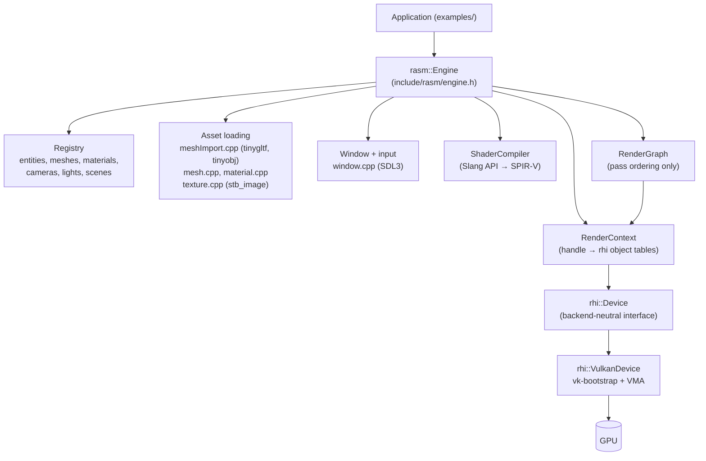
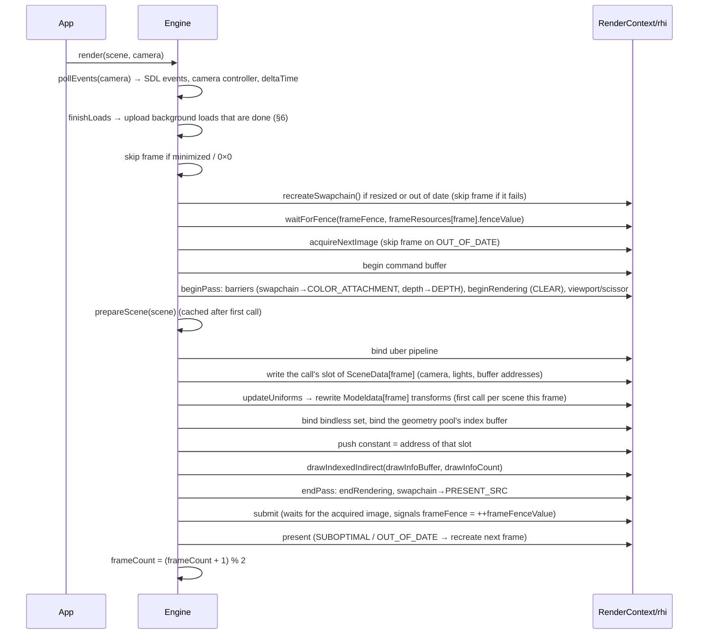
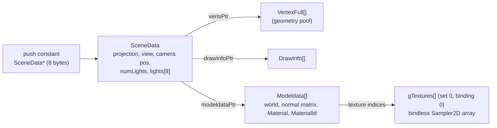

# RASM Architecture

This document describes how RASM is built **today** (branch `feat/pbr`, Oct 2026). Planned changes live in [development_plan.md](development_plan.md); known defects are tracked by ID (e.g. `B1`, `D4`) in [code_review.md](code_review.md).

## 1. Overview

RASM is a C++20 rendering engine with a single implemented backend (Vulkan 1.4). It is built as a static library (`rasm`, alias `rasm::rasm`) and driven by small example programs. Its rendering core is *GPU-driven*: the whole scene is drawn with one `vkCmdDrawIndexedIndirect` call. Vertices are pulled from one engine-wide geometry pool through buffer device addresses, textures are accessed through one bindless descriptor array, and the only per-draw binding is a 64-bit push constant.



| Layer | Files | Responsibility |
|---|---|---|
| Public API | `include/rasm/` (`rasm.h`, `engine.h`, …) and `include/rasm/render/` (`renderGraph.h`, `renderContext.h`, `resource.h`) | Single facade class `Engine`; everything is created through it and referenced by handles. The low-level API (render graph, `RenderContext`, the resource descriptors) lives in `render/`. |
| Engine | `src/engine.cpp` | Construction, frame loop (`beginFrame`/`render`/`endFrame`), swapchain recreation, finishing background loads within the frame's budget. |
| Core utilities | `src/core/` | Handle manager, profiler, file reading. |
| Platform | `src/platform/window.cpp` | SDL3 window, event polling and camera input. |
| Assets | `src/assets/` | glTF/OBJ import on the worker thread (`meshImport.h/.cpp`, also used by tests), meshes and the geometry pool (`mesh.cpp`), textures (`texture.cpp`), materials and glTF material/texture import (`material.cpp`). |
| Scene | `src/scene/` | Scenes, entities, cameras, lights, transforms. |
| Renderer | `src/renderer/` | The GPU-driven scene path (`gpuScene.cpp`: `prepareScene`, `updateUniforms`, `drawScene`), render graph, Slang shader compiler, GPU struct definitions (`uberMaterialTypes.h`). |
| Render context | `src/rhi/renderContext.cpp` | Backend-neutral API over handles; owns the handle → `rhi::` object tables, the creation-dedup caches and render targets. |
| RHI | `src/rhi/device.h` | The backend-neutral GPU interface: `Device`, `CommandBuffer`, `Queue`, `Swapchain` and the resource objects (§12). |
| Vulkan backend | `src/rhi/vulkan/` | `VulkanDevice` (instance, device, VMA, resource creation), `VulkanCommandBuffer` (recording, barriers), `VulkanSwapchain` (surface swapchain and its semaphores), `VulkanQueue` (submission), one `.h`/`.cpp` pair each. `vulkanTypes.h`: the Vulkan objects behind each `rhi::` struct. |
| Third-party implementations | `src/thirdparty_impl.cpp` | The single translation unit with the `*_IMPLEMENTATION` defines (stb, tinygltf, tinyobjloader, VMA). |
| Shaders | `shaders/lib/`, `shaders/passes/` | `lib/`: shared modules: GPU structs (`core.slang`), PBR BRDF (`pbr.slang`), unlit shading (`unlit.slang`). `passes/`: entry shaders: the uber shader (`rasm.slang`). |

Applications compile against `include/rasm/` and glm only. `src/`, the backend libraries and the tinygltf/stb include paths are PRIVATE to the `rasm` target, and static linking still pulls the libraries in. `RenderContext` keeps its `rhi::Device` and object tables in a private `RenderContext::Impl`, defined in `src/rhi/renderContext.cpp`. `Engine` holds `ShaderCompiler` through a forward declaration.

## 2. Object model: handles and registries

**Handles** (`rasm/handle.h`) are typed `Handle<Tag>{ uint64_t index; uint64_t generation; }` values. `generation == 0` means invalid. `HandleManager` hands out a monotonically increasing `index` per type, starting at 1, with `generation` always 1. Handles are never recycled or invalidated, and there is no destroy API (see `D4`).

There are two kinds of handle owner:

- **CPU-side objects** live in `Engine::registry` (a private struct of `std::vector`s) and are indexed directly by `handle.index`. These are `Entity`, `Mesh`, `Material`, `Camera`, `Light` and `Scene`. Slot 0 is an unused default-constructed element. Each `create*` checks `index` against a compile-time `MAX_*` constant.
- **GPU objects** live in `RenderContext`. Each type has an `unordered_map<Handle, rhi::Xxx*>` table (`buffers`, `textures`, `pipelines`, `commandBuffers`, …) pointing at objects the `rhi::Device` created. Each `rhi::` struct carries a copy of the descriptor it was created from, and the backend derives from it to add its native objects (§12).

**Descriptors** (`rasm/render/resource.h`). Each GPU resource has its own creation descriptor: `BufferDesc`, `TextureDesc`, `ShaderDesc`, `PipelineDesc`, `RenderTargetDesc`, `BindlessDescriptorSetLayoutDesc` and `DescriptorPoolDesc` (fixed `D5`). Each is an aggregate with a `std::string name` and default member initializers, so it is filled with designated initializers and a field left unset has a defined value. Each has a defaulted `operator==`, so every field takes part in equality. Passing the wrong kind of descriptor is a compile error. `ShaderDesc` owns its SPIR-V (`std::vector<uint8_t> code`). Descriptor sets, command buffers and fences only take a name. `DescriptorType` names the descriptor kind of a layout or pool.

**Creation dedup.** Only immutable objects are deduplicated: `createShader`, `createPipeline` and `createBindlessDescriptorSetLayout` first look the desc up in a `*DescCache` (`unordered_map<XxxDesc, Handle, XxxDescHash>`) and return the existing handle for an equal desc. Equality is the defaulted one, so it covers every field, including the name and the SPIR-V bytes. The hashes (`ShaderDescHash`, `PipelineDescHash`, `BindlessDescriptorSetLayoutDescHash`, defined in `src/rhi/resource.cpp`) fold the fields with `hashCombine` from `rasm/handle.h`, which is order-sensitive, unlike the old XOR. `HandleHash` uses it too. Buffers, textures, descriptor pools and descriptor sets are mutable, so every `create*`/`allocate*` call makes a new object (fixed `B1`). Callers that want sharing cache at the asset level: `loadTexture` caches by path and format, and glTF import caches per model by image index and color space.

## 3. Engine lifetime and the frame loop

### Construction (`Engine::Engine`, `src/engine.cpp`)
1. Create the SDL3 window (`createWindow`).
2. `RenderContext::initialize` calls `rhi::createDevice` for `EngineConfig::preferredBackend`. For Vulkan, `VulkanDevice::initialize`:
   - creates the instance (validation optional),
   - creates the surface from the main window (`createWindowSurface` in `src/platform/`, which wraps `SDL_Vulkan_CreateSurface`),
   - selects a physical device with the required features (below),
   - creates the device, graphics queue and VMA allocator.

   It then creates the swapchain (`B8G8R8A8_SRGB`), registers its images as texture handles, and creates the shared sampler set.
3. Create the frame fence (a timeline) and, for each of the `MAX_FRAMES_IN_FLIGHT = 2` slots, a command buffer and a depth texture (`D32_SFLOAT_S8_UINT`).
4. Initialize the Slang session (SPIR-V 1.4, scalar layout, column-major matrices, search path `lib/` under `EngineConfig::shaderDir`). A missing folder fails here, so a wrong path stops startup instead of failing every frame.
5. Create the geometry pool: one device-local vertex buffer of `EngineConfig::geometryPoolVertices` `Vertex`es (STORAGE, read through its device address) and one index buffer of `EngineConfig::geometryPoolIndices` `uint32_t`s. Every mesh lives in these two buffers (§6). Their size is fixed for the engine's lifetime, so an app that draws little can make them smaller and one with big scenes larger.
6. Create the single bindless descriptor set: layout, pool and set. It is binding 0 of set 0, an array of 1024 `COMBINED_IMAGE_SAMPLER`s with `UPDATE_AFTER_BIND | PARTIALLY_BOUND`.
7. `isRunning = true`. Any failure returns early and leaves `running() == false`.

**Required Vulkan features**: API 1.4.
- 1.0: `multiDrawIndirect`, `samplerAnisotropy`, `shaderInt64`.
- 1.1: `shaderDrawParameters`.
- 1.2: descriptor indexing (runtime arrays, partially bound, update-after-bind, variable count, non-uniform sampled image indexing), `bufferDeviceAddress`, `scalarBlockLayout`, `timelineSemaphore`, `shaderInt8`, `storagePushConstant8`.
- 1.3: `dynamicRendering`, `synchronization2`.
- 1.4: `hostImageCopy`.
- Extensions: `VK_KHR_swapchain`, `VK_EXT_memory_budget`.

### Per frame (`Engine::render`)



Notes:
- `frameCount` is the frame-in-flight **slot index** (0 or 1), not a running frame counter.
- Input handling, delta-time measurement and the camera controller run inside `beginFrame`. The caller passes the camera that should receive input.
- `beginFrame` returns `false` when the frame is skipped. The caller then records nothing and does not call `endFrame`.
- Frame pacing uses one timeline fence, `Engine::frameFence`. Every frame submit signals the next value (`frameFenceValue + 1`), and the slot remembers it in `FrameResources::fenceValue`. Before reusing a slot, `beginFrame` waits for that value. A slot takes the new value only when the submit succeeds, because waiting for a value nothing signals would block forever. Nothing is reset, so a skipped frame needs no cleanup.
- Every frame presents, and present needs the image in `PRESENT_SRC_KHR`. A frame that only draws to render targets gets an empty swapchain pass in `endFrame`, so it presents the clear color. There is no offscreen-only frame yet (`D7`).
- Acquire, present and `recreateSwapchain` return `SwapchainStatus` (`OK`, `SUBOPTIMAL`, `OUT_OF_DATE`, `FAILURE`). `SUBOPTIMAL` from acquire still renders the frame, because the image was acquired and its semaphore will be signaled. `Engine::swapchainOutOfDate` schedules recreation.
- Swapchain-sized resources (depth textures, viewport, camera aspect) use the swapchain extent in pixels (`Swapchain::width`/`height`). `Window::width`/`height` are logical and are only used for mouse input.
- The swapchain always uses `VK_PRESENT_MODE_FIFO_KHR`, so the frame rate is capped at the display's refresh rate (see `B21` in the code review).
- `endFrame` emits the Tracy frame mark, so skipped frames add none. Zones cover the frame functions, the backend-neutral `RenderContext` calls that block or submit, and whole upload loops. `fillBuffer` has no zone of its own because it runs per primitive per frame. See the [build guide](build_guide.md#profiling-with-tracy) for connecting a profiler.

## 4. The GPU-driven path: `prepareScene` + `drawScene`

`Engine::render` records one pass with `Engine::drawScene`, which render graph passes can call directly. `Engine::prepareScene` (`src/renderer/gpuScene.cpp`) runs once per scene, the first time that scene is rendered, and its result is cached in `Engine::preparedScenes`. It does the following:

1. **Flattens the scene.** For every entity with a mesh it builds a list of `SceneDraw`s, one per `SubMesh`: one per glTF primitive, or one for an OBJ. Each holds the sub-mesh's `MeshGeometry` (its range in the geometry pool), the node's world transform and a material handle. A mesh missing vertices or indices is skipped with a warning. If any of the scene's meshes, or a texture of an entity's material, is still loading, it returns an empty `PreparedScene` and caches nothing, so the scene is prepared once, when everything is in place. A mesh that failed to load draws nothing.
2. **Builds the uber pipeline.** `Engine::createPipeline` compiles `shaders/passes/rasm.slang` (`vertMain`/`fragMain`) and creates a graphics pipeline with an empty vertex-input state (vertex pulling) and the bindless set layout. The pipeline has the swapchain's color format and `D32_SFLOAT_S8_UINT` depth, so a render target that `drawScene` draws into must use the same formats. For any other target `drawScene` logs an error and skips the draw.
3. **Allocates scene buffers.** Geometry is not copied: it is already in the geometry pool. `megaModelDataBuffer` and `sceneDataBuffer`, which the CPU rewrites every frame, are `hostVisible`. `drawInfoBuffer` is device-local and filled through the upload manager (§12, `P1`):

   | Buffer | Usage | Content |
   |---|---|---|
   | `megaModelDataBuffer[2]` | STORAGE | One `gfx::Modeldata` per draw: world matrix, normal matrix, material, material id. |
   | `drawInfoBuffer` | INDIRECT | One `gfx::DrawInfo` (`VkDrawIndexedIndirectCommand` layout) per draw. |
   | `sceneDataBuffer[2]` | STORAGE | `MAX_SCENE_DRAWS_PER_FRAME` `gfx::SceneData`s per frame slot. |
4. **Writes draw records.** For each sub-mesh i it sets `DrawInfo{indexCount, 1, firstIndex, vertexOffset = firstVertex, 0}` from its `MeshGeometry`. Indices in the pool are *local* to their sub-mesh, so `vertexOffset` moves them to the sub-mesh's vertices. `Modeldata[i]` gets the entity transform × node transform, the converted `gfx::Material` and the `gfx::MaterialId`.

Every frame, `updateUniforms` rewrites only the matrix part of each `Modeldata` (`offsetof(Modeldata, material)` bytes) from the current entity transforms. It runs in the first `drawScene` call of each scene in a frame; later calls for that scene reuse the transforms already written.

The GPU reads `SceneData` after the whole frame is recorded, so each `drawScene` call of a frame writes its own slot of `sceneDataBuffer[frame]` and pushes that slot's address. That is what lets passes in one frame use different cameras. `Modeldata` has no slots: all the calls of a frame share the transforms it holds, so a transform changed between two calls shows up next frame. Past `MAX_SCENE_DRAWS_PER_FRAME` calls, or with an invalid camera, `drawScene` logs an error and skips the draw.

`prepareScene` returns a const reference to the cached entry. For a scene with no geometry it returns an empty `PreparedScene` before any buffer is allocated and caches nothing, so entities added later are picked up. `drawScene` skips the draw when the prepared scene has no pipeline, so the pass keeps its clear color.

A failed preparation (a shader error, a buffer that could not be created) also returns an empty `PreparedScene` and caches nothing. It logs the failure, destroys any buffers it had created, and retries on the next frame, so a shader fixed on disk is picked up while the application runs. Only a complete result is cached. The pipeline is built before the buffers so that a shader error, which repeats every frame, allocates nothing.

### GPU data chain



In `vertMain`:
- `drawID` comes from the SPIR-V `DrawIndex` built-in, read with `spirv_asm` in `core.slang`.
- Slang lowers `SV_VertexID` to `VertexIndex − BaseVertex`, so the shader adds `drawInfoPtr[drawID].vertexOffset` back before indexing `vertsPtr`.
- `fragMain` reads `Modeldata[drawID]` and branches on its `materialId`: `MaterialId.UNLIT` calls `Unlit()` in `unlit.slang`, and everything else calls `PBR()` in `pbr.slang`.

### CPU/GPU struct contract

The C++ structs in `src/renderer/uberMaterialTypes.h` and the Slang structs in `shaders/lib/core.slang` must match byte for byte under **scalar layout**. The C++ side `static_assert`s the sizes and key offsets (`SceneData` = 552 bytes, `Modeldata` = 188 bytes, …), and `rasm::Vertex` is asserted equal to `gfx::VertexFull`. Those asserts only pin the C++ side, so debug builds also run `validateRasmStructs` (`shaderCompiler.cpp`), which asserts each struct's size and field offsets against Slang reflection after linking. Read shader layouts by walking from `pc` through the pointers: `ProgramLayout::getTypeLayout` reports std140/std430 padding instead (`Modeldata` = 240 bytes). When you change a struct, change both sides, the asserts and the `validateRasmStructs` tables.

## 5. Materials and textures

- `rasm::Material` (`rasm/material.h`) is a CPU-side record:
  - `textures[PbrSlot::COUNT]` and `texCoords[...]`,
  - a flat `float params[]` indexed by `PbrParam` offsets (albedo is 3 floats at offset 0, metallic is at 3, …).
- `convertToGfxMaterial` (`gpuScene.cpp`) turns it into the GPU `gfx::Material`. Texture handles are replaced by bindless slot indices, and `INVALID_TEXTURE_INDEX` (0xFFFFFFFF) means "no texture".
- **Bindless slots.** `Engine::addBindlessTexture` → `RenderContext::updateBindlessDescriptorSet` writes the texture into the next free slot (`nextBindlessTextureIndex++`), or into a slot the caller names, which also moves `nextBindlessTextureIndex` past it. The slot is remembered in `registry.bindlessTextureIndexMap`. Automatic allocation never reuses a slot; naming a slot that is already taken replaces its descriptor.
- **Texture upload.** `loadTexture` decodes on a worker (§6) and frees the pixels after the upload. The upload itself is `VulkanDevice::fillTexture`, on the main thread:
  - the image is transitioned on the host and filled with `VK_EXT_host_image_copy` (core in 1.4), so no command buffer or staging buffer is involved;
  - the full mip chain is generated on the CPU with `stb_image_resize2`, sRGB-aware for sRGB formats.
- **Sampling.** `RenderContext::initialize` creates one sampler per `SamplerType`: linear or nearest, each with repeat, mirrored repeat or clamp (linear ones use 8× anisotropy; none clamps the LOD, so each serves any mip count). A bindless slot is written with the sampler passed to `addBindlessTexture`, `LINEAR_REPEAT` by default. glTF textures pick theirs from the glTF sampler (`wrapS` for both axes, `magFilter` for nearest or linear), and render target color attachments use `LINEAR_CLAMP`. A texture handle has one slot, so an image that two glTF samplers share is uploaded once per sampler.
- **Color spaces.** Base color and emissive are uploaded as `R8G8B8A8_SRGB`. Normal, metallic-roughness and occlusion maps are uploaded as `R8G8B8A8_UNORM`.
- Every material uses the uber shader. To add a shading path, add a value to `gfx::MaterialId` and its mirror in `core.slang`, map it in `getGfxMaterialId` (`gpuScene.cpp`), and branch on it in `fragMain`. Today's mapping is `UNLIT` → `MaterialId::UNLIT` (base color only, no tone mapping) and `PBR` → `MaterialId::PBR`.

## 6. Asset import

**Background loading (`P6`).** `loadMesh`, `loadGLTF` and `loadTexture` return a handle at once and load on a worker thread. Each load is one `std::async` task, with no thread pool.

```
 main thread                         worker (std::async)
 ───────────                         ───────────────────
 loadMesh(path) ── handle (LOADING) ─▶ importMeshFile: read + decode file
 loadTexture(path)                    decodeTexture: stbi_load
   reads header, creates texture
   handle ──────────────────────────▶
 beginFrame → finishLoads ◀── done ── GLTFRaw / TextureRaw
   meshes: materials, textures, geometry → pool, state READY
   textures: fillTexture
   CPU data freed
   stops after LOAD_BUDGET (4 ms) per frame
```

- The worker never touches the engine. Everything that creates GPU objects or writes the registry runs on the main thread in `finishLoads`, at the start of `beginFrame`, before anything binds the bindless set or the geometry pool. The bindless set has `UPDATE_AFTER_BIND`, so new slots can be written while the previous frame is still on the GPU, and geometry uploads go out with the frame's submit (§12).
- `finishLoads` stops once it has spent `LOAD_BUDGET` (4 ms) in a frame, and the load that crosses the budget still finishes, so loads that end together spread over several frames. A single big glTF still finishes in one frame: the mip chain of every texture is generated on the main thread inside `fillTexture`. `waitForLoads` has no budget.
- `isLoaded(mesh)` is true once a mesh is `READY`, and false while it is `LOADING` or after it `FAILED`. `isLoaded(texture)` is true once its pixels are in (a lookup in `pendingTextures`, which is keyed by handle). `waitForLoads()` blocks until every pending load is finished.
- A scene waits for all of its assets (§4), so nothing is drawn half-loaded and no scene buffer is rebuilt while the GPU may use it (`D4`).
- An error found before the worker starts (unsupported extension, missing mesh file, out of handles, unreadable texture header) returns an invalid handle and caches nothing. A mesh that fails later is `FAILED` and draws nothing; `loadMesh` on its path again retries the load on the same handle. A texture whose decode fails after its header was read stays white, because a material may already point at it. A texture destroyed while it decodes is skipped.
- **What stays in memory.** After `finishLoads`, the CPU vertex and index arrays, the `tinygltf::Model` and the decoded pixels are freed. The worker already drops the glTF buffers once every accessor is read. A mesh keeps only its `SubMesh` list: a `MeshGeometry` range in the pool, a node transform and a material.
- **Geometry pool.** `uploadGeometry` appends each sub-mesh to the pool with a bump allocator: `firstVertex`/`firstIndex` are where it starts. Nothing is freed from the pool, because meshes are never destroyed yet (`D4`). `finishMeshLoad` checks that the whole mesh fits before it creates anything, so a mesh that does not fit logs the pool usage and fails without using pool space, materials or bindless slots. `createMesh` uploads straight away and returns a `READY` mesh.
- `Engine::loadMesh(path)` dispatches on the file extension and caches by resolved path in `registry.loadedMeshes`, so a relative and an absolute path to one file share a mesh.
  - **OBJ** (tinyobjloader) is de-indexed into one vertex per index. Y and V are flipped per vertex.
  - **glTF/GLB** (tinygltf) goes through `processGLTF`, which walks the default scene's node tree from a root transform of `scale(1, −1, 1)` (the Y flip). The walk uses an explicit stack and imports each node once, skipping out-of-range references and any node reached a second time (a cycle, or a node with two parents, which glTF forbids). For each mesh node, `extractGLTFRaws` reads `POSITION`, `NORMAL`, `TANGENT` and `TEXCOORD_0..2` and the indices through one validated accessor reader. That reader handles strides, sparse accessors and quantized or normalized components. Strips and fans become triangle lists, primitives without indices get generated ones, and point and line primitives are skipped. Missing normals are computed as smooth normals, and in that case `TANGENT` is ignored, as the glTF spec requires. Each primitive keeps its glTF material index, and `finishMeshLoad` calls `loadMaterial` for it on the main thread.
- **Tangents and normal maps.** `Vertex::tangent` holds the glTF tangent with w = ±1, or w = 0 when the mesh has none. The vertex shader transforms it with the model matrix and multiplies w by the sign of the matrix's determinant, so mirroring transforms such as the root Y flip keep the bitangent right. `getNormalFromMap` uses the authored frame (B = cross(N, T)·w) when w ≠ 0. Otherwise it reconstructs a frame from UV derivatives, with B pointing toward decreasing v (glTF normal maps store +Y as up in the image).
- `loadMaterial` maps a glTF PBR material to `rasm::Material`. Materials with `KHR_materials_unlit` become `MaterialType::UNLIT`, and only their base color texture is uploaded. tinygltf decodes images to RGBA8 on the worker, and `loadMaterial` expands only an image with fewer channels before it uploads each texture. `finishMeshLoad` creates a `GltfImportCache` for each import and passes it to `loadMaterial`. It caches materials by material index and textures by image index and color space, so primitives that share a material share one `MaterialHandle` and one set of bindless slots.
- A primitive without a material uses its entity's material. `getMaterial` resolves an invalid handle to `defaultMaterial`, the glTF default material (white, metallic 1, roughness 1) created at startup.

## 7. Shader compilation

- `ShaderCompiler` wraps one Slang global session and one session.
- `compileFromString(source, moduleName, entryPoint)` loads a module, finds the entry point, composes, links and returns SPIR-V. The session keeps every module and rejects a second one with the same name and different source, so the name it loads includes a hash of the source. Callers can reuse a name.
- Shaders are compiled **at runtime from source** every time a pipeline is built. Nothing is cached.
- The examples set `shaderDir` to the repo's `shaders/`, so a shader edit reaches an example the next time it starts, with no build.
- `tools/compile-shaders.bat` is an offline `slangc` invocation that is useful for checking compile errors. The engine does not consume its output.

## 8. Camera and input

- `Camera` holds a `CameraProjection` (a union of perspective and orthographic), a `CameraController` (trackball or free-fly, plus `easingSpeed`), the rendered `transform`, and a `targetTransform`.
- `pollEvents` converts SDL events into a `CameraInput`: mouse drag in NDC normalized by the smaller window dimension, wheel delta, WASD state and frame delta-time. It feeds that input to `updateCamera`, which updates the target with the active controller and then eases the rendered transform toward it with exponential smoothing. The trackball eases along the orbit sphere.
- Window resize updates every camera's aspect ratio and marks the swapchain for recreation. Escape or closing the window sets `isRunning = false`.
- `drawScene` fits the camera's projection to the current pass with `getProjectionMatrix(camera, aspect)` and leaves the camera unchanged, so a render target of any shape renders undistorted. A perspective camera keeps its vertical field of view, and an orthographic one keeps its width.
- View matrix = `conjugate(rotation)` × `translate(−position)`. Projection uses `glm::perspective`/`glm::ortho` with the Vulkan [0, 1] depth range (`GLM_FORCE_DEPTH_ZERO_TO_ONE` is a PUBLIC compile definition of `rasm`, see `B2`).

## 9. Render graph (low-level path)

- `RenderGraph::addPass(name, setup, execute)` records the resources each pass reads and writes through `PassBuilder`. `compile()` builds producer → consumer edges and topologically sorts the passes (Kahn's algorithm, with cycle detection). A cycle logs an error and empties the execution order, so `execute()` draws no passes and tries again next frame. It still runs the frame, which keeps the window handling events.
- `execute()` runs `beginFrame` once, then for each pass in order calls `setRenderTarget(pass.outputRenderTarget)`, `beginPass`, `pass.execute(ctx)` and `endPass`. A pass without an output render target renders to the swapchain. Last comes `endFrame`.
- The graph currently only orders passes. It does not insert barriers or layout transitions, does not allocate transient resources, and uses the current scene's first camera. Only `examples/01_render_graph` uses it.
- A pass records through `Engine::drawScene`, or through its own pipeline from `Engine::createPipeline`. That example's overlay pass does the second: it binds a pipeline and draws a screen-covering triangle.
- A render target has one color and one depth texture per frame slot, and a `clearColor` that every pass writing it starts from. `beginPass` transitions the current slot's attachments from `UNDEFINED` and sizes the viewport from the render target. `endPass` transitions the color attachment to `SHADER_READ_ONLY_OPTIMAL`, the layout its bindless descriptor promises. Later passes read it with `getRenderTargetTexture` and `getBindlessTextureIndex`. Depth is not stored and is not in the bindless array.
- `transitionImageLayout` takes the barrier's source scope from the old usage and its destination scope from the new one. `UNKNOWN` discards the contents and waits for every stage the image could have been used in, including `COLOR_ATTACHMENT_OUTPUT`, which chains the barrier to the acquire semaphore of a swapchain image. A usage without a defined scope logs an error, records no barrier and returns `false`.

## 10. Compile-time limits

| Constant | Value | Where |
|---|---|---|
| `MAX_FRAMES_IN_FLIGHT` | 2 | `rasm/types.h` |
| `MAX_BINDLESS_TEXTURES` | 1024 | `rasm/types.h` |
| `MAX_MESHES` | 8 (7 usable) | `rasm/mesh.h` |
| `MAX_ENTITIES` / `MAX_ENTITIES_PER_SCENE` | 1024 | `rasm/entity.h`, `rasm/scene.h` |
| `MAX_MATERIALS` | 256 | `rasm/engine.h` |
| `MAX_CAMERAS` | 8 | `rasm/engine.h` |
| `MAX_LIGHTS` (global) / per scene | 8 / 8 | `rasm/light.h`, `rasm/scene.h` |
| `MAX_SCENES` | 16 | `rasm/scene.h` |
| `MAX_SCENE_DRAWS_PER_FRAME` | 8 | `rasm/scene.h` |
| `MAX_VERTEX_UV_SETS` | 3 | `rasm/mesh.h` (mirrored in `core.slang`) |
| `EngineConfig::geometryPoolVertices` / `geometryPoolIndices` (defaults) | 2²¹ (128 MiB) / 2²³ (32 MiB) | `rasm/types.h` |

## 11. Conventions that cross files

- **Paths.** Nothing depends on the working directory unless the application asks for it.
  - `EngineConfig::shaderDir` is the folder holding `lib/` and `passes/`. When empty, it takes the `RASM_SHADER_DIR` default, which is `shaders`.
  - `EngineConfig::assetRoot` is the folder that relative paths passed to `loadMesh`, `loadGLTF` and `loadTexture` resolve against. Absolute paths ignore it. When empty, paths are opened as given, which means relative to the working directory.
  - A relative `shaderDir` or `assetRoot` resolves against the executable's directory, and `getConfig()` returns the absolute result. `resolveAssetPath` gives the path a load would open.
  - Paths are UTF-8. `src/platform/paths.h` converts them, because `std::filesystem::path` otherwise assumes the Windows ANSI code page. A string that isn't valid UTF-8 is read in that code page instead, which is what `path::string()` returns. `resolveAssetPath` always returns UTF-8, and stb_image (through `STBI_WINDOWS_UTF8`), tinygltf and the `std::ifstream` that `loadMesh` gives tinyobjloader all open it as such.
- **Coordinate system.** The engine works in a Y-down world: imported geometry is mirrored in Y (`D8`), and back-face culling is disabled. Light directions and camera transforms are expressed in that mirrored space.
- **Depth.** `D32_SFLOAT_S8_UINT`, cleared to 1.0, compare `LESS_OR_EQUAL`.
- **Output.** The PBR shader applies Reinhard tone mapping. The sRGB swapchain format does the gamma encoding, so shaders must output linear color.

## 12. RHI

`src/rhi/device.h` is the boundary between the engine and a graphics API. Code above it (`RenderContext`, and through it `Engine`) never sees a native type, and each backend implements it under `src/rhi/<backend>/`. Vulkan is the only implementation today.

**Objects.**
- `rhi::createDevice(Backend, DeviceDesc)` picks the implementation for `EngineConfig::preferredBackend`. `DX12`, `METAL` and `WEBGPU` log that they are not implemented and return null.
- Resources are plain structs (`Buffer`, `Texture`, `Sampler`, `Shader`, `Pipeline`, `DescriptorSetLayout`, `DescriptorPool`, `DescriptorSet`, `Fence`) that hold their neutral description. A backend derives from each (`VulkanBuffer : Buffer`) and adds its native objects. An object passed to a device always came from that device, so the backend `static_cast`s it to its own type. `CommandBuffer`, `Queue` and `Swapchain` are interfaces with virtual functions.
- `create*` logs a failure and returns null. `destroy*` releases at once, so the caller must know the GPU is done with the object: today that means the device is idle or a fence wait covered it. Deferred destruction is `D4`. Swapchain images belong to the swapchain, and `RenderContext::destroyTexture` refuses them.
- `RenderContext` maps handles to these pointers and adds what no API provides per object: handle allocation, dedup of shaders, pipelines and layouts, render targets, bindless slot allocation and the shared sampler set.

**Command buffers.** Each frame slot records one command buffer. `begin` resets it, so the GPU must have finished its previous submission, which the frame fence wait guarantees. On Vulkan each command buffer owns a command pool, and `begin` resets the pool. Barriers are `TextureUsage` transitions (§9).

**Fences are timelines.** A submit signals a 64-bit value and `waitForFence(fence, value)` blocks until the GPU has reached it. Values only grow and are never reset. This maps to Vulkan timeline semaphores, `ID3D12Fence` and `MTLSharedEvent`, and on WebGPU to counting `onSubmittedWorkDone` callbacks.

**Swapchain.** `acquireNextImage`, `present` and `resize` return `SwapchainStatus`. The swapchain owns whatever synchronizes it with the queue, so no semaphore crosses the interface: a `SubmitDesc` with `swapchain` set waits for the image of the last acquire and makes the next `present` wait for that submit.
- The swapchain enforces acquire → submit → present. A submit that names the swapchain without an image acquired since the last such submit fails, and so does a present without such a submit. Acquiring again while the last image is still unsubmitted (e.g. its submit failed) returns that image again rather than acquiring another, and acquiring while the last submitted image is unpresented fails.
- Vulkan keeps one acquire semaphore per frame in flight and uses them in turn. Every presenting submit also signals a timeline semaphore the swapchain owns, and acquire waits until the submit that last waited on a semaphore has finished before reusing it, so correctness doesn't depend on the caller's frame pacing.
- Vulkan keeps one present semaphore per image: an image is acquired again only after its present finished. They survive `resize`, because the presentation engine may still wait on one after the device is idle; a larger new swapchain only adds semaphores.
- `resize` returns `OUT_OF_DATE` on a 0×0 surface and `FAILURE` if the surface query fails, and both keep the old swapchain. Otherwise it consumes any pending acquire or present signal with a wait-only submit, waits for the device to be idle and replaces the images. `RenderContext::recreateSwapchain` re-registers the image handles when the images changed, so earlier `getSwapchainImages` handles are invalid then; `getSwapchainImages` returns a copy. If building the new swapchain fails there are no images, and acquire reports `OUT_OF_DATE` until a resize succeeds.
- The swapchain presents to the window the device was created for (`DeviceDesc::window`).

**Buffers and uploads (`P1`).** `BufferDesc::hostVisible` marks data the CPU rewrites every frame. Such a buffer is always mapped, and `fillBuffer` writes it at once. Any other buffer is device-local. VMA maps it too when that memory is also host-visible (ReBAR, integrated GPUs, Apple), and then `fillBuffer` is a plain write as well. Otherwise `Buffer::mapped` is false, and `RenderContext::fillBuffer` hands the data to `rhi::UploadManager` (`src/rhi/uploadManager.cpp`):
- The data is copied into a 64 MB host-visible staging ring and a `BufferCopy` is recorded. Writes over 16 MB are split into chunks. Back-to-back copies into the same buffer merge into one.
- `RenderContext::submit` flushes the pending copies first: one command buffer that calls `CommandBuffer::copyBuffers`, submitted on the graphics queue, signalling the upload fence. The barriers inside `copyBuffers` order the copies after earlier submissions and before later ones on the same queue, so the frame submit needs no semaphore wait.
- Two upload command buffers alternate. Ring space is freed once the upload fence passes the batch that used it (`Device::getFenceValue`, which doesn't block). A full ring flushes and waits for every copy.
- The data reaches the buffer with the next submit, not at once. Destroying a buffer drops its pending copies and waits for submitted copies into it, which a mid-frame flush (full ring, overlap) can leave in flight.
- A batch whose flush fails stays pending and goes out with the next flush, since `fillBuffer` already returned true for it.
- Copies in one batch have no barriers between them, so a write that overlaps a range already written in the batch starts a new batch.

**Queues.** There is one graphics queue (`QueueType::GRAPHICS`), used for frames and uploads. Transfer and async-compute queues are `D13`. Vulkan submits with `vkQueueSubmit2` and waits for the acquired image at `COLOR_ATTACHMENT_OUTPUT`, the stage the barrier out of `UNKNOWN` also waits for.

**Adding a backend.**
1. Implement `Device`, `CommandBuffer`, `Queue` and `Swapchain`, and derive the resource structs, under `src/rhi/<backend>/`.
2. Add a case to the switch in `src/rhi/device.cpp`, the sources to `RASM_SRC`, and the libraries to `src/CMakeLists.txt` and `cmake/rasmConfig.cmake.in`.
3. The shader target follows the backend (`getShaderCompilerTarget` in `engine.cpp`: MSL, HLSL or WGSL). The shaders still read buffers through device addresses and `spirv_asm`, so D3D12 and WebGPU need the binding work in `D12` first, and WebGPU also the Tier B path of the development plan.
4. `createWindowSurface` in `src/platform/` is Vulkan-specific, because it takes a `VkInstance`. Each backend needs its own platform hook (an `HWND` for D3D12, a `CAMetalLayer` for Metal, a surface for WebGPU) until `D7` puts native window handles in `DeviceDesc`.
